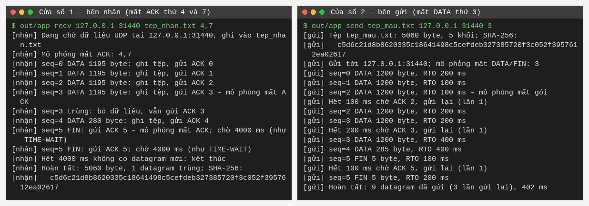

# Bài 4.4 – Truyền tệp tin cậy trên UDP bằng giao thức dừng và chờ (Go)

| Thông tin | Nội dung |
|---|---|
| Mã giả tương ứng | Mã giả 4.6 (SAW_SEND – bên gửi), Mã giả 4.7 (SAW_RECEIVE – bên nhận) |
| Mục giáo trình | 4.4.1 Số thứ tự, xác nhận và truyền lại; 4.4.2 Ước lượng thời gian khứ hồi và thời gian chờ (RFC 6298) |
| Kế thừa | Mã giả 4.4 (chờ phản hồi đúng địa chỉ, đúng mã trong phần thời gian còn lại); Mã giả 4.1 (vòng RECVFROM/SENDTO); Mã giả 2.1 |
| Thư viện | Thư viện chuẩn Go: `net`, `encoding/binary`, `crypto/sha256`, `math/rand` |

## Mục tiêu
Cài đặt độ tin cậy ở tầng ứng dụng: datagram có tiêu đề 5 byte (số thứ tự 32 bit, byte loại DATA/ACK/FIN), bên gửi chờ ACK đúng số thứ tự với RTO ước lượng theo RFC 6298 (SRTT, RTTVAR, nhân đôi khi hết thời gian chờ, thuật toán Karn), bên nhận luôn gửi ACK, bỏ datagram trùng và chờ thêm sau FIN như TIME-WAIT. Có tham số mô phỏng mất gói ở cả hai phía; tính đúng đắn được kiểm tra bằng mã băm SHA-256 của tệp gửi và tệp nhận.

## Tệp
- `main.go` – chọn vai trò `send` hoặc `recv`.
- `sawsend.go` – Mã giả 4.6 `SawSend`, `RttEstimator` (RFC 6298), `waitAck`.
- `sawrecv.go` – Mã giả 4.7 `SawReceive`.
- `sawcommon.go` – hằng số, `ParseEndpoint` (Mã giả 2.1), bộ mô phỏng mất gói `LossSim`, SHA-256.
- `tep_mau.txt` – tệp mẫu 5.060 byte dùng trong demo (giống bản Python).
- `loimang.go` – `isRefused`, `isReset`, `isUnreachable`: nhận biết lỗi kết nối bị từ chối, bị đặt lại, không có đường đi theo cả mã POSIX (Linux, macOS) và mã Winsock (Windows).
- `demo.json` – kịch bản chạy minh họa (dùng với `tools/demo.py`).
- `ket_qua.txt`, `ket_qua.png` – kết quả thực thi thật.

## Cách chạy
Trong thư mục bài:
```bash
# Cửa sổ 1 – bên nhận, mất ACK gửi đi thứ 4 và 7
go run . recv 0.0.0.0 9000 tep_nhan.txt 4,7
# Cửa sổ 2 – bên gửi, mất datagram gửi đi thứ 3
go run . send tep_mau.txt 127.0.0.1 9000 3
```
Tham số mô phỏng mất gói (tùy chọn, cuối dòng lệnh): `0.1` – mỗi datagram gửi đi mất ngẫu nhiên với xác suất 10%; `3,7` – mất đúng datagram gửi đi thứ 3 và thứ 7, đếm cả lần gửi lại; bỏ trống – không mất gói. Đối chiếu mã SHA-256 in ở hai cửa sổ, hoặc dùng `sha256sum` (Linux), `certutil -hashfile tep_nhan.txt SHA256` (Windows). Kịch bản `demo.json` biên dịch một lần thành `out/app` (cổng 31440).

## Kết quả thực thi


Datagram DATA `seq=2` bị mất ở bên gửi: sau 100 ms không có ACK, bên gửi nhân đôi RTO lên 200 ms và gửi lại. ACK của `seq=3` bị mất ở bên nhận: bên gửi gửi lại `seq=3`, bên nhận nhận ra datagram trùng, bỏ dữ liệu nhưng vẫn gửi ACK. ACK của FIN bị mất: bên gửi gửi lại FIN, bên nhận (đang chờ 4.000 ms như TIME-WAIT) trả lời ACK lần nữa nên bên gửi kết thúc thành công. Sau mẫu RTT hợp lệ của `seq=4`, RTO trở về 100 ms. Hai mã SHA-256 trùng nhau, xác nhận tệp nhận đúng từng byte; nhật ký trùng khớp từng dòng với bản Python.

## Ghi chú
- Hằng số thời gian giống bản Python, chọn cho mạng nội bộ (Mục 4.4.2 cho phép giá trị nhỏ hơn 1 giây sau khi đo): RTO ban đầu 200 ms, RTO tối thiểu 100 ms, `MAX_RTO` = 2000 ms (mã giả dùng 60 000 ms, mức trần của RFC 6298); bên nhận chờ 2 × `MAX_RTO` = 4000 ms sau FIN. α = 1/8, β = 1/4, K = 4, G = 1 ms theo RFC 6298.
- `SETOPT(s, RECV_TIMEOUT, 2 * MAX_RTO)` là thiết lập có hiệu lực cho mọi lần nhận sau đó; vì deadline của Go là một mốc thời gian, `SawReceive` lưu khoảng chờ trong biến `recvTimeout` và đặt lại `SetReadDeadline` trước mỗi lần `ReadFromUDP`.
- Bộ mô phỏng mất gói (`LossSim`) được thêm cho bài thực hành, không có trong mã giả: datagram "mất" không được gửi ra socket nhưng vẫn được ghi nhật ký.
- `WAIT_ACK` (mã giả chỉ gọi tên) được cài đặt theo khuôn của Mã giả 4.4: chờ trong phần thời gian còn lại (một deadline cố định), bỏ datagram từ địa chỉ khác, không phải ACK hoặc sai số thứ tự.
- Bên nhận ghi trực tiếp vào tệp đích và nhận datagram từ mọi địa chỉ như mã giả; chương trình thật nên ghi vào tệp tạm và chỉ chấp nhận một bên gửi.
- Kiểm thử bổ sung ngoài demo: tệp ngẫu nhiên 300.000 byte, mất ngẫu nhiên 10% ở cả hai phía, chéo ngôn ngữ (Go gửi → Python nhận, Python gửi → Go nhận): cả hai lần mã SHA-256 đều trùng.
- `time.Now()` và `time.Since` cung cấp `NOW()` (đồng hồ đơn điệu của Go); hết thời gian chờ là `net.Error` có `Timeout()` bằng `true`.
- Kiểm thử: Linux, Go 1.24.7.
