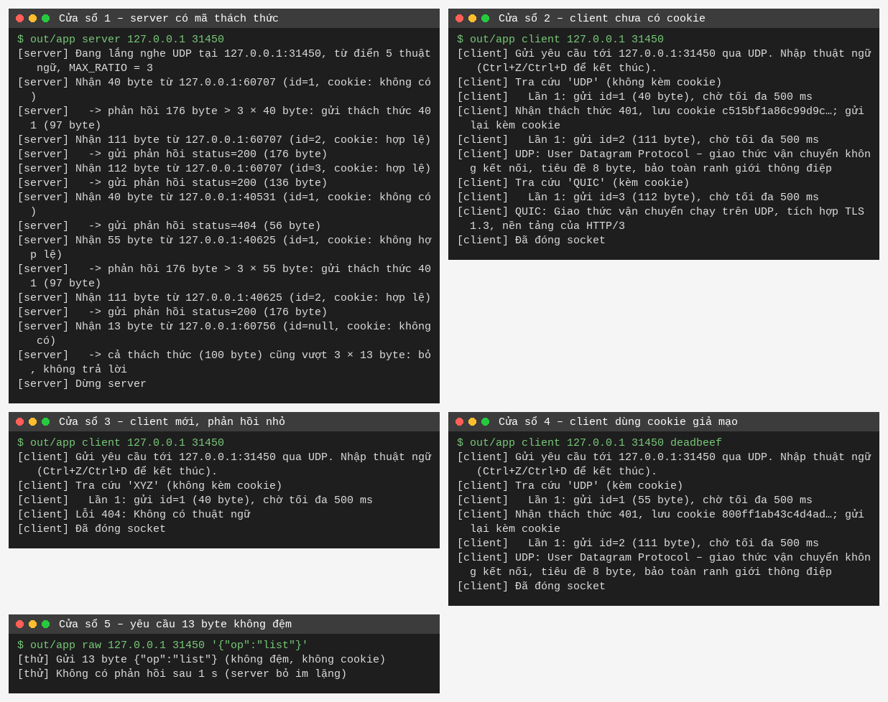

# Bài 4.5 – Xác thực địa chỉ nguồn bằng mã thách thức không trạng thái (Go)

| Thông tin | Nội dung |
|---|---|
| Mã giả tương ứng | Mã giả 4.8 (COOKIE, HANDLE_DATAGRAM); phía client theo đoạn văn sau Mã giả 4.8 |
| Mục giáo trình | 4.6.1 Giả mạo địa chỉ nguồn và tấn công khuếch đại |
| Kế thừa | Mã giả 4.3 (server tra cứu UDP, `PROCESS_REQUEST`) – thay thân vòng lặp bằng `HANDLE_DATAGRAM`; Mã giả 4.4 (`UDP_REQUEST`) ở client; Mã giả 2.1 |
| Thư viện | Thư viện chuẩn Go: `net`, `encoding/json`, `crypto/hmac`, `crypto/sha256`, `crypto/subtle`, `crypto/rand` |

## Mục tiêu
Chống bị lợi dụng cho tấn công phản xạ và khuếch đại: với địa chỉ chưa xác thực, server không gửi phản hồi lớn hơn `MAX_RATIO` = 3 lần yêu cầu mà gửi thách thức nhỏ (mã 401 kèm cookie). Cookie = HMAC-SHA256(KEY, "ip:cổng:w") với w là khung thời gian 1 phút, nên server không cần lưu trạng thái; client nhận cookie, gửi lại yêu cầu kèm cookie và được phục vụ.

## Tệp
- `main.go` – chọn vai trò `server`, `client` hoặc `raw`.
- `cookieserver.go` – Mã giả 4.8 (`Cookie`, `HandleDatagram`) và vòng nhận của server.
- `cookieclient.go` – client lưu và gửi lại cookie, đệm yêu cầu đầu tiên; `UdpRequest` (Mã giả 4.4).
- `rawsend.go` – công cụ thử (không thuộc mã giả): gửi nguyên văn một datagram, không đệm, không cookie.
- `lookup.go` – `LoadGlossary`, `ProcessRequest` (chép từ Bài 4.2); `jsonutil.go`, `netutil.go` – tiện ích JSON và `ParseEndpoint`.
- `glossary.json` – từ điển thuật ngữ (giống bản Python).
- `loimang.go` – `isRefused`, `isReset`, `isUnreachable`: nhận biết lỗi kết nối bị từ chối, bị đặt lại, không có đường đi theo cả mã POSIX (Linux, macOS) và mã Winsock (Windows).
- `demo.json` – kịch bản chạy minh họa (dùng với `tools/demo.py`).
- `ket_qua.txt`, `ket_qua.png` – kết quả thực thi thật.

## Cách chạy
Trong thư mục bài (nơi có `glossary.json`):
```bash
# Cửa sổ 1 – server
go run . server 0.0.0.0 9100
# Cửa sổ 2 – client
go run . client 127.0.0.1 9100
# Cửa sổ 3 – client dùng cookie giả mạo
go run . client 127.0.0.1 9100 deadbeef
# Cửa sổ 4 – gửi một yêu cầu nhỏ không đệm
go run . raw 127.0.0.1 9100 '{"op":"list"}'
```
Nhập tên thuật ngữ ở cửa sổ client. Tham số thứ ba của client (thêm cho bài thực hành) là cookie ban đầu, dùng để mô phỏng client gửi cookie giả mạo hoặc cookie của địa chỉ khác. Kịch bản `demo.json` biên dịch một lần thành `out/app` (cổng 31450).

## Kết quả thực thi


Yêu cầu `UDP` đầu tiên (đệm tới 40 byte, chưa có cookie) sẽ tạo phản hồi 176 byte > 3 × 40 byte, nên server chỉ gửi thách thức 401 dài 97 byte; client lưu cookie, gửi lại kèm cookie và được phục vụ; yêu cầu `QUIC` sau đó dùng lại cookie và được phục vụ ngay. Client mới hỏi `XYZ` không cần cookie vì phản hồi 404 (56 byte) không vượt 3 lần yêu cầu. Client dùng cookie giả mạo `deadbeef` bị server đánh giá "không hợp lệ" và nhận thách thức như client chưa có cookie. Yêu cầu `{"op":"list"}` 13 byte không đệm (cửa sổ 5) bị bỏ im lặng vì ngay cả thách thức 100 byte cũng vượt 3 × 13 byte.

## Ghi chú
- Bản Go theo đúng Mã giả 4.8 trong giáo trình hiện hành: bỏ datagram lớn hơn `MAX_DGRAM`; bỏ im lặng datagram không phải JSON hoặc không phải đối tượng; không gửi cả thách thức nếu nó vượt `MAX_RATIO` lần yêu cầu (`IF LENGTH(out) > MAX_RATIO * LENGTH(data) THEN RETURN`); client đệm khoảng trắng để yêu cầu chưa có cookie đủ `MinFirstRequest` = 40 byte (3 × 40 = 120 byte, đủ chứa thách thức khoảng 97–100 byte). Bản Python chưa có ba điểm sau cùng, nên yêu cầu đầu tiên ở bản Python dài 35 byte thay vì 40 byte.
- Giữ phép kiểm tra `MAX_DGRAM` cho phản hồi (mã 413) của Mã giả 4.3, vốn không xuất hiện trong thân `HANDLE_DATAGRAM`.
- `SAFE_EQUAL` được cài bằng `subtle.ConstantTimeCompare` (so sánh thời gian hằng), tránh lộ thông tin qua thời gian xử lý.
- Client gửi lại kèm cookie đúng một lần cho mỗi thuật ngữ để tránh lặp vô hạn nếu server liên tục thách thức.
- Khóa `KEY` được sinh ngẫu nhiên (`crypto/rand`) mỗi lần khởi động server nên cookie cũ mất hiệu lực sau khi server khởi động lại; server chấp nhận cookie của khung thời gian hiện tại và khung liền trước (tối đa khoảng 2 phút).
- `encoding/json` sắp xếp khóa của `map`; kích thước các datagram (97, 111, 112, 176 byte…) vẫn giống bản Python vì chỉ thứ tự trường khác.
- Kiểm thử: Linux, Go 1.24.7.
