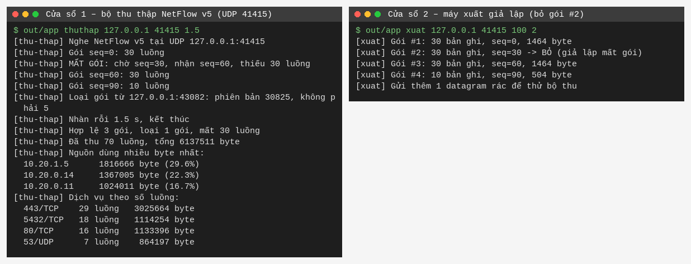

# Bài mở rộng MR4.1 – Thu thập và phân tích NetFlow v5 trên UDP (Go)

| Thông tin | Nội dung |
|---|---|
| Loại | **Bài mở rộng** – không có trong giáo trình, không có mã giả tương ứng |
| Liên hệ với giáo trình | Chương 4: Bài 4.1 (server UDP), Bài 4.3 (mã hóa, giải mã nhị phân theo thứ tự byte mạng), Bài 4.4 (số thứ tự để phát hiện mất gói); Chương 1 (bộ năm thông số) |
| Thư viện | Thư viện chuẩn Go: `net` (`ListenPacket`), `encoding/binary`, `net/netip`, `sort` |
| Bản ngôn ngữ khác | [Python](../../../python/Chuong04/BaiMR4.1_ThuThapNetFlow/) |

## Mục tiêu
NetFlow là cách bộ định tuyến báo cáo lưu lượng: mỗi *luồng* (flow) là một nhóm gói cùng bộ năm thông số, kèm số gói, số byte, thời điểm. Máy xuất (exporter) gửi các bản ghi luồng tới bộ thu thập (collector) bằng UDP. Bài xây dựng cả hai phía: máy xuất giả lập đóng gói NetFlow v5 (tiêu đề 24 byte + tối đa 30 bản ghi × 48 byte), bộ thu thập nhận datagram, kiểm tra tính hợp lệ, phát hiện mất gói nhờ trường `flow_sequence`, loại datagram hỏng và tổng hợp: nguồn dùng nhiều byte nhất, dịch vụ (cổng/giao thức) phổ biến.

## Tệp
- `main.go` – chọn vai trò: `thuthap`, `xuat`.
- `netflow.go` – `packPacket`, `parsePacket` (`encoding/binary`).
- `exporter.go` – máy xuất giả lập; `collector.go` – bộ thu thập.
- `demo.json` – kịch bản chạy minh họa (dùng với `tools/demo.py`).
- `ket_qua.txt`, `ket_qua.png` – kết quả thực thi thật.

## Cách chạy
Trong thư mục bài:
```bash
go build -o out/app .        # hoặc thay out/app bằng go run .
out/app thuthap 127.0.0.1 2055 1.5        # cửa sổ 1: giây nhàn rỗi
out/app xuat 127.0.0.1 2055 100 2         # cửa sổ 2: số luồng, gói bỏ
```
Bộ thu thập tự kết thúc và in báo cáo khi không nhận thêm gói nào trong thời gian nhàn rỗi (hoặc khi nhấn Ctrl+C). Cổng 2055 là cổng NetFlow thường dùng.

Tái lập kết quả từ thư mục gốc của kho: `python3 tools/demo.py go/Chuong04/BaiMR4.1_ThuThapNetFlow`.

## Kết quả thực thi


100 luồng được chia thành 4 gói (30 + 30 + 30 + 10 bản ghi; gói đầy dài 24 + 30 × 48 = 1464 byte). Gói thứ hai bị cố ý bỏ, nên bộ thu thập thấy `flow_sequence` nhảy từ 30 lên 60 và báo thiếu 30 luồng. Datagram rác bắt đầu bằng hai byte `xi` = 0x7869 = 30825 nên bị loại vì sai phiên bản. Báo cáo cuối cho tổng byte, ba nguồn dùng nhiều byte nhất và thống kê theo dịch vụ. Hai bản Python và Go sinh đúng cùng dữ liệu (cùng bộ sinh LCG) nên số liệu giống hệt nhau.

## Ghi chú
- UDP giữ ranh giới thông điệp: mỗi lần nhận là trọn một gói xuất, khác với luồng byte TCP ở Chương 3.
- NetFlow chạy trên UDP nên mất gói là bình thường; `flow_sequence` chỉ giúp *biết* đã mất bao nhiêu luồng, không lấy lại được. Bộ thu thập thật còn phải giới hạn địa chỉ máy xuất được chấp nhận (dữ liệu UDP dễ bị giả mạo nguồn, xem Bài 4.5).
- NetFlow v5 chỉ cho IPv4 và có định dạng cố định; v9 (RFC 3954) và IPFIX (RFC 7011) dùng bản mẫu (template) để mô tả trường. Dữ liệu luồng ở đây là giả lập; `203.0.113.10` thuộc dải dành cho tài liệu (RFC 5737).
- Bộ sinh số LCG lấy 15 bit cao vì các bit thấp của LCG lặp theo chu kỳ ngắn; chỉ dùng để sinh dữ liệu thử, không dùng cho bảo mật.
- Tiêu đề và bản ghi được ghi, đọc theo vị trí byte bằng `binary.BigEndian`; Ctrl+C được xử lý bằng cách đặt `SetReadDeadline(time.Now())` để vòng đọc kết thúc.
- Kiểm thử: Linux, Go 1.24.7 (`gofmt`, `go vet` sạch).

## Đọc thêm
- Eric Chou, *Mastering Python Networking*, 4th ed., Packt, 2023, Chương 8 *Network Monitoring with Python – Part 2* (mục *Flow-based monitoring*, *NetFlow parsing with Python*, *Python Socket and Struct*).

Mã nguồn của bài được viết mới cho kho này; sách trên chỉ là tài liệu tham khảo ý tưởng.
