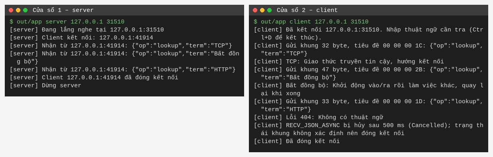

# Bài 5.1 – Các hàm gửi, nhận khung JSON bất đồng bộ (Go)

| Thông tin | Nội dung |
|---|---|
| Mã giả tương ứng | Mã giả 5.1 (Các hàm gửi, nhận khung JSON bất đồng bộ) |
| Mục giáo trình | 5.2.4 Các hàm socket bất đồng bộ; 5.4.1 Hủy tác vụ hợp tác |
| Kế thừa | Mã giả 3.3 (SEND_ALL), 3.4 (RECV_EXACT), 3.6 (khung JSON), 3.7 (PROCESS_REQUEST), 3.8 (LOOKUP_CLIENT), 2.1 (PARSE_ENDPOINT), 2.2 (SAFE_CONNECT) |
| Thư viện | Thư viện chuẩn Go: `net`, `context`, `encoding/binary`, `encoding/json` |

## Mục tiêu
Chuyển các hàm định khung của Mục 3.4 sang dạng bất đồng bộ theo quy tắc của Mục 5.2.4: logic giữ nguyên, thêm tín hiệu hủy `ct`. Server tra cứu dùng các hàm này phục vụ mỗi kết nối bằng một goroutine riêng; client in 4 byte tiêu đề của từng khung để đối chiếu với giải thích bước (6) và minh họa việc hủy một lời gọi nhận đang chờ bằng tín hiệu hủy (Mục 5.4.1).

## Tệp
- `khungjson.go` – `RecvExactAsync`, `RecvJSONAsync`, `SendJSONAsync`, `MakeFrame`, `ParseEndpoint`, `SafeConnectAsync`, các kiểu lỗi và tiện ích JSON.
- `main.go` – chọn vai trò `server` hoặc `client`.
- `frameserver.go` – server tra cứu (mỗi kết nối một goroutine).
- `frameclient.go` – client tra cứu, in tiêu đề khung và minh họa hủy.
- `loimang.go` – `isRefused`, `isReset`, `isUnreachable`: nhận biết lỗi kết nối bị từ chối, bị đặt lại, không có đường đi theo cả mã POSIX (Linux, macOS) và mã Winsock (Windows).
- `demo.json` – kịch bản chạy minh họa (dùng với `tools/demo.py`).
- `ket_qua.txt`, `ket_qua.png` – kết quả thực thi thật.

## Cách chạy
Mở hai cửa sổ dòng lệnh trong thư mục bài:
```bash
# Cửa sổ 1 – server
go run . server 0.0.0.0 9100
# Cửa sổ 2 – client
go run . client 127.0.0.1 9100
```
Nhập từng thuật ngữ (ví dụ `TCP`), kết thúc bằng Ctrl+D (Linux/macOS) hoặc Ctrl+Z rồi Enter (Windows). Dừng server bằng Ctrl+C. Kịch bản `demo.json` biên dịch một lần thành `out/app` (cổng 31510).

## Kết quả thực thi


Ba khung có độ dài nội dung 28, 43 và 29 byte (tiêu đề `00 00 00 1C`, `00 00 00 2B`, `00 00 00 1D`): chuỗi "Bất đồng bộ" có 11 ký tự nhưng chiếm nhiều byte hơn trong UTF-8, nên độ dài khung luôn tính bằng byte. Thuật ngữ không có trong từ điển nhận mã 404. Lời gọi nhận cuối bị hủy sau 500 ms; client đóng kết nối thay vì dùng tiếp, và server nhận biết client đóng đúng ranh giới khung (`received = 0`) nên kết thúc phiên bình thường. Kết quả trùng từng byte với bản Python.

## Ghi chú
- Go không có `async`/`await`. Cách làm của Go giống luồng ảo của Java (Mục 5.2.3): mỗi tác vụ là một goroutine gọi các hàm vào/ra chặn thông thường; khi goroutine chờ mạng, môi trường chạy Go đăng ký socket với epoll (Linux), kqueue (macOS) hoặc IOCP (Windows) và cho goroutine khác chạy. Vì vậy `AWAIT RECV_ASYNC` tương ứng `conn.Read`, `RUN_BACKGROUND` tương ứng từ khóa `go`; tên hàm giữ hậu tố `Async` để đối chiếu với mã giả.
- Tín hiệu hủy `ct` là `context.Context`, được truyền làm tham số đầu tiên như quy ước của Go. Lời gọi `Read` đang chờ không tự theo dõi `ctx`, nên `watchCancel` dùng `context.AfterFunc` đặt deadline của kết nối về quá khứ khi `ctx` bị hủy; hàm khi đó trả `context.Canceled` (tương ứng `Cancelled`). Client minh họa hủy bằng `time.AfterFunc(500 ms, cancel)`.
- Thời gian chờ nhận 5000 ms của client dùng `context.WithTimeout`, cùng cơ chế với hủy (lỗi `context.DeadlineExceeded`).
- `SEND_ALL_ASYNC` tương ứng `conn.Write`, vốn gửi hết dữ liệu hoặc trả lỗi; `RecvExactAsync` viết vòng lặp tường minh để đối chiếu với mã giả (thư viện chuẩn có sẵn `io.ReadFull`).
- JSON được mã hóa không thêm khoảng trắng và giữ nguyên chữ có dấu (`SetEscapeHTML(false)`), nên độ dài khung giống hệt bản C#, Java, Python.
- Server không có trong Mã giả 5.1; server dùng lại nghiệp vụ của Mã giả 3.7 với từ điển nhỏ viết sẵn trong mã thay cho tệp `glossary.json`.
- Kiểm thử: Linux, Go 1.24.7.
