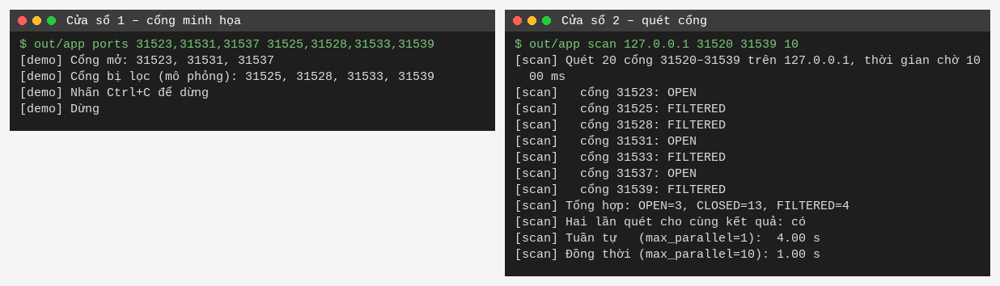

# Bài 5.2 – Kiểm tra nhiều cổng đồng thời có giới hạn (Go)

| Thông tin | Nội dung |
|---|---|
| Mã giả tương ứng | Mã giả 5.2 (Kiểm tra nhiều cổng đồng thời có giới hạn) |
| Mục giáo trình | 5.2.5 Thực hiện nhiều tác vụ đồng thời |
| Kế thừa | Mã giả 1.2 (PORT_CHECK), Mã giả 1.1 (RESOLVE_HOST) |
| Thư viện | Thư viện chuẩn Go: `net`, `context`, `sync` (`WaitGroup`), kênh có bộ đệm làm semaphore |

## Mục tiêu
Cài đặt `SCAN_PORTS` và `CHECK_ONE`: khởi động một goroutine kiểm tra cho mỗi cổng mà chưa chờ, giới hạn số kết nối đồng thời bằng semaphore và chờ tất cả bằng `WHEN_ALL`. Chương trình quét cùng một dải cổng hai lần, tuần tự (`max_parallel` = 1) và đồng thời (`max_parallel` = k), để kiểm chứng công thức thời gian xấu nhất ⌈N/k⌉·t của Mục 5.2.5.

## Tệp
- `main.go` – chọn vai trò `scan` hoặc `ports`.
- `scanasync.go` – `PortCheckAsync`, `CheckOne`, `ScanPorts`; quét tuần tự rồi đồng thời và in thời gian.
- `demoports.go` – mở các cổng minh họa (mở, bị lọc) trên 127.0.0.1.
- `backlog_unix.go`, `backlog_windows.go` – `setBacklog`: gọi lại `listen()` với backlog 1 (mỗi tệp chỉ được biên dịch trên hệ điều hành ghi ở dòng `//go:build`).
- `loimang.go` – `isRefused`, `isReset`, `isUnreachable`: nhận biết lỗi kết nối bị từ chối, bị đặt lại, không có đường đi theo cả mã POSIX (Linux, macOS) và mã Winsock (Windows).
- `demo.json` – kịch bản chạy minh họa (dùng với `tools/demo.py`).
- `ket_qua.txt`, `ket_qua.png` – kết quả thực thi thật.

## Cách chạy
```bash
# Cửa sổ 1 – mở cổng minh họa
go run . ports 9003,9011,9017 9005,9008,9013,9019
# Cửa sổ 2 – quét dải 9000–9019, k = 10
go run . scan 127.0.0.1 9000 9019 10
```
Kịch bản `demo.json` biên dịch một lần thành `out/app` và dùng dải 31520–31539.

## Kết quả thực thi


Dải 20 cổng có 3 cổng mở, 4 cổng bị lọc (mô phỏng) và 13 cổng đóng. Mỗi cổng bị lọc chờ hết 1000 ms, nên quét tuần tự mất khoảng 4 × 1 s = 4,00 s, còn quét đồng thời với k = 10 mất khoảng ⌈4/10⌉ × 1 s = 1,00 s; cổng đóng và cổng mở trả lời gần như tức thời qua loopback. Hai lần quét cho cùng kết quả.

## Ghi chú
- `SEMAPHORE(max_parallel)` được cài bằng kênh có bộ đệm `make(chan struct{}, k)`: `ACQUIRE_ASYNC` là gửi một phần tử vào kênh (chờ khi kênh đầy), `RELEASE` là lấy ra; `defer` bảo đảm nhả semaphore cả khi kiểm tra lỗi, tương ứng `FINALLY`.
- Mỗi `CHECK_ONE` chạy trong một goroutine (`go func() …`), tức khởi động mà chưa chờ; `WHEN_ALL` tương ứng `sync.WaitGroup.Wait()`. Kết quả ghi vào phần tử thứ i của lát cắt nên giữ đúng thứ tự cổng.
- `CONNECT_TIMEOUT` dùng `net.Dialer{Timeout: 1000 ms}`; khi hết giờ, socket đang kết nối dở được đóng.
- Cổng "bị lọc" được mô phỏng trên loopback: socket lắng nghe với backlog 1 không bao giờ chấp nhận kết nối, chương trình minh họa tự lấp đầy hàng đợi; khi hàng đợi đầy, Linux bỏ qua gói SYN mới nên phía quét hết thời gian chờ giống như gặp tường lửa. `net.Listen` của Go không cho chọn backlog, nên `setBacklog` lấy socket gốc bằng `SyscallConn` và gọi lại `listen(fd, 1)`. Trên Windows, hàng đợi đầy thường được trả lời bằng RST, khi đó các cổng này hiện là CLOSED và hai thời gian quét gần bằng nhau.
- Như Mục 1.2.5, chương trình kiểm tra nhiều cổng chỉ được chạy trên hệ thống thuộc quyền quản lý hoặc trong mạng thí nghiệm cô lập; kịch bản minh họa chỉ quét 127.0.0.1.
- Kiểm thử: Linux, Go 1.24.7.
