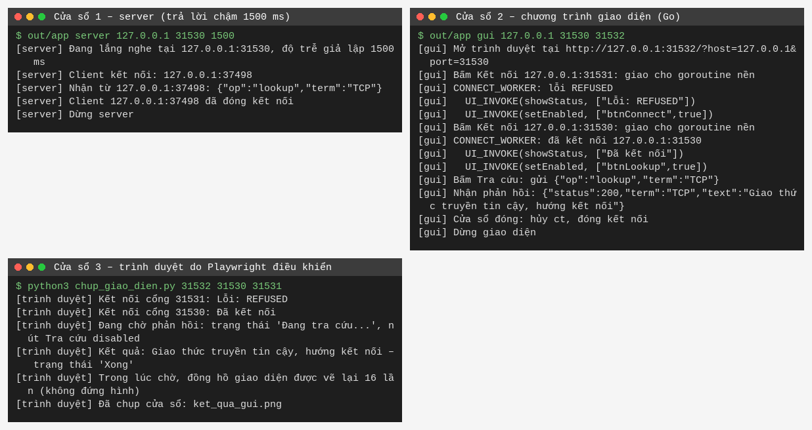
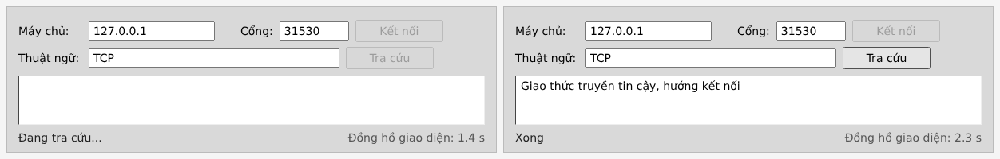

# Bài 5.3 – Ứng dụng tra cứu có giao diện bất đồng bộ (Go)

| Thông tin | Nội dung |
|---|---|
| Mã giả tương ứng | Mã giả 5.3 (Cách (1): luồng nền và UI_INVOKE), Mã giả 5.4 (Cách (2): trình xử lý sự kiện bất đồng bộ) |
| Mục giáo trình | 5.3.1 Mô hình luồng giao diện đơn, 5.3.2 Ba cách tiếp cận, 5.3.5 Tranh chấp và quản lý trạng thái |
| Kế thừa | Mã giả 2.2 (SAFE_CONNECT), 3.7 (server tra cứu), 3.8 (một lượt tra cứu), 5.1 (khung JSON bất đồng bộ) |
| Thư viện | Thư viện chuẩn Go: `net`, `net/http` (giao diện web, Server-Sent Events), `context`, `embed`; Playwright và Pillow (Python) chỉ dùng để thao tác tự động và chụp ảnh trong kịch bản minh họa |

## Mục tiêu
Kết hợp socket với giao diện đồ họa theo hai cách tiếp cận của Mục 5.3.2. Nút Kết nối dùng cách (1): goroutine nền gọi `SAFE_CONNECT` rồi chuyển kết quả về luồng giao diện bằng `UI_INVOKE` (Mã giả 5.3). Nút Tra cứu dùng cách (2): trình xử lý sự kiện bất đồng bộ gửi yêu cầu và chờ phản hồi mà không chặn luồng giao diện (Mã giả 5.4). Một đồng hồ trên cửa sổ cập nhật mỗi 100 ms để kiểm chứng giao diện không đứng hình khi server trả lời chậm.

## Giao diện web thay cho cửa sổ
Thư viện chuẩn Go không có bộ công cụ giao diện đồ họa (không có tương đương WinForms, Swing, Tkinter), và bài chỉ dùng thư viện chuẩn. Vì vậy "cửa sổ" là một trang web cục bộ do chính chương trình Go phục vụ tại `http://127.0.0.1:<cổng_giao_diện>/`:
- **Luồng giao diện** là luồng JavaScript duy nhất của trang trong trình duyệt. Mọi thao tác trên điều khiển (nút, ô nhập, nhãn) chỉ diễn ra ở đây, đúng quy tắc của Mục 5.3.1.
- **Chương trình Go** giữ kết nối TCP `conn` và tín hiệu hủy `ct` (trường của "cửa sổ" `LookupWindow`), thực hiện mọi thao tác mạng trong goroutine.
- **`UI_INVOKE`**: goroutine nền đưa cặp (thủ tục, tham số) vào hàng đợi `uiQueue`; trang web nhận hàng đợi qua Server-Sent Events (`/events`) và gọi thủ tục tương ứng (`showStatus`, `setEnabled`) trên luồng giao diện – cùng ý tưởng với `queue.Queue` + `root.after` của Tkinter trong bảng ui-dispatch.
- **Cách (2)**: trình xử lý nút Tra cứu là hàm `async` của JavaScript, tức `ASYNC PROCEDURE ON_LOOKUP_CLICK` của Mã giả 5.4: tắt nút, `await fetch("/api/lookup")`, cập nhật kết quả trực tiếp (phần sau `await` chạy lại trên luồng giao diện), bật lại nút trong `finally`. Phần `AWAIT SEND_JSON_ASYNC`, `AWAIT RECV_JSON_ASYNC` được chương trình Go thực hiện trong goroutine phục vụ yêu cầu HTTP đó.

## Tệp
- `main.go` – chọn vai trò `server` hoặc `gui`.
- `lookupgui.go` – "cửa sổ" `LookupWindow`: `UiInvoke`, `onConnectClick`, `connectWorker` (cách 1), `onLookupClick` (phần mạng của cách 2), `onClose`, luồng SSE.
- `giaodien.html` – trang giao diện (nhúng vào tệp thực thi bằng `//go:embed`): đồng hồ, nhận `UI_INVOKE`, trình xử lý `async` của nút Tra cứu.
- `khungjson.go` – khung JSON bất đồng bộ (Mã giả 5.1) và `SafeConnectAsync` (Mã giả 2.2), chép từ Bài 5.1.
- `lookupserver.go` – server tra cứu tối giản có độ trễ giả lập.
- `chup_giao_dien.py` – kịch bản Playwright thao tác tự động trên trang như người dùng và chụp ảnh (không thuộc mã giả).
- `loimang.go` – `isRefused`, `isReset`, `isUnreachable`: nhận biết lỗi kết nối bị từ chối, bị đặt lại, không có đường đi theo cả mã POSIX (Linux, macOS) và mã Winsock (Windows).
- `demo.json` – kịch bản chạy minh họa (dùng với `tools/demo.py`).
- `ket_qua.txt`, `ket_qua.png` – nhật ký thật của server, chương trình giao diện và kịch bản; `ket_qua_gui.png` – ảnh chụp trang giao diện thật.

## Cách chạy
```bash
# Cửa sổ 1 – server, trả lời chậm 1500 ms
go run . server 0.0.0.0 9100 1500
# Cửa sổ 2 – chương trình giao diện, phục vụ trang web ở cổng 8080
go run . gui 127.0.0.1 9100 8080
```
Mở trình duyệt tại địa chỉ chương trình in ra (`http://127.0.0.1:8080/?host=127.0.0.1&port=9100`), bấm Kết nối, nhập thuật ngữ rồi bấm Tra cứu. Dừng hai chương trình bằng Ctrl+C.

Chạy kịch bản minh họa tự động (cần `pip install playwright pillow` và `playwright install chromium`): sau hai lệnh trên với cổng 31530 và 31532, chạy `python3 chup_giao_dien.py 31532 31530 31531`. Kịch bản `demo.json` biên dịch một lần thành `out/app` rồi chạy cả ba bước.

## Kết quả thực thi




Ảnh trái được chụp khi đang chờ server (độ trễ giả lập 1500 ms): trạng thái "Đang tra cứu...", nút Tra cứu bị tắt (chống bấm lặp), đồng hồ vẫn chạy. Ảnh phải được chụp khi đã có kết quả: nội dung hiển thị, nút được bật lại. Nhật ký cho thấy lần bấm Kết nối tới cổng không có server được goroutine nền báo `Lỗi: REFUSED` qua hai lời gọi `UI_INVOKE` (hiện trạng thái, bật lại nút Kết nối); trong khoảng 1,5 s chờ, đồng hồ được vẽ lại 15–16 lần. Khi rời trang, chương trình Go hủy `ct` và đóng kết nối, server ghi nhận client đã đóng.

## Ghi chú
- Trong Mã giả 5.4, `conn` được mở khi nạp cửa sổ; bài mở kết nối bằng nút Kết nối (cách 1), như bản Python. Phản hồi khác 200 (ví dụ 404) được hiển thị kèm mã và lý do.
- Lỗi mạng hoặc lỗi giao thức phía Go (`NetError`, `ProtocolError`, `ConnectionClosed`) được trả về trang với mã HTTP 502 và trường `loi`; trình xử lý `async` ném lỗi và hiện "Lỗi: …" trong nhánh `catch`, đúng dòng 14–15 của mã giả.
- Mỗi yêu cầu HTTP được `net/http` phục vụ trên một goroutine riêng; `onLookupClick` giữ khóa `mu` để chỉ một yêu cầu dùng `conn` tại một thời điểm, tránh các khung xen kẽ (Mục 5.3.5).
- Rời hoặc đóng trang (sự kiện `pagehide`) gửi `/api/close`: chương trình Go gọi `cancel()` (tương ứng `CANCEL(ct)`) và đóng kết nối.
- Trang chỉ lắng nghe trên `127.0.0.1` nên máy khác không mở được giao diện.
- `ket_qua.png` là nhật ký dòng lệnh do `tools/demo.py` vẽ; ảnh trang thật được lưu riêng ở `ket_qua_gui.png`.
- Kiểm thử: Linux, Go 1.24.7; kịch bản minh họa dùng Python 3.13 với Playwright 1.63 (Chromium không màn hình).
