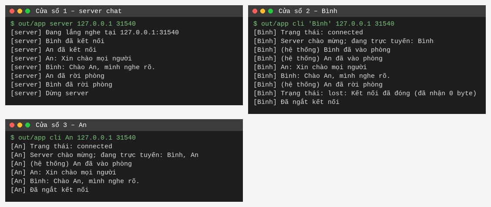

# Bài 5.4 – Lớp dịch vụ ChatClient bất đồng bộ (Go)

| Thông tin | Nội dung |
|---|---|
| Mã giả tương ứng | Mã giả 5.5 (Lớp dịch vụ ChatClient bất đồng bộ) |
| Mục giáo trình | 5.3.2 Ba cách tiếp cận (cách 3), 5.3.3 Ví dụ: lớp dịch vụ chat client, 5.4.5 Xử lý ngoại lệ trong tác vụ bất đồng bộ |
| Kế thừa | Mã giả 5.1 (khung JSON bất đồng bộ); SAFE_CONNECT_ASYNC = Mã giả 2.2 + ct; giao thức chat của Mục 6.3.1 (phần `hello`, `msg`, `sys`, `welcome`) |
| Thư viện | Thư viện chuẩn Go: `net`, `context`, `sync` (`Mutex`), goroutine và kênh |

## Mục tiêu
Cài đặt lớp `ChatClient` theo cách tiếp cận (3) của Mục 5.3.2: lớp dịch vụ mạng giữ kết nối dài hạn, có vòng nhận chạy nền phát sự kiện `OnMessage`, thủ tục gửi tuần tự hóa bằng khóa `sendLock`, và thủ tục ngắt kết nối hủy vòng nhận trước khi đóng socket. Tầng giao diện (ở đây là giao diện dòng lệnh) chỉ đăng ký hai sự kiện và gọi các thủ tục của lớp, nên lớp kiểm thử được mà không cần cửa sổ.

## Tệp
- `main.go` – chọn vai trò `server` hoặc `cli`.
- `chatclient.go` – kiểu `ChatClient`: `Connect`, `receiveLoop`, `SendMessage`, `Disconnect`, sự kiện `OnMessage`, `OnStatus`.
- `chatcli.go` – giao diện dòng lệnh dùng `ChatClient`.
- `chatserver.go` – server chat tối giản đi kèm.
- `khungjson.go` – khung JSON bất đồng bộ (Mã giả 5.1), `SafeConnectAsync`, chép từ Bài 5.1.
- `loimang.go` – `isRefused`, `isReset`, `isUnreachable`: nhận biết lỗi kết nối bị từ chối, bị đặt lại, không có đường đi theo cả mã POSIX (Linux, macOS) và mã Winsock (Windows).
- `demo.json` – kịch bản chạy minh họa (dùng với `tools/demo.py`).
- `ket_qua.txt`, `ket_qua.png` – kết quả thực thi thật.

## Cách chạy
```bash
# Cửa sổ 1 – server chat
go run . server 0.0.0.0 9200
# Cửa sổ 2, 3 – hai người dùng
go run . cli Bình 127.0.0.1 9200
go run . cli An 127.0.0.1 9200
```
Mỗi dòng nhập được gửi thành một tin; `/quit` để ngắt kết nối; `/cho <giây>` tạm dừng đọc bàn phím (dùng trong kịch bản minh họa). Kịch bản `demo.json` biên dịch một lần thành `out/app` (cổng 31540).

## Kết quả thực thi


Bình kết nối trước, An kết nối sau; tin của mỗi người được server chuyển tới cả hai (gồm cả người gửi). Khi An gõ `/quit`, `Disconnect` hủy vòng nhận trước rồi mới đóng socket, nên phía An kết thúc lặng lẽ (nhánh `Cancelled`), còn Bình nhận thông báo hệ thống "An đã rời phòng". Cuối kịch bản, server bị dừng trước: vòng nhận của Bình gặp kết nối đóng và báo `OnStatus("lost: ...")` (nhánh lỗi ngoài ý muốn), sau đó Bình được dừng bằng Ctrl+C. Nhật ký trùng khớp với bản Python.

## Ghi chú
- `cts` tương ứng `context.WithCancel`: `CANCEL(c.cts)` là gọi hàm `cancel`, làm lời gọi nhận đang chờ trong `receiveLoop` kết thúc với `context.Canceled`. `send_lock` là `sync.Mutex` (`defer Unlock()` tương ứng `FINALLY RELEASE`), `RUN_BACKGROUND` là từ khóa `go`.
- Sự kiện `OnMessage`, `OnStatus` được gọi trên goroutine của vòng nhận. Giao diện dòng lệnh in trực tiếp; một giao diện đồ họa phải chuyển về luồng giao diện bằng `UI_INVOKE` như Bài 5.3.
- `SendMessage` nhận tham số `room` và gửi `{type: "msg", room, text}` đúng như Mã giả 5.5; giao diện dòng lệnh luôn dùng phòng `"chung"`, và server tối giản chỉ có một phòng.
- Bàn phím được đọc trên một goroutine phụ và chuyển vào kênh, nên tin đến vẫn được hiển thị trong lúc chờ người dùng gõ. Ctrl+C được xử lý như `/quit` để chương trình in "Đã ngắt kết nối".
- Server chat đi kèm là bản tối giản viết bằng Go: một phòng chung, chuyển tiếp `msg`, trả lời `ping`, lỗi 409 khi trùng tên, mỗi kết nối một goroutine. Server dùng một khóa gửi cho mỗi client thay cho hộp thư đi và tác vụ ghi riêng của Chương 6. Bản đầy đủ (nhiều phòng, tin riêng) thuộc Chương 6.
- Kiểm thử: Linux, Go 1.24.7.
