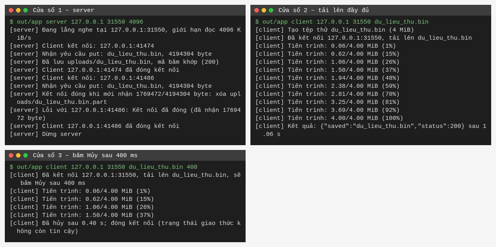

# Bài 5.5 – Tải tệp bất đồng bộ có báo cáo tiến trình và hủy (Go)

| Thông tin | Nội dung |
|---|---|
| Mã giả tương ứng | Mã giả 5.6 (Tải tệp bất đồng bộ có báo cáo tiến trình và hủy) |
| Mục giáo trình | 5.3.4 Ví dụ: tải tệp có báo cáo tiến trình và hủy; 5.4.1 Hủy tác vụ hợp tác |
| Kế thừa | Mã giả 3.10 (PUT_CLIENT), 3.9 (HANDLE_PUT – server đi kèm), 5.1 (khung JSON bất đồng bộ) |
| Thư viện | Thư viện chuẩn Go: `net`, `context`, `crypto/sha256`, `encoding/json`, `os` |

## Mục tiêu
Chuyển thủ tục gửi tệp của Mục 3.5.2 sang dạng bất đồng bộ, giữ nguyên giao thức bốn bước (tiêu đề có SHA-256, trạng thái 100, nội dung, trạng thái 200/422), bổ sung hàm báo tiến trình tối đa khoảng 10 lần mỗi giây và tín hiệu hủy. Kịch bản minh họa tải một tệp 4 MiB hoàn chỉnh, sau đó tải lại và bấm Hủy giữa chừng để kiểm chứng phía server xóa tệp `.part`.

## Tệp
- `main.go` – chọn vai trò `server` hoặc `client`.
- `putclient.go` – `PutFileAsync` (Mã giả 5.6), `sha256OfFileAsync`, hàm báo tiến trình, nút Hủy mô phỏng bằng hẹn giờ.
- `putserver.go` – server nhận tệp có kiểm tra mã băm (Mã giả 3.9, kiểm tra tham số như Bài 3.4), giới hạn tốc độ đọc.
- `khungjson.go` – khung JSON bất đồng bộ (Mã giả 5.1), `SafeConnectAsync`, chép từ Bài 5.1; thêm `SendAllAsync`.
- `loimang.go` – `isRefused`, `isReset`, `isUnreachable`: nhận biết lỗi kết nối bị từ chối, bị đặt lại, không có đường đi theo cả mã POSIX (Linux, macOS) và mã Winsock (Windows).
- `demo.json` – kịch bản chạy minh họa (dùng với `tools/demo.py`).
- `ket_qua.txt`, `ket_qua.png` – kết quả thực thi thật.

## Cách chạy
```bash
# Cửa sổ 1 – server, đọc tối đa 4096 KiB/s
go run . server 0.0.0.0 9100 4096
# Cửa sổ 2 – tải lên đầy đủ (tự tạo tệp thử 4 MiB nếu chưa có)
go run . client 127.0.0.1 9100 du_lieu_thu.bin
# Tải lên và bấm Hủy sau 400 ms
go run . client 127.0.0.1 9100 du_lieu_thu.bin 400
```
Tệp nhận được lưu trong thư mục `uploads/` cạnh server. Kịch bản `demo.json` biên dịch một lần thành `out/app` (cổng 31550).

## Kết quả thực thi


Lần tải thứ nhất in tiến trình khoảng mỗi 100 ms và kết thúc với `status` 200 sau khoảng 1,1 s (server đọc 4096 KiB/s); mức 100% chỉ được in sau khi server xác nhận. Lần thứ hai bị hủy sau 400 ms: client đóng kết nối; vòng nhận của server gặp kết nối đóng trước khi đủ `size` byte nên xóa `uploads/du_lieu_thu.bin.part`, đúng như thiết kế khớp nhau của hai đầu giao thức ở Mục 5.3.4.

## Ghi chú
- Tín hiệu hủy `ct` là `context.Context`; nút Hủy được mô phỏng bằng `time.AfterFunc(400 ms, cancel)` (`CANCEL(cts)`). Khi `ctx` bị hủy, lời gọi `Write` đang chờ bộ đệm gửi trong `SendAllAsync` kết thúc ngay (deadline bị đặt về quá khứ), hàm trả `context.Canceled`, `defer f.Close()` đóng tệp (`FINALLY CLOSE_FILE`), rồi nơi gọi đóng kết nối (Mục 5.4.1).
- `SHA256_OF_FILE_ASYNC` đọc tệp theo khối 64 KiB và kiểm tra `ctx.Err()` giữa các khối, nên việc tính mã băm tệp lớn cũng hủy được. `READ_ASYNC` là `f.Read` thông thường: trong Go, đọc tệp trên goroutine không chặn các goroutine khác.
- Theo Mã giả 5.6, `on_progress(size, size)` chỉ được gọi sau khi nhận `status` 200 (biến `sent` đếm byte đã vào bộ đệm gửi, chưa chắc đã tới server). Bản Python báo 100% trước khi nhận phản hồi.
- Để quan sát được tiến trình trên loopback, server minh họa giới hạn tốc độ đọc (tham số `rate_kib`) và đặt bộ đệm nhận 64 KiB (`SetReadBuffer`) cho mỗi kết nối; client đặt bộ đệm gửi 64 KiB (`SetWriteBuffer`). Đây là khác biệt so với mã giả, chỉ phục vụ minh họa.
- `encoding/json` sắp xếp khóa của `map`, nên kết quả in ra là `{"saved":…,"status":200}`.
- Kịch bản tạo tệp thử `du_lieu_thu.bin` (4 MiB, nội dung giả ngẫu nhiên cố định) và thư mục `uploads/`; hai thứ này không được lưu kèm bài.
- Kiểm thử: Linux, Go 1.24.7.
