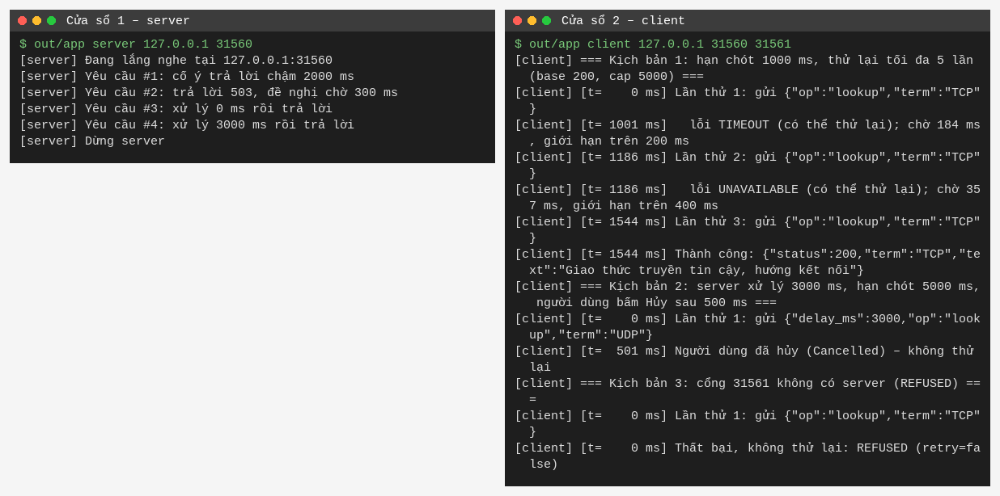

# Bài 5.6 – Hạn chót, hủy và thử lại có lùi thời gian (Go)

| Thông tin | Nội dung |
|---|---|
| Mã giả tương ứng | Mã giả 5.7 (Yêu cầu có hạn chót và hủy), Mã giả 5.8 (Thử lại có lùi theo cấp số nhân và nhiễu ngẫu nhiên) |
| Mục giáo trình | 5.4.1 Hủy tác vụ hợp tác, 5.4.2 Thời gian chờ và hạn chót, 5.4.3 Thử lại có lùi thời gian và nhiễu ngẫu nhiên |
| Kế thừa | Mã giả 5.1 (khung JSON bất đồng bộ), 2.2 (SAFE_CONNECT, `NetError` có trường `retry`), 4.4 (UDP_REQUEST – vòng gửi lại có lùi thời gian) |
| Thư viện | Thư viện chuẩn Go: `context` (`WithTimeout`, `WithCancel`), `time`, `math/rand`, `net` |

## Mục tiêu
Cài đặt `REQUEST_WITH_DEADLINE`, kết hợp tín hiệu hủy của người dùng với tín hiệu tự hủy khi hết hạn và phân biệt hai nguyên nhân, cùng `RETRY_ASYNC` thử lại có lùi theo cấp số nhân với nhiễu ngẫu nhiên, tôn trọng thời gian chờ do server đề nghị. Server đi kèm cố ý trả lời chậm ở yêu cầu thứ nhất và trả lỗi 503 ở yêu cầu thứ hai.

## Tệp
- `main.go` – chọn vai trò `server` hoặc `client`.
- `deadlineretry.go` – `RequestWithDeadline` (Mã giả 5.7), `RetryAsync` (Mã giả 5.8), hàm tạo `op(ct)` và ba kịch bản.
- `flakyserver.go` – server tra cứu cố ý trả lời chậm, trả 503.
- `khungjson.go` – khung JSON bất đồng bộ (Mã giả 5.1), `SafeConnectAsync`, `NetError` có thêm `RetryAfterMs`.
- `loimang.go` – `isRefused`, `isReset`, `isUnreachable`: nhận biết lỗi kết nối bị từ chối, bị đặt lại, không có đường đi theo cả mã POSIX (Linux, macOS) và mã Winsock (Windows).
- `demo.json` – kịch bản chạy minh họa (dùng với `tools/demo.py`).
- `ket_qua.txt`, `ket_qua.png` – kết quả thực thi thật.

## Cách chạy
```bash
# Cửa sổ 1 – server "khó tính"
go run . server 0.0.0.0 9100
# Cửa sổ 2 – ba kịch bản; cổng thứ hai là cổng không có server
go run . client 127.0.0.1 9100 9101
```
Server đếm yêu cầu từ lúc khởi động; cần khởi động lại server trước mỗi lần chạy client để lặp lại đúng kịch bản. Kịch bản `demo.json` biên dịch một lần thành `out/app` (cổng 31560, cổng 31561 không có server).

## Kết quả thực thi


Kịch bản 1: lần thử 1 hết hạn chót 1000 ms (`Timeout`, luôn được thử lại), chờ một khoảng ngẫu nhiên không quá 200 ms; lần thử 2 nhận 503 kèm đề nghị chờ 300 ms nên thời gian chờ được nâng lên ít nhất 300 ms (giới hạn trên của khoảng ngẫu nhiên lúc này là 400 ms); lần thử 3 thành công. Kịch bản 2: người dùng bấm Hủy sau 500 ms trong khi hạn chót là 5000 ms; kết quả là `Cancelled`, không phải `Timeout`, và không có lần thử lại. Kịch bản 3: kết nối bị từ chối (`REFUSED`, `retry = false`) nên lỗi được báo ngay sau lần thử đầu. Thời gian chờ ngẫu nhiên khác nhau giữa các lần chạy.

## Ghi chú
- `LINK(user_ct, CANCEL_AFTER(timeout_ms))` là đúng một lời gọi `context.WithTimeout(userCtx, timeout)`: ngữ cảnh con bị hủy khi người dùng hủy ngữ cảnh cha hoặc khi hết hạn. Sau lỗi, `RequestWithDeadline` kiểm tra `userCtx.Err()` để phân biệt hai nguyên nhân, đúng như dòng `IF user_ct.cancelled` của mã giả, và đóng kết nối vì trạng thái khung không xác định.
- `RetryAsync` theo Mã giả 5.8: bắt `Timeout` (kiểu `*TimeoutError`, luôn đáng thử lại) và `NetError` (thử lại khi `Retry` bằng `true`); `context.Canceled` không được bắt nên người dùng hủy là dừng ngay. `op` là hàm nhận `ct`, mỗi lần gọi mở kết nối mới vì sau khi hết hạn kết nối cũ đã bị đóng. Bản Python đổi `Timeout` thành `NetError("TIMEOUT")` trong `op()`; bản Go giữ hai loại lỗi riêng như mã giả hiện hành.
- Phản hồi 503 được `op` đổi thành `NetError("UNAVAILABLE", Retry: true, RetryAfterMs: retry_after_ms)`; `RetryAfterMs` bằng 0 nghĩa là server không đề nghị (tương ứng `NULL`).
- `RANDOM(0, x)` là `rand.Float64() * x`; `DELAY_ASYNC(delay, ct)` là `select` giữa `time.After(delay)` và `ctx.Done()`, nên người dùng hủy được cả trong lúc đang chờ giữa hai lần thử.
- `encoding/json` sắp xếp khóa của `map`, nên yêu cầu của kịch bản 2 in ra là `{"delay_ms":3000,"op":"lookup","term":"UDP"}`.
- Kiểm thử: Linux, Go 1.24.7.
