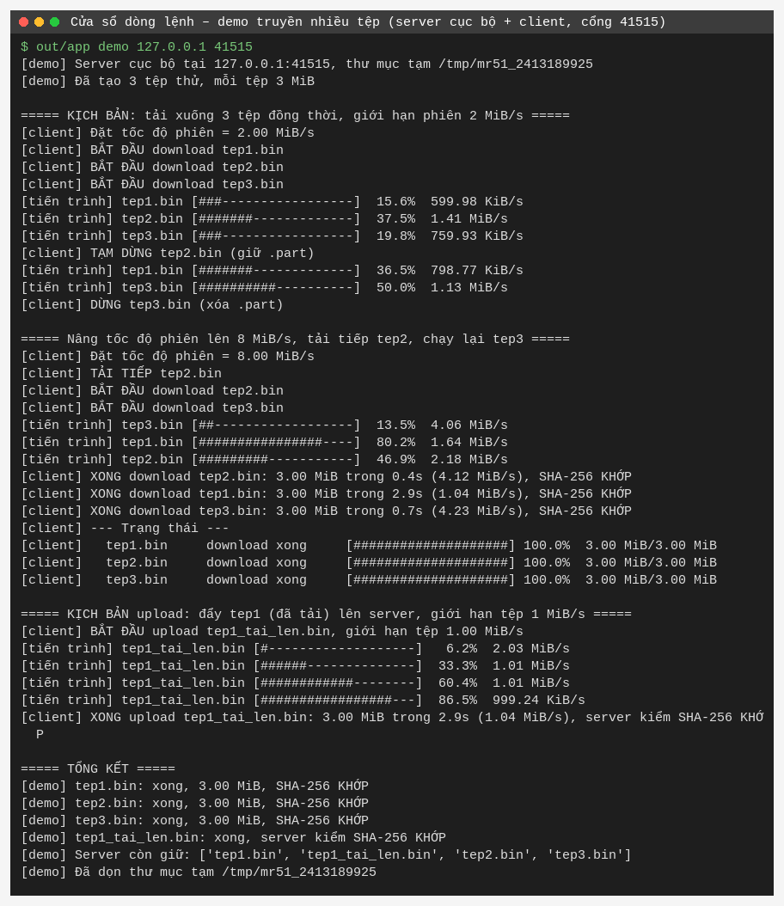

# Bài mở rộng MR5.1 – Truyền nhiều tệp đồng thời có điều khiển và giới hạn tốc độ (Go)

| Thông tin | Nội dung |
|---|---|
| Loại | **Bài mở rộng** – không có trong giáo trình, không có mã giả tương ứng |
| Liên hệ với giáo trình | Chương 5: Bài 5.5 (tải tệp có tiến trình và hủy), Bài 5.1 (khung bất đồng bộ); Chương 3: Bài 3.9/3.10 (gửi tệp có SHA-256), Bài 3.4 (HTTP `Range` – ý tưởng tải tiếp) |
| Thư viện | Thư viện chuẩn Go: `net`, `crypto/sha256`, `encoding/binary`, `encoding/json`, `sync`, `os` |
| Bản ngôn ngữ khác | [C#](../../../csharp/Chuong05/BaiMR5.1_TruyenNhieuTep/), [Java](../../../java/Chuong05/BaiMR5.1_TruyenNhieuTep/), [Python](../../../python/Chuong05/BaiMR5.1_TruyenNhieuTep/), [Rust](../../../rust/Chuong05/BaiMR5.1_TruyenNhieuTep/) |

## Mục tiêu
Tải lên/tải xuống **n tệp lớn đồng thời** với đầy đủ điều khiển như một trình quản lý tải thật:
- **start / pause / resume / stop** cho từng tệp (pause giữ tệp `.part`, resume tải tiếp từ offset, stop xóa `.part`);
- **giới hạn tốc độ theo phiên** (thùng token dùng chung, đổi được lúc chạy, ví dụ `512K → 2M → 8M`) và **giới hạn theo từng tệp**;
- **tải tiếp (resume)** bằng offset + kiểm **SHA-256** ở cuối để bảo đảm toàn vẹn;
- in **thanh tiến trình** và **tốc độ đo được**.

Mỗi lượt truyền là một **goroutine**; trạng thái điều khiển được bảo vệ bằng `sync.Mutex`.

## Giao thức
Một kết nối TCP cho mỗi lượt truyền. Mở đầu là một **khung điều khiển JSON có tiền tố độ dài 4 byte** (big-endian), sau đó là **luồng byte nhị phân** của tệp từ `offset` tới hết:
- Tải xuống: client gửi `{"op":"download","name":…,"offset":OFF}`; server đáp `{"ok":true,"size":…,"sha256":…}` rồi gửi byte `[OFF..hết]`.
- Tải lên: client gửi `{"op":"upload","name":…,"offset":OFF,"size":…,"sha256":…}`; server đáp `{"ok":true}`, nhận byte ghi vào `name.part`, cuối cùng kiểm SHA-256, đổi tên thành `name`, đáp `{"ok":true,"sha256_ok":…}`.

Server **không** tự giới hạn tốc độ: client điều tiết bằng thùng token, TCP tự tạo áp lực ngược (`io.Copy` phía server gửi chậm theo).

## Tệp
- `khung.go` – định khung JSON (`Khung`), thùng token (`ThungToken`), băm SHA-256, phân tích chuỗi tốc độ.
- `server.go` – server, mỗi kết nối một goroutine `phucVu`.
- `client.go` – `LuotTruyen`, `QuanLy` (điều khiển start/pause/resume/stop, hai vòng `taiXuong`/`taiLen`).
- `main.go` – chọn vai `server`/`client`/`demo`, giao diện dòng lệnh, kịch bản demo.
- `demo.json`, `ket_qua.txt`, `ket_qua.png`.

## Cách chạy
Giao diện dòng lệnh (hai cửa sổ):
```bash
go build -o out/app .
out/app server 0.0.0.0 41515 kho_server          # cửa sổ 1
out/app client 127.0.0.1 41515 tai_ve            # cửa sổ 2, rồi nhập lệnh:
#   start tep1.bin / speed 1M / pause tep1.bin / resume tep1.bin / stop tep1.bin
#   start anh.bin upload 512K / status / quit
```
Kịch bản tự động (tự dựng server cục bộ, tạo tệp thử rồi dọn sạch):
```bash
out/app demo 127.0.0.1 41515
```
Tái lập kết quả: `python3 tools/demo.py go/Chuong05/BaiMR5.1_TruyenNhieuTep`.

## Kết quả thực thi


Demo tạo 3 tệp 3 MiB, tải xuống đồng thời với giới hạn phiên 2 MiB/s. Trong pha chậm, `tep1` chạy hết và cho tốc độ ~1,1 MiB/s (bị điều tiết); `tep2` bị tạm dừng giữa chừng (giữ `.part`), `tep3` bị dừng hẳn (xóa `.part`). Sau khi nâng giới hạn lên 8 MiB/s, `tep2` tải tiếp từ offset và `tep3` chạy lại, cả hai hoàn tất nhanh (~4 MiB/s mỗi tệp). Cuối cùng một lượt **tải lên** với giới hạn tệp 1 MiB/s cho tốc độ ~1,0 MiB/s và server xác nhận **SHA-256 KHỚP**. Thư mục tạm được dọn sạch. Hai bản Go và Python in thông điệp giống nhau.

## Bài tập gợi ý
1. (Cơ bản) Đổi số tệp và kích thước trong vai `demo`, quan sát tổng thông lượng luôn bị chặn ở giới hạn phiên.
2. (Cơ bản) Thêm lệnh `speed-file <tên> <tốc_độ>` để đổi giới hạn riêng của một tệp lúc đang chạy.
3. (Trung bình) Dùng `context.Context` để hủy lượt truyền thay cho cờ trạng thái, truyền `ctx` xuống vòng đọc/ghi.
4. (Trung bình) Gộp nhiều lượt truyền vào **một** kết nối TCP (multiplexing) bằng khung điều khiển + khung dữ liệu.
5. (Nâng cao) Thêm thử lại có lùi thời gian khi kết nối rớt và kiểm thử với mạng giả lập độ trễ cao.

## Ghi chú
- Thùng token giới hạn **tổng** thông lượng của phiên; cách chia giữa các tệp phụ thuộc lịch goroutine nên có thể không tuyệt đối đều (đã giảm "bùng" còn 0,25 giây để chia đều hơn).
- `pause` đóng kết nối và giữ `.part`; `resume` mở kết nối mới với `offset = kích thước .part`. SHA-256 cuối cùng kiểm toàn vẹn dữ liệu ghép từ nhiều phiên.
- Tệp thử trong demo tạo trong thư mục tạm (`os.MkdirTemp`) và **xóa sau khi chạy** (`os.RemoveAll`); không để lại tệp lớn trong kho mã.
- Kiểm thử: Linux, Go 1.24.7 (`gofmt`, `go vet` sạch).

## Đọc thêm
- RFC 9110 §14 *HTTP Range Requests* (ý tưởng tải tiếp bằng offset).
- RFC 6234 *US Secure Hash Algorithms (SHA)* – SHA-256.
- Tài liệu gói `net`, `io`, `context` của Go; khái niệm *token bucket* trong điều tiết lưu lượng.

Mã nguồn của bài được viết mới cho kho này; tài liệu trên chỉ là nguồn tham khảo ý tưởng.
