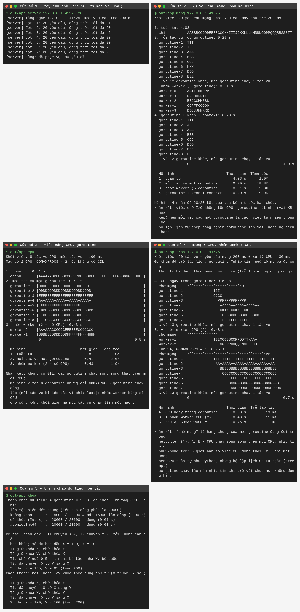

# Bài mở rộng MR5.2 – So sánh các mô hình đồng thời: tuần tự, goroutine, nhóm worker, kênh (Go)

| Thông tin | Nội dung |
|---|---|
| Loại | **Bài mở rộng** – không có trong giáo trình, không có mã giả tương ứng |
| Liên hệ với giáo trình | Chương 5: Bài 5.1 (khung bất đồng bộ), Bài 5.2 (kiểm tra nhiều cổng đồng thời có giới hạn); Chương 6: Bài 6.1 (server đa luồng, nhóm luồng), Bài 6.2 (server bất đồng bộ) |
| Thư viện | Thư viện chuẩn Go: `net`, `context`, `sync` (`WaitGroup`, `Mutex`), `sync/atomic`, `runtime` |
| Bản ngôn ngữ khác | [C#](../../../csharp/Chuong05/BaiMR5.2_MoPhongDongThoi/), [Java](../../../java/Chuong05/BaiMR5.2_MoPhongDongThoi/), [Python](../../../python/Chuong05/BaiMR5.2_MoPhongDongThoi/), [Rust](../../../rust/Chuong05/BaiMR5.2_MoPhongDongThoi/) |

## Mục tiêu
Cùng một khối việc, chạy bằng nhiều mô hình đồng thời, đo thời gian thật và **vẽ biểu đồ Gantt bằng văn bản** cho thấy tác vụ nào chạy trên worker nào, vào lúc nào – đối chiếu với bản Python (luồng, GIL, `asyncio`, nhóm tiến trình).

| Lệnh | Khối việc | Mô hình so sánh |
|---|---|---|
| `mang` | 20 yêu cầu TCP tới máy chủ thử, mỗi yêu cầu trễ 200 ms (chờ I/O) | 1. tuần tự; 2. mỗi tác vụ một goroutine + `WaitGroup`; 3. nhóm worker 5 goroutine đọc việc từ kênh; 4. goroutine + kênh kết quả (fan-out/fan-in) + `context` hạn chót 2 s |
| `cpu` | 8 tác vụ tính toán, mỗi tác vụ ≈ 100 ms | 1. tuần tự; 2. mỗi tác vụ một goroutine; 3. nhóm worker bằng số CPU |
| `tron` | 20 tác vụ = yêu cầu mạng 200 ms + xử lý CPU ≈ 30 ms | A. CPU ngay trong goroutine của tác vụ; B. gửi việc CPU sang nhóm worker (số CPU) qua kênh; C. như A nhưng `GOMAXPROCS = 1` – đo thêm **độ trễ lập lịch** bằng goroutine nhịp tim |
| `khoa` | biến đếm chung, chuyển tiền giữa hai tài khoản | tranh chấp dữ liệu và sửa bằng `sync.Mutex`, `atomic.Int64`; bế tắc và cách tránh bằng thứ tự lấy khóa |

## Kiến thức chính
- **Goroutine là “tác vụ bất đồng bộ” của Go:** rất nhẹ (ngăn xếp khởi đầu vài KB); lời gọi mạng trông như chặn nhưng chỉ chặn goroutine – bộ lập lịch đưa goroutine vào *netpoller* và chạy goroutine khác. Vì vậy Go không cần cú pháp `async/await` riêng: “mỗi yêu cầu một goroutine” đã là mô hình bất đồng bộ.
- **Kênh (channel):** nhóm worker đọc việc từ một kênh (giới hạn đồng thời, như Bài 5.2); fan-out/fan-in gom kết quả qua kênh; `select` với `ctx.Done()` để bỏ chờ khi quá hạn chót.
- **Không có GIL:** goroutine chạy song song thật trên mọi CPU (tối đa `GOMAXPROCS` goroutine cùng lúc, mặc định bằng số CPU). Khối `cpu` nhanh gần gấp số CPU; tạo nhiều goroutine hơn số CPU không nhanh hơn nữa, mỗi tác vụ chỉ bị kéo dài vì chia lượt.
- **Bộ lập lịch tự ngắt (preemption, từ Go 1.14):** ngay cả với `GOMAXPROCS = 1`, goroutine chạy vòng lặp CPU dài vẫn bị ngắt định kỳ nên goroutine khác (nhịp tim, kết nối khác) không bị “đứng” – khác với `asyncio` của Python, nơi một coroutine không nhường thì cả vòng lặp đứng.
- **Tranh chấp dữ liệu:** “đọc – nhường CPU – ghi” không bảo vệ làm mất cập nhật; sửa bằng `Mutex` hoặc thao tác nguyên tử `atomic.Int64.Add`. Công cụ `go run -race .` phát hiện lỗi này lúc chạy.
- **Bế tắc:** hai goroutine lấy hai khóa theo thứ tự ngược nhau thì chờ nhau mãi. Bài làm khóa bằng kênh có bộ đệm 1 để chờ có hạn bằng `select` + `time.After`; cách tránh là lấy khóa theo cùng một thứ tự. Runtime Go chỉ tự báo `all goroutines are asleep - deadlock!` khi **mọi** goroutine cùng bị chặn, không phát hiện được bế tắc cục bộ như ở đây.

## Cấu trúc tệp
- `main.go` – chọn vai trò: `server`, `mang`, `cpu`, `tron`, `khoa`.
- `dongthoi.go` – ba khối việc và các mô hình đồng thời.
- `dongho.go` – ghi khoảng thời gian, vẽ biểu đồ Gantt, bảng so sánh.
- `khoa.go` – tranh chấp dữ liệu, `Mutex`, `atomic`; bế tắc và thứ tự lấy khóa.
- `server.go` – máy chủ thử: mỗi kết nối một goroutine, trả lời sau độ trễ giả lập, báo số kết nối đồng thời lớn nhất của mỗi “đợt”.
- `demo.json` – kịch bản chạy minh họa (dùng với `tools/demo.py`).
- `ket_qua.txt`, `ket_qua.png` – kết quả thực thi thật.

## Cách chạy
Trong thư mục bài (Windows: `go build -o out\app.exe .` rồi chạy `out\app.exe ...`):
```bash
go build -o out/app .                    # hoặc thay out/app bằng go run .
out/app server 127.0.0.1 9000 200        # cửa sổ 1: máy chủ thử, trễ 200 ms
out/app mang 127.0.0.1 9000              # cửa sổ 2
out/app cpu
out/app tron 127.0.0.1 9000
out/app khoa
go run -race . khoa                      # bộ phát hiện tranh chấp báo WARNING: DATA RACE
```
Tái lập kết quả từ thư mục gốc của kho: `python3 tools/demo.py go/Chuong05/BaiMR5.2_MoPhongDongThoi`.

## Kết quả thực thi


Cách đọc biểu đồ: mỗi hàng là một worker; mỗi cột là 1/48 trục thời gian chung của cả khối việc; chữ cái là tác vụ đang chạy (A = tác vụ 1), `*` là nhiều tác vụ cùng lúc trên một hàng (ở khối `tron`, hàng “chờ mạng” gom mọi goroutine đang đợi trong netpoller). Lần chạy trong ảnh (Linux, 2 CPU):
- **mang:** tuần tự 4,03 s; mỗi tác vụ một goroutine 0,20 s; nhóm 5 worker 0,81 s (4 đợt); goroutine + kênh + context 0,20 s, nhận đủ 20/20 kết quả trước hạn chót. Thứ tự goroutine bắt đầu chạy không theo thứ tự tạo (hàng `goroutine-1` chạy tác vụ T) – bộ lập lịch không hứa hẹn thứ tự. Cửa sổ máy chủ: đồng thời lớn nhất mỗi đợt 1, 20, 5, 20.
- **cpu:** tuần tự 0,81 s; 8 goroutine 0,41 s (2,0 lần); nhóm 2 worker 0,43 s – tăng tốc theo số CPU, khác hẳn nhóm luồng Python (bị GIL giới hạn).
- **tron:** A 0,50 s, nhịp tim trễ tối đa 13 ms; B 0,48 s, 11 ms; C (`GOMAXPROCS = 1`) 0,75 s – CPU tuần tự như Python – nhưng nhịp tim vẫn chỉ trễ 11 ms nhờ bộ lập lịch tự ngắt (so với 651 ms của `asyncio` khi chạy CPU trong vòng lặp ở bản Python).
- **khoa:** không khóa còn 5000/20000; `Mutex` và `atomic.Int64` đều đúng 20000. Bế tắc: T1 chờ quá 0,5 s thì nhả khóa nên T2 làm xong; lấy khóa theo thứ tự X trước Y thì cả hai giao dịch đều xong.

Thời gian đo thay đổi chút ít giữa các lần chạy và giữa các máy; quan hệ giữa các mô hình thì ổn định.

## Ghi chú
- Việc CPU là vòng lặp bộ sinh đồng dư tuyến tính giống bản Python; số vòng lặp được hiệu chỉnh lúc chạy để mỗi tác vụ ≈ 100 ms (hoặc 30 ms). Kết quả được cộng vào biến `sink` để trình biên dịch không loại bỏ vòng lặp.
- Số đồng thời lớn nhất ở máy chủ có thể nhỉnh hơn kích thước nhóm worker một chút: client đã mở kết nối mới trong khi goroutine phía máy chủ của kết nối cũ chưa kịp đóng.
- `runtime.GOMAXPROCS(1)` chỉ dùng để minh họa; chương trình thật để mặc định.
- Kiểm thử: Linux, Go 1.24.7, máy 2 CPU; `go vet` sạch; `go run -race . khoa` báo đúng tranh chấp ở mô hình không khóa.

## Bài tập gợi ý
1. Đổi số worker ở khối `mang` thành 2, 10, 20; dự đoán trước thời gian (≈ ⌈20 / n⌉ × 0,2 s) rồi đo lại.
2. Tăng số yêu cầu lên 10 000 với mô hình 4 và thêm semaphore (kênh có bộ đệm 100) để không mở quá nhiều socket một lúc; đo bộ nhớ bằng `runtime.ReadMemStats` và so sánh với số luồng hệ điều hành mà bản Python cần.
3. Giảm hạn chót của mô hình 4 xuống 100 ms: chương trình nhận được bao nhiêu kết quả, các goroutine còn lại kết thúc thế nào (gợi ý: `DialContext` và `SetDeadline` theo `ctx`)?
4. Viết lại tranh chấp theo kiểu “chia sẻ bằng giao tiếp”: một goroutine duy nhất giữ biến đếm, các goroutine khác gửi “+1” qua kênh – không cần khóa.
5. (Nâng cao) Chạy `go run -race . cpu` và `go run -race . tron`: bộ phát hiện có báo gì không? Vì sao các biến `sink`, `lag` được bảo vệ hoặc đồng bộ qua kênh như trong mã?

## Đọc thêm
- Tài liệu Go: [*Effective Go* – Concurrency](https://go.dev/doc/effective_go#concurrency), [*The Go Memory Model*](https://go.dev/ref/mem), [*Data Race Detector*](https://go.dev/doc/articles/race_detector), [gói `context`](https://pkg.go.dev/context).
- Ghi chú phát hành [Go 1.14](https://go.dev/doc/go1.14#runtime) – goroutine được ngắt bất đồng bộ (asynchronous preemption).
- Matt Butcher, Matt Farina, *Go in Practice*, Manning, 2016, Chương 3 (Techniques 10–15: goroutine, `WaitGroup`, khóa, kênh).
- Claus Töpke, *Network Programming and Automation Essentials*, Packt, 2023, Chương 8 *Scaling Your Code*.

Mã nguồn của bài được viết mới cho kho này; các tài liệu trên chỉ là nguồn tham khảo kiến thức.
