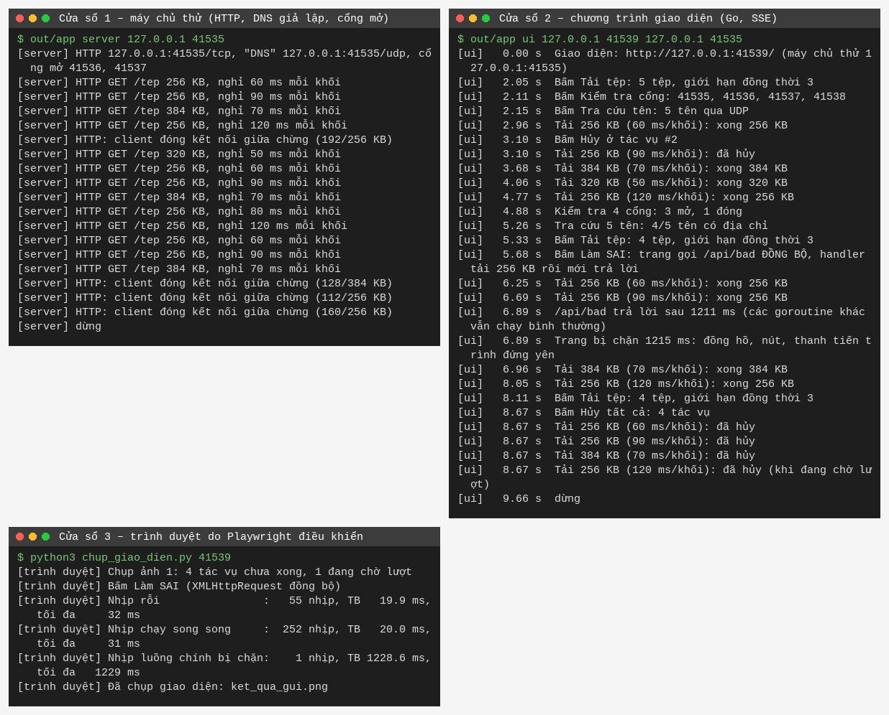
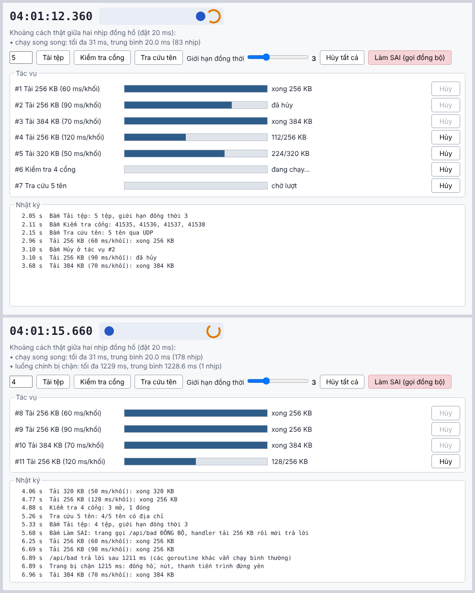

# Bài mở rộng MR5.3 – Giao diện luôn phản hồi khi nhiều tác vụ mạng chạy song song (Go, giao diện web cục bộ)

| Thông tin | Nội dung |
|---|---|
| Loại | **Bài mở rộng** – không có trong giáo trình, không có mã giả tương ứng |
| Liên hệ với giáo trình | Chương 5: Bài 5.3 (giao diện bất đồng bộ), Bài 5.5 (tải tệp có tiến trình và hủy), Bài 5.2 (giới hạn đồng thời); Bài 1.2 (kiểm tra cổng), Bài 4.3 (tra cứu tên qua UDP), Bài 7.4 (SSE); MR5.2 (các mô hình đồng thời) |
| Thư viện | Thư viện chuẩn Go: `net/http` (mẫu định tuyến Go 1.22), `context`, `sync`, `embed`, `encoding/json`; Playwright + Pillow (Python) chỉ dùng cho kịch bản minh họa |
| Bản ngôn ngữ khác | [Python](../../../python/Chuong05/BaiMR5.3_GiaoDienDaTacVu/) (Tkinter) |

## Mục tiêu
Go không có thư viện giao diện đồ họa trong thư viện chuẩn, nên giao diện là **một trang web cục bộ** do chính chương trình Go phục vụ (giống Bài 5.3 bản Go). Trang chạy nhiều tác vụ mạng cùng lúc – tải tệp HTTP từ máy chủ thử với độ trễ khác nhau, kiểm tra cổng TCP, tra cứu tên qua máy chủ “DNS” giả lập trên UDP – với thanh tiến trình và nút Hủy cho từng tác vụ, nút Hủy tất cả và thanh trượt giới hạn đồng thời; đồng hồ (mili giây) và hoạt hình **không bao giờ đứng**. Nút **“Làm SAI”** gọi một API chậm bằng `XMLHttpRequest` **đồng bộ**: luồng chính của trình duyệt bị chặn suốt thời gian chờ – tương đương “chờ mạng trên luồng giao diện” ở bản Tkinter. Trang tự đo **khoảng cách thật giữa hai nhịp đồng hồ** (đặt 20 ms).

## Kiến thức chính
- **Phía server Go:** mỗi tác vụ là một goroutine có `context.WithCancel`; bấm Hủy gọi `cancel()`, mọi lời gọi mạng đang chờ (`http.NewRequestWithContext`, `DialContext`, UDP với `context.AfterFunc` đặt hạn chót) trả về ngay.
- **Giới hạn đồng thời công bằng (FIFO):** tác vụ lấy “vé” theo thứ tự bấm nút (`limiter.enter`); kênh vé được đóng khi tới lượt; đổi giới hạn bằng thanh trượt thì cấp thêm lượt ngay; tác vụ bị hủy khi còn chờ thì rời hàng đợi mà không mở kết nối.
- **Đẩy tiến trình bằng Server-Sent Events** (`/api/events`, `text/event-stream`, như Bài 7.4): trạm phát (hub) gửi sự kiện tới mọi trình duyệt đang mở; gửi không chặn (kênh có bộ đệm) để goroutine tác vụ không bao giờ phải chờ trình duyệt chậm.
- **Phía trình duyệt:** luồng chính của JavaScript là “luồng giao diện”; nút bấm chỉ gọi `fetch()` bất đồng bộ, cập nhật đến qua `EventSource`. `XMLHttpRequest` đồng bộ (đã bị khuyến cáo không dùng) chặn cả trang – cách sai để đối chứng.
- **Handler chặn ≠ server chặn:** `/api/bad` làm việc 1,2 s ngay trong handler, nhưng `net/http` chạy mỗi request trên một goroutine riêng nên các tác vụ khác và luồng SSE vẫn chạy bình thường – chỉ trang đang chờ đồng bộ là đứng.

## Cấu trúc tệp
- `main.go` – chọn vai trò: `server` (máy chủ thử), `ui` (chương trình giao diện).
- `ui.go` – quản lý tác vụ (goroutine + context), trạm phát SSE, các API `/api/start`, `/api/cancel`, `/api/cancel_all`, `/api/limit`, `/api/log`, `/api/bad`.
- `tacvu.go` – bộ giới hạn FIFO; tải tệp HTTP có tiến trình, kiểm tra cổng, tra cứu tên qua UDP – tất cả nhận `context`.
- `giaodien.html` – trang giao diện (HTML + JavaScript thuần, nhúng vào tệp chạy bằng `//go:embed`): đồng hồ, hoạt hình, thống kê nhịp, danh sách tác vụ, nhật ký.
- `server.go` – máy chủ thử cục bộ: HTTP `GET /tep?kb=..&tre=..`, “DNS” giả lập trên UDP, hai cổng TCP mở.
- `chup_giao_dien.py` – kịch bản Playwright điều khiển trình duyệt, chụp ảnh và in thống kê nhịp (chỉ cho minh họa).
- `demo.json` – kịch bản chạy minh họa (dùng với `tools/demo.py`).
- `ket_qua.txt`, `ket_qua.png` – nhật ký thật của máy chủ, chương trình giao diện, trình duyệt; `ket_qua_gui.png` – hai ảnh chụp trang thật.

## Cách chạy
Trong thư mục bài (Windows: `go build -o out\app.exe .` rồi chạy `out\app.exe ...`):
```bash
go build -o out/app .                          # hoặc thay out/app bằng go run .
out/app server 127.0.0.1 9000                  # cửa sổ 1: máy chủ thử (cổng 9000–9002; 9003 để trống)
out/app ui 127.0.0.1 8080 127.0.0.1 9000       # cửa sổ 2: chương trình giao diện
```
Mở trình duyệt tại `http://127.0.0.1:8080/` rồi bấm **Tải tệp**, **Kiểm tra cổng**, **Tra cứu tên**, **Hủy**, kéo thanh trượt; cuối cùng bấm **Làm SAI** và quan sát đồng hồ, quả bóng đứng khoảng 1,2 s trong khi cửa sổ dòng lệnh của chương trình Go vẫn ghi nhận các tác vụ khác hoàn thành.

Tái lập kết quả từ thư mục gốc của kho: `python3 tools/demo.py go/Chuong05/BaiMR5.3_GiaoDienDaTacVu` (bước trình duyệt cần `pip install playwright pillow && playwright install chromium`).

## Kết quả thực thi




Kịch bản (giới hạn đồng thời 3): bấm Tải 5 tệp, Kiểm tra cổng, Tra cứu tên – 7 tác vụ, vào chạy đúng thứ tự bấm; bấm Hủy tác vụ #2 khi đang tải (`đã hủy`). **Ảnh trên:** 4 tác vụ chưa xong, các thanh tiến trình đang chạy, tác vụ #7 “chờ lượt”. Kiểm tra cổng: 3 mở, 1 đóng; tra cứu tên: 4/5 tên có địa chỉ. Sau đó bấm Tải 4 tệp rồi **Làm SAI**: `/api/bad` trả lời sau 1211 ms, trang bị chặn 1215 ms; trong lúc đó server vẫn ghi nhận hai tệp #8, #9 tải xong (5,68 s → 6,25 s, 6,69 s). **Ảnh dưới** chụp ngay sau đó: khoảng cách lớn nhất giữa hai nhịp khi chạy song song chỉ 31 ms, còn khi luồng chính bị chặn là 1229 ms. Cuối cùng bấm Tải 4 tệp rồi **Hủy tất cả**: 3 tác vụ đang tải dừng ngay, tác vụ đang chờ lượt bị hủy mà không mở kết nối (máy chủ thử ghi tổng cộng 4 lần “client đóng kết nối giữa chừng”: #2 và 3 tệp này).

Thống kê do trang đo (in ở cửa sổ trình duyệt): rỗi 55 nhịp, tối đa 32 ms; chạy song song 252 nhịp, trung bình 20,0 ms, tối đa 31 ms; luồng chính bị chặn: một “nhịp” dài 1229 ms.

## Ghi chú
- Trình duyệt ghi cảnh báo *Synchronous XMLHttpRequest on the main thread is deprecated* – đúng là lý do nó được dùng làm ví dụ sai.
- Hub bỏ sự kiện khi bộ đệm 1024 sự kiện của một trình duyệt đầy (trình duyệt quá chậm hoặc đang đứng) thay vì chặn goroutine tác vụ; ứng dụng thật nên gửi kèm trạng thái đầy đủ định kỳ để trang tự đồng bộ lại.
- Thời gian chụp ảnh trong kịch bản minh họa không được tính vào thống kê nhịp (trang có hàm `demo.pause`).
- Chương trình giao diện chỉ nên lắng nghe trên `127.0.0.1`: API không có xác thực.
- Kiểm thử: Linux, Go 1.24.7; `go vet` sạch; trình duyệt Chromium không màn hình qua Playwright.

## Bài tập gợi ý
1. Mở hai thẻ trình duyệt cùng lúc: cả hai có thấy cùng tiến trình không? Vì sao (trạm phát SSE gửi tới mọi người đăng ký)? Tác vụ tạo ở thẻ mới có hiện ở thẻ cũ không?
2. Thêm cột tốc độ (KB/s) và thời gian còn lại, tính ở goroutine tác vụ và gửi kèm sự kiện `progress`.
3. Thay nút “Làm SAI” bằng một vòng lặp JavaScript tính toán 1 s trên luồng chính; rồi chuyển phép tính đó vào một Web Worker. So sánh thống kê nhịp.
4. Khi trình duyệt mất kết nối SSE rồi kết nối lại (`EventSource` tự kết nối lại), trang mất các sự kiện ở giữa. Thêm `/api/state` trả trạng thái toàn bộ tác vụ, gọi khi `es.onopen`.
5. (Nâng cao) Thêm hạn chót cho từng tác vụ bằng `context.WithTimeout` (Bài 5.6) và hiển thị “quá hạn” khác với “đã hủy” (`errors.Is(err, context.DeadlineExceeded)`).

## Đọc thêm
- Tài liệu Go: [gói `context`](https://pkg.go.dev/context) (`WithCancel`, `AfterFunc`), [gói `net/http`](https://pkg.go.dev/net/http) (`ServeMux` với mẫu phương thức từ Go 1.22, `Flusher`), [gói `embed`](https://pkg.go.dev/embed).
- WHATWG HTML Living Standard, mục [*Server-sent events*](https://html.spec.whatwg.org/multipage/server-sent-events.html).
- WHATWG *XMLHttpRequest Living Standard*, phương thức `open()` – ghi chú về yêu cầu đồng bộ trên luồng chính.
- Matt Butcher, Matt Farina, *Go in Practice*, Manning, 2016, Chương 3 (goroutine, kênh).

Mã nguồn của bài được viết mới cho kho này; các tài liệu trên chỉ là nguồn tham khảo kiến thức.
