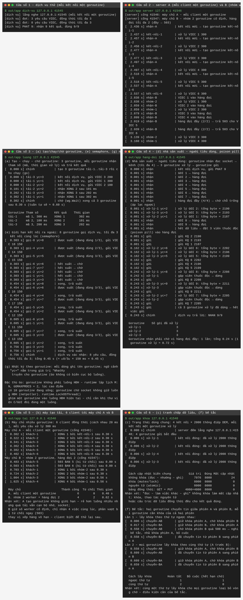

# Bài mở rộng MR5.4 – Luồng (thread) và đa luồng trong chương trình mạng (Go: goroutine)

| Thông tin | Nội dung |
|---|---|
| Loại | **Bài mở rộng** – không có trong giáo trình, không có mã giả tương ứng |
| Liên hệ với giáo trình | Chương 5 (Bài 5.1–5.6); Chương 6 (Bài 6.1 server đa luồng, nhóm luồng; Bài 6.2) |
| Thư viện | Thư viện chuẩn: `net`, `bufio`, `sync` (`WaitGroup`, `Mutex`, `Map`), `sync/atomic`, `runtime` |
| Bản ngôn ngữ khác | [C#](../../../csharp/Chuong05/BaiMR5.4_LuongVaDaLuong/), [Java](../../../java/Chuong05/BaiMR5.4_LuongVaDaLuong/), [Python](../../../python/Chuong05/BaiMR5.4_LuongVaDaLuong/), [Rust](../../../rust/Chuong05/BaiMR5.4_LuongVaDaLuong/) |

## Mục tiêu
Cùng kịch bản, cùng giao thức và cùng thông điệp với bản Python: đi từng bước vào đơn vị chạy đồng thời của Go – **goroutine** – trong một chương trình mạng:

| Vai trò | Phần | Nội dung |
|---|---|---|
| `luong` | (a) | Tạo 3 goroutine (`go f(...)`), truyền tham số qua đối số hàm, chờ bằng `sync.WaitGroup`, lấy kết quả qua ô riêng của một slice |
| `server` + `tai` | (b) | Server A: **mỗi client một goroutine**; server B: **2 worker cố định đọc từ kênh có bộ đệm 2**, `select … default` khi kênh đầy → `503 BAN` |
| `khoa` | (c) | 4 kết nối × 2000 `DEM`: bộ đếm không khóa (mất cập nhật), `sync.Mutex`, `atomic.Int64`, `sync.Map` |
| `hang-doi` | (d) | Nhà sản xuất – người tiêu dùng: goroutine nhận → kênh (bộ đệm 4) → 3 goroutine xử lý → goroutine gửi; viên thuốc độc |
| `luong` | (e) | **Semaphore = kênh có bộ đệm 3**: gửi vào là lấy suất, nhận ra là trả suất |
| `khoa` | (f) | Bế tắc hai khóa ngược thứ tự; khóa làm bằng kênh để **chờ có hạn** bằng `select` + `time.After` |
| mọi vai trò | (g) | Nhật ký có tên goroutine và ngữ cảnh `yc=` – truyền tường minh qua `*NhatKy` (Go không có thread-local) |

Bài khác [MR5.2](../BaiMR5.2_MoPhongDongThoi/): MR5.2 so sánh các mô hình trên một khối việc; MR5.4 dạy các mẫu dùng goroutine trong server/client mạng.

## Liên hệ giáo trình
- **Chương 5 (Bài 5.1–5.6):** goroutine + `net` của Go là cách Go làm bất đồng bộ “ẩn” – mã viết tuần tự, runtime chờ socket bằng netpoller. Giới hạn đồng thời (Bài 5.2) xuất hiện lại ở (e).
- **Chương 6 (Bài 6.1, 6.2):** phần (b) đặt hai kiến trúc server cạnh nhau; [MR5.5](../BaiMR5.5_PhoiHopDaLuongBatDongBo/) phối hợp vòng lặp sự kiện với nhóm worker.

## Kiến thức chính
- **Goroutine không phải luồng hệ điều hành.** Runtime Go lập lịch **M:N**: nhiều goroutine (G) chạy trên vài luồng HĐH (M), mỗi luồng cần một “bộ xử lý logic” P; số P = `GOMAXPROCS` (mặc định = số CPU). Goroutine khởi đầu với stack vài KB, tạo hàng chục nghìn cái là bình thường. Khi goroutine chờ socket, runtime cất nó vào **netpoller** (epoll/kqueue/IOCP) và dùng luồng HĐH cho goroutine khác; khi gọi hệ thống chặn thật, runtime tách P sang luồng khác.
- `runtime.LockOSThread()` **ghim** goroutine hiện tại vào luồng HĐH đang chạy nó – chỉ cần khi thư viện C, OpenGL/GUI hoặc lời gọi hệ thống đòi đúng một luồng (bài MR5.5 dùng cho “luồng cảm biến”).
- **Chờ và lấy kết quả:** Go không có `join`; dùng `sync.WaitGroup` (`Add`, `Done`, `Wait`) hoặc kênh kết quả. Goroutine không có tên – nhãn `tải-1`, `nhóm-1` trong nhật ký là giá trị truyền vào.
- **Kênh có bộ đệm = hàng đợi có giới hạn**; `select { case ch <- v: … default: … }` là “thử gửi không chờ” (giống `put_nowait`), dùng để trả `503` hoặc phát hiện hàng đợi đầy (áp lực ngược). Cách dừng thường dùng nhất là `close(ch)` – mọi goroutine `range ch` thoát khi kênh rỗng; bài giữ viên thuốc độc (`goi{k: 0}`) để giống các bản khác.
- **Tranh chấp dữ liệu:** biến `int64` thường bị nhiều goroutine “đọc – `runtime.Gosched()` – ghi” là **data race** thật (Go Memory Model coi là lỗi); `go run -race .` phát hiện được (cần cgo). Sửa bằng `sync.Mutex`, `atomic.Int64.Add`, hoặc `sync.Map` với giá trị `*atomic.Int64`.
- `sync.Mutex` không có chờ có hạn (`TryLock` chỉ thử một lần) → khóa dựng bằng **kênh có bộ đệm 1**: gửi = lấy khóa, nhận = nhả khóa, `select` với `time.After(500ms)` để phát hiện bế tắc. Sửa bằng thứ tự lấy khóa cố định.
- Go **không có biến cục bộ luồng**: goroutine có thể chuyển giữa các luồng HĐH; ngữ cảnh được truyền tường minh (ở đây `*NhatKy`; chương trình lớn dùng `context.Context`, `log/slog`).

**Khác biệt so với bản Python:** từ “luồng” trong một số thông điệp được thay bằng “goroutine”/“worker”; hàm `join` → `wg.Wait`; không có GIL nên lỗi tranh chấp ở (c) hiếm lộ hơn (runtime ít chuyển goroutine đúng giữa đọc và ghi), nhưng vẫn là lỗi và `-race` bắt được; dòng “Đặc thù Go” in `GOMAXPROCS` và số goroutine lúc cao điểm.

## Tệp
- `main.go` – phân nhánh vai trò; (a), (e), (g); ghi chú M:N và `LockOSThread`.
- `nhatky.go` – `NhatKy` (tên + ngữ cảnh), `say`.
- `dichvu.go` – dịch vụ thử `VIEC`, `PHAT`, `THONGKE`.
- `maychu.go` – (b) server A, B và máy tạo tải.
- `khoa.go` – (c) tranh chấp dữ liệu, (f) bế tắc với khóa kênh.
- `hangdoi.go` – (d) nhà sản xuất – người tiêu dùng.
- `demo.json`; `ket_qua.txt`, `ket_qua.png` – kết quả thực thi thật.

Module chung `go/go.mod`; thư mục bài là một `package main`, sạch `gofmt`/`go vet`.

## Cách chạy
Trong thư mục bài:
```bash
go build -o out/app .                      # Windows: go build -o out\app.exe .
out/app dich-vu  127.0.0.1 9000            # cửa sổ 1
out/app server   127.0.0.1 9001            # cửa sổ 2: A ở 9001, B ở 9002
out/app luong    127.0.0.1 9000
out/app hang-doi 127.0.0.1 9000
out/app tai      127.0.0.1 9001
out/app khoa     127.0.0.1 9003
go run -race . khoa 127.0.0.1 9003         # (tùy chọn) bộ phát hiện tranh chấp, cần cgo
```
Tái lập: `python3 tools/demo.py go/Chuong05/BaiMR5.4_LuongVaDaLuong` (cổng 41545–41548).

## Kết quả


Lần chạy trong ảnh (Linux, 2 CPU, Go 1.24.7):
- **(a)** ba goroutine xong sau 0,30 s (tuần tự ≈ 0,60 s).
- **(b)** A: 6/6 trong 0,40 s; B: VIEC 1, 2 chạy ngay trên `nhóm-2`, `nhóm-1`, VIEC 3, 4 vào kênh, VIEC 5, 6 nhận `503` sau 0,00 s; tổng 0,62 s.
- **(c)** không khóa còn 7976/8000 (mất 24); Mutex, atomic, `sync.Map` đúng 8000.
- **(d)** 9 gói, mỗi worker 3 gói, 0,24 s (≈ 0,72 s nếu một goroutine); goroutine nhận chờ 1 lần; `NHAN 9/9`.
- **(e)** đồng thời tối đa 3, 0,45 s; lúc cao điểm có 10 goroutine sống, `GOMAXPROCS = 2`.
- **(f)** ngược thứ tự: 1 hoàn tất, 1 bỏ cuộc sau 500 ms; cùng thứ tự: 2 hoàn tất.

## Bài tập gợi ý
1. Chạy `go run -race . khoa 127.0.0.1 9003` và đọc báo cáo: hai goroutine nào, dòng nào ghi/đọc `khongKhoa`?
2. Thay viên thuốc độc ở (d) bằng `close(viec)` + `for g := range viec`; luồng gửi biết khi nào dừng? (gợi ý: `WaitGroup` của các worker rồi `close(ketQua)`).
3. Viết semaphore ở (e) bằng `golang.org/x/sync/semaphore` hoặc `sync.Cond`; so sánh với kênh có bộ đệm.
4. Ở (b), thêm `context.WithTimeout` cho mỗi việc của nhóm B: việc chờ trong kênh quá 200 ms thì bỏ và trả `503`.
5. Đặt `GOMAXPROCS=1` (biến môi trường) rồi chạy lại `khoa`: số mất cập nhật thay đổi thế nào? Vì sao?

## Đọc thêm
- [Effective Go – Concurrency](https://go.dev/doc/effective_go#concurrency); [The Go Memory Model](https://go.dev/ref/mem); [Data Race Detector](https://go.dev/doc/articles/race_detector).
- Tài liệu gói: [`sync`](https://pkg.go.dev/sync), [`sync/atomic`](https://pkg.go.dev/sync/atomic), [`runtime` (GOMAXPROCS, LockOSThread)](https://pkg.go.dev/runtime).
- Go Blog: [*Go Concurrency Patterns: Pipelines and cancellation*](https://go.dev/blog/pipelines).

Mã nguồn của bài được viết mới cho kho này; các tài liệu trên chỉ là nguồn tham khảo kiến thức.
