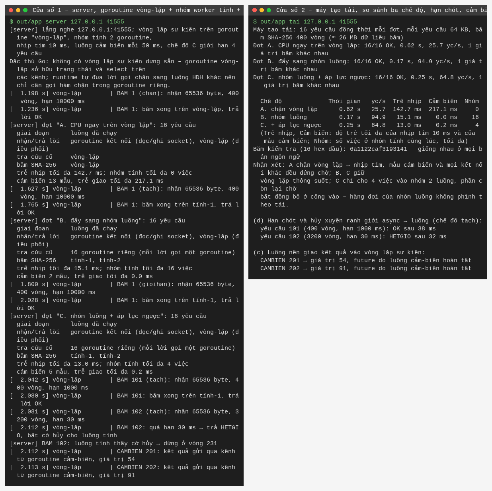

# Bài mở rộng MR5.5 – Phối hợp đa luồng và bất đồng bộ trong server mạng (Go)

| Thông tin | Nội dung |
|---|---|
| Loại | **Bài mở rộng** – không có trong giáo trình, không có mã giả tương ứng |
| Liên hệ với giáo trình | Chương 5 (Bài 5.1–5.6); Chương 6 (Bài 6.1, 6.2); MR5.4 |
| Thư viện | Thư viện chuẩn: `net`, `context` (`WithTimeout`, `AfterFunc`), `time.Ticker`, `select`, `runtime.LockOSThread`, `crypto/sha256` |
| Bản ngôn ngữ khác | [Python](../../../python/Chuong05/BaiMR5.5_PhoiHopDaLuongBatDongBo/) (bản tham chiếu), [C#](../../../csharp/Chuong05/BaiMR5.5_PhoiHopDaLuongBatDongBo/), [Java](../../../java/Chuong05/BaiMR5.5_PhoiHopDaLuongBatDongBo/), [Rust](../../../rust/Chuong05/BaiMR5.5_PhoiHopDaLuongBatDongBo/) |

## Mục tiêu
Cùng kịch bản, giao thức và thông điệp với bản Python: một “vòng lặp sự kiện” nhận yêu cầu `BAM` (64 KB), gọi **hàm thư viện cũ kiểu chặn** (20 ms) rồi **băm SHA-256** 400 vòng; so sánh ba chế độ A (làm ngay trên vòng lặp – SAI), B (đẩy sang nhóm worker), C (B + áp lực ngược), đo **nhịp tim 10 ms**, cộng thêm hạn chót/hủy và một luồng nền giao kết quả vào vòng lặp.

Go **không có vòng lặp sự kiện dựng sẵn và không cần**: mỗi kết nối một goroutine, runtime tự chờ socket bằng netpoller và tự đưa lời gọi chặn sang luồng HĐH khác. Để so sánh được với asyncio/tokio, bài dựng kiểu **actor**: một goroutine `vòng-lặp` sở hữu toàn bộ trạng thái (không cần khóa) và `select` trên các kênh – yêu cầu đã đọc xong từ goroutine kết nối, sự kiện “tra cứu xong”, “băm xong”, “hết hạn”, mẫu cảm biến, và `time.Ticker` 10 ms.

| Phần | Cách làm trong Go |
|---|---|
| (a) việc CPU | 2 goroutine worker `tính-1`, `tính-2` nhận việc từ kênh `viecTinh`, báo kết quả về kênh sự kiện |
| (b) hàm chặn | gọi trong **goroutine riêng** cho mỗi lời gọi (`go func(){ traCuuCu(); chSuKien <- … }()`) |
| (c) luồng nền → vòng lặp | goroutine `cảm-biến` gọi `runtime.LockOSThread()` để là một luồng HĐH thật, gửi mẫu vào kênh `chMau`; trả lời `CAMBIEN` qua kênh sự kiện |
| (d) hủy, hạn chót | `context.WithTimeout`; `context.AfterFunc` báo “hết hạn” cho vòng lặp; worker kiểm tra `select { case <-ctx.Done(): … default: }` mỗi vòng |
| (e) áp lực ngược | vòng lặp đếm số yêu cầu đang “ở trong” (≤ 4), phần còn lại xếp vào hàng chờ ở cổng vào |
| (f) cách làm SAI | chế độ `chan`: goroutine vòng lặp tự gọi hàm chặn và tự băm |

## Liên hệ giáo trình
- **Chương 5 (Bài 5.1–5.6):** hủy hợp tác và hạn chót (Bài 5.6) – ở Go là `context`; nguyên tắc “đừng chặn vòng lặp” (Bài 5.3).
- **Chương 6 (Bài 6.1, 6.2):** server nhóm worker + phần điều phối bất đồng bộ; nối tiếp [MR5.4](../BaiMR5.4_LuongVaDaLuong/) và [MR5.2](../BaiMR5.2_MoPhongDongThoi/).

## Kiến thức chính
- **Goroutine sở hữu trạng thái + `select`** là cách Go làm “vòng lặp sự kiện”: chỉ một goroutine chạm vào trạng thái, mọi goroutine khác giao tiếp bằng kênh (“Don't communicate by sharing memory; share memory by communicating”). Nếu goroutine đó tự làm việc nặng, mọi kênh khác phải chờ – giống chặn vòng lặp asyncio.
- **Khác asyncio ở mức độ:** `select` chọn **ngẫu nhiên** giữa các kênh đang sẵn sàng, nên nhịp tim chen được vào giữa các yêu cầu; ở chế độ A trễ nhịp tối đa ≈ 3–4 yêu cầu liền nhau (≈ 140 ms) chứ không phải cả 16 yêu cầu như asyncio (≈ 600 ms) – nhưng vẫn gấp hàng chục lần chế độ B, C. `time.Ticker` bỏ nhịp khi không ai nhận kịp.
- **Hàm chặn trong Go** chỉ cần chạy trong goroutine riêng: khi goroutine vào lời gọi hệ thống chặn, runtime tách P sang luồng HĐH khác nên các goroutine còn lại vẫn chạy. Không cần “nhóm luồng chặn” như Python/C#/Rust.
- **`context`** mang hạn chót và tín hiệu hủy xuyên qua mọi goroutine; worker phải *tự kiểm tra* `ctx.Done()` – Go cũng không “giết” được goroutine. `context.AfterFunc(ctx, f)` chạy `f` trên goroutine khác khi ctx kết thúc.
- `runtime.LockOSThread()` ghim goroutine vào một luồng HĐH – dùng khi cần đúng nghĩa “một luồng HĐH chạy nền” (thư viện C, thiết bị, GUI).

**Khác biệt so với bản Python:** vòng lặp là goroutine + `select` thay cho asyncio; tra cứu cũ chạy trong 16 goroutine riêng (bảng giai đoạn in “16 goroutine riêng”) thay cho 8 luồng `chặn-k`; socket được đọc/ghi trong goroutine kết nối, vòng lặp chỉ điều phối; thông điệp `CAMBIEN` ghi “kết quả gửi qua kênh” thay cho “future”. Suất ở cổng vào (C) được trả khi luồng tính xong, bản Python trả khi trả lời.

## Tệp
- `main.go` – phân nhánh vai trò `server`, `tai`.
- `chung.go` – hằng số, `bam()` (SHA-256, kiểm tra `ctx` mỗi vòng), `traCuuCu()`, nhật ký.
- `maychu.go` – goroutine vòng lặp, worker tính, luồng cảm biến, xử lý `BAM`/`CAMBIEN`/`THONGKE`.
- `tai.go` – máy tạo tải: 16 goroutine mỗi đợt, bảng so sánh, hạn chót, `CAMBIEN`.
- `demo.json`; `ket_qua.txt`, `ket_qua.png` – kết quả thực thi thật.

## Cách chạy
```bash
go build -o out/app .
out/app server 127.0.0.1 9000     # cửa sổ 1
out/app tai    127.0.0.1 9000     # cửa sổ 2
```
Tái lập: `python3 tools/demo.py go/Chuong05/BaiMR5.5_PhoiHopDaLuongBatDongBo` (cổng 41555). Client Go chạy được với server Python và ngược lại (cùng giao thức, cùng giá trị băm `6a1122caf3193141`).

## Kết quả


Lần chạy trong ảnh (Linux, 2 CPU, Go 1.24.7):

| Chế độ | Thời gian 16 yêu cầu | Trễ nhịp tối đa | Trễ giao mẫu cảm biến | Việc ở nhóm tính tối đa |
|---|---|---|---|---|
| A. chặn vòng lặp | 0,62 s | 143 ms | 217 ms | 0 |
| B. đẩy sang nhóm worker | 0,17 s | 15,1 ms | 0,0 ms | 16 |
| C. + áp lực ngược | 0,25 s | 13,0 ms | 0,2 ms | 4 |

- **(d)** yêu cầu 102 (3200 vòng, hạn 30 ms) nhận `HETGIO` sau 32 ms; worker dừng ở vòng 231.
- Ở B, C trễ nhịp ≈ 13–15 ms vì hai worker băm chiếm cả 2 CPU (`GOMAXPROCS = 2`), goroutine vòng lặp phải chờ tới lượt lập lịch – vẫn rất nhỏ so với A.

## Bài tập gợi ý
1. Bỏ goroutine vòng lặp: cho mỗi goroutine kết nối tự gọi `traCuuCu()` và tự gửi việc vào nhóm worker, thống kê bảo vệ bằng `sync.Mutex`. Mã ngắn hơn bao nhiêu? Đây là cách viết Go “thông thường”.
2. Chạy với `GOMAXPROCS=1`: chế độ B còn giữ được nhịp tim không? (gợi ý: bộ lập lịch Go ngắt goroutine chạy lâu sau ≈ 10 ms).
3. Thêm hạn chờ ở cổng vào cho chế độ C: chờ quá 100 ms thì trả `503`.
4. Thay `context.AfterFunc` bằng `time.AfterFunc` và so sánh: khi yêu cầu xong sớm, cái nào cần gọi `Stop()`/`cancel()` để giải phóng?
5. Cho worker dùng `crypto/sha256` trên nhiều khối song song (mỗi worker một phần dữ liệu) – kết quả còn giống bản Python không? Vì sao?

## Đọc thêm
- [Effective Go – Concurrency](https://go.dev/doc/effective_go#concurrency); [The Go Programming Language Specification – Select statements](https://go.dev/ref/spec#Select_statements).
- Tài liệu gói: [`context`](https://pkg.go.dev/context), [`runtime.LockOSThread`](https://pkg.go.dev/runtime#LockOSThread), [`time.Ticker`](https://pkg.go.dev/time#Ticker), [`crypto/sha256`](https://pkg.go.dev/crypto/sha256).
- Go Blog: [*Go Concurrency Patterns: Context*](https://go.dev/blog/context), [*Pipelines and cancellation*](https://go.dev/blog/pipelines).

Mã nguồn của bài được viết mới cho kho này; các tài liệu trên chỉ là nguồn tham khảo kiến thức.
