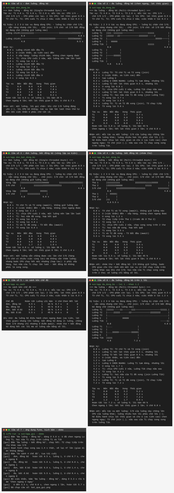
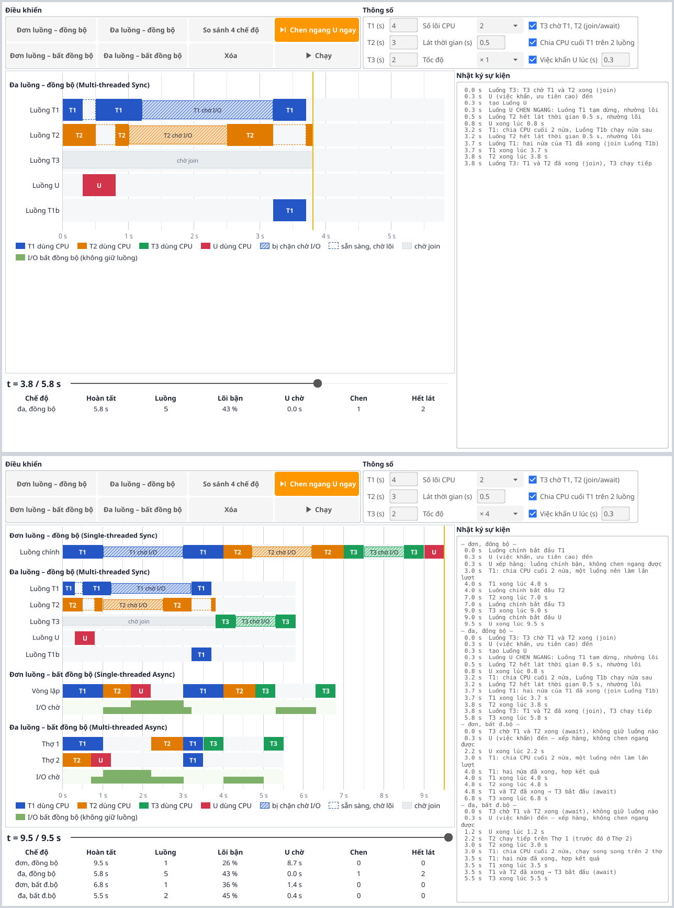

# Bài mở rộng MR5.6 – Mô phỏng thực thi tác vụ: đơn luồng/đa luồng × đồng bộ/bất đồng bộ, chen ngang, phụ thuộc, một việc trên hai luồng (Go)

| Thông tin | Nội dung |
|---|---|
| Loại | **Bài mở rộng** – không có trong giáo trình, không có mã giả tương ứng |
| Liên hệ với giáo trình | Chương 5: Bài 5.1–5.3 (bất đồng bộ, giao diện không treo), Bài 5.2 (giới hạn đồng thời); Chương 6: Bài 6.1, 6.2 (server đa luồng, nhóm luồng, server bất đồng bộ); MR1.2 (mô phỏng bên trong máy chủ), MR5.2, MR5.4, MR5.5 (đo thật cùng các mô hình) |
| Thư viện | Lõi và bản dòng lệnh: chỉ thư viện chuẩn (`flag`, `fmt`, `strings`, `unicode/utf8`, `math`) trong mô-đun gốc `go/`; không tạo goroutine nào – luồng, lõi CPU, lát thời gian, vòng lặp sự kiện đều được mô phỏng trong gói `laplich`. Giao diện: **Fyne v2.6.3** (`fyne.io/fyne/v2`, mô-đun riêng `gui/`, cần cgo/gcc); ảnh ghép bằng `image/png`, dưới Xvfb chụp màn hình bằng ImageMagick (`import`) |
| Bản ngôn ngữ khác | [Python](../../../python/Chuong05/BaiMR5.6_MoPhongThucThiTacVu/), [C#](../../../csharp/Chuong05/BaiMR5.6_MoPhongThucThiTacVu/), [Java](../../../java/Chuong05/BaiMR5.6_MoPhongThucThiTacVu/), [Rust](../../../rust/Chuong05/BaiMR5.6_MoPhongThucThiTacVu/) |

## Mục tiêu
Một ứng dụng giao diện để **nhìn thấy** cùng một khối việc chạy khác nhau thế nào khi tổ chức chương trình theo bốn cách – *đơn luồng/đa luồng × đồng bộ/bất đồng bộ* – theo thời gian, với đủ các hiện tượng mà sinh viên thường chỉ đọc trong sách: chờ I/O chặn luồng, chồng thời gian chờ, tranh lõi CPU, **chia lát thời gian**, **chen ngang** của việc ưu tiên cao, **phụ thuộc** (join/await), **một công việc chạy trên hai luồng** (chia đôi chạy song song; chạy tiếp trên luồng khác sau khi chờ I/O).

Ba tác vụ T1, T2, T3 (thời lượng nhập được, mặc định 4, 3, 2 s), mỗi tác vụ: **CPU 1/4 → chờ I/O 1/2 → CPU phần còn lại**. Tùy chọn: T3 chờ T1 và T2; chia bước CPU cuối của T1 làm hai nửa chạy cùng lúc (khi bước đó dài ≥ 0,2 s); **việc khẩn U** (0,5 s CPU, ưu tiên cao) đến lúc 0,3 s hoặc lúc bấm nút *Chen ngang U ngay*; số lõi CPU (1–4); lát thời gian (mặc định 0,5 s).

| Chế độ | Cách chạy | Điều cần quan sát |
|---|---|---|
| Đơn luồng – đồng bộ | một luồng, lời gọi chặn, làm lần lượt theo thứ tự đến | luồng đứng yên khi chờ I/O; U phải chờ tất cả (8,7 s) |
| Đa luồng – đồng bộ | mỗi tác vụ một luồng hệ điều hành; bộ lập lịch cấp lõi theo ưu tiên rồi thứ tự đến, chia lát thời gian, cho ưu tiên cao chen ngang | U chen ngang Luồng T1 ngay khi đến (chờ 0 s); luồng hết lát thì nhường lõi; T3 chờ join; nửa sau của T1 chạy trên Luồng T1b song song; 5 luồng |
| Đơn luồng – bất đồng bộ | một luồng chạy vòng lặp sự kiện; bước CPU chạy trên vòng lặp tới khi xong; chờ I/O không giữ luồng; hàng việc FIFO | hàng *I/O chờ* có 2 lệnh chờ cùng lúc (T1, T2) mà chỉ một luồng; U xếp hàng sau T2 (chờ 1,4 s); hai nửa của T1 chạy lần lượt – bất đồng bộ không phải là song song |
| Đa luồng – bất đồng bộ | nhóm thợ (số thợ = số lõi), mỗi bước CPU giao cho thợ rảnh đầu tiên | T2 bắt đầu trên Thợ 2, sau I/O **chạy tiếp trên Thợ 1**; hai nửa của T1 chạy song song trên 2 thợ; hoàn tất sớm nhất (5,5 s) với 2 luồng |

## Kiến thức chính
- **Đồng bộ và bất đồng bộ.** Lời gọi đồng bộ (chặn) giữ luồng suốt thời gian chờ I/O; lời gọi bất đồng bộ gửi yêu cầu rồi trả luồng lại, kết quả đến sau như một sự kiện. Vì vậy *đơn luồng – bất đồng bộ* chồng được các lần chờ I/O mà không cần thêm luồng. Trong Go, mã viết theo kiểu chặn (`conn.Read`) nhưng chỉ **goroutine** bị chặn: bộ lập lịch của Go đỗ goroutine đó lên *netpoller* (epoll/kqueue/IOCP) và cho luồng hệ điều hành chạy goroutine khác – chính là mô hình *đa luồng – bất đồng bộ* của bài, ẩn sau cú pháp đồng bộ.
- **Đơn luồng và đa luồng.** Nhiều luồng thì nhiều việc tiến triển cùng lúc; *song song thật* chỉ có khi có nhiều lõi (ở chế độ 1 lõi, các luồng chỉ xen kẽ nhau). Trong Go, `runtime.GOMAXPROCS(n)` đặt số luồng hệ điều hành chạy mã Go cùng lúc (mặc định = số lõi) – tương ứng với *số thợ = số lõi*; `GOMAXPROCS(1)` gần với *đơn luồng – bất đồng bộ*: mọi goroutine xen kẽ trên một luồng, I/O vẫn chồng nhau.
- **Bộ lập lịch hệ điều hành** (mô phỏng): mỗi nhịp 0,1 s, lõi trống được cấp cho luồng sẵn sàng có ưu tiên cao nhất, cùng ưu tiên thì luồng chờ lâu nhất; luồng chạy hết **lát thời gian** mà có luồng cùng hoặc cao hơn ưu tiên đang chờ thì phải nhường (round-robin); luồng **ưu tiên cao** sẵn sàng mà không còn lõi thì **chen ngang** (preemption) luồng ưu tiên thấp đang chạy. Luồng bị chen ngang chuyển sang *sẵn sàng* (ô viền đứt), không mất công đã làm. Go không cho đặt ưu tiên goroutine; từ Go 1.14 bộ lập lịch của Go cũng chen ngang không đồng bộ (asynchronous preemption) goroutine chạy quá ~10 ms.
- **Đa nhiệm hợp tác** (cooperative): vòng lặp sự kiện và nhóm thợ chỉ đổi việc ở điểm `await`/kết thúc bước; một bước CPU dài làm mọi việc khác chờ – nên việc khẩn U không chen ngang được.
- **Phụ thuộc:** T3 chờ T1, T2 bằng `join` (đồng bộ – luồng T3 bị chặn, ô chấm) hoặc `await`/`WhenAll` (bất đồng bộ – không giữ luồng nào, T3 chỉ xuất hiện khi bắt đầu chạy). Trong Go: `sync.WaitGroup` (`wg.Add(2)`, mỗi tác vụ `defer wg.Done()`, T3 `wg.Wait()`), hoặc nhận từ **kênh** (`<-xong1; <-xong2`), hoặc `errgroup.Group.Wait()`; goroutine đang chờ không giữ luồng hệ điều hành nào.
- **Một việc trên hai luồng:** (1) chia đôi phần CPU và chạy hai nửa song song (luồng phụ T1b, hoặc hai thợ) rồi hợp kết quả – chỉ nhanh hơn khi có ≥ 2 lõi; trong Go: `go nuaSau(ch)` + tự làm nửa đầu + `<-ch`; (2) ở nhóm thợ + bất đồng bộ, phần tiếp theo sau lần chờ chạy trên thợ rảnh bất kỳ, không nhất thiết luồng cũ – goroutine của Go cũng vậy: sau mỗi lần bị chặn nó có thể tiếp tục trên một luồng hệ điều hành (M) khác (muốn giữ cố định phải gọi `runtime.LockOSThread`).
- **Tất định:** mô phỏng không dùng luồng thật và không ngẫu nhiên nên cùng tham số cho cùng biểu đồ ở cả năm ngôn ngữ; bấm *Chen ngang U ngay* lúc t chỉ là mô phỏng lại với U đến lúc t – phần trước t không đổi. Hai chi tiết để in trùng từng ký tự với bản Python: `round()` của Python làm tròn nửa về số chẵn (dùng `math.RoundToEven`), và căn lề đếm theo ký tự Unicode (`%-11s` của Go đếm byte nên bài tự viết `Trai`/`Phai` bằng `utf8.RuneCountInString`).

## Cấu trúc tệp
- `laplich/laplich.go` – gói bộ lập lịch mô phỏng (chỉ thư viện chuẩn): `ThamSo`, `Viec`, chế độ đồng bộ (`dongBo`: luồng, hàng sẵn sàng, cấp lõi, lát thời gian, chen ngang, join, luồng phụ) và bất đồng bộ (`batDongBo`: vòng lặp/nhóm thợ, hàng việc FIFO, I/O không giữ luồng, WhenAll), `TinhChiSo`, biểu đồ Gantt văn bản, `Giay`, `Trai`/`Phai`.
- `main.go` – bản dòng lệnh (package `main` của mô-đun gốc): in tham số, Gantt, nhật ký, bảng tác vụ, chỉ số, nhận xét; lệnh `so_sanh`, `tat_ca`.
- `gui/` – mô-đun Go riêng cho giao diện Fyne (mô-đun gốc chỉ dùng thư viện chuẩn), dùng gói `laplich` qua `replace ../../..`:
  - `main.go` – cửa sổ: nút bốn chế độ, *So sánh 4 chế độ*, *Xóa*, *Chen ngang U ngay*, *Dừng/Chạy*, thanh kéo thời gian, tốc độ; ô nhập thời lượng T1–T3, số lõi, lát thời gian, ba tùy chọn; bảng chỉ số, nhật ký sự kiện; hoạt hình 30 ms;
  - `bando.go` – widget biểu đồ Gantt tự vẽ bằng `canvas.Rectangle`/`Line`/`Text`/`Raster` (gạch chéo: chờ I/O; viền đứt: chờ lõi; ô chấm: chờ join), lưới thời gian, đường "bây giờ", chú giải;
  - `demo.go` – vai trò `--demo`: tự thao tác, chụp hai ảnh, ghép thành `ket_qua_gui.png`.
- `demo.json` – kịch bản chạy minh họa; `ket_qua.txt`, `ket_qua.png`, `ket_qua_gui.png` – kết quả thực thi thật.

## Cách chạy
Trong thư mục bài (Windows: `out\app.exe` thay cho `out/app`):
```bash
go build -o out/app .                                   # hoặc thay out/app bằng go run .
out/app da_dong_bo                                      # bản dòng lệnh, một chế độ
out/app so_sanh --loi 1                                 # so sánh bốn chế độ trên 1 lõi
out/app da_bat_dong_bo --t1 6 --khong-chia --khan 2
out/app tat_ca                                          # cả bốn chế độ rồi bảng so sánh

cd gui && go mod tidy && go run .                       # ứng dụng giao diện (lần đầu: tidy cần mạng)
go -C gui build -o ../out/app_gui . && out/app_gui --demo   # kịch bản tự thao tác, ghi ket_qua_gui.png
```
Tham số dòng lệnh: `--t1 --t2 --t3` (giây), `--loi` (số lõi), `--lat` (lát thời gian, giây), `--khan` (lúc U đến), `--khong-khan`, `--khong-phu-thuoc`, `--khong-chia` (viết `-t1` hay `--t1` đều được).

**Fyne cần trình biên dịch C (cgo).** Windows: cài gcc bằng `winget install -e --id BrechtSanders.WinLibs.POSIX.UCRT` (mở terminal mới để PATH có `gcc`), kiểm tra `go env CGO_ENABLED` là `1` (nếu không: `go env -w CGO_ENABLED=1`). Linux: `sudo apt install gcc libgl1-mesa-dev xorg-dev`. macOS: `xcode-select --install`. Lần biên dịch đầu tiên của Fyne mất vài phút. `go.sum` của `gui/` sinh bằng `go mod tidy` trên máy có mạng (không đưa vào kho).

Tái lập kết quả từ thư mục gốc của kho: `python3 tools/demo.py go/Chuong05/BaiMR5.6_MoPhongThucThiTacVu` (bước giao diện cần X11 – dưới Linux không màn hình dùng `xvfb-run` – và ImageMagick).

## Kết quả thực thi


Ảnh ứng dụng (trên: *Đa luồng – đồng bộ* dừng ở 3,8 s – U đã chen ngang Luồng T1 lúc 0,3 s, Luồng T2 hết lát nhường lõi, hai nửa T1 chạy cùng lúc trên Luồng T1 và T1b, T3 đang chờ join; dưới: *So sánh 4 chế độ* chạy hết):



| Chế độ (mặc định, 2 lõi) | Hoàn tất | Luồng | Lõi bận | U chờ | Chen ngang | Hết lát |
|---|---|---|---|---|---|---|
| đơn luồng, đồng bộ | 9,5 s | 1 | 26 % | 8,7 s | 0 | 0 |
| đa luồng, đồng bộ | 5,8 s | 5 | 43 % | 0,0 s | 1 | 2 |
| đơn luồng, bất đồng bộ | 6,8 s | 1 | 36 % | 1,4 s | 0 | 0 |
| đa luồng, bất đồng bộ | 5,5 s | 2 | 45 % | 0,4 s | 0 | 0 |

Cửa sổ 6 chạy *đa luồng – đồng bộ* trên 1 lõi, U đến lúc 1,2 s: T1 và T2 xen kẽ từng lát 0,5 s, U chen ngang T1; hai nửa của T1 không còn song song (Luồng T1b chờ lõi) nên hoàn tất 7,2 s. Đầu ra dòng lệnh trùng từng ký tự với bản Python (so bằng `cmp` cho 6 tiến trình của `demo.json` và hơn 300 tổ hợp tham số khác). Kiểm thử: Linux, Go 1.24.7; giao diện Fyne v2.6.3 dưới Xvfb + Mesa (OpenGL phần mềm).

## Ghi chú
- Mô hình đã đơn giản hóa: chuyển ngữ cảnh tốn 0; luồng phụ T1b và luồng U được tạo tức thời; I/O không giới hạn số lệnh cùng lúc; vòng lặp/nhóm thợ dùng hàng FIFO (không ưu tiên) như asyncio và thread pool chuẩn; số thợ bằng số lõi nên thợ không phải tranh lõi.
- Thứ tự trong một nhịp: tác vụ đến → các luồng sang thao tác kế tiếp (hai lượt, để join thấy ngay luồng vừa kết thúc) → lập lịch (hết lát → cấp lõi trống → chen ngang; nạn nhân chen ngang là luồng ưu tiên thấp nhất, rồi đã chạy lâu nhất trong lát, rồi đứng đầu) → chạy một nhịp. Các bản ngôn ngữ khác theo đúng thứ tự này nên in trùng từng ký tự.
- Ứng dụng giao diện: mọi dữ liệu chỉ được đọc/ghi trên luồng giao diện của Fyne; một goroutine chỉ đếm nhịp 30 ms (`time.Tick`) và gửi `fyne.Do(u.nhip)` – không chạm dữ liệu nên không cần khóa. Kịch bản `--demo` chạy trên goroutine riêng và thao tác giao diện qua `fyne.DoAndWait`.
- Chụp ảnh: trên Windows/macOS dùng `Canvas().Capture()` của Fyne; dưới Xvfb (OpenGL phần mềm) hàm này trả về ảnh trắng nên bài chụp màn hình bằng `import -window root` rồi cắt đúng kích thước cửa sổ. Ảnh chỉ gồm nội dung cửa sổ (không có thanh tiêu đề).

## Bài tập gợi ý
1. Đặt số lõi 1, 2, 4 và so sánh bốn chế độ: chế độ nào nhanh lên khi thêm lõi, chế độ nào không? Vì sao *đơn luồng – bất đồng bộ* không đổi?
2. Đổi lát thời gian 0,1 s và 2 s ở *đa luồng – đồng bộ* trên 1 lõi: số lần hết lát, thời gian chờ của từng tác vụ thay đổi thế nào? Lát quá nhỏ trong thực tế tốn gì (chuyển ngữ cảnh)?
3. Thêm ưu tiên cho hàng việc của nhóm thợ (U đứng đầu hàng): U chờ còn bao lâu? Vì sao vẫn không bằng 0?
4. Thêm “chia nhỏ việc CPU” cho chế độ bất đồng bộ: mỗi bước CPU dài hơn 0,2 s tự nhường (await, trong Go là `runtime.Gosched()`) sau mỗi 0,2 s. U chờ bao lâu? So sánh với chen ngang của hệ điều hành.
5. (Nâng cao) Đổi tỉ lệ CPU/I/O của tác vụ thành 80/20 (việc nặng CPU) rồi 10/80 (việc nặng I/O) và kết luận mô hình nào hợp với máy chủ mạng thông thường. Viết thêm một chương trình Go thật (goroutine + `time.Sleep` thay I/O + vòng lặp tính toán thay CPU) với `GOMAXPROCS` 1 và 2 để đối chiếu.

## Đọc thêm
- Tài liệu Go: *Effective Go* – mục *Concurrency* (goroutine, kênh); gói `sync` (`WaitGroup`, `Mutex`), `runtime` (`GOMAXPROCS`, `Gosched`, `LockOSThread`), `context`; bài *Go Concurrency Patterns: Pipelines and cancellation* (go.dev/blog); *The Go Memory Model* (go.dev/ref/mem).
- Tài liệu Fyne: *Getting Started*, *Widget/Canvas*, *Goroutines and the UI thread* (`fyne.Do`) – docs.fyne.io.
- A. Silberschatz, P. B. Galvin, G. Gagne, *Operating System Concepts*, Wiley – chương *CPU Scheduling* (round-robin, ưu tiên, preemption) và *Threads & Concurrency*.
- Dan Kegel, *The C10K problem* (kegel.com/c10k.html) – các mô hình máy chủ: mỗi kết nối một luồng, nhóm luồng, vòng lặp sự kiện.

Mã nguồn của bài được viết mới cho kho này; các tài liệu trên chỉ là nguồn tham khảo kiến thức.
