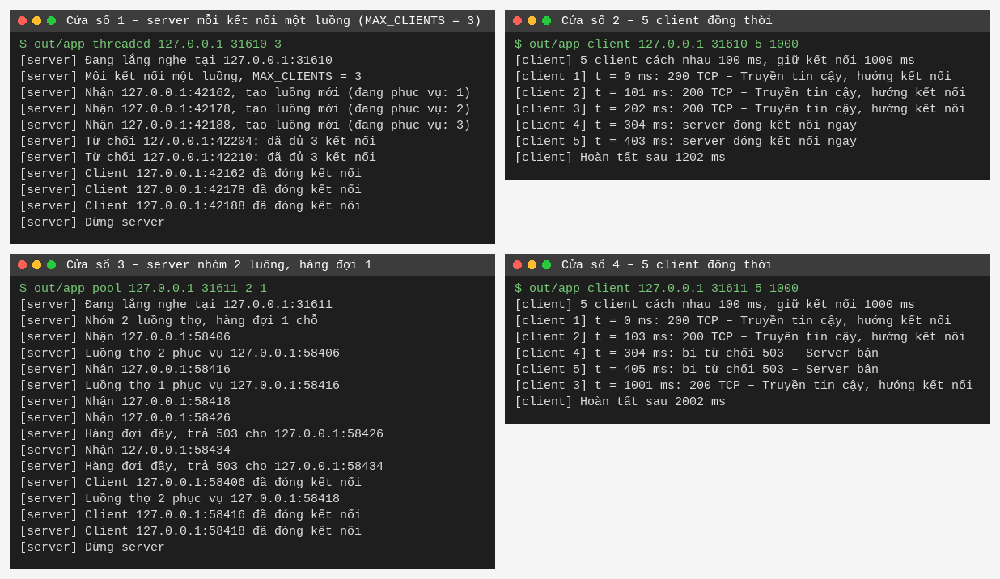

# Bài 6.1 – Server tra cứu đa luồng và server nhóm luồng (Go)

| Thông tin | Nội dung |
|---|---|
| Mã giả tương ứng | Mã giả 6.1 (Server đa luồng: mỗi kết nối một luồng), Mã giả 6.2 (Server dùng nhóm luồng và hàng đợi có giới hạn) |
| Mục giáo trình | 6.2.1 Luồng cho mỗi kết nối, 6.2.2 Nhóm luồng |
| Kế thừa | Mã giả 2.1 (PARSE_ENDPOINT), 2.2 (SAFE_CONNECT), 3.1 (khung server), 3.4 (RECV_EXACT), 3.6 (khung JSON), 3.7 (PROCESS_REQUEST, HANDLE_LOOKUP), 3.8 (client tra cứu, rút gọn) |
| Thư viện | Thư viện chuẩn Go: `net`, `sync/atomic`, `encoding/json`, `encoding/binary` |

## Mục tiêu
Chuyển server tra cứu tuần tự của Chương 3 thành server phục vụ đồng thời nhiều client theo hai cách: mỗi kết nối một luồng có trần `MAX_CLIENTS`, và nhóm k luồng thợ với hàng đợi có giới hạn, trả mã 503 khi hàng đợi đầy (áp lực ngược). Phần nghiệp vụ `HANDLE_LOOKUP` được giữ nguyên.

## Tệp
- `thread_server.go` – Mã giả 6.1: `threadedServer` (THREADED_SERVER), `serve` (SERVE), `idleConn` (RECV_TIMEOUT).
- `pool_server.go` – Mã giả 6.2: `poolServer` (POOL_SERVER), `worker` (WORKER).
- `lookup_service.go` – Mã giả 3.7: `processRequest`, `handleLookup`, `loadGlossary`.
- `netutil.go` – Mã giả 2.1, 2.2, 3.4, 3.6.
- `multi_client.go` – chương trình mở n client tra cứu đồng thời.
- `main.go` – chọn vai trò `threaded`, `pool`, `client`.
- `glossary.json` – từ điển thuật ngữ.
- `demo.json` – kịch bản chạy minh họa (dùng với `tools/demo.py`).
- `ket_qua.txt`, `ket_qua.png` – kết quả thực thi thật.

## Cách chạy
Mở các cửa sổ dòng lệnh trong thư mục bài:
```bash
go build -o out/app .
# Cửa sổ 1 – server mỗi kết nối một luồng (mặc định 0.0.0.0 9000, MAX_CLIENTS 500)
out/app threaded 0.0.0.0 9000
# hoặc server nhóm luồng: k = 8 luồng thợ, hàng đợi 16 chỗ
out/app pool 0.0.0.0 9000 8 16
# Cửa sổ 2 – 5 client đồng thời, mỗi client giữ kết nối 1000 ms
out/app client 127.0.0.1 9000 5 1000
```
Trên Windows dùng `go build -o out/app.exe .` và `out\app.exe`.
Dừng server bằng Ctrl+C.

## Kết quả thực thi


Kịch bản chạy hai server với tham số nhỏ để thấy rõ giới hạn: server mỗi kết nối một luồng với `MAX_CLIENTS = 3` phục vụ ngay ba client đầu (mỗi client một goroutine, client 2 và 3 không phải chờ client 1 giữ kết nối), client 4 và 5 bị đóng kết nối ngay sau `ACCEPT`. Server nhóm 2 luồng thợ, hàng đợi 1 chỗ phục vụ ngay client 1, 2; client 3 nằm trong hàng đợi và chỉ được phục vụ ở t ≈ 1000 ms khi một luồng thợ rảnh; client 4, 5 nhận phản hồi `503 Server bận`.

## Ghi chú
- Phần nghiệp vụ dùng `HANDLE_LOOKUP` (khung JSON, Mã giả 3.7) thay cho `HANDLE_ECHO` vì Mã giả 6.2 trả lỗi 503 dưới dạng khung JSON; Mục 6.2 cho phép giữ nguyên `HANDLE_ECHO` hoặc `HANDLE_LOOKUP`.
- `serve` ghi mọi lỗi trả về từ `handleLookup` (gồm `ConnectionClosed` đóng giữa khung và `ProtocolError` khung quá lớn, như khối `CATCH` của Mã giả 3.1); Mã giả 6.1 chỉ ghi `NetError`, `Timeout`. Khối `FINALLY` là `defer`.
- Tham số thứ ba của server mỗi kết nối một luồng ghi đè `MAX_CLIENTS` (mặc định 500) để minh họa. Giáo trình không quy định giá trị mặc định của k và `queue_size`; bài chọn k = 8 (theo ví dụ ở Mục 6.2.2) và 16.
- `SPAWN_THREAD` là lệnh `go` (goroutine). Goroutine nhẹ hơn luồng hệ điều hành: bộ lập lịch của Go phân phối nhiều goroutine lên ít luồng hệ điều hành, và goroutine đang chờ socket không giữ luồng nào. Cấu trúc chương trình vẫn đúng mô hình "mỗi kết nối một luồng" của mã giả; giới hạn `MAX_CLIENTS` vẫn cần để chặn số kết nối (bộ nhớ, mô tả tệp).
- `ATOMIC_COUNTER` là `atomic.Int64` (phép cộng nguyên tử của phần cứng, không cần khóa). `BLOCKING_QUEUE(queue_size)` là kênh có bộ đệm `make(chan job, queueSize)`: `q <- j` trong `select` có nhánh `default` là `try_put`, `<-q` là `take`. Hàm `logLine` dùng khóa để các goroutine không in chen vào giữa dòng của nhau.
- `SETOPT(conn, RECV_TIMEOUT, 300000)`: Go chỉ có hạn chót tuyệt đối (`SetReadDeadline`), nên kiểu `idleConn` đặt lại hạn chót trước mỗi lần đọc để có đúng nghĩa "thời gian chờ mỗi lần RECV".
- `net.Listen` gộp các bước `SOCKET`, `SETOPT(REUSEADDR)`, `BIND`, `LISTEN`; Go tự bật `SO_REUSEADDR` trên Linux và dùng backlog tối đa của hệ điều hành thay cho 128.
- Khi server đóng kết nối ngay sau `ACCEPT` trong lúc yêu cầu của client đã đến, hệ điều hành gửi RST thay cho FIN; client có thể thấy EOF, `ECONNRESET` hoặc `EPIPE` và cả ba đều được báo là "server đóng kết nối ngay". Trên Linux, phản hồi 503 đã nằm trong bộ đệm nhận vẫn đọc được sau RST.
- `multi_client` là chương trình minh họa bổ sung (không có trong mã giả): các client khởi động cách nhau 100 ms để thứ tự `ACCEPT` ổn định; thời điểm t thay đổi nhẹ giữa các lần chạy. Số JSON được `encoding/json` giải mã thành `float64` nên mã trạng thái được so với `200.0`.
- Kiểm thử: Linux, Go 1.24.7.
