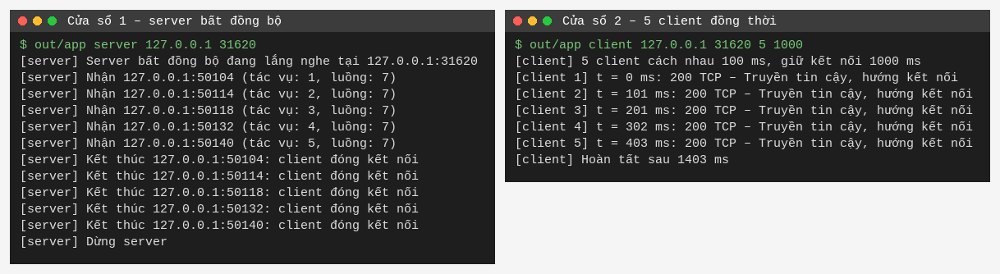

# Bài 6.2 – Server tra cứu bất đồng bộ (Go)

| Thông tin | Nội dung |
|---|---|
| Mã giả tương ứng | Mã giả 6.3 (Server bất đồng bộ: mỗi kết nối một tác vụ) |
| Mục giáo trình | 6.2.3 Server bất đồng bộ |
| Kế thừa | Mã giả 6.1 (SOCKET, SETOPT, BIND, LISTEN), 5.1 (RECV_JSON_ASYNC, SEND_JSON_ASYNC), 3.7 (PROCESS_REQUEST), 2.1; client: 2.2, 3.6, 3.8 (rút gọn) |
| Thư viện | Thư viện chuẩn Go: goroutine, `net`, `sync/atomic`, `runtime/pprof` (đếm luồng hệ điều hành), `encoding/json` |

## Mục tiêu
Phục vụ mỗi kết nối bằng một tác vụ bất đồng bộ thay cho một luồng: khi tác vụ chờ ở `AWAIT RECV_JSON_ASYNC`, nó không chiếm luồng nào. Mã nguồn gần như giống phiên bản đa luồng, chỉ khác ở các lời gọi bất đồng bộ.

## Tệp
- `async_server.go` – Mã giả 6.3: `asyncServer` (ASYNC_SERVER), `serveAsync` (SERVE_ASYNC), `processRequest` (Mã giả 3.7).
- `netutil.go` – Mã giả 2.1, 2.2, 3.4, 3.6 (`recvJSON`, `sendJSON` đóng vai `RECV_JSON_ASYNC`, `SEND_JSON_ASYNC` khi chạy trong goroutine).
- `multi_client.go` – chương trình mở n client tra cứu đồng thời.
- `main.go` – chọn vai trò `server`, `client`.
- `glossary.json` – từ điển thuật ngữ.
- `demo.json` – kịch bản chạy minh họa (dùng với `tools/demo.py`).
- `ket_qua.txt`, `ket_qua.png` – kết quả thực thi thật.

## Cách chạy
Mở các cửa sổ dòng lệnh trong thư mục bài:
```bash
go build -o out/app .
# Cửa sổ 1 – server (mặc định 0.0.0.0 9000)
out/app server 0.0.0.0 9000
# Cửa sổ 2 – 5 client đồng thời, mỗi client giữ kết nối 1000 ms
out/app client 127.0.0.1 9000 5 1000
```
Trên Windows dùng `go build -o out/app.exe .` và `out\app.exe`.
Dừng server bằng Ctrl+C.

## Kết quả thực thi


Năm client khởi động cách nhau 100 ms đều được phục vụ ngay (t ≈ 0, 100, …, 400 ms) dù các client trước vẫn giữ kết nối. Số tác vụ tăng theo số client trong khi số luồng của tiến trình không đổi, minh họa việc tác vụ đang chờ không chiếm luồng.

## Ghi chú
- `SERVE_ASYNC` không có thao tác `bye` (khác `HANDLE_LOOKUP` của Mã giả 3.7), nên client chỉ đóng kết nối; server nhận `ConnectionClosed` với 0 byte và ghi "client đóng kết nối".
- Mã giả không liệt kê `JsonError` trong khối `CATCH`; bản cài đặt coi JSON sai như `ProtocolError` và kết thúc phiên (Mã giả 3.7 thì trả 400 và tiếp tục).
- Con số "luồng" in ra có ý nghĩa khác nhau giữa các nền tảng; điểm cần quan sát là con số này không tăng theo số client.
- Go không có `async`/`await`: tác vụ bất đồng bộ là goroutine (`RUN_BACKGROUND` là lệnh `go`). Lời gọi `Accept`, `Read` trong goroutine trông như lời gọi chặn nhưng được bộ lập lịch của Go thực hiện trên epoll: goroutine đang chờ bị tạm cất, luồng hệ điều hành được dùng cho goroutine khác, nên `AWAIT ..._ASYNC` tương ứng với lời gọi thường trong goroutine. Vì thế mã của Bài 6.1 và Bài 6.2 trong Go gần như trùng nhau; khác biệt nằm ở cách nền tảng thực thi, đúng như nhận xét của Mục 6.2.3.
- "luồng" là `pprof.Lookup("threadcreate").Count()` – số luồng hệ điều hành mà tiến trình Go đã tạo (gồm luồng của bộ lập lịch và bộ thu gom rác); "tác vụ" là bộ đếm nguyên tử số goroutine phiên đang chạy.
- `WITH_TIMEOUT(300000, RECV_JSON_ASYNC(conn))` là `SetReadDeadline(now + 300 s)` đặt trước mỗi lần nhận một khung (hạn chót áp cho cả khung, không phải từng lần RECV).
- Kiểm thử: Linux, Go 1.24.7.
