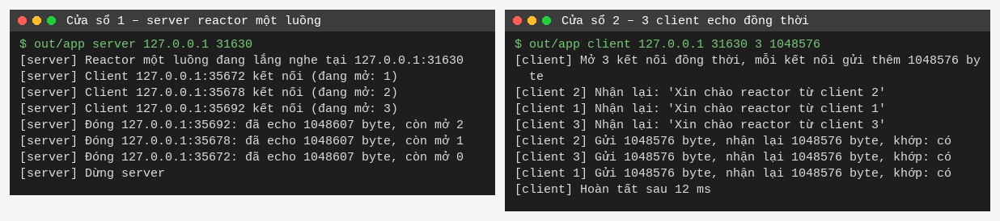

# Bài 6.3 – Server echo một luồng theo mô hình reactor (Go)

| Thông tin | Nội dung |
|---|---|
| Mã giả tương ứng | Mã giả 6.4 (Server echo một luồng dùng dồn kênh vào/ra) |
| Mục giáo trình | 6.2.4 Dồn kênh vào/ra và mô hình reactor |
| Kế thừa | Mã giả 3.1 (chức năng echo, SOCKET/SETOPT/BIND/LISTEN), 2.1; client: 2.2, 3.2, 3.4 (RECV_EXACT) |
| Thư viện | Thư viện chuẩn Go: `syscall` (`Socket`, `Bind`, `Listen`, `SetNonblock`, `Select`, `Accept`, `Read`, `Write`; Linux), `net`, `crypto/rand` (client) |

## Mục tiêu
Phục vụ nhiều client bằng một luồng duy nhất: mọi socket ở chế độ không chặn, vòng lặp chỉ chặn tại `SELECT` rồi xử lý các socket đã sẵn sàng. Mỗi kết nối có bộ đệm gửi riêng vì `SEND` có thể chỉ gửi một phần; socket có bộ đệm gửi đạt `MAX_BUF` bị loại khỏi tập theo dõi đọc (áp lực ngược). Client đóng chiều gửi (nhận 0 byte) được đưa vào tập `closing`: server ngừng đọc nhưng gửi nốt dữ liệu còn chờ rồi mới đóng, nên không mất dữ liệu khi client half-close.

## Tệp
- `reactor_server.go` – Mã giả 6.4: `reactorServer` với `syscall.Select`, `fdSet`, `fdIsSet` (Linux).
- `reactor_khac.go` – bản thay thế khi biên dịch cho hệ điều hành khác Linux (báo không hỗ trợ).
- `echo_clients.go` – n client echo đồng thời, đóng chiều gửi (half-close) sau khi gửi khối lớn, kiểm tra dữ liệu nhận lại.
- `netutil.go` – Mã giả 2.1, 2.2, 3.4.
- `main.go` – chọn vai trò `server`, `client`.
- `demo.json` – kịch bản chạy minh họa (dùng với `tools/demo.py`).
- `ket_qua.txt`, `ket_qua.png` – kết quả thực thi thật.

## Cách chạy
Mở các cửa sổ dòng lệnh trong thư mục bài:
```bash
go build -o out/app .
# Cửa sổ 1 – server (mặc định 0.0.0.0 9000)
out/app server 0.0.0.0 9000
# Cửa sổ 2 – 3 kết nối đồng thời, mỗi kết nối gửi thêm khối 1 MiB
out/app client 127.0.0.1 9000 3 1048576
```
Server chỉ chạy trên Linux (hoặc WSL trên Windows); client chạy được ở mọi hệ điều hành.
Dừng server bằng Ctrl+C.

## Kết quả thực thi


Ba kết nối được một luồng duy nhất phục vụ xen kẽ. Mỗi client nhận lại đúng dòng chào và đúng khối 1 048 576 byte ngẫu nhiên dù đã đóng chiều gửi ngay sau khi gửi xong (lúc đó phần lớn dữ liệu vẫn nằm trong bộ đệm gửi của server); server chỉ đóng kết nối khi đã gửi hết và ghi tổng số byte đã echo của từng kết nối.

## Ghi chú
- `MAX_BUF ← 65536` theo mã giả.
- Gói `net` của Go đã tự dùng epoll và ẩn mô tả tệp, nên mọi chương trình mạng Go "bình thường" thực chất đã chạy trên một reactor của bộ lập lịch. Để thấy tường minh vòng `SELECT` của mã giả, server gọi thẳng lời gọi hệ thống qua gói `syscall`; mỗi lệnh của mã giả ứng với đúng một lời gọi (`SOCKET` → `syscall.Socket`, `SELECT` → `syscall.Select`, `RECV` → `syscall.Read`, `SEND` → `syscall.Write`…). Tập socket của `SELECT` là `syscall.FdSet` (mảng bit); `fdSet`, `fdIsSet` tương ứng `FD_SET`, `FD_ISSET` của C. `select` giới hạn mô tả tệp < 1024 (`FD_SETSIZE`); server thật dùng epoll.
- Cấu trúc `FdSet` khác nhau giữa các hệ điều hành, nên `reactor_server.go` có ràng buộc biên dịch `//go:build linux`.
- Mã giả không xử lý lỗi của `RECV`/`SEND`; bản cài đặt coi lỗi (ví dụ ConnectionReset) như client đã đóng: xóa khỏi bảng và đóng socket, để một client lỗi không làm dừng vòng lặp của cả server. `Select` bị tín hiệu ngắt (`EINTR`, bộ lập lịch Go dùng tín hiệu để chiếm quyền) thì chọn lại.
- Theo mã giả, nhận 0 byte (FIN) chỉ đưa socket vào tập `closing`: socket bị loại khỏi tập theo dõi đọc, vẫn ở tập theo dõi ghi khi còn dữ liệu, và vòng cuối của mỗi lượt đóng các socket trong `closing` đã gửi hết. Lỗi `RECV` (ví dụ ConnectionReset) thì đóng ngay vì không thể gửi tiếp. Client mẫu gọi `CloseWrite()` (half-close) sau khi gửi khối 1 MiB để kiểm tra nhánh này.
- Client gửi khối lớn ở một goroutine phụ và nhận song song ở goroutine chính. Nếu gửi hết rồi mới nhận, hai bên bế tắc: server ngừng đọc khi bộ đệm gửi đạt `MAX_BUF` (áp lực ngược, Mục 6.2.4), còn client không đọc phản hồi.
- Các socket được duyệt theo số mô tả tệp tăng dần (map của Go không có thứ tự). Kết nối mới được `ACCEPT` trước khi xử lý các socket cũ trong cùng vòng lặp, nên số mô tả tệp vừa đóng không bị dùng lại trong vòng đó.
- Kiểm thử: Linux, Go 1.24.7.
