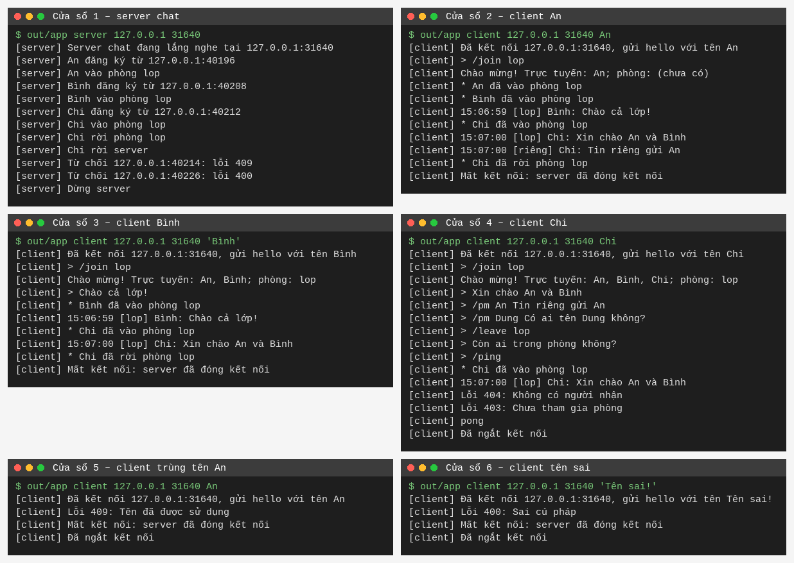

# Bài 6.4 – Server chat nhiều phòng (Go)

| Thông tin | Nội dung |
|---|---|
| Mã giả tương ứng | Mã giả 6.5 (Server chat: cấu trúc dữ liệu và tác vụ phiên), Mã giả 6.6 (Server chat: phát tới phòng, gửi riêng và tác vụ ghi) |
| Mục giáo trình | 6.3.1 Đặc tả giao thức chat, 6.3.2 Kiến trúc server, 6.3.3 Mã giả server chat, 6.3.4 Các vấn đề bảo mật |
| Kế thừa | Mã giả 6.3 (server bất đồng bộ), 5.1 (khung JSON bất đồng bộ), 5.5 (lớp ChatClient), 2.1, 2.2 |
| Thư viện | Thư viện chuẩn Go: goroutine, kênh (`chan`), `sync` (`Mutex`), `sync/atomic`, `regexp`, `encoding/json`, `net` |

## Mục tiêu
Xây dựng server chat theo đặc tả Mục 6.3.1: đăng ký tên bằng `hello` trong 10 giây (`welcome` hoặc lỗi 409), tham gia và rời phòng, tin nhóm (`msg`), tin riêng (`pm`), nhịp tim `ping`/`pong`, mã lỗi 400, 403, 404, 409, 429. Mỗi client có một tác vụ phiên đọc socket, một hộp thư đi 256 thông điệp và đúng một tác vụ ghi; bảng `users`, `rooms` được bảo vệ bằng khóa và không thực hiện vào/ra khi giữ khóa.

## Tệp
- `chat_server.go` – Mã giả 6.5: `chatServer` (vòng chấp nhận), `chatSession` (CHAT_SESSION).
- `chat_broadcast.go` – Mã giả 6.6: `broadcast`, `sendTo`, `enqueue`, `writer`; `Client`, `users`, `rooms`, `lock`; `register`, `unregister`, `joinRoom`, `leaveRoom`.
- `chat_client.go` – Mã giả 5.5: kiểu `ChatClient` và client dòng lệnh.
- `netutil.go` – Mã giả 2.1, 2.2, 3.4, 3.6, 5.1.
- `main.go` – chọn vai trò `server`, `client`.
- `demo.json` – kịch bản chạy minh họa (dùng với `tools/demo.py`).
- `ket_qua.txt`, `ket_qua.png` – kết quả thực thi thật.

## Cách chạy
Mở các cửa sổ dòng lệnh trong thư mục bài:
```bash
go build -o out/app .
# Cửa sổ 1 – server (mặc định 0.0.0.0 9200)
out/app server 0.0.0.0 9200
# Cửa sổ 2, 3, … – mỗi cửa sổ một client
out/app client 127.0.0.1 9200 An
out/app client 127.0.0.1 9200 Bình
```
Trên Windows dùng `go build -o out/app.exe .` và `out\app.exe`.
Lệnh của client: `/join phòng`, `/leave phòng`, `/pm tên nội dung`, `/ping`, `/quit`; dòng khác được gửi thành tin `msg` tới phòng của lệnh `/join` gần nhất. Dừng server bằng Ctrl+C.

## Kết quả thực thi


Ba client An, Bình, Chi cùng vào phòng `lop`: tin nhóm đến mọi thành viên (kể cả người gửi), tin riêng của Chi chỉ đến An, tin riêng tới người không tồn tại trả lỗi 404, tin gửi vào phòng sau khi đã rời trả lỗi 403, `ping` nhận `pong`. Client đăng ký trùng tên An nhận lỗi 409, client có tên chứa ký tự không cho phép nhận lỗi 400; cả hai bị đóng kết nối ngay. Hai dòng "Mất kết nối" ở cuối cửa sổ An, Bình xuất hiện vì kịch bản dừng server trước khi dừng hai client chạy nền.

## Ghi chú
- Mã giả chỉ nêu tên `REGISTER`, `UNREGISTER`, `JOIN_ROOM`, `LEAVE_ROOM`. Bản cài đặt: `JOIN_ROOM` thêm tên vào phòng rồi phát thông báo hệ thống `sys`; `LEAVE_ROOM` phát `sys` cho các thành viên còn lại, hoặc trả 403 nếu người gửi không ở trong phòng; `UNREGISTER` xóa client khỏi `users` và mọi phòng, phát "đã rời phòng" tới các phòng đó (ngoài khóa).
- Thông điệp `welcome` gửi cả `users` và `rooms` theo bảng đặc tả (Mã giả 6.5 dòng 10 chỉ có `users`); thông điệp `error` có thêm trường `text` theo bảng đặc tả.
- Bổ sung theo Mục 6.3.4 (không có trong mã giả): tên người dùng và tên phòng phải khớp `^[\p{L}\p{N}_-]{1,32}$` (chữ cái Unicode kể cả tiếng Việt, chữ số, `_`, `-`; sai → 400), thông điệp thiếu trường bắt buộc → 400, mỗi client tối đa 10 tin `msg`/`pm` mỗi giây (vượt → 429). Lưu ý `\w` của gói `regexp` trong Go chỉ khớp ký tự ASCII, nên phải viết lớp ký tự Unicode `\p{L}` thì tên "Bình" mới hợp lệ.
- Client: thủ tục `SEND_MESSAGE(c, room, text)` của Mã giả 5.5 được tổng quát thành `send(obj)` vì cần gửi nhiều loại thông điệp (`join`, `leave`, `pm`, `ping`, `msg` có trường `room`). Sự kiện trạng thái "connected" được báo trước khi khởi động vòng nhận để dòng "Đã kết nối" luôn in trước thông điệp đầu tiên.
- Khi hết dữ liệu nhập (Ctrl+D/Ctrl+Z), client chờ 1 giây để nhận nốt các thông điệp rồi mới ngắt kết nối. Trường `ts` do server gán theo giờ UTC; client hiển thị phần HH:MM:SS.
- Hộp thư đi `BOUNDED_QUEUE(256)` là kênh có bộ đệm `make(chan …, 256)`; `try_put` là `select` có nhánh `default`; `take_async` là vòng `for msg := range c.outbox`; `outbox.close()` là `close(kênh)`: tác vụ ghi gửi nốt các tin còn trong kênh rồi dừng. Vì Go báo lỗi (panic) khi gửi vào kênh đã đóng, mỗi `Client` có thêm khóa riêng và cờ `closed` để `enqueue` bỏ tin gửi tới client vừa rời. Khi phiên kết thúc, server chờ tác vụ ghi tối đa 1 giây rồi mới đóng socket.
- Các goroutine phiên chạy song song thật trên nhiều luồng hệ điều hành, nên khóa `lock` (`sync.Mutex`) là bắt buộc (không chỉ để bám mã giả). Map của Go không có thứ tự, nên danh sách người dùng, phòng và thành viên được sắp xếp trước khi gửi.
- Khi nhận Ctrl+C, server in "Dừng server" và kết thúc tiến trình ngay (không chạy khối `FINALLY` của các phiên), nên không có dòng "… rời server" của An, Bình như bản Python.
- Kiểm thử: Linux, Go 1.24.7.
