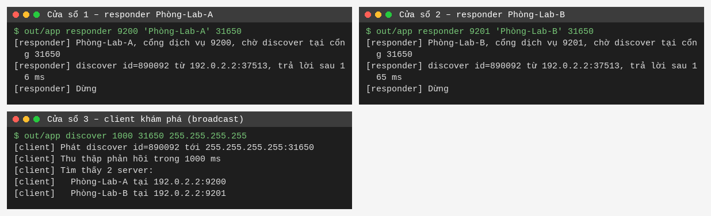

# Bài 6.5 – Khám phá server trong LAN bằng broadcast (Go)

| Thông tin | Nội dung |
|---|---|
| Mã giả tương ứng | Mã giả 6.7 (Khám phá server trong LAN bằng broadcast: DISCOVER, RESPONDER) |
| Mục giáo trình | 6.4.2 Broadcast, 6.4.4 Thiết lập TTL và tránh ngập lụt gói tin |
| Kế thừa | Mã giả 4.4 (UDP_REQUEST): gửi một yêu cầu, thu thập nhiều phản hồi đến hết thời gian chờ |
| Thư viện | Thư viện chuẩn Go: `net` (`ListenConfig`, `PacketConn`), `syscall` (`SO_BROADCAST`, `SO_REUSEADDR`), `encoding/json`, `math/rand/v2` |

## Mục tiêu
Client phát một yêu cầu `discover` tới địa chỉ broadcast giới hạn `255.255.255.255` (bắt buộc bật tùy chọn `BROADCAST`), mỗi server trả lời bằng unicast kèm cổng dịch vụ sau một khoảng trễ ngẫu nhiên 0–200 ms (tránh bùng nổ phản hồi); client thu thập mọi phản hồi có đúng `id` trong khoảng thời gian chờ.

## Tệp
- `discover.go` – Mã giả 6.7: DISCOVER.
- `responder.go` – Mã giả 6.7: RESPONDER.
- `util.go` – đọc tham số, kiểm tra cổng, `setOpt` (SETOPT trước BIND), xử lý Ctrl+C.
- `sockopt_unix.go`, `sockopt_windows.go` – `setsockoptInt` cho từng hệ điều hành (mô tả tệp `int` hay `Handle`).
- `main.go` – chọn vai trò `responder`, `discover`.
- `demo.json` – kịch bản chạy minh họa (dùng với `tools/demo.py`).
- `ket_qua.txt`, `ket_qua.png` – kết quả thực thi thật.

## Cách chạy
Mở các cửa sổ dòng lệnh trong thư mục bài:
```bash
go build -o out/app .
# Trên mỗi máy chạy server: responder [cổng dịch vụ] [tên] [DISC_PORT]   (mặc định 9200 server-chat 9999)
out/app responder 9200 Phòng-Lab-A 9999
# Trên máy client: discover [wait_ms] [DISC_PORT] [địa chỉ broadcast]   (mặc định 2000 9999 255.255.255.255)
out/app discover 2000 9999 255.255.255.255
```
Trên Windows dùng `go build -o out/app.exe .` và `out\app.exe`.
Tường lửa của máy chạy responder phải cho phép UDP đến cổng `DISC_PORT`. Dừng responder bằng Ctrl+C.

## Kết quả thực thi


Hai responder chạy trên cùng máy kiểm thử nhận cùng một yêu cầu broadcast, trả lời sau các khoảng trễ ngẫu nhiên khác nhau; client tìm thấy cả hai server với tên và cổng dịch vụ (phản hồi trễ ít đến trước). Địa chỉ 192.0.2.2 là địa chỉ của giao diện mạng của máy kiểm thử: gói tới `255.255.255.255` được gửi qua giao diện có tuyến mặc định và đồng thời được chuyển cho các socket cục bộ. Môi trường kiểm thử không chặn broadcast tới `255.255.255.255`.

## Ghi chú
- Socket của RESPONDER bật `REUSEADDR` trước `BIND` (mã giả không có) để hai responder chạy được trên cùng một máy trong kịch bản minh họa; datagram broadcast được giao cho mọi socket cùng cổng. Trong LAN mỗi máy một responder thì không cần tùy chọn này.
- Gói `net` của Go không có hàm bật `SO_BROADCAST`/`SO_REUSEADDR` cho UDP; `net.ListenConfig{Control: …}` cho phép gọi `syscall.SetsockoptInt` trên socket vừa tạo, đúng thứ tự SOCKET → SETOPT → BIND của mã giả.
- `NEXT_ID()` sinh số ngẫu nhiên 1–999 999. Giáo trình không nêu `wait_ms` mặc định; bài chọn 2000 ms.
- `SETOPT(s, RECV_TIMEOUT, MAX(1, deadline − NOW()))` của mã giả là `SetReadDeadline(deadline)`: Go dùng hạn chót tuyệt đối nên không gặp trường hợp giá trị 0 nghĩa là chờ vô hạn.
- Datagram không phải JSON hợp lệ bị bỏ qua mà không phản hồi, theo Mục 6.4.4.
- `AWAIT RECVFROM_ASYNC`, `AWAIT DELAY_ASYNC` là `ReadFrom`, `time.Sleep` trong vòng lặp của responder (có thể chạy responder trong một goroutine nền của server chat).
- Kiểm thử: Linux, Go 1.24.7.
