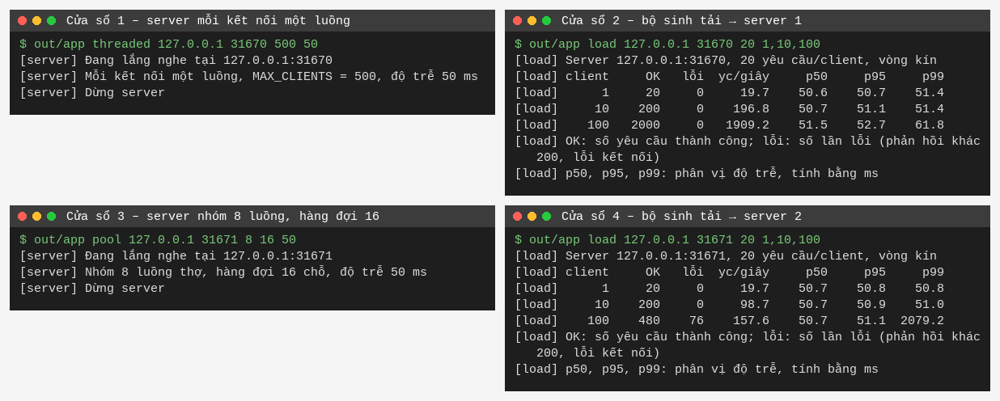

# Bài 6.7 – Kiểm thử tải: thông lượng và phân vị độ trễ (Go)

| Thông tin | Nội dung |
|---|---|
| Mã giả tương ứng | Mã giả 6.9 (Bộ sinh tải đo thông lượng và phân vị độ trễ); server đi kèm: Mã giả 6.1, 6.2 |
| Mục giáo trình | 6.1.2 Các chỉ số đánh giá server, 6.5.1 Kiểm thử tải |
| Kế thừa | Mã giả 5.2 (khởi động N tác vụ, WHEN_ALL), 5.1 (khung JSON bất đồng bộ); bản sao server Bài 6.1 (Mã giả 6.1, 6.2, 3.7) |
| Thư viện | Thư viện chuẩn Go: goroutine, `sync` (`WaitGroup`, `Mutex`), `net`, `encoding/json`, `sort`, `math` |

## Mục tiêu
Đo thông lượng (yêu cầu/giây) và các phân vị p50, p95, p99 của độ trễ khi số client vòng kín tăng dần (1, 10, 100), với hai server của Bài 6.1 có độ trễ giả lập 50 ms mỗi yêu cầu, như bài tập "Ba kiến trúc server tra cứu" của Chương 6.

## Tệp
- `load_gen.go` – Mã giả 6.9: `loadTest` (LOAD_TEST), `oneClient` (ONE_CLIENT), `percentile`.
- `thread_server.go` – bản sao Mã giả 6.1 (Bài 6.1), không ghi nhật ký từng kết nối.
- `pool_server.go` – bản sao Mã giả 6.2 (Bài 6.1), không ghi nhật ký từng kết nối.
- `lookup_service.go` – Mã giả 3.7 có độ trễ giả lập `DELAY_MS`.
- `netutil.go` – Mã giả 2.1, 2.2, 3.4, 3.6.
- `main.go` – chọn vai trò `threaded`, `pool`, `load`.
- `glossary.json` – từ điển thuật ngữ.
- `demo.json` – kịch bản chạy minh họa (dùng với `tools/demo.py`).
- `ket_qua.txt`, `ket_qua.png` – kết quả thực thi thật.

## Cách chạy
Mở các cửa sổ dòng lệnh trong thư mục bài:
```bash
go build -o out/app .
# Cửa sổ 1 – một trong hai server, độ trễ giả lập 50 ms
out/app threaded 0.0.0.0 9000 500 50      # [max_clients] [delay_ms]
out/app pool 0.0.0.0 9000 8 16 50         # [k] [queue_size] [delay_ms]
# Cửa sổ 2 – bộ sinh tải: 20 yêu cầu mỗi client, các mức 1, 10, 100 client
out/app load 127.0.0.1 9000 20 1,10,100
```
Trên Windows dùng `go build -o out/app.exe .` và `out\app.exe`.
Dừng server bằng Ctrl+C.

## Kết quả thực thi


Với server mỗi kết nối một luồng, thông lượng tăng gần tuyến tính theo số client (khoảng 20 × n yêu cầu/giây) và p50 xấp xỉ 50 ms ở mọi mức tải. Với nhóm 8 luồng, hàng đợi 16 chỗ: ở 10 client, 2 client phải chờ trong hàng đợi đến khi có luồng thợ rảnh nên thông lượng chỉ còn khoảng 100 yêu cầu/giây; ở 100 client, chỉ 24 client (8 + 16) được nhận, 76 client bị từ chối 503 (mỗi client dừng ngay và được đếm một lỗi); p99 khoảng 2 giây do thời gian chờ trong hàng đợi, đúng như hạn chế của nhóm luồng với kết nối dài hạn (Mục 6.2.2). Kết quả đo trên loopback, server và bộ sinh tải cùng một máy.

## Ghi chú
- Các server là bản sao của Bài 6.1 để bài tự chứa; khác biệt: không ghi nhật ký từng kết nối (tránh hàng nghìn dòng khi chịu tải) và có tham số `delay_ms` – độ trễ giả lập trong `PROCESS_REQUEST`.
- Theo Mã giả 6.9: phản hồi khác 200 (ví dụ 503) tăng `errors` rồi `BREAK` – client đó dừng, nên mỗi client bị từ chối chỉ đếm một lần; lỗi kết nối, `ConnectionClosed`, `ProtocolError` tăng `errors` và kết thúc client đó (khối `CATCH`), không làm dừng cả bài; kết quả trả thêm trường `errors` (cột "lỗi"). `errors` là `atomic.Int64`.
- `PERCENTILE` dùng phương pháp hạng gần nhất (nearest-rank); thông lượng = số yêu cầu thành công / tổng thời gian của mức tải.
- Bộ sinh tải là vòng kín: khi server chậm, tải tự giảm (Mục 6.5.1). Để kết quả sát thực tế hơn, máy sinh tải nên tách khỏi máy server.
- `ONE_CLIENT` là hàm lồng chạy trong goroutine; `WHEN_ALL` là `sync.WaitGroup`; `NOW_PRECISE` là `time.Now()` (Go dùng đồng hồ đơn điệu khi trừ hai thời điểm). Các goroutine chạy song song thật trên nhiều luồng, nên `CONCURRENT_LIST` là slice `lat` được bảo vệ bằng `sync.Mutex`.
- Tệp bộ sinh tải đặt tên `load_gen.go` vì Go coi mọi tệp có đuôi `_test.go` là tệp kiểm thử và không biên dịch vào chương trình.
- Kiểm thử: Linux, Go 1.24.7.
