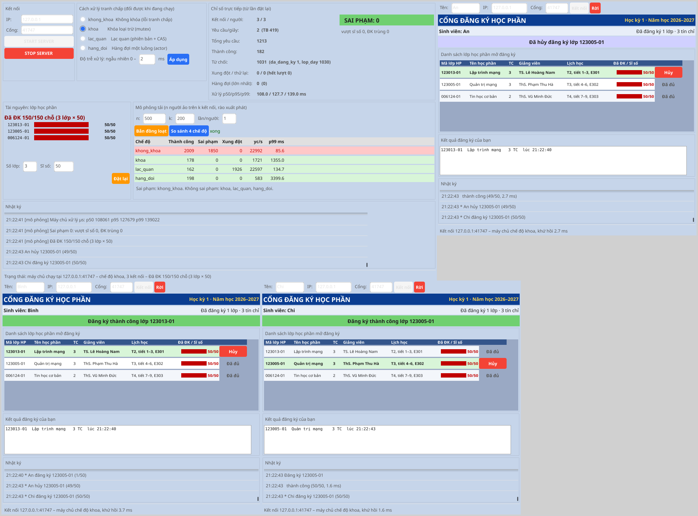
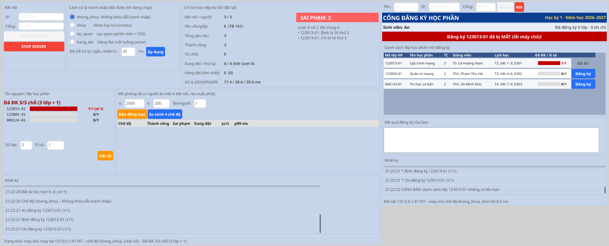
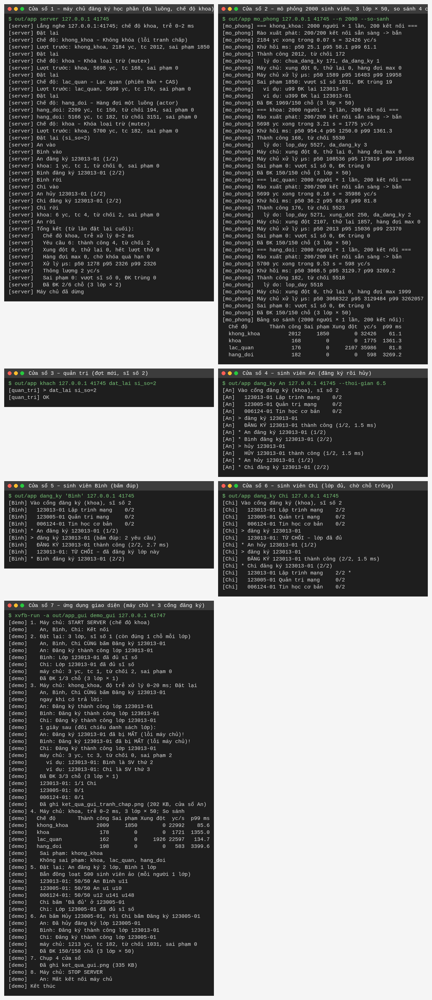

# Bài mở rộng MR6.10 – Đăng ký học phần: 2 000 sinh viên tranh vài lớp sĩ số 50 (Go)

| Thông tin | Nội dung |
|---|---|
| Loại | **Bài mở rộng**, không có trong giáo trình và không có mã giả tương ứng. Thuộc nhóm "tranh chấp tài nguyên" MR6.6–MR6.13, dùng chung khung của [MR6.6](../BaiMR6.6_DauGia/) |
| Liên hệ với giáo trình | Chương 6: Bài 6.1 (server đa luồng, một luồng mỗi kết nối), Bài 6.7 (kiểm thử tải); Chương 3: Bài 3.2 (định khung thông điệp theo dòng); bài mở rộng MR5.4/MR5.5 (luồng, đồng bộ) |
| Thư viện | Bản dòng lệnh: chỉ thư viện chuẩn Go (`net`, `sync`, `sync/atomic`, `encoding/json`, `math/rand/v2`, `hash/fnv`). Ứng dụng giao diện (`gui/`, mô-đun riêng): Fyne v2.6.3 (cần cgo/gcc); kịch bản demo giao diện trên Linux cần Xvfb và ImageMagick (`import`) |
| Bản ngôn ngữ khác | [Python](../../../python/Chuong06/BaiMR6.10_DangKyHocPhan/), [C#](../../../csharp/Chuong06/BaiMR6.10_DangKyHocPhan/), [Java](../../../java/Chuong06/BaiMR6.10_DangKyHocPhan/), [Rust](../../../rust/Chuong06/BaiMR6.10_DangKyHocPhan/) |

## Mục tiêu
Bài mô phỏng cổng đăng ký học phần trong ngày mở đăng ký: vài **lớp học phần** (mặc định 3 lớp, sĩ số 50) và hàng nghìn sinh viên cùng bấm "Đăng ký". Mỗi lớp là một ô tài nguyên (tập tên sinh viên); hai thao tác ghi là `dang_ky` (lớp còn chỗ, chưa có tên mình) và `huy` (chỉ hủy lớp mình đã đăng ký). Máy chủ TCP đa luồng (một goroutine mỗi kết nối) xử lý "đọc → kiểm tra (giả lập độ trễ cơ sở dữ liệu 0–2 ms) → ghi" theo **bốn cách**: không khóa, khóa loại trừ **theo từng lớp**, lạc quan, hàng đợi một goroutine. **Sổ kiểm toán** đếm **vượt sĩ số** (một lượt đăng ký được chấp nhận khi lớp đã đủ theo sổ) và **ĐK trùng** (một sinh viên được chấp nhận hai lần vào cùng lớp).

Phần khung chép nguyên từ [MR6.6](../BaiMR6.6_DauGia/) (chỉ đổi đường dẫn gói). Bài này chỉ viết nghiệp vụ, sinh viên dòng lệnh, cổng đăng ký giao diện, bảng tài nguyên của máy chủ và kịch bản demo. Giao thức và dòng in giống hệt bản Python.

## Kiến thức chính
Số liệu dưới đây lấy từ `ket_qua.txt`, là một lần chạy thật trên máy cục bộ (127.0.0.1, Go 1.24, độ trễ xử lý ngẫu nhiên 0–2 ms). Mỗi lần chạy, số liệu lệch đi đôi chút.

```
  Chế độ       Thành công Sai phạm Xung đột  yc/s  p99 ms
  khong_khoa         2012     1850        0 32426    61.1
  khoa                168        0        0  1775  1361.3
  lac_quan            176        0     2107 35986    81.8
  hang_doi            182        0        0   598  3269.2
```
(2000 sinh viên, mỗi người muốn 1 lớp; 3 lớp × 50 = 150 chỗ; 200 kết nối. Mỗi sinh viên có thứ tự ưu tiên ngẫu nhiên theo tên: lớp đủ thì thử lớp kế tiếp, được nhận thì 10 % "đổi ý" hủy ngay. "Thành công" gồm cả lượt hủy thành công.)

- **Tranh chấp: vượt sĩ số và mất đăng ký.** Ở `khong_khoa`, hàng trăm goroutine cùng đọc danh sách lớp lúc còn chỗ, cùng qua bước kiểm tra, cùng ghi "danh sách cũ + tên mình", bản ghi sau đè bản trước. Sổ kiểm toán ghi nhận **1969 lượt đăng ký thành công cho 150 chỗ** (vượt sĩ số 1831, ĐK trùng 19), và 171 lượt hủy bị từ chối `chua_dang_ky` dù chính người đó vừa được báo nhận (tên đã bị bản ghi của người khác đè mất). Trên máy đa lõi gần như **mọi** sinh viên đều "được nhận" ngay lần đầu, nhiều hơn hẳn bản Python (1166 lượt). Chế độ này chỉ dùng để minh họa lỗi trong phòng lab (loopback).
- **ĐK trùng: idempotency theo (sinh viên, lớp).** Sinh viên thứ 100, 200, … mang tên người liền trước (hai thiết bị, cùng thứ tự ưu tiên). Hai yêu cầu có `ma_yc` khác nhau nên lớp chống gửi lại của khung không chặn được; luật "đã có tên thì từ chối" nằm trong trạng thái lớp. Bản dòng lệnh minh họa bằng `dk 123013-01 x2`: lần thứ hai nhận "đã đăng ký lớp này".
- **Khóa theo tài nguyên.** `khoa` cho mỗi lớp một khóa riêng, ba lớp chạy song song (1775 yc/s, gấp khoảng 3 lần `hang_doi` 598 yc/s). Nhưng mỗi lớp vẫn là điểm nóng: hàng nghìn yêu cầu cùng chờ khóa của 3 ô, nên p99 khứ hồi 1,4 s.
- **Lạc quan khi điểm nóng bị ghi nhiều.** Phút đầu phần lớn yêu cầu đều *ghi*, nên `lac_quan` có **2107 xung đột** và 250 yêu cầu hết 5 lượt thử ("xung đột, thử lại sau") – sai phạm vẫn 0 và thông lượng cao (35 986 yc/s), nhưng người dùng thấy "Hệ thống bận, vui lòng thử lại" (Kung & Robinson 1981).
- **Hàng đợi một goroutine (actor).** `hang_doi` đúng, công bằng theo thứ tự đến, hàng đợi dài tối đa gần 2000, p99 khứ hồi 3,3 s.
- **Sổ kiểm toán.** Sổ giữ danh sách lớp *theo sổ*, ghi trong vùng găng của chế độ (`khiGhi`): `dang_ky` thêm tên, `huy` bỏ tên. Bảng điều khiển máy chủ hiện cả hai: "1/1 (sổ 3)" nghĩa là danh sách lớp có 1 tên trong khi máy chủ đã báo thành công cho 3 người.
- **Lượt chạy dòng lệnh** (sĩ số 2): An đăng ký 123013-01 (1/2); Bình bấm đúp – lần đầu thành công (2/2), lần hai "đã đăng ký lớp này"; Chi "lớp đã đủ"; An hủy (1/2); Chi đăng ký lại được chỗ vừa nhả (2/2).

### Giao thức (giống hệt ở 5 ngôn ngữ)
Phần chung (chào, quản trị, `thong_ke`, `lap_lai`) xem [README MR6.6](../BaiMR6.6_DauGia/README.md#giao-thức-giống-hệt-ở-5-ngôn-ngữ).

| Chiều | Thông điệp |
|---|---|
| người dùng → server | `{"loai":"dang_ky","ma_yc":k,"ma_lop":"123013-01"}`, `{"loai":"huy","ma_yc":k,"ma_lop":"123013-01"}` (kết nối gộp thêm `"nguoi":"u17"`) |
| server → client | `{"loai":"kq","ok":true,"thao_tac":"dang_ky","ma_lop":…,"nguoi":…,"da_dk":37}` hoặc `{"ok":false,"ma_loi":"lop_day"\|"da_dang_ky"\|"chua_dang_ky"\|"sai_du_lieu"\|"xung_dot"\|…,"ly_do":…,"ma_lop":…,"da_dk":50}` |
| server → tất cả | `{"loai":"cap_nhat","che_do":…,"si_so":50,"lop":[{"ma","ten","gv","lich","tc","si_so","da_dk","theo_so","sv":[tên…]}…]}` (≤ 10 lần/s); `su_kien` "An đăng ký 123013-01 (1/50)" (chỉ người dùng thật) |
| quản trị → server | `{"loai":"dat_lai","ma_yc":k,"so_lop":3,"si_so":50}` (1–6 lớp, sĩ số 1–500) |

## Cấu trúc tệp
- `tranhchap/`: khung chung (như MR6.6) + `nghiepvu.go` (`MayChuDangKy`: mỗi lớp một ô `lop:<mã>`, danh mục 6 lớp; luật sổ kiểm toán), `nguoiao.go` (sinh viên ảo: thứ tự ưu tiên xáo theo tên – băm FNV làm hạt giống, 10 % hủy ngay, người thứ 100, 200, … dùng tên người liền trước; `ThamSoDatLai = {}`).
- `main.go` (lệnh con `server`, `mo_phong`, `khach`, `dang_ky`), `chung_cli.go`, `server.go` (`--so-lop`, `--si-so`), `dang_ky.go` (sinh viên dòng lệnh: `dk`, `dk … x2`, `huy`, `xem`).
- `gui/`: `chung_gui.go`, `ve.go` (khung chung), `server_gui.go`, `dang_ky_gui.go`, `demo_gui.go`, `main.go`.
- `demo.json`, `ket_qua.txt`, `ket_qua.png`, `ket_qua_gui.png`, `ket_qua_gui_tranh_chap.png`: kịch bản và kết quả thực thi thật.

## Cách chạy
Chạy trong thư mục bài (Go 1.24+):
```bash
go build -o out/app .
out/app server 127.0.0.1 9000                                  # cửa sổ 1 (gõ lệnh ở đây)
out/app mo_phong 127.0.0.1 9000 --n 2000 --so-sanh             # bảng so sánh 4 chế độ
out/app khach 127.0.0.1 9000 dat_lai si_so=2                   # đợt mới, sĩ số 2
out/app dang_ky An 127.0.0.1 9000                              # gõ: dk 123013-01 / huy … / xem
```
- Lệnh của máy chủ: `che_do khong_khoa|khoa|lac_quan|hang_doi`, `tre <ms>`, `dat_lai [so_lop=… si_so=…]`, `thong_ke`, `thoat`. Tùy chọn: `--che-do`, `--tre-ms`, `--so-lop`, `--si-so`.
- Lệnh của `dang_ky`: `dk <mã lớp> [x2]`, `huy <mã lớp>`, `xem`, `thoat`; dòng `@t lệnh` chờ tới giây thứ t.

Muốn tái lập kết quả, chạy từ thư mục gốc của kho: `python3 tools/demo.py go/Chuong06/BaiMR6.10_DangKyHocPhan`.

## Ứng dụng giao diện


Ảnh trên là lần chạy thật của `demo_gui` (Linux, Xvfb + Mesa llvmpipe, Fyne v2.6.3): bảng điều khiển máy chủ (trên trái), An (trên phải), Bình và Chi (dưới). Sau so sánh 4 chế độ, đợt mới 3 lớp × 50: An đăng ký 2 lớp, Bình 1 lớp, 500 sinh viên ảo lấp đầy cả ba lớp; Chi bấm "Đã đủ" ở 123005-01 thì nhận "Lớp 123005-01 đã đủ sĩ số"; An hủy 123005-01 và Chi đăng ký được chỗ vừa nhả.



Ở bước trước đó, máy chủ chạy `khong_khoa` với độ trễ 0–20 ms, sĩ số 1. Ba người cùng bấm "Đăng ký" 123013-01, cả ba thấy "Đăng ký thành công". Bản cập nhật kế tiếp cho thấy danh sách lớp chỉ còn **một** tên, nên hai cửa sổ kia báo đỏ "Đăng ký 123013-01 đã bị MẤT (lỗi máy chủ)!"; ô **SAI PHẠM** chuyển đỏ (vượt sĩ số 2), bảng tài nguyên ghi "1/1 (sổ 3)". Cùng thao tác ở `khoa`: một người được, hai người "Lớp 123013-01 đã đủ sĩ số".

- **Máy chủ** (`server_gui`): phần chung giống MR6.6; **tài nguyên**: tổng số chỗ đã đăng ký theo sổ, mỗi lớp một thanh sĩ số (xanh, đỏ khi đủ; số theo sổ kiểm toán tô đỏ khi vượt sĩ số), ô số lớp, sĩ số và nút **Đặt lại**.
- **Cổng đăng ký** (`dang_ky_gui`): thanh tiêu đề, thông tin sinh viên (số lớp, số tín chỉ), **bảng lớp học phần** (mã lớp, tên, tín chỉ, giảng viên, lịch học, thanh sĩ số đổi màu khi ≥ 80 % / đủ, nút **Đăng ký / Hủy / Đã đủ**), thông báo có màu, danh sách lớp của bạn. Nếu máy chủ báo "thành công" mà danh sách lớp (theo `cap_nhat`) liên tục 0,5 s không có tên mình, cửa sổ báo "đăng ký đã bị MẤT". Lớp vừa có kết quả được bỏ qua trong phép đối chiếu này cho tới khi có `cap_nhat` **mới** (tập `choCN`) – tránh báo nhầm ngay sau khi hủy thành công, lúc cửa sổ còn giữ bản trạng thái cũ vẫn có tên mình (như bản Python, Java, C#).

### Cách chạy
```bash
go -C gui mod tidy                                   # lần đầu (cần mạng)
go -C gui build -o ../out/app_gui .
out/app_gui server_gui 127.0.0.1 41747               # bấm START SERVER (3 lớp × 50)
out/app_gui dang_ky_gui An 127.0.0.1 41747
out/app_gui dang_ky_gui Bình 127.0.0.1 41747
```
- **Windows:** Go 1.24+ và gcc cho cgo (như [MR6.6](../BaiMR6.6_DauGia/README.md#cách-chạy-1)). Kịch bản tự động (Linux, cần `xvfb`, `imagemagick`): `xvfb-run -a -s "-screen 0 2600x1700x24" out/app_gui demo_gui 127.0.0.1 41747`.
- Chạy riêng từng cửa sổ: mọi dòng nhật ký và cứ 5 giây một dòng số liệu cũng in ra dòng lệnh.
- Thử trên nhiều máy: cả lớp cùng tranh một lớp học phần sĩ số nhỏ trên máy chủ của thầy; khi đó **chỉ dùng `khoa`, `lac_quan`, `hang_doi`**.

## Kết quả thực thi


## Ghi chú
- **Chạy chéo với bản Python** (đã thử): (a) `out/app mo_phong --n 2000 --so-sanh` → máy chủ Python: `khong_khoa` 2009 thành công / 1850 sai phạm, `khoa` 170 / 0, `lac_quan` 184 / 0 (1391 xung đột), `hang_doi` 180 / 0; sinh viên An (Go) đăng ký được lớp sĩ số 1, Bình (Python) bấm đúp nhận hai lần "lớp đã đủ"; (b) `mo_phong.py --n 2000 --so-sanh` → máy chủ Go: `khong_khoa` 2013 / 1850, `khoa` 182 / 0, `lac_quan` 182 / 0 (1503 xung đột), `hang_doi` 178 / 0.
- Thứ tự ưu tiên của sinh viên ảo xáo bằng `math/rand/v2` với hạt giống là mã băm FNV của tên (cùng tên → cùng thứ tự, như `random.Random(tên)` của bản Python, tuy dãy cụ thể khác).
- Kiểm thử: Linux, Go 1.24.7 (`gofmt`, `go vet` sạch); giao diện: Fyne v2.6.3 dưới Xvfb (chưa thử trên Windows; cửa sổ dùng `SetFixedSize` nên có `giuVe` chống cửa sổ trắng như MR6.5).

## Bài tập gợi ý
1. Chạy `--so-sanh` với `--tre-ms 0`. `khong_khoa` còn vượt sĩ số không? Vì sao khe đọc–ghi quyết định số sai phạm?
2. Đặt lại với `so_lop=6`. Thông lượng của `khoa` và `hang_doi` thay đổi thế nào? Vì sao?
3. Thêm luật "mỗi sinh viên tối đa 2 lớp trong đợt". Luật này đụng tới bao nhiêu ô (khóa những ô nào), và có nguy cơ khóa chết không?
4. Cho `lac_quan` tăng số lần thử lên 20. Số "hết lượt thử" và p99 thay đổi ra sao?
5. Giao diện: thêm "danh sách chờ" – lớp đủ thì cho sinh viên đăng ký chờ, có người hủy thì người chờ đầu tiên được nhận tự động.

## Đọc thêm
- H. T. Kung, J. T. Robinson (1981). *On Optimistic Methods for Concurrency Control*. ACM Transactions on Database Systems 6(2).
- E. G. Coffman, M. J. Elphick, A. Shoshani (1971). *System Deadlocks*. ACM Computing Surveys 3(2).
- Tài liệu Go: [`sync`](https://pkg.go.dev/sync), [`sync/atomic`](https://pkg.go.dev/sync/atomic), [`hash/fnv`](https://pkg.go.dev/hash/fnv), [`math/rand/v2`](https://pkg.go.dev/math/rand/v2), [The Go Memory Model](https://go.dev/ref/mem); Fyne: [Goroutines – `fyne.Do`](https://docs.fyne.io/started/goroutines).

Mã nguồn của bài được viết mới cho kho này.
