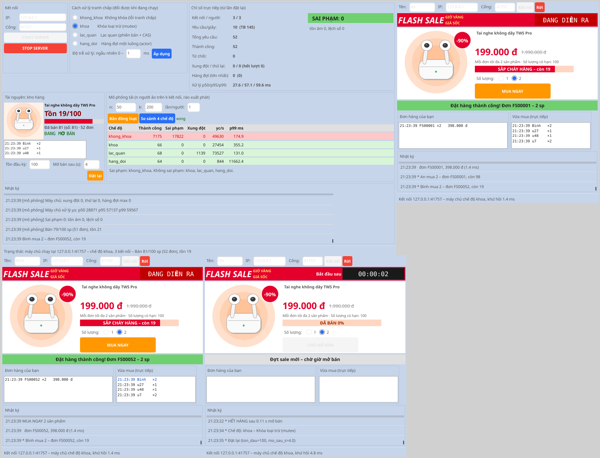
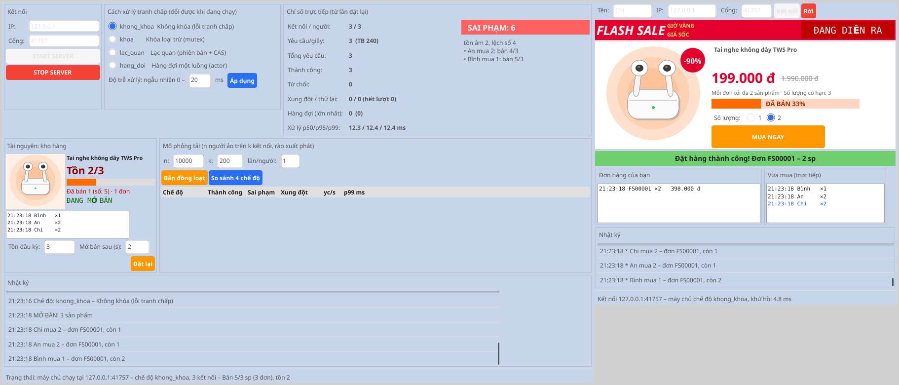
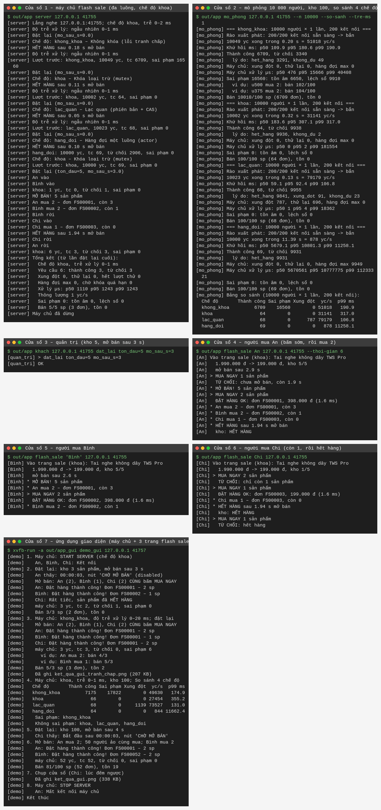

# Bài mở rộng MR6.11 – Flash sale: 10 000 người tranh 100 sản phẩm đúng giờ mở bán (Go)

| Thông tin | Nội dung |
|---|---|
| Loại | **Bài mở rộng**, không có trong giáo trình và không có mã giả tương ứng. Thuộc nhóm "tranh chấp tài nguyên" MR6.6–MR6.14, dùng chung khung của [MR6.6](../BaiMR6.6_DauGia/) |
| Liên hệ với giáo trình | Chương 6: Bài 6.1 (server đa luồng, một luồng mỗi kết nối), Bài 6.7 (kiểm thử tải); Chương 3: Bài 3.2 (định khung thông điệp theo dòng); bài mở rộng MR5.4/MR5.5 (luồng, đồng bộ) |
| Thư viện | Bản dòng lệnh: chỉ thư viện chuẩn Go (`net`, `sync`, `sync/atomic`, `encoding/json`, `math/rand/v2`). Ứng dụng giao diện (`gui/`, mô-đun riêng): Fyne v2.6.3 (cần cgo/gcc); kịch bản demo giao diện trên Linux cần Xvfb và ImageMagick (`import`) |
| Bản ngôn ngữ khác | [Python](../../../python/Chuong06/BaiMR6.11_FlashSale/), [C#](../../../csharp/Chuong06/BaiMR6.11_FlashSale/), [Java](../../../java/Chuong06/BaiMR6.11_FlashSale/), [Rust](../../../rust/Chuong06/BaiMR6.11_FlashSale/) |

## Mục tiêu
Bài mô phỏng "giờ vàng" flash sale của một sàn thương mại điện tử: kho có **100 sản phẩm** giá sốc, mở bán lúc T (đếm ngược), **10 000 người** cùng bấm "MUA NGAY" đúng lúc mở, mỗi đơn 1–2 sản phẩm. Kho là **một ô** tài nguyên – điểm nóng mà mọi đơn cùng tranh. Thao tác `mua` là "đọc tồn → kiểm tra (giả lập độ trễ cơ sở dữ liệu) → ghi tồn mới", xử lý theo **bốn cách**: không khóa, khóa loại trừ, lạc quan, hàng đợi một goroutine. Hai việc **không** cần qua vùng găng: kiểm tra giờ mở bán (chỉ đọc đồng hồ đơn điệu) và "hết hàng nhanh" (tồn chỉ giảm, đã đọc thấy 0 thì chắc chắn là 0). **Sổ kiểm toán** đếm **tồn âm** (bán vượt tồn đầu kỳ) và **lệch sổ** (tổng đã bán theo sổ ≠ tồn đầu kỳ − tồn hiện tại).

Phần khung chép nguyên từ [MR6.6](../BaiMR6.6_DauGia/) (chỉ đổi đường dẫn gói). Bài này chỉ viết nghiệp vụ, người mua dòng lệnh, trang flash sale giao diện, bảng tài nguyên của máy chủ và kịch bản demo. Giao thức và dòng in giống hệt bản Python.

## Kiến thức chính
Số liệu dưới đây lấy từ `ket_qua.txt`, là một lần chạy thật trên máy cục bộ (127.0.0.1, Go 1.24, độ trễ xử lý ngẫu nhiên **0–1 ms**). Mỗi lần chạy, số liệu lệch đi đôi chút.

```
  Chế độ       Thành công Sai phạm Xung đột  yc/s  p99 ms
  khong_khoa         6709    16560        0 51018   190.9
  khoa                 64        0        0 31141   317.0
  lac_quan             68        0      787 79179   106.8
  hang_doi             69        0        0   878 11258.1
```
(10 000 người × 1 đơn 1–2 sản phẩm, kho 100, 200 kết nối; trước mỗi chế độ, bộ mô phỏng đặt lại với `mo_sau_s=0` nên **rào xuất phát chính là giờ G**. "Thành công" là số đơn được nhận.)

- **Bán vượt kho (race condition trên điểm nóng).** Ở `khong_khoa`, hàng nghìn goroutine cùng đọc "còn 100", cùng trừ và ghi đè nhau: máy chủ nhận **6709 đơn, 10 010 sản phẩm từ kho 100** (sổ: tồn âm 6650 lần, lệch sổ 9910 sản phẩm, ví dụ `u500 mua 2: bán 102/100`). Trên máy đa lõi tranh chấp nặng hơn hẳn bản Python (Python cùng tham số: 9227 đơn). Chế độ này chỉ dùng để minh họa lỗi trong phòng lab (loopback).
- **Hết hàng nhanh, ngoài vùng găng.** Ba chế độ đúng đều bán đúng 100/100 sản phẩm (64–69 đơn), phần còn lại (gần 10 000 yêu cầu) nhận "hết hàng". Phần lớn các yêu cầu đó được trả lời **ngay** nhờ đọc tồn không khóa (tồn chỉ giảm, đọc thấy 0 thì chắc chắn 0) – không phải xếp hàng chờ khóa. Vì vậy `khoa` vẫn đạt 31 141 yc/s dù chỉ có **một** ô kho.
- **Lạc quan.** `lac_quan` có 787 xung đột (các đơn đụng nhau ở ô kho trước khi cháy hàng), sai phạm 0, thông lượng cao nhất (79 179 yc/s).
- **Hàng đợi một goroutine.** `hang_doi` đúng nhưng **mọi** yêu cầu – kể cả hàng nghìn yêu cầu đến sau khi đã hết hàng – xếp vào một hàng (vì kiểm tra "hết hàng nhanh" làm trước, nhưng lúc đó kho chưa hết; các yêu cầu đã vào hàng phải chờ tới lượt mới biết là hết): 878 yc/s, p99 11,3 s.
- **Đồng hồ mở bán.** Giờ mở bán lưu theo đồng hồ đơn điệu của máy chủ; `cap_nhat` gửi `mo_con_ms` (số ms còn lại), client tự đếm ngược. Goroutine nền (100 ms) báo "MỞ BÁN! 5 sản phẩm". Bấm sớm bị từ chối `chua_mo` mà không chạm kho.
- **Lượt chạy dòng lệnh** (kho 5, mở bán sau 3 s): An bấm sớm nhận "chưa mở bán, còn 1.9 s"; mở bán, An mua 2 (đơn FS00001), Bình mua 2 (FS00002); Chi mua 2 nhận "chỉ còn 1 sản phẩm" (`khong_du`), mua 1 thì được (FS00003), máy chủ báo "HẾT HÀNG sau 1.94 s mở bán"; Chi mua thêm nhận "hết hàng".

### Giao thức (giống hệt ở 5 ngôn ngữ)
Phần chung (chào, quản trị, `thong_ke`, `lap_lai`) xem [README MR6.6](../BaiMR6.6_DauGia/README.md#giao-thức-giống-hệt-ở-5-ngôn-ngữ).

| Chiều | Thông điệp |
|---|---|
| người dùng → server | `{"loai":"mua","ma_yc":k,"so_luong":1\|2}` (kết nối gộp thêm `"nguoi":"u17"`) |
| server → client | `{"loai":"kq","ok":true,"ma_don":"FS00001","so_luong":2,"ton":98,"nguoi":"An","thanh_tien":398000}` · `{"ok":false,"ma_loi":"chua_mo","ly_do":"chưa mở bán, còn 2.4 s","con_ms":2400}` · `"ma_loi":"het_hang"\|"khong_du"` (kèm `"ton"`) · `"sai_du_lieu"\|"xung_dot"` |
| server → tất cả | `{"loai":"cap_nhat","che_do","sp":{"ten","gia_goc","gia_sale","toi_da"},"ton_dau","ton","da_ban","so_don","ban_theo_so","mo_ban","mo_con_ms","don_gan":[{"nguoi","so_luong","gio"}…]}`; `su_kien` "MỞ BÁN! 100 sản phẩm", "An mua 2 – đơn FS00001, còn 98", "HẾT HÀNG sau 0.17 s mở bán" |
| quản trị → server | `{"loai":"dat_lai","ma_yc":k,"ten_sp","gia_goc","gia_sale","ton_dau":100,"mo_sau_s":30,"toi_da":2}` |

## Cấu trúc tệp
- `tranhchap/`: khung chung (như MR6.6) + `nghiepvu.go` (`MayChuFlashSale`: ô `kho`, đồng hồ mở bán, hết hàng nhanh, thông báo mở bán trong `dinhKy`; luật sổ kiểm toán), `nguoiao.go` (người ảo đặt 1 đơn 1–2 sản phẩm, "chỉ còn k" thì mua đúng k; `ThamSoDatLai = {mo_sau_s: 0}`).
- `main.go` (lệnh con `server`, `mo_phong`, `khach`, `flash_sale`), `chung_cli.go`, `server.go` (`--ton`, `--mo-sau`), `flash_sale.go` (người mua dòng lệnh: `mua [n]`).
- `gui/`: `chung_gui.go`, `ve.go` (khung chung), `server_gui.go`, `flash_sale_gui.go` (ảnh tai nghe vẽ bằng bút ảnh), `demo_gui.go`, `main.go`.
- `demo.json`, `ket_qua.txt`, `ket_qua.png`, `ket_qua_gui.png`, `ket_qua_gui_tranh_chap.png`: kịch bản và kết quả thực thi thật.

## Cách chạy
Chạy trong thư mục bài (Go 1.24+):
```bash
go build -o out/app .
out/app server 127.0.0.1 9000                                  # cửa sổ 1 (mở bán sau 30 s)
out/app mo_phong 127.0.0.1 9000 --n 10000 --so-sanh --tre-ms 1
out/app khach 127.0.0.1 9000 dat_lai ton_dau=5 mo_sau_s=10       # đợt mới: kho 5, mở sau 10 s
out/app flash_sale An 127.0.0.1 9000                           # gõ: mua 2
```
- Lệnh của máy chủ: `che_do …`, `tre <ms>`, `dat_lai [ten_sp=… gia_goc=… gia_sale=… ton_dau=… mo_sau_s=… toi_da=…]`, `thong_ke`, `thoat`. Tùy chọn: `--che-do`, `--tre-ms`, `--ton`, `--mo-sau`.
- Lệnh của `flash_sale`: `mua [n]`, `thoat`; dòng `@t lệnh` chờ tới giây thứ t.

Muốn tái lập kết quả, chạy từ thư mục gốc của kho: `python3 tools/demo.py go/Chuong06/BaiMR6.11_FlashSale`.

## Ứng dụng giao diện


Ảnh trên là lần chạy thật của `demo_gui` (Linux, Xvfb + Mesa llvmpipe, Fyne v2.6.3): bảng điều khiển máy chủ (trên trái), An (trên phải), Bình (dưới trái) và Chi (dưới phải, chụp lúc còn đếm ngược "Bắt đầu sau 00:00:0…", nút "CHỜ MỞ BÁN" bị khóa). Sau so sánh 4 chế độ, đợt mới kho 100 mở bán sau 4 s: An mua 2 (FS00001), 50 người ảo cùng mua, Bình mua 2 (FS00052); thanh tồn kho đỏ "SẮP CHÁY HÀNG – còn 19", danh sách "Vừa mua" cập nhật trực tiếp.



Ở bước trước đó, máy chủ chạy `khong_khoa` với độ trễ 0–20 ms, kho **3 sản phẩm**. An (2), Bình (1), Chi (2) cùng bấm MUA NGAY khi mở bán: cả ba "Đặt hàng thành công!", cả ba đều là **đơn FS00001** (ba người cùng đọc "0 đơn"), sổ kiểm toán ghi bán 5/3 – ô **SAI PHẠM** chuyển đỏ (tồn âm, lệch sổ). Cùng thao tác ở `khoa`: An, Bình được (FS00001, FS00002), Chi "Rất tiếc, sản phẩm đã HẾT HÀNG".

- **Máy chủ** (`server_gui`): phần chung giống MR6.6; **tài nguyên**: ảnh sản phẩm, tồn kho (số lớn + thanh đã bán), đã bán theo kho và theo sổ (đỏ khi lệch hoặc vượt), đồng hồ mở bán, 3 đơn gần nhất, ô tồn đầu kỳ, mở bán sau (s) và nút **Đặt lại**.
- **Trang flash sale** (`flash_sale_gui`): dải **FLASH SALE** đỏ, đồng hồ đếm ngược "Bắt đầu sau hh:mm:ss" / "ĐANG DIỄN RA" / "CHÁY HÀNG"; thẻ sản phẩm (ảnh tai nghe và hộp sạc vẽ bằng bút ảnh, nhãn "-90%", giá sale cỡ lớn, giá gốc gạch ngang), thanh tồn kho ("ĐÃ BÁN x%", "SẮP CHÁY HÀNG – còn k", "HẾT HÀNG"), chọn số lượng 1–2, nút **MUA NGAY** (khóa tới giờ mở bán), thông báo có màu, "Đơn hàng của bạn" và "Vừa mua (trực tiếp)".

### Cách chạy
```bash
go -C gui mod tidy                                   # lần đầu (cần mạng)
go -C gui build -o ../out/app_gui .
out/app_gui server_gui 127.0.0.1 41757               # bấm START SERVER (mở bán sau 30 s)
out/app_gui flash_sale_gui An 127.0.0.1 41757
out/app_gui flash_sale_gui Bình 127.0.0.1 41757
```
- **Windows:** Go 1.24+ và gcc cho cgo (như [MR6.6](../BaiMR6.6_DauGia/README.md#cách-chạy-1)). Kịch bản tự động (Linux, cần `xvfb`, `imagemagick`): `xvfb-run -a -s "-screen 0 2600x1700x24" out/app_gui demo_gui 127.0.0.1 41757`.
- Chạy riêng từng cửa sổ: mọi dòng nhật ký và cứ 5 giây một dòng số liệu cũng in ra dòng lệnh.
- Thử trên nhiều máy: đặt kho nhỏ (ví dụ bằng 1/3 số sinh viên) và mở bán sau 30 s để cả lớp cùng chờ "giờ G"; khi đó **chỉ dùng `khoa`, `lac_quan`, `hang_doi`**.

## Kết quả thực thi


## Ghi chú
- **Chạy chéo với bản Python** (đã thử): (a) `out/app mo_phong --n 10000 --so-sanh --tre-ms 1` → máy chủ Python: `khong_khoa` 9617 đơn / 23 786 sai phạm, `khoa` 70 / 0, `lac_quan` 67 / 0 (885 xung đột), `hang_doi` 60 / 0; người mua An (Go) mua 2 trong kho 3, Bình (Python) mua 2 nhận "chỉ còn 1 sản phẩm"; (b) `mo_phong.py --n 10000 --so-sanh --tre-ms 1` → máy chủ Go: `khong_khoa` 2371 / 5786, `khoa` 65 / 0, `lac_quan` 67 / 0 (1273 xung đột), `hang_doi` 64 / 0.
- Vài dòng in của khung (dòng "Lượt trước" của máy chủ, dòng "Máy chủ xử lý µs" của `hang_doi` với p99 hàng chục giây) có thể dài 65–66 ký tự khi số liệu lớn, như bản Python.
- Kiểm thử: Linux, Go 1.24.7 (`gofmt`, `go vet` sạch); giao diện: Fyne v2.6.3 dưới Xvfb (chưa thử trên Windows; cửa sổ dùng `SetFixedSize` nên có `giuVe` chống cửa sổ trắng như MR6.5).

## Bài tập gợi ý
1. Bỏ bước "hết hàng nhanh" trong `nghiepvu.go`, chạy lại `--so-sanh`. Thông lượng và p99 của `khoa`, `hang_doi` đổi thế nào? Vì sao?
2. Chia kho thành 10 ô, mỗi ô 10 sản phẩm (đơn hàng chọn ngẫu nhiên một ô còn hàng). Đó là kỹ thuật "chia nhỏ điểm nóng" (sharding). Cần sửa sổ kiểm toán ra sao?
3. Cho người ảo bấm lại khi nhận `xung_dot` (tối đa 3 lần). Số đơn của `lac_quan` và p99 thay đổi ra sao?
4. Thêm giới hạn "mỗi người tối đa 2 sản phẩm trong cả đợt" (không chỉ mỗi đơn). Tài nguyên nào bị tranh thêm?
5. Giao diện: hiện "đang có N người xem trang" lấy từ số kết nối của máy chủ.

## Đọc thêm
- H. T. Kung, J. T. Robinson (1981). *On Optimistic Methods for Concurrency Control*. ACM Transactions on Database Systems 6(2).
- Tài liệu Go: [`sync`](https://pkg.go.dev/sync), [`sync/atomic`](https://pkg.go.dev/sync/atomic), [`time`](https://pkg.go.dev/time) (đồng hồ đơn điệu), [The Go Memory Model](https://go.dev/ref/mem), [`net`](https://pkg.go.dev/net); Fyne: [Goroutines – `fyne.Do`](https://docs.fyne.io/started/goroutines).

Mã nguồn của bài được viết mới cho kho này.
