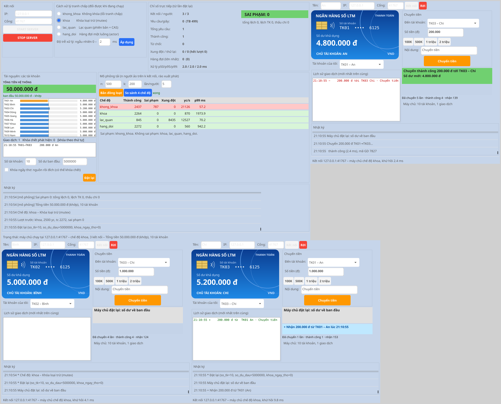
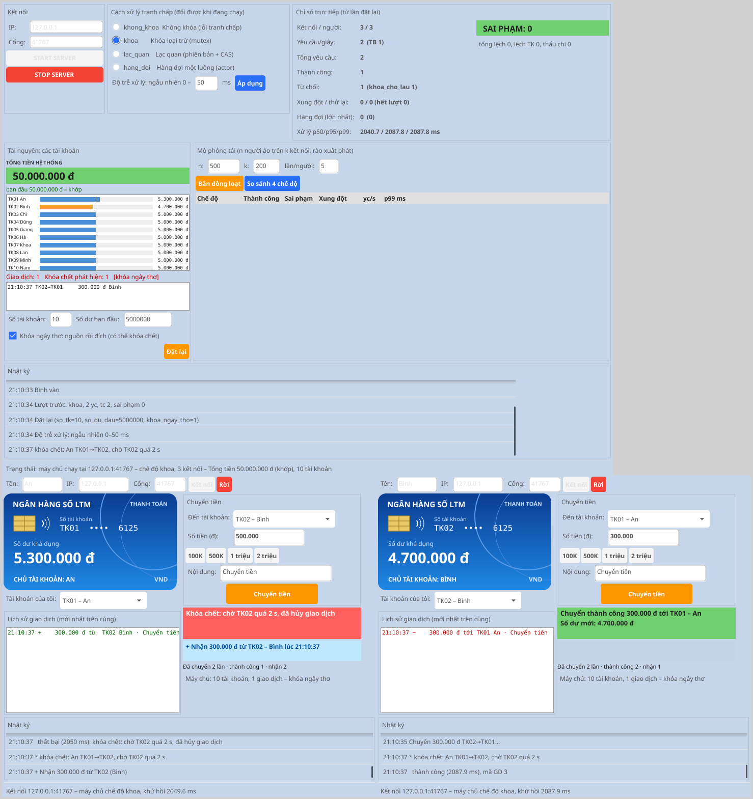
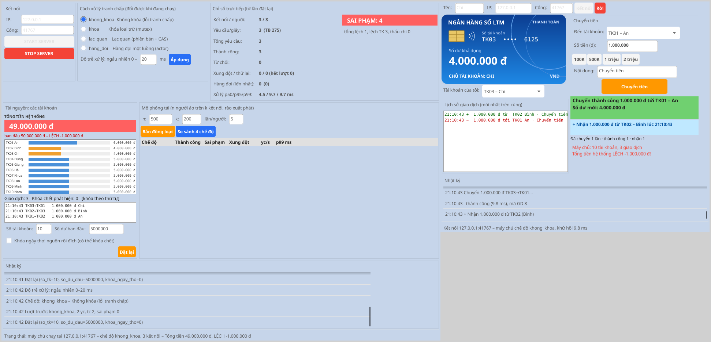
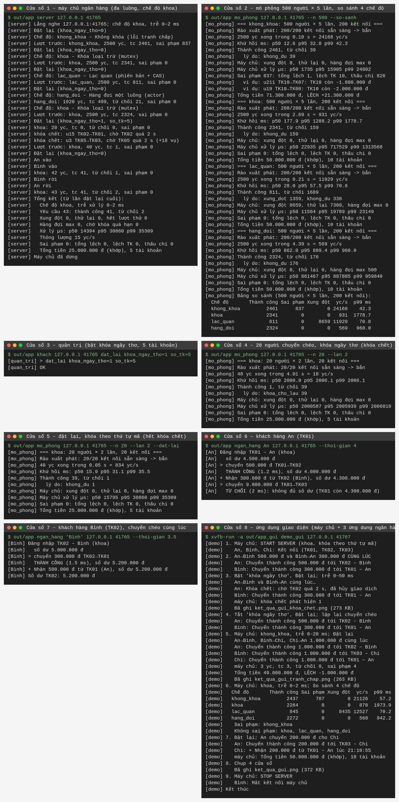

# Bài mở rộng MR6.12 – Chuyển khoản ngân hàng: chuyển chéo A→B và B→A, khóa chết và thứ tự khóa (Go)

| Thông tin | Nội dung |
|---|---|
| Loại | **Bài mở rộng**, không có trong giáo trình và không có mã giả tương ứng. Thuộc nhóm "tranh chấp tài nguyên" MR6.6–MR6.14, dùng chung khung của [MR6.6](../BaiMR6.6_DauGia/) |
| Liên hệ với giáo trình | Chương 6: Bài 6.1 (server đa luồng, một luồng mỗi kết nối), Bài 6.7 (kiểm thử tải); Chương 3: Bài 3.2 (định khung thông điệp theo dòng); bài mở rộng MR5.4/MR5.5 (luồng, đồng bộ) |
| Thư viện | Bản dòng lệnh: chỉ thư viện chuẩn Go (`net`, `sync`, `sync/atomic`, `encoding/json`, `math/rand/v2`). Ứng dụng giao diện (`gui/`, mô-đun riêng): Fyne v2.6.3 (cần cgo/gcc); kịch bản demo giao diện trên Linux cần Xvfb và ImageMagick (`import`) |
| Bản ngôn ngữ khác | [Python](../../../python/Chuong06/BaiMR6.12_ChuyenKhoan/), [C#](../../../csharp/Chuong06/BaiMR6.12_ChuyenKhoan/), [Java](../../../java/Chuong06/BaiMR6.12_ChuyenKhoan/), [Rust](../../../rust/Chuong06/BaiMR6.12_ChuyenKhoan/) |

## Mục tiêu
Bài mô phỏng một ngân hàng số có **5–20 tài khoản** (mặc định 10, mỗi tài khoản 5.000.000 đ). Thao tác `chuyen` trừ tài khoản nguồn và cộng tài khoản đích trong **cùng một thao tác** – tức là luôn đụng **hai** tài nguyên. Nhiều người chuyển chéo cùng lúc (A→B và B→A), xử lý theo **bốn cách**: không khóa, khóa loại trừ hai tài khoản **theo thứ tự mã** (TK01 trước TK02), lạc quan (so sánh-và-đổi **cả hai** ô một cách nguyên tử), hàng đợi một goroutine. Tùy chọn **khóa ngây thơ** (`khoa_ngay_tho=1`) khóa nguồn rồi mới khóa đích: A→B giữ A chờ B, B→A giữ B chờ A – **khóa chết (deadlock)**. Khung phát hiện bằng hết thời gian chờ khóa (2 s), hủy giao dịch "nạn nhân" và báo "khóa chết: …". **Sổ kiểm toán** tự tính số dư theo sổ và đếm **thấu chi** (một giao dịch làm tài khoản nguồn âm), **lệch TK** (số tài khoản có số dư khác sổ – mất cập nhật) và **tổng lệch** (tổng tiền toàn hệ thống đổi).

Phần khung chép nguyên từ [MR6.6](../BaiMR6.6_DauGia/) (chỉ đổi đường dẫn gói). Bài này chỉ viết nghiệp vụ, khách hàng dòng lệnh, ứng dụng ngân hàng giao diện, bảng tài nguyên của máy chủ và kịch bản demo. Giao thức và dòng in giống hệt bản Python.

## Kiến thức chính
Số liệu dưới đây lấy từ `ket_qua.txt`, là một lần chạy thật trên máy cục bộ (127.0.0.1, Go 1.24, độ trễ xử lý ngẫu nhiên 0–2 ms). Mỗi lần chạy, số liệu lệch đi đôi chút.

```
  Chế độ       Thành công Sai phạm Xung đột  yc/s  p99 ms
  khong_khoa         2461      837        0 24168    42.3
  khoa               2341        0        0   931  1778.7
  lac_quan            811        0     8659 11929    70.8
  hang_doi           2324        0        0   569   960.0
```
(500 người × 5 lần chuyển qua lại giữa một cặp tài khoản ngẫu nhiên, 10 tài khoản, 200 kết nối; trước mỗi chế độ đặt lại với `khoa_ngay_tho=0`.)

- **Mất cập nhật, tiền tự sinh ra.** Ở `khong_khoa`, hai goroutine cùng đọc số dư, cùng thấy "đủ tiền", cùng trừ và ghi đè nhau. Sổ kiểm toán đếm **826 lần thấu chi** (ví dụ `u211 TK10→TK07: TK10 còn -1.800.000 đ`), **10/10 tài khoản lệch sổ**, và **tổng tiền hệ thống 71.300.000 đ thay vì 50.000.000 đ** (LỆCH +21.300.000 đ). Chế độ này chỉ dùng để minh họa lỗi trong phòng lab (loopback).
- **Khóa hai tài nguyên theo thứ tự – không khóa chết.** `khoa` xin khóa hai ô theo thứ tự mã đã sắp xếp, nên mọi goroutine xin khóa cùng một thứ tự và không thể chờ vòng tròn (Coffman và cộng sự 1971). Đúng 0 sai phạm, nhưng chậm (931 yc/s, p99 1,8 s) vì 10 tài khoản là 10 điểm nóng.
- **Khóa ngây thơ → khóa chết.** Đặt lại với `khoa_ngay_tho=1 so_tk=5`, 20 người × 2 lần chuyển chéo: chỉ **1/40** giao dịch thành công, 39 bị hủy `khoa_cho_lau` sau đúng 2 s (khứ hồi p50 2,0 s). Máy chủ báo `khóa chết: u15 TK02→TK01, chờ TK02 quá 2 s` rồi gộp các vụ trong cùng một giây (`(+18 vụ)`). Đặt lại về khóa theo thứ tự: cùng tải đó 39/40 thành công trong 0,05 s (1 lần `khong_du`).
- **Lạc quan khi hai ô cùng bị ghi.** `lac_quan` đọc (số dư, phiên bản) của cả hai tài khoản rồi so sánh-và-đổi cả hai: **8659 xung đột**, chỉ 811 giao dịch thành công, phần lớn còn lại hết 5 lượt thử ("xung đột, thử lại sau"). Sai phạm 0 nhưng người dùng thấy lỗi nhiều: điều khiển lạc quan không hợp khi tranh chấp ghi cao trên ít ô (Kung & Robinson 1981).
- **Hàng đợi một goroutine.** Không cần khóa nên không thể khóa chết; đúng nhưng tuần tự (569 yc/s).
- **Lượt chạy dòng lệnh** (khóa theo thứ tự): An chuyển 500.000 đ cho Bình và Bình chuyển 300.000 đ cho An cùng lúc – cả hai thành công, mỗi người thấy "+ Nhận … từ …" với số dư mới; An chuyển 9.000.000 đ thì nhận "TỪ CHỐI: không đủ số dư (TK01 còn 4.300.000 đ)".

### Giao thức (giống hệt ở 5 ngôn ngữ)
Phần chung (chào, quản trị, `thong_ke`, `lap_lai`) xem [README MR6.6](../BaiMR6.6_DauGia/README.md#giao-thức-giống-hệt-ở-5-ngôn-ngữ).

| Chiều | Thông điệp |
|---|---|
| người dùng → server | `{"loai":"chuyen","ma_yc":k,"tu":"TK01","den":"TK02","so_tien":300000,"noi_dung":"…"}` (≤ 40 ký tự; kết nối gộp thêm `"nguoi":"u17"`) |
| server → client | `{"loai":"kq","ok":true,"tu","den","so_tien","so_du":4700000,"nguoi","noi_dung","ma_gd":17}` · `{"ok":false,"ma_loi":"khong_du","ly_do":"không đủ số dư (TK01 còn 200.000 đ)","so_du":200000}` · `"ma_loi":"khoa_cho_lau","ly_do":"khóa chết: chờ TK02 quá 2 s, đã hủy giao dịch"` · `"khong_co"\|"sai_du_lieu"\|"xung_dot"` |
| server → tất cả | `{"loai":"cap_nhat","che_do","tai_khoan":[{"ma","chu","so_du"}…],"tong","tong_dau","khoa_ngay_tho","khoa_chet","so_gd","lich_su":[{"ma","gio","nguoi","tu","den","so_tien","noi_dung"}…]}`; `su_kien` "khóa chết: u15 TK02→TK01, chờ TK02 quá 2 s (+3 vụ)" |
| quản trị → server | `{"loai":"dat_lai","ma_yc":k,"so_tk":10,"so_du_dau":5000000,"khoa_ngay_tho":0\|1}` |

## Cấu trúc tệp
- `tranhchap/`: khung chung (như MR6.6, cờ `KhoaNgayTho` của kho) + `nghiepvu.go` (`MayChuNganHang`: mỗi tài khoản một ô `int64`, thứ tự [nguồn, đích] để khóa ngây thơ giữ nguyên, báo khóa chết tối đa 1 dòng/giây, mã giao dịch tăng mãi qua các lần đặt lại; luật sổ kiểm toán), `nguoiao.go` (người ảo chuyển `lan` lần qua lại giữa một cặp tài khoản; `ThamSoDatLai = {khoa_ngay_tho: 0}`).
- `main.go` (lệnh con `server`, `mo_phong`, `khach`, `ngan_hang`), `chung_cli.go`, `server.go` (`--so-tk`, `--so-du`, `--khoa-ngay-tho`), `ngan_hang.go` (khách hàng dòng lệnh: `chuyen`, `so_du`).
- `gui/`: `chung_gui.go`, `ve.go` (khung chung), `server_gui.go`, `ngan_hang_gui.go` (thẻ tài khoản vẽ bằng bút ảnh), `demo_gui.go`, `main.go`.
- `demo.json`, `ket_qua.txt`, `ket_qua.png`, `ket_qua_gui.png`, `ket_qua_gui_tranh_chap.png`, `ket_qua_gui_khoa_chet.png`: kịch bản và kết quả thực thi thật.

## Cách chạy
Chạy trong thư mục bài (Go 1.24+):
```bash
go build -o out/app .
out/app server 127.0.0.1 9000                                  # cửa sổ 1 (gõ lệnh ở đây)
out/app mo_phong 127.0.0.1 9000 --n 500 --so-sanh              # bảng so sánh 4 chế độ
out/app khach 127.0.0.1 9000 dat_lai khoa_ngay_tho=1 so_tk=5   # bật khóa ngây thơ
out/app mo_phong 127.0.0.1 9000 --n 20 --lan 2                 # -> khóa chết, hủy sau 2 s
out/app mo_phong 127.0.0.1 9000 --n 20 --lan 2 --dat-lai       # khóa theo thứ tự: hết khóa chết
out/app ngan_hang An 127.0.0.1 9000                            # gõ: chuyen TK02 500000 tra tien
```
- Lệnh của máy chủ: `che_do …`, `tre <ms>`, `dat_lai [so_tk=… so_du_dau=… khoa_ngay_tho=0|1]`, `thong_ke`, `thoat`. Tùy chọn: `--che-do`, `--tre-ms`, `--so-tk`, `--so-du`, `--khoa-ngay-tho`.
- Lệnh của `ngan_hang`: `chuyen <TK đích> <số tiền> [nội dung]`, `so_du`, `thoat`; `--tk TK05` đăng nhập tài khoản khác (mặc định tài khoản mang tên mình); dòng `@t lệnh` chờ tới giây thứ t.

Muốn tái lập kết quả, chạy từ thư mục gốc của kho: `python3 tools/demo.py go/Chuong06/BaiMR6.12_ChuyenKhoan`.

## Ứng dụng giao diện


Ảnh trên là lần chạy thật của `demo_gui` (Linux, Xvfb + Mesa llvmpipe, Fyne v2.6.3): bảng điều khiển máy chủ (trên trái: TỔNG TIỀN HỆ THỐNG khớp, thanh số dư 10 tài khoản, bảng so sánh 4 chế độ), An (trên phải), Bình và Chi (dưới). Sau khi đặt lại, An chuyển 200.000 đ cho Chi: thẻ của An còn 4.800.000 đ, lịch sử ghi tiền ra màu đỏ; Chi thấy "+ Nhận 200.000 đ từ TK01 – An" và thẻ 5.200.000 đ.



Bật "khóa ngây thơ", đặt lại, trễ 0–50 ms: An→Bình 500.000 đ và Bình→An 300.000 đ cùng lúc. Hai giao dịch giữ mỗi bên một khóa và chờ nhau; sau 2 s, An nhận "Khóa chết: chờ TK02 quá 2 s, đã hủy giao dịch" (đỏ), giao dịch của Bình đi tiếp và thành công; máy chủ ghi "Khóa chết phát hiện: 1". Tắt ô đó và đặt lại: lặp lại thì cả hai thành công ngay.



`khong_khoa`, trễ 0–20 ms: An→Bình, Bình→Chi, Chi→An 1.000.000 đ cùng lúc. Cả ba "Chuyển thành công", nhưng các bản ghi đè nhau làm **tổng tiền hệ thống lệch** (lần chạy này: 49.000.000 đ, LỆCH −1.000.000 đ), ô tổng tiền và ô **SAI PHẠM** chuyển đỏ.

- **Máy chủ** (`server_gui`): phần chung giống MR6.6; **tài nguyên**: TỔNG TIỀN HỆ THỐNG (xanh khi khớp, đỏ khi lệch, kèm "ban đầu … – LỆCH …"), mỗi tài khoản một thanh số dư (vạch xám = số dư ban đầu, cam khi thấp hơn), số giao dịch và số vụ khóa chết, 3 giao dịch gần nhất, ô số tài khoản, số dư ban đầu, ô chọn **Khóa ngây thơ** và nút **Đặt lại**.
- **Ngân hàng số** (`ngan_hang_gui`): **thẻ tài khoản** (nền chuyển màu, góc bo, chip, biểu tượng không tiếp xúc vẽ bằng bút ảnh; số tài khoản, chủ tài khoản, SỐ DƯ cỡ lớn), chọn tài khoản của tôi, form chuyển tiền (tài khoản đích, số tiền, nút chọn nhanh 100K/500K/1 triệu/2 triệu, nội dung), thông báo nhiều dòng có màu, dòng "+ Nhận …", lịch sử giao dịch (tiền ra đỏ, tiền vào xanh).

### Cách chạy
```bash
go -C gui mod tidy                                   # lần đầu (cần mạng)
go -C gui build -o ../out/app_gui .
out/app_gui server_gui 127.0.0.1 41767               # bấm START SERVER (10 tài khoản)
out/app_gui ngan_hang_gui An 127.0.0.1 41767
out/app_gui ngan_hang_gui Bình 127.0.0.1 41767
```
- **Windows:** Go 1.24+ và gcc cho cgo (như [MR6.6](../BaiMR6.6_DauGia/README.md#cách-chạy-1)). Kịch bản tự động (Linux, cần `xvfb`, `imagemagick`): `xvfb-run -a -s "-screen 0 2600x1700x24" out/app_gui demo_gui 127.0.0.1 41767`.
- Chạy riêng từng cửa sổ: mọi dòng nhật ký và cứ 5 giây một dòng số liệu cũng in ra dòng lệnh.
- Thử trên nhiều máy: từng cặp sinh viên chuyển chéo cho nhau cùng lúc trên máy chủ của thầy, bật/tắt "khóa ngây thơ" để thấy khóa chết; **không dùng `khong_khoa`** ngoài phòng lab.

## Kết quả thực thi


## Ghi chú
- **Chạy chéo với bản Python** (đã thử): (a) `out/app mo_phong --n 500 --so-sanh` → máy chủ Python: `khong_khoa` 2408 / 928 sai phạm, `khoa` 2274 / 0, `lac_quan` 1112 / 0 (7892 xung đột), `hang_doi` 2235 / 0; khóa ngây thơ 20 × 2: 4/40 thành công, 36 `khoa_cho_lau`, máy chủ Python báo "khóa chết: …"; An (Go) và Bình (Python) chuyển chéo cùng lúc, cả hai thành công và thấy tiền đến; (b) `mo_phong.py --n 500 --so-sanh` → máy chủ Go: `khong_khoa` 2415 / 828, `khoa` 2255 / 0, `lac_quan` 901 / 0 (7939 xung đột), `hang_doi` 2275 / 0; khóa ngây thơ: 1/40 thành công, 39 `khoa_cho_lau`.
- Khóa của mỗi ô trong khung là kênh đệm 1 chỗ (`chan struct{}`) để có "chờ khóa tối đa 2 s" (`select` với `time.Timer`) – `sync.Mutex` không có `Lock` có thời hạn. Khóa ngây thơ nghỉ `tre()` giữa hai lần khóa để khe khóa chết mở rộng như bản Python.
- Kiểm thử: Linux, Go 1.24.7 (`gofmt`, `go vet` sạch); giao diện: Fyne v2.6.3 dưới Xvfb (chưa thử trên Windows; cửa sổ dùng `SetFixedSize` nên có `giuVe` chống cửa sổ trắng như MR6.5).

## Bài tập gợi ý
1. Với khóa ngây thơ, giảm thời gian chờ khóa từ 2 s xuống 0,1 s. Số giao dịch thành công và thông lượng thay đổi ra sao? Vì sao "phát hiện bằng hết giờ" có thể hủy cả giao dịch không khóa chết?
2. Thay vì hủy, cho "nạn nhân" thử lại sau một khoảng nghỉ ngẫu nhiên (backoff). Có khi nào cả hệ thống "sống mà không tiến" (livelock) không?
3. Thêm thao tác `chuyen_nhieu` (một nguồn, ba đích). Thứ tự khóa phải thế nào để vẫn không khóa chết?
4. Đo `lac_quan` với 20 tài khoản thay vì 10: số xung đột giảm bao nhiêu? Vì sao?
5. Giao diện: thêm biểu đồ tổng tiền hệ thống theo thời gian ở bảng điều khiển máy chủ.

## Đọc thêm
- E. G. Coffman, M. J. Elphick, A. Shoshani (1971). *System Deadlocks*. ACM Computing Surveys 3(2): bốn điều kiện khóa chết, phòng bằng thứ tự khóa.
- H. T. Kung, J. T. Robinson (1981). *On Optimistic Methods for Concurrency Control*. ACM Transactions on Database Systems 6(2).
- Tài liệu Go: [`sync`](https://pkg.go.dev/sync), [`sync/atomic`](https://pkg.go.dev/sync/atomic) (`CompareAndSwap`), [`time`](https://pkg.go.dev/time) (`Timer`), [The Go Memory Model](https://go.dev/ref/mem), [Effective Go – Channels](https://go.dev/doc/effective_go#channels); Fyne: [Goroutines – `fyne.Do`](https://docs.fyne.io/started/goroutines).

Mã nguồn của bài được viết mới cho kho này.
