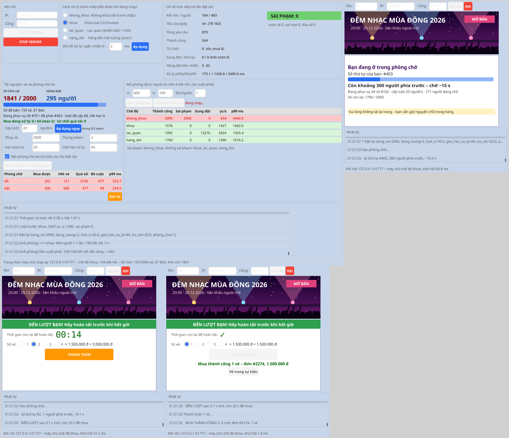
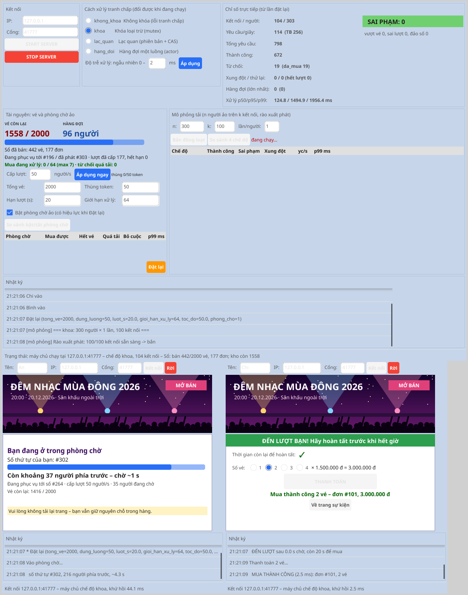
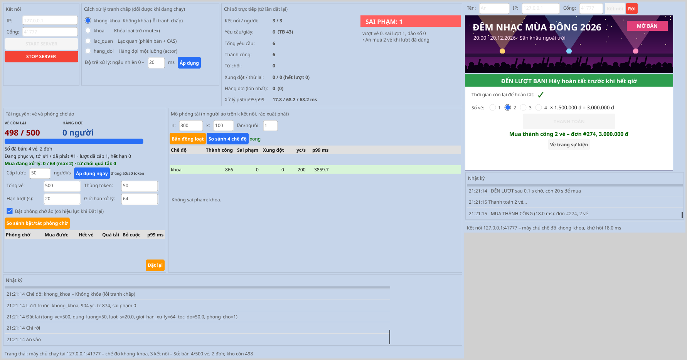
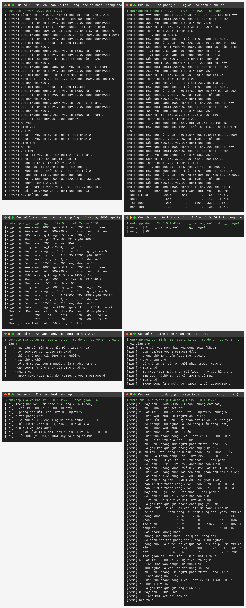

# Bài mở rộng MR6.13 – Phòng chờ ảo bán vé concert: thùng token, chờ dài, công bằng FIFO (Go)

| Thông tin | Nội dung |
|---|---|
| Loại | **Bài mở rộng**, không có trong giáo trình và không có mã giả tương ứng. Thuộc nhóm "tranh chấp tài nguyên" MR6.6–MR6.13, dùng chung khung của [MR6.6](../BaiMR6.6_DauGia/) |
| Liên hệ với giáo trình | Chương 6: Bài 6.1 (server đa luồng, một luồng mỗi kết nối), Bài 6.7 (kiểm thử tải); Chương 3: Bài 3.2 (định khung thông điệp theo dòng); bài mở rộng MR5.4/MR5.5 (luồng, đồng bộ) |
| Thư viện | Bản dòng lệnh: chỉ thư viện chuẩn Go (`net`, `sync`, `sync/atomic`, `container/heap`, `encoding/json`, `math/rand/v2`). Ứng dụng giao diện (`gui/`, mô-đun riêng): Fyne v2.6.3 (cần cgo/gcc); kịch bản demo giao diện trên Linux cần Xvfb và ImageMagick (`import`) |
| Bản ngôn ngữ khác | [Python](../../../python/Chuong06/BaiMR6.13_PhongCho/), [C#](../../../csharp/Chuong06/BaiMR6.13_PhongCho/), [Java](../../../java/Chuong06/BaiMR6.13_PhongCho/), [Rust](../../../rust/Chuong06/BaiMR6.13_PhongCho/) |

## Mục tiêu
Bài mô phỏng trang bán **500 vé concert** cho rất nhiều người cùng lúc, có **phòng chờ ảo** (virtual waiting room). Người dùng `xep_hang` để nhận số thứ tự, rồi gửi `cho_luot` – yêu cầu **chờ dài** (long polling): máy chủ giữ yêu cầu và chỉ trả lời khi tới lượt (hoặc khi hết vé). Goroutine nền của máy chủ (100 ms) cấp lượt theo **thùng token** (token bucket): token rót đều `toc_do` người/giây, thùng chứa tối đa `dung_luong` token, mỗi người tốn một token; lượt có hạn `luot_s` (20 s) để `mua` 1–4 vé. Tắt phòng chờ thì ai cũng gọi `mua` ngay; máy chủ chỉ cho tối đa `gioi_han_xu_ly` (64) yêu cầu mua đang xử lý cùng lúc, quá số đó từ chối ngay `qua_tai` (như HTTP 503).

Ba ô của kho tranh chấp đi qua **bốn cách** xử lý (không khóa, khóa loại trừ, lạc quan, hàng đợi một goroutine): `hang` (phát số thứ tự), `kho` (vé còn) và `luot:<tên>` (lượt của từng người – `mua` tiêu lượt **nguyên tử** cùng với trừ kho). **Sổ kiểm toán** đếm **vượt vé**, **sai lượt** (một đơn được nhận khi lượt đã dùng – hai tab cùng bấm mua) và **đảo số** (người vào sau nhận số thứ tự không lớn hơn người vào trước – FIFO bị phá).

Phần khung chép nguyên từ [MR6.6](../BaiMR6.6_DauGia/) (chỉ đổi đường dẫn gói); riêng `chung_cli.go` có thêm móc `lenhRieng` để `server` nhận lệnh stdin `toc_do <người/s>` (như `server.py` của bản Python thêm lệnh này). Giao thức và dòng in giống hệt bản Python.

## Kiến thức chính
Số liệu dưới đây lấy từ `ket_qua.txt`, là một lần chạy thật trên máy cục bộ (127.0.0.1, Go 1.24, độ trễ xử lý ngẫu nhiên 0–2 ms). Mỗi lần chạy, số liệu lệch đi đôi chút.

```
  Chế độ       Thành công Sai phạm Xung đột  yc/s  p99 ms
  khong_khoa         2995     2941        0   654  4425.7
  khoa               1545        0        0  1404  1647.6
  lac_quan           1086        0    14042  3339  1116.2
  hang_doi           1739        0        0  1350  1627.3
```
(1000 người, mỗi người mua 1–4 vé, phòng chờ bật, cấp lượt 200 người/s, thùng 20 token, 200 kết nối; 1/10 người là "tab thứ hai" của người liền trước. "Thành công" gồm cả `xep_hang`, `cho_luot` và `mua` thành công; khứ hồi gồm cả thời gian đứng trong phòng chờ.)

- **Mọi quy tắc đều vỡ ở `khong_khoa`.** Phát số thứ tự là "đọc – cộng 1 – ghi" trên ô `hang`: hàng trăm người cùng nhận số 1, 2, 3 (sổ: **882 lần đảo số**, ví dụ `u159 vào sau nhưng nhận số 2 ≤ 3`); trừ kho đè nhau nên bán **vượt 1964 vé** (sổ đã bán gần 2500/500); hai tab cùng tiêu một lượt (**95 lần sai lượt**). Chế độ này chỉ dùng để minh họa lỗi trong phòng lab (loopback).
- **Ba chế độ đúng.** `khoa`, `lac_quan`, `hang_doi` bán đúng 500/500 vé, 0 sai phạm. `lac_quan` có 14 042 xung đột (ô `hang` và ô `kho` bị ghi dày), 2522 yêu cầu hết lượt thử; người ảo bấm lại khi gặp `xung_dot` (tối đa 3 lần).
- **Bật / tắt phòng chờ** (`so_sanh_phong_cho`, chế độ `khoa`, 1000 người):

```
  Phòng chờ Mua được Hết vé Quá tải Bỏ cuộc p50 ms p99 ms
  tắt            206    115    2734     679   45.5  526.4
  bật            210    688     326      78   68.6  195.2
  Thời gian cả lượt: tắt 0.59 s, bật 1.81 s
```
  Tắt phòng chờ, 1000 người dồn vào `mua` cùng lúc: máy chủ từ chối **2734 lần** `qua_tai`, **679 người bỏ cuộc** sau 3 lần bấm lại, p99 thời gian mua 526 ms. Bật phòng chờ, phía "mua" chỉ nhận vài chục người mỗi 100 ms: quá tải giảm còn 326 lần, p99 còn 195 ms; đổi lại cả lượt kéo dài hơn (1,81 s) vì người dùng xếp hàng. Khác bản Python (bật: 0 quá tải), máy chủ Go vẫn có quá tải khi bật phòng chờ: các yêu cầu của cùng một kết nối gộp được xử lý **lần lượt**, nên `cho_luot`/`mua` của người đã được cấp lượt phải chờ sau các `xep_hang` còn xếp trong kết nối đó (1000 lần phát số thứ tự tuần tự trên ô `hang`, mỗi lần 0–2 ms); khi phát số xong, hàng trăm lượt mua dồn tới cùng lúc và chạm giới hạn 64 (đã kiểm: với `tre 0` thì tối đa chỉ 4 yêu cầu mua cùng lúc, 0 quá tải; mô phỏng Go chạy với máy chủ Python cũng cho 0 quá tải).
- **Chờ dài (long polling) và công bằng FIFO.** `cho_luot` không trả lời ngay mà để máy chủ giữ hàm trả lời; goroutine nền lấy người có số thứ tự nhỏ nhất ra khỏi đống nhị phân (`container/heap`) khi có token. Lượt quá hạn bị thu hồi (lượt chạy dòng lệnh: cấp lượt 0,5 người/s, An số #1 tới lượt ngay, Bình #2 bấm mua sớm bị từ chối "chưa tới lượt – hãy vào hàng chờ" rồi tới lượt sau 1,7 s, Chi #3 tới lượt sau 3,3 s và bấm đúp `mua2 4`: một đơn 4 vé, lần hai "lượt này đã dùng để mua").
- **Ô lượt tạo khi cấp lượt.** Ô `luot:<tên>` chỉ được tạo lúc cấp lượt (trước khi người đó biết mình có lượt), và `mua` đọc – ghi nó **cùng** ô `kho` trong một thao tác (khóa hai ô theo thứ tự tên, không khóa chết). Chưa có ô thì khung trả `khong_co`, máy chủ đổi thành `khong_luot`.

### Giao thức (giống hệt ở 5 ngôn ngữ)
Phần chung (chào, quản trị, `thong_ke`, `lap_lai`) xem [README MR6.6](../BaiMR6.6_DauGia/README.md#giao-thức-giống-hệt-ở-5-ngôn-ngữ).

| Chiều | Thông điệp |
|---|---|
| người dùng → server | `{"loai":"xep_hang","ma_yc":k}`, `{"loai":"cho_luot","ma_yc":k}`, `{"loai":"mua","ma_yc":k,"so_ve":2}` (kết nối gộp thêm `"nguoi":"u17"`) |
| server → client | xếp hàng: `{"loai":"kq","ok":true,"so":291,"truoc":134,"cho_s":2.7,"trang_thai":"cho"[,"da_co":true]}`; chờ dài: `{"ok":true,"luot":true,"so":291,"han_ms":20000}`; mua: `{"ok":true,"so_ve":2,"thanh_tien":3000000,"con":498,"ma_don":90}`; từ chối: `"ma_loi":"het_ve"\|"qua_tai"\|"khong_luot"\|"da_mua"\|"het_luot"\|"pc_tat"\|"chua_xep_hang"\|"dat_lai"\|"xung_dot"\|…` |
| server → tất cả | `{"loai":"cap_nhat","che_do","su_kien":{"ten","gia_ve","tong_ve","ve_toi_da","luot_s"},"phong_cho","con_lai","da_ban","toc_do","dung_luong","token","dang_phuc_vu","so_cap","dang_cho","da_cap_luot","het_han","het_ve","dang_xu_ly","xu_ly_max","gioi_han","qua_tai","so_don","ban_so","lich_su":[…]}`; `su_kien` "Đã bán hết 500 vé", "Tốc độ cấp lượt: 20 người/s" |
| quản trị → server | `{"loai":"dat_lai","ma_yc":k,"tong_ve","ve_toi_da","gia_ve","ten_su_kien","phong_cho":0\|1,"toc_do","dung_luong","luot_s","gioi_han_xu_ly"}` |

## Cấu trúc tệp
- `tranhchap/`: khung chung (như MR6.6) + `nghiepvu.go` (`MayChuPhongCho`: ô `hang`, `kho`, `luot:<tên>`; phòng chờ (người, đống nhị phân theo số thứ tự, thùng token) dưới một `sync.Mutex` riêng; chờ dài; giới hạn xử lý; `DatTocDo`; luật sổ kiểm toán), `nguoiao.go` (người ảo xep_hang → cho_luot → mua, phòng chờ tắt thì mua ngay và bấm lại khi quá tải; `DoMua`, `SoSanhPhongCho`, `BangPhongCho`; `ThamSoDatLai = {phong_cho: 1, toc_do: 200, dung_luong: 20}`).
- `main.go` (lệnh con `server`, `mo_phong`, `so_sanh_phong_cho`, `khach`, `mua_ve`), `chung_cli.go` (thêm móc `lenhRieng`), `server.go` (tùy chọn phòng chờ, lệnh `toc_do`, lệnh con `so_sanh_phong_cho`), `mua_ve.go` (người mua dòng lệnh: `xep_hang`, `mua`, `mua2`, `--tu-dong`).
- `gui/`: `chung_gui.go`, `ve.go` (khung chung), `server_gui.go`, `phong_cho_gui.go` (áp phích vẽ bằng bút ảnh, ba trang), `demo_gui.go`, `main.go`.
- `demo.json`, `ket_qua.txt`, `ket_qua.png`, `ket_qua_gui.png`, `ket_qua_gui_tranh_chap.png`, `ket_qua_gui_phong_cho.png`: kịch bản và kết quả thực thi thật.

## Cách chạy
Chạy trong thư mục bài (Go 1.24+):
```bash
go build -o out/app .
out/app server 127.0.0.1 9000                                  # cửa sổ 1 (phòng chờ bật, 50 người/s)
out/app mo_phong 127.0.0.1 9000 --n 1000 --so-sanh             # bảng so sánh 4 chế độ
out/app so_sanh_phong_cho 127.0.0.1 9000 --n 1000              # bật/tắt phòng chờ
out/app khach 127.0.0.1 9000 dat_lai toc_do=0.5 dung_luong=1   # cấp lượt chậm để thấy hàng chờ
out/app mua_ve An 127.0.0.1 9000 --tu-dong --so-ve 2
```
- Lệnh của máy chủ: `che_do …`, `tre <ms>`, `toc_do <người/s>` (đổi ngay, không đặt lại), `dat_lai [k=v …]`, `thong_ke`, `thoat`. Tùy chọn: `--che-do`, `--tre-ms`, `--tong-ve`, `--toc-do`, `--dung-luong`, `--luot-s`, `--gioi-han`, `--tat-phong-cho`.
- Lệnh của `mua_ve`: `xep_hang`, `mua <n>`, `mua2 <n>` (bấm đúp), `thoat`; `--tu-dong` vào hàng ngay và tới lượt thì tự mua `--so-ve` vé; dòng `@t lệnh` chờ tới giây thứ t.

Muốn tái lập kết quả, chạy từ thư mục gốc của kho: `python3 tools/demo.py go/Chuong06/BaiMR6.13_PhongCho`.

## Ứng dụng giao diện


Ảnh trên là lần chạy thật của `demo_gui` (Linux, Xvfb + Mesa llvmpipe, Fyne v2.6.3): bảng điều khiển máy chủ (trên trái), An (trên phải), Bình và Chi (dưới). Đặt lại: 2000 vé, cấp lượt 20 người/s, thùng 2 token. Bình và Chi vào hàng, tới lượt ngay (Bình đang ở trang chọn vé, đồng hồ lượt đếm ngược; Chi đã mua 1 vé). 400 người ảo ùa vào, An vào hàng sau họ: "Còn khoảng 300 người phía trước – chờ ~15 s", thanh tiến trình vị trí; bảng máy chủ hiện hàng đợi, số đang phục vụ, thùng token, số yêu cầu mua đang xử lý và bảng so sánh bật/tắt phòng chờ.



Đầu kịch bản (2000 vé, 50 người/s): Chi vào hàng đầu tiên và tới lượt ngay ("ĐẾN LƯỢT BẠN!"), mua 2 vé; 300 người ảo ùa vào; An, Bình vào hàng sau họ – An số #302, "Còn khoảng 132 người phía trước – chờ ~3 s"; An tới lượt với đồng hồ 00:18 và mua 3 vé.



`khong_khoa`, trễ 0–20 ms: cửa sổ Chi đăng nhập lại tên **An** (tab thứ hai của An). Hai tab cùng vào hàng (tab hai nhận lại chỗ cũ), cùng tới lượt, cùng bấm THANH TOÁN 2 vé với **một** lượt: cả hai đơn được nhận (#273, #274) – ô **SAI PHẠM** chuyển đỏ ("An mua 2 vé khi lượt đã dùng"). Ở `khoa`, tab thứ hai nhận "Lượt này đã được dùng để mua".

- **Máy chủ** (`server_gui`): phần chung giống MR6.6; **tài nguyên**: VÉ CÒN LẠI (thanh), HÀNG ĐỢI, sổ đã bán (đỏ khi vượt), đang phục vụ / đã phát số / lượt đã cấp / hết hạn, số yêu cầu mua đang xử lý so với giới hạn và số lần quá tải, ô tốc độ cấp lượt + **Áp dụng ngay**, mức token, tham số đặt lại, ô **Bật phòng chờ ảo**, nút **So sánh bật/tắt phòng chờ** với bảng hai dòng (đỏ khi có quá tải).
- **Bán vé concert** (`phong_cho_gui`): áp phích (nền chuyển màu, sao, đèn sân khấu, đám đông vẽ bằng bút ảnh); ba trang: **Sự kiện** (giá vé, thanh vé còn lại, nút "VÀO HÀNG CHỜ MUA VÉ" / "MUA VÉ NGAY"), **Phòng chờ** (số thứ tự, thanh tiến trình vị trí, "Còn khoảng … người phía trước – chờ ~… s", số đang phục vụ), **Chọn vé** ("ĐẾN LƯỢT BẠN!", đồng hồ lượt đỏ khi < 5 s, số vé, thành tiền, THANH TOÁN, kết quả, "Về trang sự kiện").

### Cách chạy
```bash
go -C gui mod tidy                                   # lần đầu (cần mạng)
go -C gui build -o ../out/app_gui .
out/app_gui server_gui 127.0.0.1 41777               # bấm START SERVER (phòng chờ bật)
out/app_gui phong_cho_gui An 127.0.0.1 41777
out/app_gui phong_cho_gui Bình 127.0.0.1 41777
```
- **Windows:** Go 1.24+ và gcc cho cgo (như [MR6.6](../BaiMR6.6_DauGia/README.md#cách-chạy-1)). Kịch bản tự động (Linux, cần `xvfb`, `imagemagick`): `xvfb-run -a -s "-screen 0 2600x1700x24" out/app_gui demo_gui 127.0.0.1 41777`.
- Chạy riêng từng cửa sổ: mọi dòng nhật ký và cứ 5 giây một dòng số liệu cũng in ra dòng lệnh.
- Thử trên nhiều máy: đặt cấp lượt 1–2 người/s để cả lớp thấy hàng chờ chạy dần; **chỉ dùng `khoa`, `lac_quan`, `hang_doi`**.

## Kết quả thực thi


## Ghi chú
- **Chạy chéo với bản Python** (đã thử): (a) `out/app mo_phong --n 1000 --so-sanh` → máy chủ Python: `khong_khoa` 2979 / 2922 sai phạm, `khoa` 1420 / 0, `lac_quan` 1218 / 0, `hang_doi` 1651 / 0; `out/app so_sanh_phong_cho` → máy chủ Python: tắt 2741 quá tải / 681 bỏ cuộc, bật 0 / 0 (p99 487 → 80 ms); An (Go, `--tu-dong`) và Chi (Python, `mua2 4`) cùng hàng chờ của máy chủ Python; (b) `mo_phong.py --n 1000 --so-sanh` → máy chủ Go: `khong_khoa` 2635 / 2344, `khoa` 1517 / 0, `lac_quan` 1111 / 0, `hang_doi` 1745 / 0; `so_sanh_phong_cho.py` → máy chủ Go: tắt 2812 quá tải / 666 bỏ cuộc, bật 48 / 12.
- Trạng thái phòng chờ (danh sách người, hàng, thùng token, các hàm trả lời đang giữ) nằm dưới một `sync.Mutex` riêng – không phải tài nguyên tranh chấp của bài; các hàm trả lời được gọi **ngoài** khóa đó.
- Dòng "Máy chủ: xung đột …" của `lac_quan` có thể dài 65 ký tự khi số xung đột vượt 10 000 (định dạng của khung chung).
- Kiểm thử: Linux, Go 1.24.7 (`gofmt`, `go vet` sạch); giao diện: Fyne v2.6.3 dưới Xvfb (chưa thử trên Windows; cửa sổ dùng `SetFixedSize` nên có `giuVe` chống cửa sổ trắng như MR6.5).

## Bài tập gợi ý
1. Chạy `so_sanh_phong_cho` với `tre 0` rồi `tre 2`. Vì sao số lần quá tải khi bật phòng chờ phụ thuộc vào thời gian phát số thứ tự? Sửa bộ mô phỏng để mỗi người ảo đi trên một kết nối riêng (k = n) và đo lại.
2. Thay ô `hang` (đọc – cộng 1 – ghi) bằng `atomic.Int64.Add`. Còn cần đi qua 4 chế độ không? Số đảo thứ tự ở `khong_khoa` thay đổi thế nào?
3. Đổi thùng token thành "cửa sổ trượt" (sliding window): cấp đúng `toc_do` người mỗi giây. Khác nhau thế nào khi có đợt dồn?
4. Thêm ưu tiên (thành viên VIP được xếp trước). Làm sao giữ công bằng FIFO trong từng nhóm?
5. Giao diện: hiện vị trí của mình trên một "đường hàng" có các chấm người phía trước, chạy dần khi tới lượt.

## Đọc thêm
- H. T. Kung, J. T. Robinson (1981). *On Optimistic Methods for Concurrency Control*. ACM Transactions on Database Systems 6(2).
- E. G. Coffman, M. J. Elphick, A. Shoshani (1971). *System Deadlocks*. ACM Computing Surveys 3(2).
- Tài liệu Go: [`sync`](https://pkg.go.dev/sync), [`sync/atomic`](https://pkg.go.dev/sync/atomic), [`container/heap`](https://pkg.go.dev/container/heap), [`time`](https://pkg.go.dev/time), [The Go Memory Model](https://go.dev/ref/mem); Fyne: [Goroutines – `fyne.Do`](https://docs.fyne.io/started/goroutines).

Mã nguồn của bài được viết mới cho kho này.
