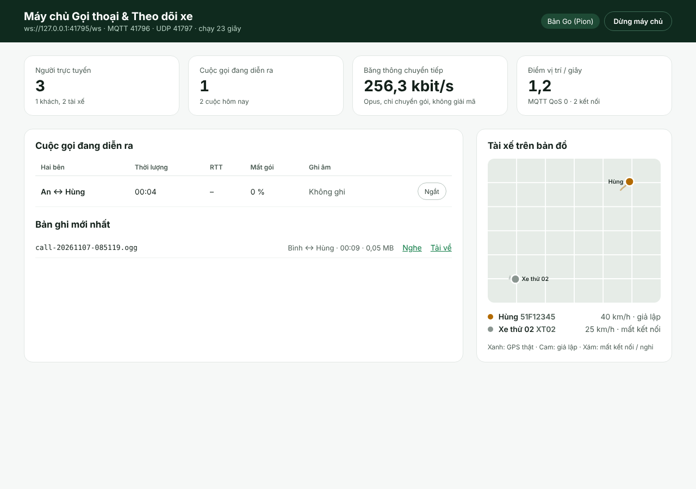
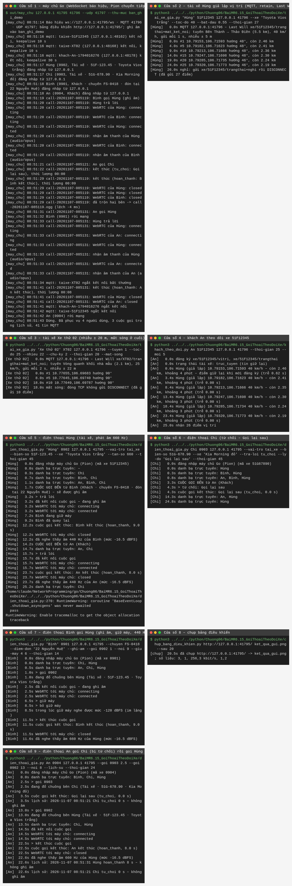

# Bài mở rộng MR6.15 – Gọi thoại qua máy chủ trung gian và theo dõi vị trí tài xế (máy chủ Go)

| Thông tin | Nội dung |
|---|---|
| Loại | **Bài mở rộng**, không có trong giáo trình và không có mã giả tương ứng. Bài gồm máy chủ (Go và [Python](../../../python/Chuong06/BaiMR6.15_GoiThoaiTheoDoiXe/)) và [app Android](../../../android/Chuong06/BaiMR6.15_GoiThoaiTheoDoiXe/) |
| Liên hệ với giáo trình | Chương 6: MR6.2 (hội thoại âm thanh), MR6.7 (đặt xe), Bài 6.1 (server phục vụ nhiều kết nối); Chương 7: Bài 7.8 (MQTT), Bài 7.4 (WebSocket); Chương 8: Bài 8.4 (TLS) |
| Thư viện | `github.com/pion/webrtc/v4` (WebRTC, ghi Ogg bằng `pkg/media/oggwriter`), `github.com/pion/ice/v4` (một cổng UDP cho mọi kết nối), `github.com/pion/interceptor` (NACK, báo cáo RTCP), `github.com/gorilla/websocket`; `net/http` của thư viện chuẩn (mẫu đường dẫn có phương thức, Go 1.22+). MQTT broker **tự viết** (`mqtt.go`). Tùy chọn: `ffmpeg` để trộn hai bên |
| Mô-đun | **Mô-đun riêng** (`go.mod` trong thư mục bài) vì mô-đun gốc `go/` chỉ dùng thư viện chuẩn |
| Bản khác | Máy chủ [Python](../../../python/Chuong06/BaiMR6.15_GoiThoaiTheoDoiXe/) (aiortc), app [Android](../../../android/Chuong06/BaiMR6.15_GoiThoaiTheoDoiXe/) |

## Mục tiêu
Giống bản Python (xem [README bản Python](../../../python/Chuong06/BaiMR6.15_GoiThoaiTheoDoiXe/README.md) cho mục tiêu, giao thức báo hiệu, chủ đề MQTT, đường dẫn HTTP – ba bản dùng **cùng một giao thức**, app Android nối được vào máy chủ nào cũng được): báo hiệu cuộc gọi qua WebSocket `/ws`, âm thanh WebRTC đi **qua máy chủ** (SFU), ghi âm từng bên rồi trộn, MQTT broker cho vị trí tài xế, bảng điều khiển ở `http://<IP>:<cổng>/` (cùng tệp `bang_dieu_khien.html`, nhúng vào chương trình bằng `//go:embed`).

Điểm khác là **cách chuyển tiếp âm thanh**: bản Go không giải mã.

## Kiến thức chính
Số liệu lấy từ `ket_qua.txt`, một lần chạy thật trên máy cục bộ (Linux, Go 1.24, 127.0.0.1) với **đúng kịch bản và đúng các công cụ Python** của bản Python (điện thoại giả, tài xế giả lập, khách theo dõi) – chính là phép thử chạy chéo: client Python, máy chủ Go.

```
[may_chu] 08:51:20 call-20261107-085119: nhận âm thanh của Bình (audio/opus)
[Hùng]  12.2s đã nghe thấy âm 440 Hz của Bình (mức -16.5 dBFS)
[Bình]   8.5s trong lúc giữ máy nghe được mức -120 dBFS (im lặng)
[Bình]  11.6s đã nghe thấy âm 660 Hz của Hùng (mức -16.5 dBFS)
[may_chu] 08:51:29 call-20261107-085119: đã trộn hai bên -> call-20261107-085119.ogg (lệch -4 ms)
[may_chu] 08:51:34 mqtt: taixe-XT02 ngắt kết nối bất thường
```

- **Chuyển nguyên gói RTP.** Với mỗi bên, máy chủ đọc gói RTP Opus từ `TrackRemote` (`ReadRTP`) và ghi nguyên gói vào `TrackLocalStaticRTP` gửi cho bên kia (`WriteRTP`); Pion tự đổi SSRC và *payload type* cho đúng phiên bên kia. Không có bước giải mã – mã hóa lại như aiortc, nên CPU gần như chỉ dành cho mã hóa SRTP. Mức âm nghe được giữ nguyên −16,5 dBFS ở cả hai chiều (bản Python −17,1 đến −17,7 dBFS do qua thêm một lần mã hóa).
- **Ghi âm bằng gói gốc.** `oggwriter` ghi thẳng gói Opus nhận được vào tệp Ogg, nên chất lượng và kích thước tệp từng bên phụ thuộc tốc độ bit **của điện thoại gửi**: với điện thoại giả (aiortc) mỗi tệp khoảng 150 KB cho 9 s (≈ 130 kbit/s), trong khi bản Python mã hóa lại ở 24 kbit/s nên chỉ khoảng 42 KB. Tệp trộn do `ffmpeg` mã hóa lại ở 32 kbit/s nên cả hai bản đều khoảng 51 KB.
- **Giữ máy** chỉ là ngừng gọi `WriteRTP` (vẫn đọc và ghi âm), bên kia nhận im lặng (−120 dBFS).
- **Một cổng UDP cho mọi kết nối.** `ice.NewMultiUDPMuxFromPort(50000)` cho mọi `RTCPeerConnection` dùng chung một socket UDP; gói STUN đầu tiên (mang *username fragment* của phiên) cho biết gói thuộc kết nối nào. Tường lửa chỉ cần mở **UDP 50000** (bản Python mở cổng ngẫu nhiên cho từng kết nối). `SetIncludeLoopbackCandidate(true)` để thử trên 127.0.0.1; chỉ dùng IPv4.
- **Băng thông**: bảng điều khiển đo khoảng **256 kbit/s** cho một cuộc gọi (tổng kích thước gói RTP máy chủ chuyển đi trong 2 s, chưa tính phần SRTP và UDP/IP): đúng bằng tốc độ bit điện thoại giả gửi lên (≈ 130 kbit/s mỗi chiều) vì máy chủ chuyển nguyên gói. Bản Python đo 227 kbit/s theo tốc độ bit của bộ mã hóa trong aiortc.
- **Đọc RTCP của track gửi đi.** Mỗi `RTPSender` có một goroutine đọc RTCP (`sender.Read`) – bắt buộc để bộ chặn NACK và báo cáo nhận (RR/SR) của `interceptor` hoạt động. RTT ở bảng điều khiển là con số điện thoại tự đo và gửi lên (`thong_ke`), nên những giây đầu cuộc gọi có thể hiện "–" khi chưa có báo cáo RTCP.
- **MQTT**: mỗi kết nối một goroutine đọc, ghi qua khóa riêng của kết nối; bảng đăng ký và tin giữ lại dùng chung một khóa. Hạn đọc (`SetReadDeadline`) = 1,5 × keepalive, quá hạn thì đóng và phát Last Will.

## Cấu trúc tệp
- `maychu.go`: `MayChu` (danh bạ, `xuLyWs` đọc tin JSON, `xuLyTin`, `batDauGoi`, `nhanOffer` tạo `RTCPeerConnection` và nối hai bên, `nhanIce`, `ketThuc` ghi lịch sử và gọi `tron` (ffmpeg), `nhanMqtt` cho bản đồ, `doBangThong`, `trangThai` cho `/api/trangthai`), `taoAPI` (codec Opus, interceptor, UDP mux), `taoChungChi` (`--tls`), `main` (các đường HTTP).
- `mqtt.go`: MQTT broker tự viết.
- `bang_dieu_khien.html`: trang bảng điều khiển (giống hệt bản Python).
- `go.mod`: mô-đun riêng; `go.sum` tạo khi chạy `go mod tidy` (không đưa lên kho).
- `demo.json`, `ket_qua.txt`, `ket_qua.png`, `ket_qua_gui.png`: kịch bản và kết quả thực thi thật (kịch bản gọi các công cụ trong thư mục bản Python).

## Cách chạy
```bash
go mod tidy                                    # lần đầu: tải Pion, gorilla/websocket, tạo go.sum (cần mạng)
go run . 0.0.0.0 8080 1883 --udp 50000         # báo hiệu 8080, MQTT 1883, WebRTC UDP 50000
# hoặc biên dịch một lần: go build -o may_chu . (Windows: go build -o may_chu.exe .)
```
- `maychu [host] [cổng_http] [cổng_mqtt] [--udp 50000] [--tls] [--thu-muc ban_ghi]`. `--tls`: `https`/`wss` với chứng chỉ tự ký trong `chung_chi/`, in **vân tay SHA-256** để nhập vào app.
- Điện thoại giả, tài xế giả lập, khách theo dõi: dùng các công cụ của bản Python (cần `aiortc`, `aiohttp`, `numpy`), ví dụ từ thư mục này:
  ```bash
  python3 ../../../python/Chuong06/BaiMR6.15_GoiThoaiTheoDoiXe/tai_xe_gia.py Hùng 51F12345 127.0.0.1 1883 --toc-do 30
  python3 ../../../python/Chuong06/BaiMR6.15_GoiThoaiTheoDoiXe/dien_thoai_gia.py Hùng 0902 127.0.0.1 8080 --vai-tro tai_xe --bien-so 51F-123.45 --tan-so 660
  ```
- Với điện thoại thật: cùng Wi-Fi với máy chạy máy chủ, mở tường lửa **TCP 8080, TCP 1883, UDP 50000** (Windows: lần đầu chạy bấm **Allow** cho chương trình ở mạng *Private*), nhập IP máy tính vào app.
- `ffmpeg` (tùy chọn, để trộn): `winget install -e --id Gyan.FFmpeg` hoặc `sudo apt install ffmpeg`.

Muốn tái lập kết quả, chạy từ thư mục gốc của kho: `python3 tools/demo.py go/Chuong06/BaiMR6.15_GoiThoaiTheoDoiXe`.

## Ứng dụng giao diện


Ảnh chụp bảng điều khiển ở giây thứ 20 của kịch bản: 3 người trực tuyến, cuộc gọi An ↔ Hùng đang diễn ra, băng thông chuyển tiếp 256,3 kbit/s, 1,2 điểm vị trí/giây, bản ghi cuộc Bình ↔ Hùng, bản đồ có xe Hùng (giả lập) và xe XT02 (mất kết nối). Nhãn góc trên ghi "Bản Go (Pion)". Giao diện điện thoại: [app Android](../../../android/Chuong06/BaiMR6.15_GoiThoaiTheoDoiXe/).

## Kết quả thực thi


## Ghi chú
- Như bản Python: chỉ dùng trong mạng lab (báo hiệu mặc định không mã hóa, không xác thực người dùng, MQTT không mật khẩu; âm thanh WebRTC luôn mã hóa DTLS-SRTP); chỉ ghi âm khi người gọi đồng ý và người nghe được báo trước; xóa `ban_ghi/` sau buổi thực hành; qua Internet cần STUN/TURN.
- Chương trình bắt Ctrl+C (và SIGTERM trên Linux): kết thúc các cuộc gọi đang diễn ra để đóng và trộn bản ghi rồi mới thoát. `POST /api/dung` từ 127.0.0.1 cũng dừng máy chủ (nút "Dừng máy chủ" trên bảng điều khiển).
- Lần biên dịch đầu tải mô-đun từ `proxy.golang.org`; phiên bản dùng khi kiểm thử: Pion WebRTC v4.2.9, ICE v4.2.1, interceptor v0.1.44, gorilla/websocket v1.5.3, Go 1.24.

## Bài tập gợi ý
1. Thêm `SetNAT1To1IPs` (SettingEngine) để máy chủ đặt sau NAT vẫn quảng bá đúng IP công khai. Khi nào cần, khi nào không?
2. Ghi lại số gói RTP mỗi bên gửi và số gói chuyển đi; tính tỉ lệ mất gói phía máy chủ và so với số liệu `thong_ke` điện thoại gửi lên.
3. Bản Go không giải mã nên không "nghe" được nội dung. Muốn làm **phát hiện im lặng** (cả hai bên không nói 60 s thì tự kết thúc) mà vẫn không giải mã, có thể dùng thông tin nào trong gói RTP (gợi ý: phần mở rộng *audio level*, RFC 6464)?

## Đọc thêm
- Tài liệu [Pion WebRTC](https://github.com/pion/webrtc) (thư mục `examples/`, đặc biệt `broadcast`, `save-to-disk`), [pion/ice](https://github.com/pion/ice) (UDP mux).
- J. Lennox, E. Ivov, E. Marocco (2011). *A Real-time Transport Protocol (RTP) Header Extension for Client-to-Mixer Audio Level Indication*. RFC 6464.
- Các RFC về WebRTC, RTP, Opus, WebSocket và chuẩn MQTT 3.1.1: xem [README bản Python](../../../python/Chuong06/BaiMR6.15_GoiThoaiTheoDoiXe/README.md#đọc-thêm).

Mã nguồn của bài được viết mới cho kho này.
