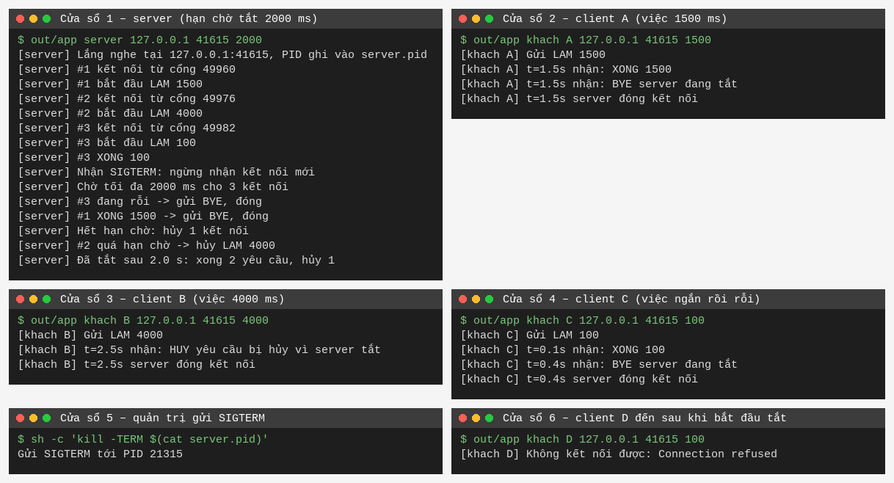

# Bài mở rộng MR6.1 – Tắt server an toàn (graceful shutdown) (Go)

| Thông tin | Nội dung |
|---|---|
| Loại | **Bài mở rộng** – không có trong giáo trình, không có mã giả tương ứng |
| Liên hệ với giáo trình | Chương 6: Bài 6.2 (server bất đồng bộ), Bài 6.1 (server đa luồng); Chương 5: Bài 5.6 (hạn chót, hủy) |
| Thư viện | Thư viện chuẩn Go: `net`, `context`, `sync` (`WaitGroup`, `sync.Map`), `os/signal` |
| Bản ngôn ngữ khác | [C#](../../../csharp/Chuong06/BaiMR6.1_TatServerAnToan/), [Java](../../../java/Chuong06/BaiMR6.1_TatServerAnToan/), [Python](../../../python/Chuong06/BaiMR6.1_TatServerAnToan/), [Rust](../../../rust/Chuong06/BaiMR6.1_TatServerAnToan/) |

## Mục tiêu
Server thật không bị “rút điện”: hệ điều hành, systemd, Docker hay Kubernetes gửi tín hiệu SIGTERM và cho một khoảng thời gian trước khi buộc dừng (SIGKILL). Bài cài đặt quy trình tắt bốn bước: (1) đóng socket nghe – client mới bị từ chối; (2) kết nối đang rỗi nhận `BYE` rồi đóng ngay; (3) kết nối đang làm dở được làm xong yêu cầu hiện tại, nhận kết quả, rồi `BYE`; (4) quá hạn chờ thì hủy phần còn lại và báo `HUY`. Giao thức dòng văn bản: client gửi `LAM <ms>`, server mô phỏng công việc dài `<ms>` mili giây rồi trả `XONG <ms>`.

## Tệp
- `main.go` – chọn vai trò: `server`, `khach`.
- `server.go` – hai ngữ cảnh `stopCtx` (ngừng nhận việc) và `forceCtx` (hủy việc dở), `WaitGroup` đếm kết nối.
- `client.go` – client thử.
- `demo.json` – kịch bản chạy minh họa (dùng với `tools/demo.py`).
- `ket_qua.txt`, `ket_qua.png` – kết quả thực thi thật.

## Cách chạy
Trong thư mục bài:
```bash
go build -o out/app .        # hoặc thay out/app bằng go run .
out/app server 127.0.0.1 9000 2000        # cửa sổ 1: hạn chờ 2000 ms
out/app khach A 127.0.0.1 9000 1500       # cửa sổ 2
out/app khach B 127.0.0.1 9000 4000       # cửa sổ 3
kill -TERM $(cat server.pid)              # cửa sổ 4 (hoặc Ctrl+C ở cửa sổ 1)
```
Server ghi PID vào `server.pid` khi khởi động và xóa tệp này khi tắt xong.

Tái lập kết quả từ thư mục gốc của kho: `python3 tools/demo.py go/Chuong06/BaiMR6.1_TatServerAnToan`.

## Kết quả thực thi


Ba client A, B, C kết nối; C làm xong việc ngắn và đang rỗi. Khi quản trị gửi SIGTERM (t ≈ 0,4 s), server ngừng nhận kết nối mới – client D đến sau bị từ chối ngay (*Connection refused*). C nhận `BYE` tức thì; A làm nốt việc 1500 ms, nhận `XONG 1500` rồi `BYE`; việc 4000 ms của B vượt hạn chờ 2000 ms nên bị hủy đúng lúc t ≈ 2,5 s và B nhận `HUY`. Server tắt sau 2,0 s với 2 yêu cầu xong (C và A), 1 yêu cầu bị hủy. Hai bản cho cùng trình tự sự kiện.

## Ghi chú
- Hạn chờ của server phải nhỏ hơn thời gian mà trình quản lý tiến trình chờ trước khi gửi SIGKILL (ví dụ `docker stop` mặc định 10 s).
- Với server HTTP, Go có sẵn `http.Server.Shutdown(ctx)` (từ Go 1.8) thực hiện các bước 1–3; sách *Go in Practice* (2016) còn dùng gói ngoài `manners` cho việc này, nay không cần nữa.
- Trên Windows không có lệnh `kill -TERM`; dùng Ctrl+C (SIGINT) – server xử lý SIGINT giống SIGTERM.
- Mỗi kết nối có một goroutine phụ đọc dòng và gửi vào kênh, nhờ đó vòng phục vụ dùng `select` để chờ đồng thời *dòng lệnh mới* và `stopCtx.Done()`; công việc dài dùng `select` giữa `time.After` và `forceCtx.Done()`.
- Kiểm thử: Linux, Go 1.24.7 (`gofmt`, `go vet` sạch).

## Đọc thêm
- Matt Butcher, Matt Farina, *Go in Practice*, Manning, 2016, Chương 2 (Technique 5 *Graceful shutdowns using manners*) và Chương 3 (Techniques 10–15: goroutine, `WaitGroup`, kênh).
- Claus Töpke, *Network Programming and Automation Essentials*, Packt, 2023, Chương 8 *Scaling Your Code* (đa luồng, coroutine).

Mã nguồn của bài được viết mới cho kho này; sách trên chỉ là tài liệu tham khảo ý tưởng.
