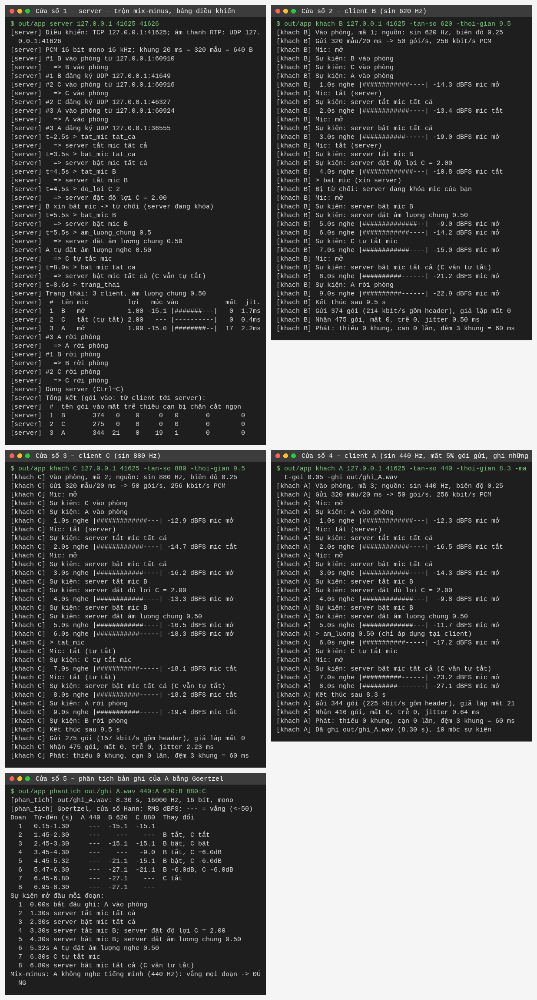

# Bài mở rộng MR6.2 – Phòng hội thoại âm thanh nhiều client (Go)

| Thông tin | Nội dung |
|---|---|
| Loại | **Bài mở rộng** – không có trong giáo trình, không có mã giả tương ứng |
| Liên hệ với giáo trình | Chương 6: Bài 6.1 (server đa luồng), Bài 6.4 (server chat nhiều client); Chương 4: Bài 4.1 (UDP); Chương 3: Bài 3.2 (định khung thông điệp) |
| Thư viện | Thư viện chuẩn Go: `net`, `sync`, `encoding/binary`, `encoding/json`, `math`, `os/signal`, `flag` |
| Bản ngôn ngữ khác | [Python](../../../python/Chuong06/BaiMR6.2_HoiThoaiAmThanh/) |

## Mục tiêu
Xây dựng một "phòng họp thoại" thu nhỏ: n client nối tới một server; mỗi client gửi âm thanh micro dạng PCM qua UDP, server **trộn tiếng** và gửi cho mỗi người tiếng của *những người khác* ("mix-minus"). Kênh điều khiển TCP cho phép server tắt/bật mic của tất cả hoặc từng người, đặt độ lợi đầu vào từng người, âm lượng chung; mỗi client tự tắt mic và tự chỉnh âm lượng nghe. Client ghi lại những gì nghe được thành tệp WAV; chương trình phân tích tần số (thuật toán Goertzel) **chứng minh bằng số liệu** rằng mỗi lệnh điều khiển đã có hiệu lực.

## Kiến thức chính
- **Âm thanh số.** Lấy mẫu 16 000 lần/giây, mỗi mẫu 16 bit có dấu, một kênh (mono) → 16 000 × 16 = 256 kbit/s. Khung 20 ms = 320 mẫu = 640 byte → 50 gói/giây. Phụ phí header mỗi gói 12 (RTP) + 8 (UDP) + 20 (IPv4) = 40 byte → 16 kbit/s; tổng ≈ 272 kbit/s mỗi chiều cho mỗi client (đúng với số `272 kbit/s gồm header` client in ra khi mic mở suốt).
- **Hai kênh, hai giao thức.** Điều khiển cần tin cậy, đúng thứ tự → TCP, mỗi dòng một JSON (định khung theo dòng như Bài 3.2). Âm thanh cần đến đúng lúc → UDP: mất một gói chỉ mất 20 ms, còn truyền lại kiểu TCP sẽ đến quá muộn để phát.
- **Gói RTP (RFC 3550).** Header 12 byte: `V=2`, payload type (96 = âm thanh L16, 127 = gói giữ kết nối rỗng), **số thứ tự** 16 bit (phát hiện mất, đảo thứ tự), **nhãn thời gian** 32 bit tính bằng mẫu (tăng 320 mỗi khung, *kể cả khi tắt mic*), **SSRC** = mã client. Mẫu L16 theo thứ tự byte mạng (big-endian, RFC 3551, `binary.BigEndian`), trong khi WAV lưu little-endian (`binary.LittleEndian`).
- **Bộ đệm jitter.** Gói đến không đều (jitter). Bên nhận giữ vài khung rồi mới phát mỗi 20 ms một khung theo số thứ tự: thiếu khung → phát khoảng lặng (che lỗi), rỗng → *cạn bộ đệm*, chờ nạp lại; đến sau lượt phát → *trễ*, bỏ. Đệm sâu hơn chịu jitter tốt hơn nhưng tăng độ trễ (3 khung = 60 ms). Jitter được ước lượng theo RFC 3550 mục 6.4.1: `J += (|D| − J)/16`.
- **Trộn tiếng, mix-minus, cắt ngọn.** Mỗi nhịp 20 ms: tổng `T = Σ gᵢ·xᵢ` của các client đang mở mic (gᵢ là độ lợi đầu vào); người nghe k nhận `(T − gₖ·xₖ) × âm_lượng_chung` – không nghe tiếng vọng của mình. Tổng có thể vượt phạm vi 16 bit → **cắt ngọn** (clipping) về −32768…32767, gây méo (sinh hài). Server đếm số mẫu bị cắt ngọn cho từng người nghe.
- **dBFS.** Mức RMS so với toàn thang: sin biên độ 0,25 → −15,1 dBFS; nhân 2 → +6,0 dB; nhân 0,5 → −6,0 dB; hai âm cùng mức cộng lại → +3 dB.
- **Goertzel.** Tính một điểm của DFT bằng bộ lọc bậc hai `s[n] = x[n] + 2cos(ω)s[n−1] − s[n−2]`, rẻ hơn FFT khi chỉ cần vài tần số (cách điện thoại giải mã phím DTMF). Mỗi client phát một tần số riêng (A 440 Hz, B 620 Hz, C 880 Hz), nên đo mức ở từng tần số là biết ai đang nói, to bao nhiêu.
- **Không tin client.** Server tự bỏ gói từ client đang bị tắt mic (kể cả client cố tình gửi), chỉ nhận UDP từ địa chỉ đã đăng ký và cùng IP với kết nối TCP; client dùng `net.DialUDP` (tương đương `connect()`) để chỉ nhận gói từ server.

### Quy tắc quyền điều khiển

| # | Quy tắc |
|---|---|
| 1 | Mic của X mở **khi và chỉ khi** X không tự tắt **và** server không khóa mic của X |
| 2 | Server tắt (khóa) thắng client: đang bị khóa, client xin bật bị **từ chối** |
| 3 | Server bật = gỡ khóa, **không bật hộ** mic mà người dùng đã tự tắt (quyền riêng tư: server làm người dùng im lặng được, nhưng không tự ý mở micro của họ) |
| 4 | Độ lợi đầu vào từng người và âm lượng chung do server đặt, áp dụng khi trộn |
| 5 | Âm lượng nghe do từng client tự đặt, áp dụng tại client; server không có lệnh đổi giá trị này |
| 6 | Tự tắt mic có hiệu lực ngay tại client; tự bật phải chờ server xác nhận |

Âm lượng người A thực sự nghe thấy tiếng B: `độ_lợi_B × âm_lượng_chung × âm_lượng_nghe_A`.

## Cấu trúc tệp
- `main.go` – chọn vai trò: `server`, `khach`, `phantich`.
- `chung.go` – hằng số âm thanh, đóng/tách gói RTP, PCM ↔ byte, dBFS, thanh đo mức, `boDemJitter`, Goertzel, đọc/ghi WAV (header RIFF 44 byte **viết tay** bằng `encoding/binary`).
- `server.go` – server: goroutine cho mỗi kết nối TCP, goroutine nhận UDP, goroutine trộn chạy theo `time.Ticker` 20 ms, bảng điều khiển đọc stdin, in tổng kết khi nhận SIGINT/SIGTERM.
- `client.go` – client: nguồn âm (sin hoặc WAV), vòng 20 ms thu–gửi–nhận–phát, ghi WAV và tệp mốc `*_moc.json`.
- `phantich.go` – chia bản ghi theo mốc sự kiện, đo mức từng âm bằng Goertzel, kiểm tra mix-minus.
- `demo.json`, `ket_qua.txt`, `ket_qua.png` – kịch bản minh họa và kết quả thực thi thật.

## Cách chạy
Trong thư mục bài (Windows: `out\app.exe` thay cho `out/app`):
```bash
go build -o out/app .                                                  # hoặc thay out/app bằng go run .
out/app server 127.0.0.1 9000 9001                                     # cửa sổ 1 (gõ lệnh điều khiển ở đây)
out/app khach B 127.0.0.1 9000 -tan-so 620                             # cửa sổ 2
out/app khach C 127.0.0.1 9000 -tan-so 880                             # cửa sổ 3
out/app khach A 127.0.0.1 9000 -tan-so 440 -ghi out/ghi_A.wav -thoi-gian 20
out/app phantich out/ghi_A.wav 440:A 620:B 880:C                       # sau khi A kết thúc
```
Lệnh server: `tat_mic tat_ca`, `tat_mic B`, `bat_mic tat_ca`, `do_loi C 2`, `am_luong_chung 0.5`, `trang_thai`, `thoat`. Lệnh client: `tat_mic`, `bat_mic`, `am_luong 0.5`, `thoat`. Dòng `@t lệnh` chờ tới giây thứ t rồi mới chạy lệnh.

Tùy chọn client: `-wav tệp.wav` (nguồn là tệp WAV 16 bit mono 16 kHz, phát lặp), `-mat-goi 0.05`, `-dem 3`, `-thoi-gian`. Các cờ đặt **sau** ba tham số vị trí.

**Không có micro/loa thật:** thư viện chuẩn Go không có API thiết bị âm thanh; dùng được phải nhờ gói ngoài gọi PortAudio/ALSA qua cgo (ví dụ `github.com/gordonklaus/portaudio`), trái với quy ước chỉ dùng thư viện chuẩn của kho. Bản Go dùng âm tổng hợp hoặc tệp WAV; muốn nói thật, chạy client Python với `--mic --loa` vào server Go (hai bản cùng giao thức).

Tái lập kết quả từ thư mục gốc của kho: `python3 tools/demo.py go/Chuong06/BaiMR6.2_HoiThoaiAmThanh`.

## Kết quả thực thi


Kịch bản: B (620 Hz), C (880 Hz), A (440 Hz, giả lập mất 5 % gói gửi) vào phòng; A ghi những gì nghe được. Server lần lượt: tắt mic tất cả (2,5 s) → bật lại (3,5 s) → tắt mic B và đặt độ lợi C = 2 (4,5 s) → B xin bật mic, **bị từ chối** → bật mic B và đặt âm lượng chung 0,5 (5,5 s); A tự đặt âm lượng nghe 0,5 (≈ 6,5 s); C tự tắt mic (≈ 7,5 s); server "bật mic tất cả" (8,0 s) nhưng C **vẫn tắt** (quy tắc 3). Kết quả phân tích bản ghi của A khớp đúng giá trị lý thuyết:

| Đoạn | Trạng thái | B 620 Hz | C 880 Hz | Lý thuyết |
|---|---|---|---|---|
| 1, 3 | mọi mic mở | −15,1 | −15,1 | sin 0,25 → −15,1 dBFS |
| 2 | server tắt tất cả | vắng | vắng | |
| 4 | B bị khóa, độ lợi C = 2 | vắng | −9,0 | +6,0 dB |
| 5 | âm lượng chung 0,5 | −21,1 | −15,1 | −6,0 dB (C: 2 × 0,5 = 1) |
| 6 | A tự đặt âm lượng nghe 0,5 | −27,1 | −21,1 | thêm −6,0 dB |
| 7, 8 | C tự tắt; server bật tất cả | −27,1 | vắng | C vẫn tắt |

Âm 440 Hz của chính A vắng ở mọi đoạn – mix-minus đúng. Server đếm được số gói mất trong luồng của A đúng bằng số gói A giả lập làm rơi, các khung thiếu được thay bằng khoảng lặng. Jitter trên máy cục bộ chỉ khoảng 0,1–0,5 ms; các client không cạn bộ đệm (3 khung) lần nào trong lần chạy này. Nếu một nhịp bị hệ điều hành lập lịch trễ làm bộ đệm cạn, đoạn chứa lần cạn đó có thêm vài chục ms im lặng và đo thấp hơn vài phần mười dB (một lần chạy thử đo được −21,5 thay vì −21,1 dBFS). Mức nghe in mỗi giây là trung bình của cả giây nên thay đổi dần qua các mốc; bảng phân tích bỏ 0,15 s đầu mỗi đoạn để loại độ trễ (≈ 80 ms: bộ đệm jitter + một nhịp trộn).

## Ghi chú
- Thời gian và số gói có thể chênh vài đơn vị giữa các lần chạy (lịch luồng của hệ điều hành); mức dBFS trong bảng phân tích ổn định tới 0,1 dB.
- Luồng trộn chạy theo đồng hồ của server, luồng gửi theo đồng hồ của từng client; trên máy thật hai đồng hồ trôi lệch nhau (clock drift) nên bộ đệm sẽ dần đầy hoặc cạn – hệ thống thực tế co giãn nhẹ âm thanh để bù.
- Hệ thống thực tế nén âm thanh (Opus, RFC 6716 – khoảng 16–32 kbit/s cho thoại), mã hóa và xác thực gói (SRTP, RFC 3711), khử vọng, tự động cân bằng mức; bài giữ PCM không nén để dễ quan sát. Không có SRTP, bất kỳ ai trên đường truyền đều nghe được và có thể giả gói với SSRC của người khác – kiểm tra địa chỉ nguồn chỉ là lớp phòng vệ tối thiểu.
- `map` của Go không có thứ tự; bảng trạng thái sắp theo mã client. `%-12s` của `fmt` đếm byte nên chuỗi tiếng Việt được căn cột theo số ký tự (rune) bằng hàm `padPhai`.
- Giao thức giống hệt bản Python: client Python nối được vào server Go và ngược lại (đã thử).
- Kiểm thử: Linux, Go 1.24.7 (`gofmt`, `go vet` sạch).

## Bài tập gợi ý
1. Đổi `--dem` của client thành 1 và chạy kèm `--mat-goi 0.1`; đếm số lần cạn bộ đệm và nghe thử bản ghi. Giải thích sự đánh đổi giữa độ trễ và độ ổn định.
2. Đặt `do_loi C 5`: quan sát số mẫu cắt ngọn trong `trang_thai`/tổng kết và đo hài bậc 3 (2640 Hz) bằng `out/app phantich ... 2640:H3`. Cài đặt giới hạn mềm (soft limiter) thay cho cắt cứng.
3. Thay phát khoảng lặng khi mất gói bằng lặp lại khung trước (packet loss concealment) và so sánh mức đo được của âm bị mất gói.
4. Thêm lệnh server `chi_nghe <tên>` (chế độ người nghe) và lệnh client `xin_phat_bieu` (giơ tay) – server duyệt rồi mới gỡ khóa.
5. Nâng cao: thêm gói báo cáo kiểu RTCP (RFC 3550 mục 6.4) để mỗi client định kỳ báo cho server tỉ lệ mất và jitter của luồng mình nhận; server hiển thị trong `trang_thai`.

## Đọc thêm
- RFC 3550 – *RTP: A Transport Protocol for Real-Time Applications* (header RTP mục 5.1; ước lượng jitter mục 6.4.1; tính số gói mất phụ lục A.3).
- RFC 3551 – *RTP Profile for Audio and Video Conferences with Minimal Control* (payload type động, định dạng L16 mục 4.5.11).
- RFC 7667 – *RTP Topologies* (Topo-Mixer – server trộn như bài này; Topo-SFU).
- RFC 768 – *User Datagram Protocol*.
- G. Goertzel, “An Algorithm for the Evaluation of Finite Trigonometric Series”, *The American Mathematical Monthly*, 65(1), 1958, tr. 34–37.
- Tài liệu Go: [`net`](https://pkg.go.dev/net), [`encoding/binary`](https://pkg.go.dev/encoding/binary), [`time.Ticker`](https://pkg.go.dev/time#Ticker).
- Microsoft, IBM, *Multimedia Programming Interface and Data Specifications 1.0*, 1991 (định dạng RIFF/WAVE).

Mã nguồn của bài được viết mới cho kho này.
