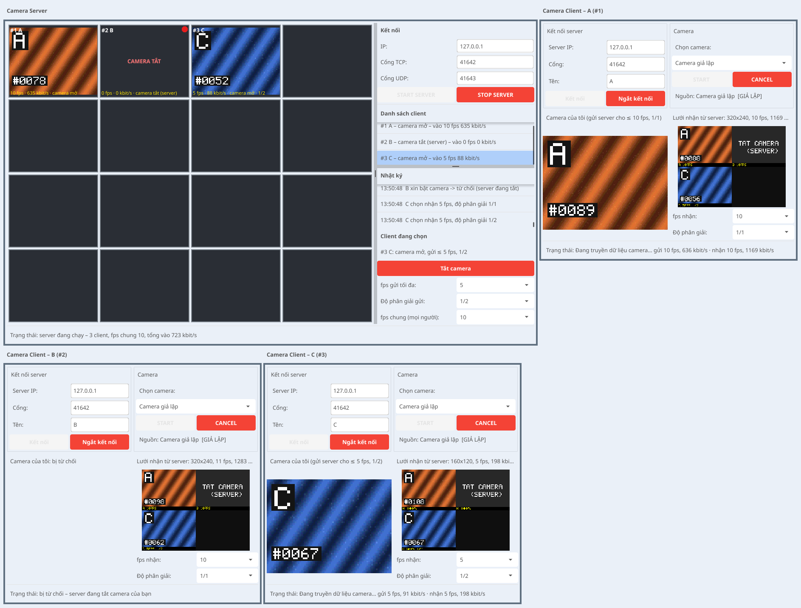
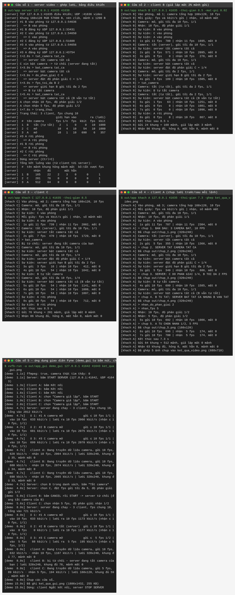
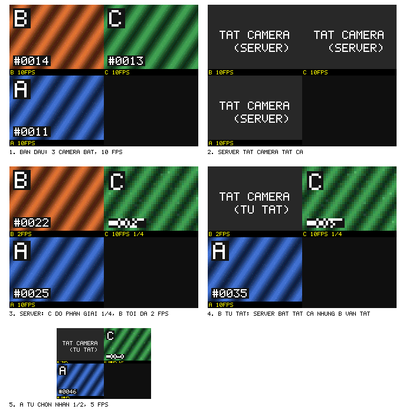

# Bài mở rộng MR6.3 – Phòng hội thoại video nhiều client (Go)

| Thông tin | Nội dung |
|---|---|
| Loại | **Bài mở rộng** – không có trong giáo trình, không có mã giả tương ứng |
| Liên hệ với giáo trình | Bài mở rộng MR6.2 (hội thoại âm thanh); Chương 6: Bài 6.1 (server đa luồng), Bài 6.4 (server chat); Chương 4: Bài 4.1 (UDP); Chương 3: Bài 3.2 (định khung thông điệp) |
| Thư viện | Bản dòng lệnh: chỉ thư viện chuẩn Go (`net`, `sync`, `compress/zlib`, `image/png`, `encoding/binary`, `encoding/json`). Ứng dụng giao diện (`gui/`, mô-đun riêng): Fyne v2.6.3 (cần cgo/gcc); camera thật qua chương trình ngoài `ffmpeg` (`os/exec`) |
| Bản ngôn ngữ khác | [C#](../../../csharp/Chuong06/BaiMR6.3_HoiThoaiVideo/), [Java](../../../java/Chuong06/BaiMR6.3_HoiThoaiVideo/), [Python](../../../python/Chuong06/BaiMR6.3_HoiThoaiVideo/), [Rust](../../../rust/Chuong06/BaiMR6.3_HoiThoaiVideo/) |

## Mục tiêu
Cùng ý tưởng với MR6.2 nhưng cho hình ảnh: n client gửi khung hình camera qua UDP; server ghép khung của mọi người thành một **lưới** và gửi cho từng người theo tốc độ khung (fps) và độ phân giải mà người đó chọn. Server điều khiển được: tắt/bật camera của tất cả hoặc từng người, giới hạn fps gửi và độ phân giải gửi của từng người (tương tự độ lợi đầu vào ở MR6.2), giới hạn fps chung (tương tự âm lượng chung). Client tự tắt/bật camera, tự chọn fps và độ phân giải nhận. Client chụp lưới đang xem thành PNG trước/sau mỗi lệnh và ghép thành `ket_qua_video.png` – bằng chứng trực quan rằng lệnh có hiệu lực.

## Kiến thức chính
- **Kích thước khung và tốc độ bit.** Khung 160×120 điểm RGB = 160 × 120 × 3 = 57 600 byte; 10 fps không nén cần 57 600 × 8 × 10 ≈ 4,6 Mbit/s. Nén zlib (không mất dữ liệu) còn khoảng 8–9 KB/khung → ≈ 700–780 kbit/s. Giảm độ phân giải 1/4 mỗi chiều → 40×30 điểm = 1/16 số điểm ảnh, client C trong kết quả chỉ còn ≈ 55 kbit/s. Khung tổng hợp có "hạt nhiễu" thưa như cảm biến thật; không có nhiễu, ảnh nhân tạo nén quá tốt (≈ 1 KB) và không phản ánh được thực tế.
- **Chia mảnh và ghép khung.** Một khung nén (vài KB) lớn hơn một datagram an toàn. Mỗi datagram ≤ 1200 byte – mức QUIC (RFC 9000 mục 14) yêu cầu mọi đường truyền phải chở được, nhỏ hơn MTU 1500 của Ethernet sau khi trừ header IP/UDP và phần bọc của VPN, nên không bị phân mảnh IP. Header 20 byte: phiên bản, loại, mã nguồn, **số khung**, **chỉ số mảnh**, **tổng số mảnh**, rộng, cao, nhãn thời gian. Bên nhận gom đủ mảnh mới giải nén; **mất một mảnh là hỏng cả khung** – lý do codec thực tế có cơ chế chống lỗi (FEC, khung tham chiếu, yêu cầu khung khóa).
- **Video trực tiếp chỉ cần khung mới nhất.** Khi một khung đủ mảnh, mọi khung cũ hơn còn dở bị bỏ; không chờ, không truyền lại. Số khung tăng dần cho phép đếm khung hỏng (thiếu mảnh) và khung mất hẳn.
- **MCU và SFU (RFC 7667).** Bài dùng kiến trúc *ghép* (MCU/Topo-Mixer): server giải nén, ghép lưới, nén lại riêng cho từng người nhận – nên điều chỉnh được fps/độ phân giải *nhận* của từng người, nhưng tốn CPU server. Kiến trúc *chuyển tiếp chọn lọc* (SFU) chỉ chuyển tiếp luồng của từng người, client tự ghép; server nhẹ hơn nhiều nhưng muốn đổi độ phân giải cho từng người nhận thì người gửi phải gửi nhiều lớp (simulcast). Khác với âm thanh (mix-minus), lưới video có cả hình của chính mình (self-view) – không gây vọng, chỉ tốn băng thông.
- **Giới hạn hai phía.** Phía gửi: server báo `fps` tối đa và `chia` (1, 2, 4) qua TCP; client tuân thủ, và server **tự thực thi** – bỏ khung đến nhanh hơn 0,8/fps giây (cột "vượt fps": vài khung bị bỏ khi đồng hồ của client nhích sớm) và bỏ khung của camera đang tắt. Phía nhận: `fps nhận = min(fps client chọn, fps chung)`.
- **Phóng to và thu nhỏ ảnh.** Thu nhỏ: lấy 1 điểm trong mỗi khối d×d (chép 3 byte của điểm góc mỗi khối). Phóng to: lặp điểm gần nhất (nearest neighbour), nên ô của C ở độ phân giải 1/4 hiện thành các ô vuông 4×4.
- **PNG.** Ảnh RGB thô được chép sang `image.NRGBA` rồi mã hóa bằng `image/png` của thư viện chuẩn (bản Python tự viết các khối PNG). Thư viện chuẩn có cả `image/jpeg`, nhưng bài giữ zlib trên đường truyền để hai bản tương thích.
- **Phòng vệ.** Giới hạn 256 mảnh/khung, giải nén có giới hạn kích thước (`io.LimitReader` 4 MB) chống "bom nén", kiểm tra rộng × cao × 3 khớp dữ liệu, chỉ nhận UDP từ địa chỉ đã đăng ký.

### Quy tắc quyền điều khiển (giống mic ở MR6.2)

| # | Quy tắc |
|---|---|
| 1 | Camera của X mở **khi và chỉ khi** X không tự tắt **và** server không tắt camera của X |
| 2 | Server tắt thắng client: đang bị server tắt, client xin bật bị **từ chối** |
| 3 | Server bật = gỡ lệnh tắt của server, **không bật hộ** camera mà người dùng tự tắt |
| 4 | Giới hạn gửi (fps tối đa, độ phân giải 1/1, 1/2, 1/4) của từng người và fps chung do server đặt |
| 5 | Tham số nhận (fps, độ phân giải lưới 1/1 hoặc 1/2) do từng client tự chọn; fps nhận không vượt fps chung |
| 6 | Tự tắt camera có hiệu lực ngay tại client; tự bật phải chờ server xác nhận |

## Cấu trúc tệp
- `main.go` – chọn vai trò: `server`, `khach`.
- `video/giaothuc.go` – gói dùng chung (bản dòng lệnh và giao diện): header datagram, `ChiaManh`, `GhepKhung`, phông chữ bitmap 5×7, tô/vẽ chữ, thu nhỏ/phóng to, camera tổng hợp, nén/giải nén zlib, `GhiPNG`. Go không cho nhập gói `main`, nên phần chung nằm ở gói con để mô-đun `gui/` dùng lại.
- `chung.go` – đặt tên ngắn (bí danh) cho các hàm, kiểu của gói `video` để `server.go`, `client.go` đọc gọn.
- `server.go` – server: goroutine cho mỗi kết nối TCP, goroutine nhận UDP (ghép mảnh, kiểm tra quyền, vẽ ô), goroutine ghép lưới và gửi theo hạn của từng người nhận, bảng điều khiển, tổng kết khi nhận SIGINT/SIGTERM.
- `client.go` – client: vòng gửi theo fps cho phép, goroutine nhận lưới, lệnh `chup`, ghép ảnh chụp (`-ghep`).
- `video/phong.go`, `video/khach.go` – lõi server/client dạng đối tượng cho ứng dụng giao diện: cùng giao thức, cùng 6 quy tắc; server trả ảnh mới nhất của từng client để vẽ lưới.
- `video/thietbi.go` – liệt kê camera, thu camera thật qua `ffmpeg` (khung thô 160×120 RGB từ stdout), tự chuyển sang "Camera giả lập" khi lỗi; `an_windows.go`/`an_khac.go` – chạy ffmpeg không bật cửa sổ console trên Windows.
- `gui/` – ứng dụng giao diện Fyne (mô-đun Go riêng, `go.mod` có `replace` về mô-đun gốc): `main.go` (vai trò `server_gui`, `client_gui`, `demo_gui`), `server_gui.go`, `client_gui.go`, `demo_gui.go`, `chung_gui.go`.
- `demo.json`, `ket_qua.txt`, `ket_qua.png` – kịch bản và kết quả thực thi thật; `ket_qua_video.png` – 5 ảnh lưới do client A chụp trong lần chạy đó; `ket_qua_gui.png` – ảnh các cửa sổ giao diện do `demo_gui` chụp.

## Cách chạy
Trong thư mục bài (Windows: `out\app.exe` thay cho `out/app`):
```bash
go build -o out/app .                                           # hoặc thay out/app bằng go run .
out/app server 127.0.0.1 9000 9001                              # cửa sổ 1 (gõ lệnh điều khiển ở đây)
out/app khach B 127.0.0.1 9000                                  # cửa sổ 2
out/app khach C 127.0.0.1 9000                                  # cửa sổ 3
out/app khach A 127.0.0.1 9000 -thoi-gian 60 -ghep ket_qua_video.png   # cửa sổ 4
```
Lệnh server: `tat_camera tat_ca`, `tat_camera B`, `bat_camera tat_ca`, `fps_toi_da B 2`, `do_phan_giai C 4`, `fps_chung 5`, `trang_thai`, `thoat`. Lệnh client: `tat_camera`, `bat_camera`, `nhan_fps 5`, `nhan_do_phan_giai 2`, `chup <nhãn>` (lưu `out/chup_N.png`), `thoat`. Dòng `@t lệnh` chờ tới giây thứ t. Nhãn ảnh chụp chỉ vẽ được chữ in hoa không dấu, số và vài ký hiệu.

Tùy chọn client (đặt sau ba tham số vị trí): `-fps 10`, `-mat-goi 0.02`, `-thoi-gian`.

**Bản dòng lệnh không dùng camera thật:** thư viện chuẩn Go không có API camera, nên chương trình dòng lệnh chỉ dùng camera tổng hợp. Muốn dùng camera thật, dùng **ứng dụng giao diện** dưới đây (camera qua tiến trình `ffmpeg`).

Tái lập kết quả từ thư mục gốc của kho: `python3 tools/demo.py go/Chuong06/BaiMR6.3_HoiThoaiVideo`.

## Ứng dụng giao diện



Ảnh trên do `demo_gui` tự thao tác và chụp (Linux, Xvfb, **Camera giả lập**). Một chương trình `out/app_gui` có ba vai trò:

```bash
out/app_gui server_gui [host] [cổng_tcp] [cổng_udp]      # mặc định 127.0.0.1 41635 41636
out/app_gui client_gui [tên] [host] [cổng_tcp]
out/app_gui demo_gui   [host] [cổng_tcp] [cổng_udp] [ảnh.png]   # tự bấm nút, chụp cửa sổ
```

**Camera Server** – lưới 4×4 ô, mỗi client một ô (theo thứ tự vào phòng): hình mới nhất server nhận được, tên, fps và kbit/s vào, **chấm đỏ** và chữ "CAMERA TẮT" khi camera tắt. Khung phải: IP, cổng, START SERVER/STOP SERVER; danh sách client; với client đang chọn: *Tắt camera*/*Bật camera* (lệnh tắt của server), fps gửi tối đa (1–15), độ phân giải gửi (1/1, 1/2, 1/4); fps chung; nhật ký; thanh trạng thái. Không thêm thông điệp nào vào giao thức: lưới trên cửa sổ server vẽ từ chính các ảnh server đã giải nén để ghép lưới gửi đi (MCU).

**Camera Client** – *Kết nối server* (IP, cổng, tên, Kết nối/Ngắt kết nối); *Camera* (chọn camera thật hoặc "Camera giả lập", START = tự bật, CANCEL = tự tắt, nhãn **[THIẾT BỊ THẬT]**/**[GIẢ LẬP]**); khung xem trước đúng hình đang gửi (đã thu nhỏ theo yêu cầu server rồi phóng lại); khung "Lưới nhận từ server" với fps nhận (1–15) và độ phân giải nhận (1/1, 1/2); thanh trạng thái ("Đang truyền dữ liệu camera…", fps, kbit/s gửi và nhận).

**Camera thật hay giả lập.** Camera chỉ mở khi bấm START. Liệt kê: Windows `ffmpeg -hide_banner -list_devices true -f dshow -i dummy` (đọc stderr, dòng `"Tên" (video)`), Linux các tệp `/dev/video*`, macOS `ffmpeg -f avfoundation -list_devices true -i ""`. Thu: `ffmpeg -f dshow -i video="Tên"` (Linux `-f v4l2 -i /dev/video0`, macOS `-f avfoundation -framerate 30 -i 0`) `-vf scale=160:120,fps=15 -pix_fmt rgb24 -f rawvideo pipe:1`; goroutine đọc đủ từng khối 57 600 byte (một khung), giữ khung mới nhất; vòng gửi lấy khung đó theo fps cho phép rồi đi đúng đường gửi sẵn có (thu nhỏ, nén zlib, chia mảnh ≤ 1200 byte). Không có ffmpeg/camera, hoặc ffmpeg dừng → "Camera giả lập" (khung tổng hợp như bản dòng lệnh).

**Luồng (thread) và quy tắc chạm điều khiển:**

```
 luồng giao diện Fyne ──bấm nút──> go func(){ net.Dial / mở ffmpeg … } ──fyne.Do──┐
   ▲  (chỉ luồng này đọc/ghi widget, canvas.Image)                                 │
   └── fyne.Do(vẽ ảnh, chữ) <── goroutine hẹn giờ 100 ms: Phong/Khach.TrangThai() ◄┘
                                     │ (khóa sync.Mutex; ảnh chỉ chép khi có khung mới)
 lõi video.Phong / Khach: goroutine TCP · goroutine nhận UDP + ghép mảnh · vòng gửi theo fps
                                     │
 goroutine đọc stdout ffmpeg ──> "khung mới nhất" (khóa) ──> vòng gửi
```

Chỉ luồng giao diện được chạm vào widget (Fyne ≥ 2.6 bắt buộc): hàm xử lý sự kiện không làm việc chặn (kết nối, mở ffmpeg chạy trong goroutine), goroutine nền chỉ gửi hàm vẽ qua `fyne.Do`.

**Cài đặt trên Windows** (một lần):
```powershell
winget install -e --id GoLang.Go
winget install -e --id BrechtSanders.WinLibs.POSIX.UCRT   # gcc cho cgo (Fyne cần), mở lại terminal
winget install -e --id Gyan.FFmpeg                        # ffmpeg (camera)
go env -w CGO_ENABLED=1
cd go\Chuong06\BaiMR6.3_HoiThoaiVideo
go -C gui mod tidy                                        # tải Fyne, tạo gui\go.sum (cần mạng)
go -C gui build -ldflags -H=windowsgui -o ..\out\app_gui.exe .
out\app_gui.exe server_gui 127.0.0.1 41635 41636
out\app_gui.exe client_gui A 127.0.0.1 41635
```
**Linux**: `sudo apt install gcc libgl1-mesa-dev xorg-dev ffmpeg`, rồi `go -C gui mod tidy && go -C gui build -o ../out/app_gui .`. macOS: `xcode-select --install`, `brew install ffmpeg` (lần đầu macOS hỏi quyền dùng camera cho terminal).

Client giao diện nối được với server dòng lệnh (của Go hay ngôn ngữ khác trong kho) và ngược lại.

## Kết quả thực thi


Ảnh lưới do client A chụp trong lần chạy trên (ô theo thứ tự vào phòng: B, C, A; dải vàng dưới mỗi ô là giới hạn gửi server đặt cho người đó):



1. Ba camera bật, 10 fps; số khung (`#0014`…) do camera của từng client vẽ.
2. Server `tat_camera tat_ca`: cả ba ô "TAT CAMERA (SERVER)"; C xin bật camera và **bị từ chối**.
3. Server bật lại, `do_phan_giai C 4`, `fps_toi_da B 2`: ô C thành các ô vuông 4×4 (40×30 điểm được phóng to), luồng của C giảm từ ≈ 740 xuống ≈ 55 kbit/s; B chỉ còn gửi 2 fps.
4. B tự tắt camera; server `bat_camera tat_ca` nhưng ô B vẫn "TAT CAMERA (TU TAT)" (quy tắc 3).
5. A tự chọn nhận độ phân giải 1/2 và 5 fps: lưới A nhận còn 160×120, luồng nhận giảm từ ≈ 1090 xuống ≈ 170 kbit/s (1/4 số điểm ảnh × 1/2 số khung).

Luồng của B giả lập mất 2 % mảnh: server đếm được khung hỏng và mảnh mất (bảng tổng kết), các khung đó bị bỏ, lưới vẫn hiện khung đủ gần nhất của B.

**Ứng dụng giao diện** (cửa sổ 5 trong `ket_qua.txt`/`ket_qua.png`, ảnh `ket_qua_gui.png`) chạy trong container Linux dưới Xvfb, không có camera (`/dev/video*` không có) → cả ba client dùng **Camera giả lập**. `demo_gui` bấm START SERVER, ba client Kết nối và START; sau 2,5 s mỗi client gửi 10 fps ≈ 630–700 kbit/s, nhận lưới 320×240 ≈ 2070 kbit/s. Server chọn B → *Tắt camera*; chọn C → fps gửi tối đa 5, độ phân giải 1/2; B bấm CANCEL → START và **bị từ chối**; C chọn nhận 5 fps, 1/2. Sau 3 s: ô B có chấm đỏ "CAMERA TẮT", vào 0 kbit/s; C vào 5 fps ≈ 88 kbit/s (1/4 số điểm ảnh × 1/2 số khung so với ≈ 700), C nhận lưới 160×120 ở 5 fps ≈ 200 kbit/s; A vẫn nhận 10 fps ≈ 1100 kbit/s. Không mất mảnh nào trên máy cục bộ. Camera thật trên Windows: chưa chạy – cần máy tác giả.

## Ghi chú
- Số fps/kbit/s đo theo cửa sổ 1 giây không thẳng hàng với thời điểm lệnh, nên giây chuyển tiếp có giá trị trung gian; ở 5 fps một cửa sổ có thể đếm được 5 hoặc 6 khung.
- Nén zlib không mất dữ liệu kém xa codec video thật: H.264/VP8/AV1 nén có mất dữ liệu và chỉ gửi phần thay đổi giữa các khung (nén liên khung), đạt chất lượng tương đương ở vài chục kbit/s cho khung nhỏ như thế này. Video thật còn cần SRTP để mã hóa, điều khiển tắc nghẽn để tự giảm tốc khi mạng nghẽn, và đồng bộ hình–tiếng theo nhãn thời gian.
- Server ghép lưới và nén lại cho từng người nhận mỗi khung; với nhiều client hơn, CPU server sẽ là nút thắt – đó chính là lý do hệ thống lớn dùng SFU. `%-12s` của `fmt` đếm byte nên cột tiếng Việt được căn theo số ký tự bằng `padPhai`.
- Giao thức (header, JSON, zlib) giống hệt bản Python: client Python nối được vào server Go và ngược lại (đã thử). `compress/zlib` mức `BestSpeed` của Go cho dung lượng lớn hơn khoảng 20 % so với `zlib.compress(…, 1)` của Python, nên số kbit/s của bản Go cao hơn.
- Kiểm thử: Linux, Go 1.24.7 (`gofmt`, `go vet` sạch, cả `GOOS=windows go vet` cho gói `video`); giao diện: Fyne v2.6.3, Xvfb + Mesa llvmpipe, ffmpeg 6.1.
- `demo_gui` chụp cửa sổ dưới Xvfb bằng ImageMagick `import -window root` (lần lượt chỉ hiện một cửa sổ), vì `Canvas().Capture()` với OpenGL phần mềm trả về ảnh trắng; trên Windows/macOS dùng `Canvas().Capture()`. Trên Windows, `demo_windows.ps1` bỏ qua bài này nếu thiếu `xvfb-run` – chạy `out\app_gui.exe demo_gui` trực tiếp để có ảnh.

## Bài tập gợi ý
1. Thêm `fps_chung 3` vào kịch bản server và quan sát fps nhận của mọi client; giải thích vì sao `nhan_fps 30` của client vẫn không vượt được giới hạn này.
2. Chạy client với `--mat-goi 0.1`: tính xác suất một khung 6 mảnh đến đủ (0,9⁶ ≈ 53 %) và so sánh với số khung hỏng server đếm được. Vì sao khung lớn chịu mất gói kém hơn?
3. Bỏ ô của chính người nhận khỏi lưới (giống mix-minus) và đo băng thông tiết kiệm được.
4. Hiển thị video trực tiếp: phục vụ khung lưới mới nhất dưới dạng PNG qua `net/http` (`/khung.png`) và một trang HTML tự tải lại ảnh mỗi 100 ms.
5. Thay zlib bằng `image/jpeg` (nén có mất dữ liệu, có tham số chất lượng): so sánh kbit/s ở chất lượng 30, 60, 90 và thêm lệnh server `chat_luong <tên> <q>`.
6. Giao diện: nhấp đúp vào một ô của lưới server để phóng to camera đó trong cửa sổ riêng (`a.NewWindow`), cập nhật từ cùng goroutine hẹn giờ qua `fyne.Do`; đóng cửa sổ thì dừng cập nhật.
7. Giao diện: thêm vào client một ô chọn kích thước thu từ camera thật (160×120, 320×240) – sửa bộ lọc `-vf scale=…` của ffmpeg và hằng `Rong`, `Cao` thành tham số; đo kbit/s và giải thích vì sao phải đổi cả phía server.
8. Nâng cao: chuyển server sang kiến trúc SFU – chuyển tiếp nguyên mảnh của từng người, client tự ghép lưới; giới hạn fps nhận bằng cách server bỏ cả khung (mọi mảnh có cùng số khung). So sánh CPU server và độ trễ với bản MCU.

## Đọc thêm
- RFC 9000 – *QUIC: A UDP-Based Multiplexed and Secure Transport*, mục 14 (kích thước datagram 1200 byte).
- RFC 7667 – *RTP Topologies* (Topo-Mixer/MCU, Topo-SFU).
- RFC 8085 – *UDP Usage Guidelines* (mục 3.2: tránh phân mảnh IP, kích thước thông điệp).
- RFC 1950, RFC 1951 – định dạng zlib và DEFLATE.
- W3C, *Portable Network Graphics (PNG) Specification* (Second Edition), 2003 (cấu trúc khối, CRC, bộ lọc hàng).
- Tài liệu Go: [`compress/zlib`](https://pkg.go.dev/compress/zlib), [`image/png`](https://pkg.go.dev/image/png), [`net`](https://pkg.go.dev/net).
- Fyne: [Getting started](https://docs.fyne.io/started/), [Goroutines – `fyne.Do`](https://docs.fyne.io/started/goroutines); FFmpeg: [thiết bị vào dshow/v4l2/avfoundation](https://ffmpeg.org/ffmpeg-devices.html).

Mã nguồn của bài được viết mới cho kho này.
