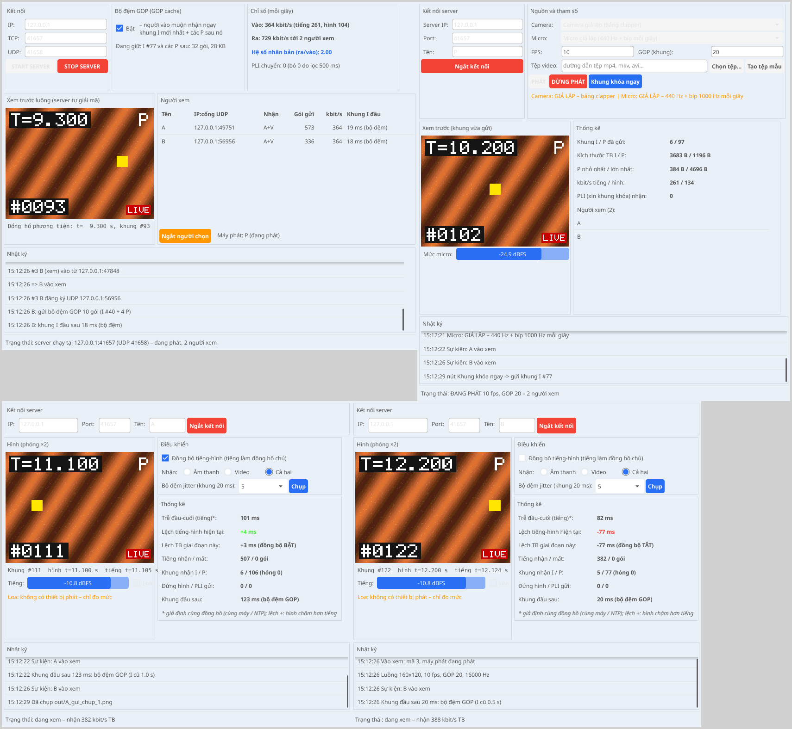
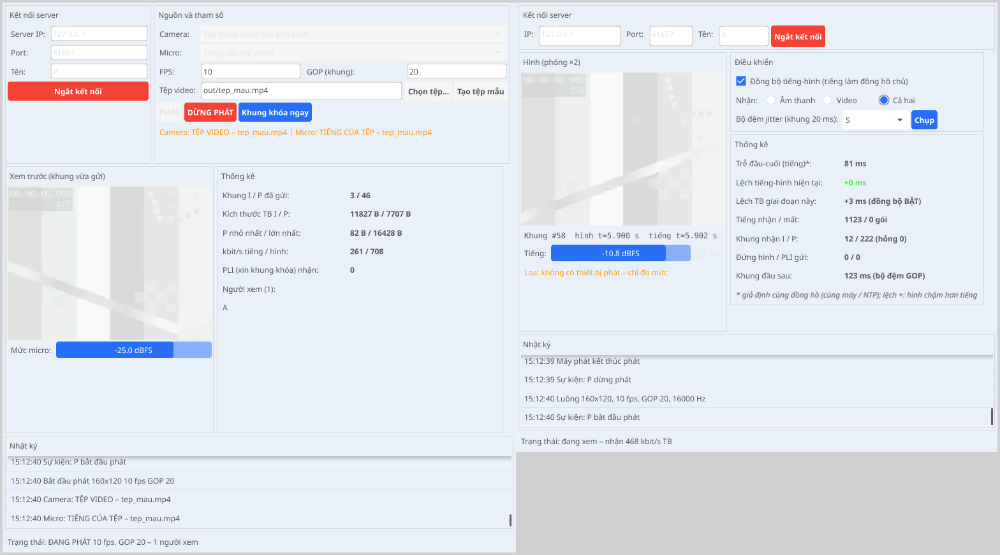
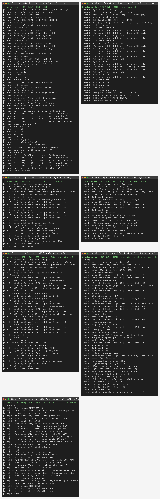
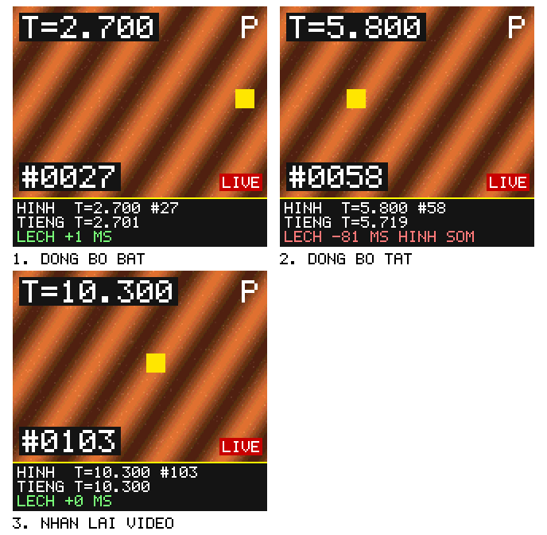

# Bài mở rộng MR6.5 – Phát trực tiếp âm thanh + video 1→n (Go)

| Thông tin | Nội dung |
|---|---|
| Loại | **Bài mở rộng** – không có trong giáo trình, không có mã giả tương ứng |
| Liên hệ với giáo trình | Bài mở rộng MR6.2 (âm thanh RTP, bộ đệm jitter), MR6.3 (video chia mảnh); Chương 6: Bài 6.1 (server đa luồng), Bài 6.6 (một nguồn – nhiều người nhận); Chương 4: Bài 4.1 (UDP); Chương 3: Bài 3.2 (định khung thông điệp) |
| Thư viện | Bản dòng lệnh: chỉ thư viện chuẩn Go (`net`, `sync`, `sync/atomic`, `compress/zlib`, `encoding/binary`, `encoding/json`, `image/png`, `os/exec`). Ứng dụng giao diện (`gui/`, mô-đun riêng): Fyne v2.6.3 (cần cgo/gcc). Thiết bị thật (tùy chọn): chương trình ngoài `ffmpeg` (camera, micro, tệp video) và `ffplay` (loa) |
| Bản ngôn ngữ khác | [Python](../../../python/Chuong06/BaiMR6.5_PhatTrucTiep/), [C#](../../../csharp/Chuong06/BaiMR6.5_PhatTrucTiep/), [Java](../../../java/Chuong06/BaiMR6.5_PhatTrucTiep/), [Rust](../../../rust/Chuong06/BaiMR6.5_PhatTrucTiep/) |

## Mục tiêu
Mô hình của livestream thật (YouTube Live, Facebook Live, Twitch; máy chủ RTMP/SRS, WebRTC SFU): **một máy phát** (camera + micro) gửi lên **máy chủ trung chuyển**; máy chủ **không giải nén, không trộn** mà chỉ **nhân bản gói** (fan-out) tới **n người xem**. Khác MR6.2/MR6.3 (hội thoại n↔n, server MCU trộn/ghép lưới). Bài cho thấy bằng số liệu thật: băng thông ra = n × vào; khung khóa I và khung sai khác P; mất một khung P thì **đứng hình** cho tới khi **xin khung khóa** (PLI); **bộ đệm GOP** giúp người vào muộn thấy hình gần như tức thì; **đồng bộ tiếng-hình** (lip-sync) với âm thanh làm đồng hồ chủ; đăng ký theo lớp (chỉ nghe). Nguồn phát: **camera thật**, **tệp video** (mp4, mkv… – phát lại như OBS "Media Source"), mẫu thử ffmpeg hoặc nguồn giả lập; micro thật, tiếng của tệp hoặc giả lập.

Giao thức giống hệt bản Python tới từng byte của header, nên máy phát, máy chủ, người xem viết bằng các ngôn ngữ khác nhau chạy chung được (đã thử chéo với bản Python – xem mục Ghi chú).

## Kiến thức chính
Số liệu dưới đây lấy từ `ket_qua.txt` (một lần chạy thật trên máy cục bộ; mỗi lần chạy lệch vài phần trăm).

- **Fan-out 1→n và SFU (RFC 7667 mục 3.7).** Máy chủ chỉ đọc header (byte đầu, loại khung, số khung) rồi `WriteToUDP()` nguyên byte cho từng người xem. Lúc `trang_thai` (4 người xem, A đang "chỉ nghe"): vào 363 kbit/s, ra 1453 kbit/s, hệ số nhân bản 4,00. Cả buổi: vào 513 KB, ra 1404 KB, hệ số 2,74 (người xem vào/ra ở các thời điểm khác nhau). CPU máy chủ gần như chỉ dành cho gửi gói – khác MCU ở MR6.3 phải giải nén, ghép và nén lại cho từng người.
- **Khung I, khung P, nhóm GOP.** I = `zlib(rgb thô 160×120×3)`; P = `zlib(XOR(khung này, khung trước))` (`compress/zlib` mức 6). Cảnh gần như tĩnh (nền tĩnh, một ô vuông chạy, đồng hồ đổi số) nên P nhỏ nhất chỉ 384 B so với I trung bình 4108 B (7,1 % ảnh thô 57 600 B). Khung chớp trắng mỗi giây tròn đổi gần như toàn ảnh nên P lúc đó lên tới 4675 B – "đổi cảnh" thì P lớn như I. Video tốn 94–170 kbit/s, tiếng L16 261 kbit/s (đều tính cả header RTP/bài).
- **Mất tham chiếu và xin khung khóa (PLI – RFC 4585 mục 6.3.1).** P số k chỉ giải được khi đã có khung k−1. D giả lập mất 3 % gói nhận: 4 lần "Thiếu khung #… → đứng hình". Lần #21 và #51: gửi `xin_khung_khoa`, máy chủ lọc 500 ms rồi chuyển cho máy phát, máy phát gửi I ngay ở khung kế tiếp – hình về sau **96 ms** (cộng 200 ms chờ khung thiếu trước khi kết luận mất tham chiếu ⇒ đứng ≈ 0,3 s). Lần #27 và #57 xảy ra chưa tới 1 s sau lần trước nên người xem phải chờ hết giới hạn 1 s mới xin lại ("xin sau giới hạn 1 s") – đứng 0,6–1,5 s.
- **Bộ đệm GOP ở máy chủ (GOP cache của SRS, nginx-rtmp).** Máy chủ giữ khung I mới nhất và mọi P sau nó (≤ 4 MB). B vào muộn 3 s khi bộ đệm bật: máy chủ gửi ngay 17 gói (I #25 + 7 P), khung I tới sau 19 ms; B hiện khung đầu sau **121 ms** (chờ bộ đệm jitter nạp tiếng để khung đầu cũng đúng tiếng). C vào lúc bộ đệm đã tắt: phải chờ khung I kế tiếp, khung đầu sau **1721 ms** (tối đa một GOP = 2 s ở 10 fps, GOP 20). Người vào **trước** khi máy phát bấm Phát thì thời gian tới khung đầu tính từ lúc bắt đầu phát (dòng in có "(từ lúc phát)").
- **Đồng bộ tiếng-hình, âm thanh là đồng hồ chủ.** Nhãn thời gian tiếng (RTP ts, 16 kHz) và hình (ms) cùng một gốc: t = 0 lúc bấm Phát. Máy phát gửi `dong_ho` mỗi giây (như RTCP Sender Report – RFC 3550 mục 6.4.1). Người xem chỉ hiện khung có nhãn ≤ đồng hồ phát tiếng: A **+2 ms** khi BẬT (sai số do nhịp hiển thị 5 ms), **−78 ms** khi TẮT (hình đi trước tiếng đúng bằng thời gian tiếng nằm trong bộ đệm jitter, ≈ 4 khung × 20 ms). Ảnh chụp `ket_qua_video.png` ghi nhãn hình và đồng hồ tiếng ngay lúc khung được hiện.
- **Độ trễ đầu-cuối (tiếng).** `giờ thực khi phát − (gio + (ts_ms − ts))` theo báo cáo đồng hồ mới nhất: 81–101 ms (bộ đệm jitter 5 khung; phần lẻ tùy pha giữa nhịp 20 ms của máy phát và người xem). Chỉ đúng khi máy phát và người xem **cùng đồng hồ** (cùng máy hoặc đồng bộ NTP).
- **Đăng ký theo lớp.** `dang_ky am_thanh` – A "chỉ nghe": máy chủ ngừng gửi hình cho A (cột "nhận" = `A`). Bật lại video khi bộ đệm đã tắt: khung tham chiếu cũ của A đã lỗi thời → mất tham chiếu → PLI → hình trở lại sau 400 ms.
- **Phát từ tệp video (đồng bộ ở phía phát).** Hai tiến trình ffmpeg cùng đọc tệp với `-re` (theo tốc độ thật) và `-stream_loop -1` (lặp lại): một ra khung rgb24 160×120 (`scale…,pad…,fps=10` – khung thứ i ứng với giây i/10 của tệp), một ra tiếng s16le 16 kHz mono. `tructiep/tepvideo.go` làm như bộ ghép kênh (muxer): tiếng là đồng hồ chủ – thiếu mẫu thì chèn 20 ms im lặng, dồn quá 300 ms thì bỏ 20 ms, ghi lại `LechMs` = thời điểm phương tiện − thời điểm trong tệp của tiếng đang gửi; khi chụp khung ở thời điểm T, máy phát chọn khung của tệp có thời điểm ≤ T − `LechMs`. Ảnh động nhiều (testsrc2 của tệp mẫu) cho P TB 7756 B so với I TB 11 827 B: XOR chỉ có lợi khi phần lớn điểm ảnh đứng yên – codec thật dùng bù chuyển động.
- **Đồng thời (goroutine).** Máy chủ: goroutine nhận kết nối, mỗi client một goroutine đọc TCP, **một** goroutine UDP nhận và chuyển tiếp ngay (thứ tự gói được giữ – bộ đệm GOP luôn đi trước gói trực tiếp). Người xem: goroutine TCP, UDP, phát 20 ms (đồng hồ chủ), hiển thị 5 ms; trạng thái chung dưới một `sync.Mutex`. Đồng hồ là `time.Since` (phần đơn điệu của `time.Time`), cờ dừng là `atomic.Bool`.

### Giao thức (giống hệt ở 5 ngôn ngữ)
Máy chủ: TCP cổng P (điều khiển, mỗi dòng một JSON UTF-8 kết thúc `\n`, ≤ 64 KB), UDP cổng P+1 (phương tiện). Mỗi client mở **một** socket UDP cho cả tiếng và hình.

| Chiều | Thông điệp TCP |
|---|---|
| client → server | `{"loai":"chao","vai_tro":"phat"\|"xem","ten":"A"}` (đầu tiên, tên 1–16 ký tự) |
| xem → server | `{"loai":"dang_ky","am_thanh":true,"video":true}`, `{"loai":"xin_khung_khoa"}` |
| phát → server | `{"loai":"thong_tin","rong":160,"cao":120,"fps":10,"gop":20,"tan_so_mau":16000}`, `{"loai":"dong_ho","ts":<ms phương tiện>,"gio":<ms Unix>}` mỗi 1 s, `{"loai":"dung_phat"}` |
| server → client | `{"loai":"chao","ma":k,"cong_udp":P+1,"phat":bool}`; `{"loai":"loi","ly_do":"đã có máy phát"\|"tên không hợp lệ"}` rồi đóng |
| server → xem | `thong_tin`, `dong_ho` (chuyển tiếp nguyên văn dòng; bản đã lưu cho người vào sau); `{"loai":"bi_ngat","ly_do":"server ngắt"}` rồi đóng |
| server → phát | `{"loai":"xin_khung_khoa","tu":"A"}` (lọc 500 ms), `{"loai":"nguoi_xem","so":n,"ds":[…]}` |
| server → tất cả | `{"loai":"su_kien","noi_dung":"B vào xem"}`, `{"loai":"ket_thuc"}` |

| Datagram UDP | Byte đầu | Cấu trúc |
|---|---|---|
| Tiếng | `0x80` | RTP v2 12 byte (0x80, PT 96, seq, ts 16 kHz từ 0, SSRC = mã máy phát; big-endian qua `encoding/binary`) + 320 mẫu L16 big-endian (640 B) |
| Hình | `0x01` | 20 byte (phiên bản 1, loại, mã nguồn, số khung, chỉ số mảnh, tổng mảnh, rộng, cao, nhãn ms) + ≤ 1180 B dữ liệu; loại 2 = giữ kết nối (`GoiGiu`), **3 = mảnh I**, **4 = mảnh P**; ≤ 256 mảnh/khung |

Client gửi `GoiGiu(mã)` ngay sau chào và mỗi 1 s; máy chủ ghi nhận địa chỉ UDP khi IP trùng IP TCP của mã đó và chỉ nhận phương tiện từ địa chỉ đã đăng ký của máy phát. Khung 0 luôn là I; I lặp lại mỗi `gop` khung hoặc ngay sau khi có `xin_khung_khoa` (đếm GOP lại từ đó). Bản Go dùng `DoiTuong` (đối tượng JSON giữ thứ tự khóa, `"loai"` đứng đầu như dict của Python) thay cho `map` (Go sắp khóa theo chữ cái).

## Cấu trúc tệp
- `main.go` – chọn vai trò `server`, `phat`, `xem`; `server.go`, `phat.go`, `xem.go` – bản dòng lệnh (in sự kiện, đọc lệnh stdin, in TỔNG KẾT).
- `tructiep/` – gói lõi dùng chung với ứng dụng giao diện:
  - `chung.go` – hằng số; RTP; header video, `ChiaManh`, `GoiGiu`, `TachHeader`; `GhepKhung` (không bỏ khung cũ còn dở, chờ 0,5 s); `BoDemJitter`; `XorKhung`, `MaHoaI/P`, `GiaiMaVideo` (chờ khung thiếu 200 ms, mất tham chiếu); phông 5×7, `GhiPNG`, `GhepAnh`; `NguonClapper`, `NguonAmClapper`; `GuiJSON`, `DocDong` (giới hạn 64 KB), đọc lệnh `@t`.
  - `ngaunhien.go` – Mersenne Twister giống hệt `random.Random(seed)` của Python: cùng hạt giống thì `-mat-goi` bỏ đúng những gói như bản Python và nền camera giả lập trùng từng byte.
  - `thietbi.go` – camera thật/testsrc qua ffmpeg, micro thật qua ffmpeg, loa qua ffplay (chép từ MR6.3/MR6.2 bản Go); `an_windows.go`, `an_khac.go` – ẩn cửa sổ console của tiến trình con trên Windows.
  - `tepvideo.go` – nguồn "tệp video": `TepVideo` (hai tiến trình ffmpeg `-re -stream_loop -1`, `LechMs`), `CameraTep`, `MicTep`, `MoTep`, `TaoTepMau`.
  - `maychu.go` – `MayChuPhat` (BatDau/Dung nhiều lần, bộ đệm GOP, lọc PLI, thống kê, `BangTrangThai`, `BangTongKet`); `mayphat.go` – `MayPhat`; `nguoixem.go` – `NguoiXem` (đồng hồ chủ, lip-sync, PLI, thống kê), `AnhChuThich`.
- `gui/` – ứng dụng giao diện Fyne (mô-đun Go riêng, `go.mod` có `replace` về mô-đun gốc): `main.go` (vai trò `server_gui`, `phat_gui`, `xem_gui`, `demo_gui`), `server_gui.go`, `phat_gui.go`, `xem_gui.go`, `demo_gui.go`, `chung_gui.go`.
- `demo.json`, `ket_qua.txt`, `ket_qua.png`, `ket_qua_video.png`, `ket_qua_gui.png`, `ket_qua_gui_tep.png` – kịch bản và kết quả thực thi thật.

## Cách chạy
Trong thư mục bài (Windows: `out\app.exe` thay cho `out/app`):
```bash
go build -o out/app .
out/app server 127.0.0.1 9000 9001                              # cửa sổ 1 (gõ lệnh ở đây)
out/app phat P 127.0.0.1 9000 -thoi-gian 120                    # cửa sổ 2: máy phát
out/app xem A 127.0.0.1 9000 -thoi-gian 60                      # cửa sổ 3, 4…: người xem
out/app xem B 127.0.0.1 9000 -tre 5 -khong-dong-bo              # vào muộn 5 s, không đồng bộ
out/app xem D 127.0.0.1 9000 -mat-goi 0.03                      # giả lập mất 3 % gói nhận
out/app phat P 127.0.0.1 9000 -tep phim.mp4                     # phát tệp video (hình + tiếng của tệp)
out/app phat P 127.0.0.1 9000 -tep out/mau.mp4 -tao-tep-mau     # tạo tệp mẫu 10 s rồi phát
```
- Lệnh máy chủ: `trang_thai`, `bo_dem bat|tat`, `ngat <tên>`, `thoat`. Lệnh máy phát: `khung_khoa`, `dung`. Lệnh người xem: `chup <nhãn>` (lưu `out/<tên>_chup_N.png`), `dong_bo bat|tat`, `dang_ky am_thanh|video|ca_hai`, `thoat`. Dòng `@t lệnh` chờ tới giây thứ t kể từ khi chương trình chạy.
- Tùy chọn (đặt sau ba tham số vị trí, `-x` hay `--x` đều được – gói `flag`): máy phát `-camera gia_lap|testsrc|<thiết bị>`, `-mic gia_lap|<chỉ số>`, `-tep`, `-tao-tep-mau`, `-fps 10`, `-gop 20`, `-thoi-gian`, `-mat-goi`; người xem `-thoi-gian` (tính cả `-tre`), `-tre`, `-dem 5` (độ sâu bộ đệm jitter, 1–25 khung), `-khong-dong-bo`, `-chi-am-thanh`, `-chi-video`, `-mat-goi`, `-ghep tệp.png`.
- **Thiết bị thật** (thư viện chuẩn Go không có API camera/âm thanh, nên bài gọi `ffmpeg` qua `os/exec` và đọc khung thô từ ống dẫn): camera `-camera /dev/video0` (Linux), `-camera "Tên camera"` (Windows, dshow), `-camera 0` (macOS); micro `-mic <chỉ số>` – chỉ số trong danh sách ffmpeg liệt kê (Windows dshow, Linux PulseAudio/ALSA, macOS avfoundation). Không có ffmpeg hoặc ffmpeg không mở được thiết bị, chương trình báo và **tự lùi về nguồn giả lập** (`Camera lỗi, dùng giả lập: …`, `Không mở được micro thật: dùng giả lập`).
- **Tệp video:** `-tep <tệp>` (cần ffmpeg) lấy cả hình lẫn tiếng của tệp, hết tệp thì phát lại từ đầu; thêm `-mic gia_lap` hoặc `-mic <chỉ số>` để thay tiếng của tệp bằng micro.

Tái lập kết quả từ thư mục gốc của kho: `python3 tools/demo.py go/Chuong06/BaiMR6.5_PhatTrucTiep`.

## Ứng dụng giao diện


Ảnh trên do `demo_gui` tự thao tác và chụp (Linux, Xvfb + Mesa llvmpipe, Fyne v2.6.3; không có webcam, không có thiết bị âm thanh): máy chủ (trên trái), máy phát P (trên phải), người xem A (đồng bộ BẬT, dưới trái) và B (đồng bộ TẮT, vào muộn 3,5 s, dưới phải). A: lệch TB +3 ms; B: lệch TB −77 ms – cùng một luồng, B thấy hình sớm hơn tiếng ≈ 80 ms. B vào muộn nhưng khung đầu sau 20 ms nhờ bộ đệm GOP (B tắt đồng bộ nên không chờ tiếng). Máy chủ: vào 354, ra 708 kbit/s, hệ số 2,00.

- **Máy chủ** (`server_gui`): IP, cổng TCP/UDP, START/STOP SERVER; công tắc **Bộ đệm GOP** và số gói/KB đang giữ; chỉ số mỗi giây: vào kbit/s (tiếng, hình), ra kbit/s, **hệ số nhân bản**, PLI chuyển/bỏ; **xem trước luồng** (máy chủ tự giải mã một bản chỉ để hiện ảnh, kèm đồng hồ phương tiện); bảng người xem (tên, IP:cổng UDP, nhận A/V, gói gửi, kbit/s, khung I đầu sau … ms và nguồn); nút **Ngắt người chọn**; nhật ký.
- **Máy phát** (`phat_gui`): kết nối; chọn camera (thật qua ffmpeg / "Tệp video" / "Mẫu thử ffmpeg (testsrc)" / "Camera giả lập (bảng clapper)"), micro (thật qua ffmpeg / "Tiếng của tệp video" / giả lập); ô **Tệp video** với **Chọn tệp…** (hộp thoại `dialog.NewFileOpen`) và **Tạo tệp mẫu** (tạo `out/tep_mau.mp4` 10 s ở nền); chọn tệp thì camera và micro tự chuyển sang tệp, bỏ "Tệp video" thì micro về mục đầu danh sách; FPS, GOP (Enter để áp dụng khi đang phát); PHÁT, DỪNG PHÁT, **Khung khóa ngay**; xem trước khung vừa gửi; thanh mức micro (dBFS); thống kê khung I/P, kích thước TB I/P, P nhỏ nhất/lớn nhất, kbit/s tiếng/hình, PLI nhận; danh sách người xem; nhật ký.
- **Người xem** (`xem_gui`): kết nối; ô hình phóng ×2 kèm nhãn hình và đồng hồ tiếng lúc hiện; thanh mức tiếng, ô **Loa** (ffplay nếu có thiết bị phát, không thì "chỉ đo mức" – trong container: "không có thiết bị phát – chỉ đo mức"); công tắc **Đồng bộ tiếng-hình**; chọn nhận **Âm thanh / Video / Cả hai**; độ sâu bộ đệm jitter (đổi khi đang xem); **Chụp**; thống kê trễ đầu-cuối, lệch hiện tại và TB của giai đoạn, tiếng nhận/mất, khung I/P, đứng hình/PLI gửi, khung đầu sau … ms; nhật ký.

Kịch bản còn bấm "Khung khóa ngay", máy chủ ngắt B (B báo "mất kết nối server"), thêm một lượt "Mẫu thử ffmpeg (testsrc)" (ảnh mẫu ít chi tiết nên I chỉ ≈ 986 B, P ≈ 303 B) và một lượt **tệp video**: tạo tệp mẫu, chọn tệp (camera và micro tự chuyển "Tệp video (chọn tệp bên dưới) | Tiếng của tệp video"), PHÁT; A nhận tiếng của tệp (−24,9 dBFS) và hình, lệch +2 ms. Máy phát (trái) và người xem A (phải):



### Cách chạy
```bash
go -C gui mod tidy                                        # lần đầu: tải Fyne, tạo gui/go.sum (cần mạng)
go -C gui build -o ../out/app_gui .
out/app_gui server_gui 127.0.0.1 41657 41658
out/app_gui phat_gui P 127.0.0.1 41657
out/app_gui xem_gui A 127.0.0.1 41657
out/app_gui xem_gui B 127.0.0.1 41657
```
- **Windows:** Go 1.24+; gcc cho cgo (Fyne cần): `winget install -e --id BrechtSanders.WinLibs.POSIX.UCRT` (mở lại terminal), `go env -w CGO_ENABLED=1`; ffmpeg/ffplay: `winget install -e --id Gyan.FFmpeg`. Cho phép ứng dụng desktop dùng camera/micro trong *Settings → Privacy & security*.
- **Linux:** `sudo apt install gcc libgl1-mesa-dev xorg-dev ffmpeg`. **macOS:** Xcode Command Line Tools, `brew install ffmpeg`.
- Chạy riêng từng cửa sổ (không qua `demo_gui`): mọi dòng nhật ký (tiền tố `[server]`, `[phat P]`, `[xem A]`) và cứ 5 giây một dòng số liệu (tiếng nhận/mất, mức dBFS, loa; khung I/P, đứng hình, lệch, trễ; kbit/s vào/ra) cũng in ra dòng lệnh, chuyển hướng được vào tệp (`out/app_gui xem_gui A … > xem_A.txt`). Khi bấm PHÁT, máy phát ghi "Camera: …", "Micro: …" (nguồn đang dùng thật hay giả lập).
- Ô Micro của máy phát mặc định chọn **micro thật đầu tiên** tìm thấy (máy không có micro thì là micro giả lập); kịch bản `demo_gui` tự chọn micro giả lập.
- Thiết bị thật chỉ được mở khi bấm PHÁT. Muốn máy khác nối vào: máy chủ nghe IP card mạng (hoặc `0.0.0.0`) và mở tường lửa cho hai cổng.
- Kịch bản tự động (Linux): `xvfb-run -a -s "-screen 0 2000x1400x24" out/app_gui demo_gui 127.0.0.1 41657 41658 ket_qua_gui.png`.

### Sơ đồ luồng
```
 máy phát                         máy chủ (SFU)                              người xem (mỗi người)
 ────────                         ─────────────                              ─────────────────────
 gor. 20 ms: mic -> RTP ──UDP──▶  gor. UDP: kiểm tra nguồn ─nhân bản──▶  gor. UDP: RTP -> bộ đệm jitter
 gor. fps: camera -> I/P ─UDP──▶    + bộ đệm GOP (I + các P)  ─n gói──▶    mảnh -> ghép -> giải mã I/P -> hàng
 TCP: thong_tin, dong_ho ──────▶  gor. TCP mỗi client ─chuyển tiếp──▶  gor. 20 ms: phát tiếng = ĐỒNG HỒ CHỦ
 TCP ◀── xin_khung_khoa (lọc 500 ms) ◀──────────────── xin_khung_khoa ◀─ gor. 5 ms: mất tham chiếu? chọn khung
                                                                        (nhãn ≤ đồng hồ tiếng) -> hiện
```
Giao diện: chỉ luồng giao diện Fyne chạm widget (Fyne ≥ 2.6 bắt buộc); hàm xử lý sự kiện không làm việc chặn (kết nối, mở ffmpeg, tạo tệp mẫu chạy trong goroutine); goroutine hẹn giờ của mỗi cửa sổ đọc `TrangThai()` mỗi 50–200 ms rồi gửi hàm vẽ qua `fyne.Do`.

## Kết quả thực thi


Ảnh do người xem A chụp trong lần chạy trên (nhãn hình, đồng hồ tiếng lúc khung được hiện, lệch):



1. Đồng bộ BẬT: hình 2,700 s – tiếng 2,701 s, lệch +1 ms.
2. Đồng bộ TẮT: hình 5,800 s nhưng tiếng mới ở 5,719 s – hình sớm 81 ms.
3. Chỉ nghe 1 s rồi nhận lại video: mất tham chiếu → PLI → khung I #97 → hình trở lại, lệch +0 ms.

## Ghi chú
- Lệch tiếng-hình đo ở đây là lệch giữa thời điểm **hiện khung** và thời điểm **đưa khung tiếng ra loa** trong chương trình; loa thật còn bộ đệm riêng của hệ điều hành và của ffplay mà chương trình không thấy. Tai người khó nhận ra lệch dưới khoảng ±40 ms (ngưỡng tô màu xanh/đỏ trong bài).
- **Chạy chéo với bản Python** (đã thử): (a) máy phát Python + máy chủ Go + người xem Go và người xem Python: cả hai giải mã I/P, lệch +3 ms khi bật đồng bộ, người xem Go −91 ms khi tắt, người xem Python mất 3 % gói đứng hình 2 lần và hồi phục bằng PLI (máy chủ Go chuyển cho máy phát Python); (b) máy phát Go + máy chủ Python + người xem Python: người xem vào muộn khi bộ đệm tắt chờ khung I 740 ms, lệch +2 ms. Dữ liệu zlib của Go và của zlib C khác byte nhưng giải nén được lẫn nhau.
- Máy phát gửi `thong_tin` rồi chờ 20 ms mới bắt đầu gửi phương tiện: TCP và UDP đi trên hai goroutine khác nhau, nếu khung I #0 tới máy chủ trước `thong_tin` thì bị coi là sai nguồn và bộ đệm GOP rỗng tới khung I kế tiếp.
- Nhãn thời gian 32 bit (ms và mẫu) quay vòng sau ≈ 49,7 ngày và ≈ 3 ngày; bài không xử lý quay vòng của nhãn hình.
- zlib + XOR kém xa codec thật (H.264/VP8/AV1 có bù chuyển động, nén có mất dữ liệu); khung IDR của H.264 (RFC 6184 mục 8) chính là khung I mà người xem xin bằng PLI. Livestream thật còn cần mã hóa (SRTP/TLS), điều khiển tắc nghẽn và simulcast/SVC.
- Kiểm thử: Linux, Go 1.24.7 (`gofmt`, `go vet` sạch, cả `GOOS=windows go vet ./tructiep/`); giao diện: Fyne v2.6.3 dưới Xvfb + Mesa llvmpipe, ffmpeg/ffplay 6.1. Máy kiểm thử không có webcam và thiết bị âm thanh – đã thử nhánh lùi về giả lập và loa "chỉ đo mức". `demo_gui` chụp cửa sổ dưới Xvfb bằng ImageMagick `import -window root` (lần lượt chỉ hiện một cửa sổ), vì `Canvas().Capture()` với OpenGL phần mềm trả về ảnh trắng; trên Windows/macOS dùng `Canvas().Capture()`.

## Bài tập gợi ý
1. Chạy `out/app xem … -dem 15` với đồng bộ tắt rồi bật: lệch TB thay đổi thế nào? Giải thích bằng công thức lệch ≈ −(độ sâu − 1) × 20 ms.
2. Chạy máy phát `-gop 5` và `-gop 100`, cho một người vào muộn khi bộ đệm GOP tắt: so sánh thời gian tới khung hình đầu tiên và kbit/s hình. Vì sao dịch vụ livestream thường chọn GOP 1–2 s?
3. Người xem mới vào (chưa có tham chiếu) hiện chỉ chờ I. Sửa để gửi `xin_khung_khoa` ngay khi vào nếu không nhận được khung I trong 300 ms; đo lại C. Điều gì xảy ra với máy phát khi 1000 người cùng vào?
4. Tăng `-mat-goi` của D lên 0,1: đếm số lần đứng hình và tính xác suất một khung I 4 mảnh tới đủ (0,9⁴ ≈ 66 %). Đề xuất cách giảm (chia khung I nhỏ hơn, FEC, gửi I hai lần).
5. Giao diện: thêm vào cửa sổ máy chủ biểu đồ kbit/s vào/ra 30 s gần nhất (`canvas.Line` cập nhật mỗi giây qua `fyne.Do`); thêm/bớt người xem và quan sát hệ số nhân bản.
6. Nâng cao: cho máy phát gửi hai lớp video (160×120 và 80×60 – simulcast) và cho người xem đăng ký chọn lớp; máy chủ chỉ chuyển tiếp lớp đã chọn.

## Đọc thêm
- RFC 3550 – *RTP: A Transport Protocol for Real-Time Applications*, mục 6.4.1 (Sender Report: ánh xạ nhãn thời gian RTP ↔ giờ NTP).
- RFC 3551 – *RTP Profile for Audio and Video Conferences with Minimal Control* (L16, payload type động).
- RFC 4585 – *Extended RTP Profile for RTCP-Based Feedback (RTP/AVPF)*, mục 6.3.1 (Picture Loss Indication).
- RFC 7667 – *RTP Topologies* (Topo-Mixer/MCU, Topo-SFU, fan-out).
- RFC 6184 – *RTP Payload Format for H.264 Video*, mục 8 (khái niệm khung IDR – khung khóa).
- RFC 8085 – *UDP Usage Guidelines* (kích thước datagram, điều khiển tắc nghẽn).
- Tài liệu Go: [`net`](https://pkg.go.dev/net), [`compress/zlib`](https://pkg.go.dev/compress/zlib), [`encoding/binary`](https://pkg.go.dev/encoding/binary), [`os/exec`](https://pkg.go.dev/os/exec), [`sync/atomic`](https://pkg.go.dev/sync/atomic).
- Fyne: [Getting started](https://docs.fyne.io/started/), [Goroutines – `fyne.Do`](https://docs.fyne.io/started/goroutines); FFmpeg: [thiết bị vào dshow/v4l2/avfoundation](https://ffmpeg.org/ffmpeg-devices.html), [ffplay](https://ffmpeg.org/ffplay.html).

Mã nguồn của bài được viết mới cho kho này.
