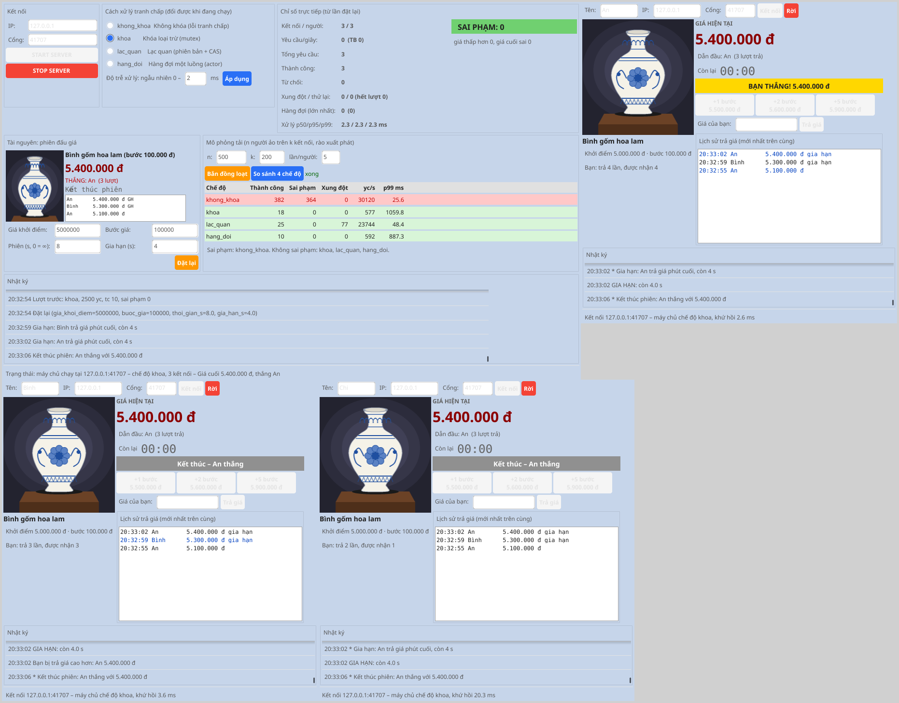
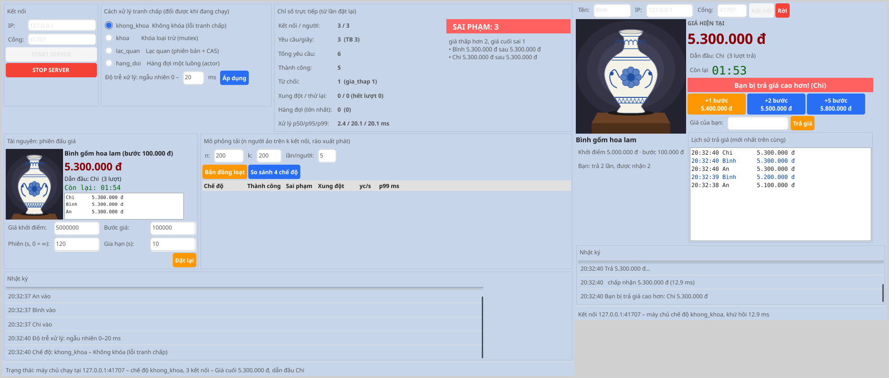
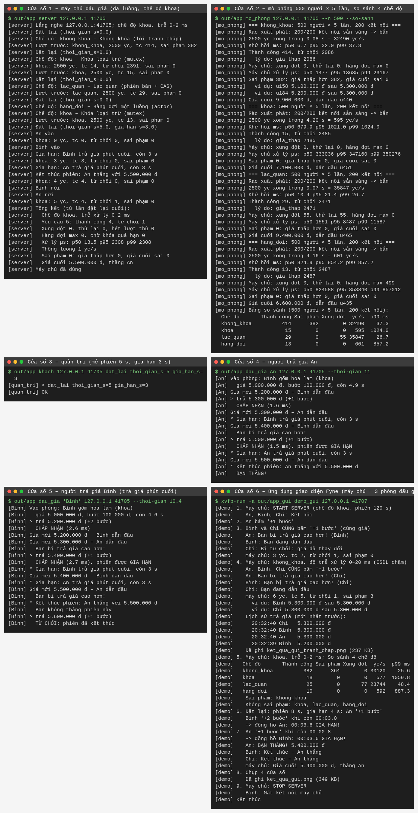

# Bài mở rộng MR6.6 – Đấu giá trực tuyến: n người cùng tranh một món hàng (Go)

| Thông tin | Nội dung |
|---|---|
| Loại | **Bài mở rộng**, không có trong giáo trình và không có mã giả tương ứng. Đây là bài đầu của nhóm "tranh chấp tài nguyên" MR6.6–MR6.14 |
| Liên hệ với giáo trình | Chương 6: Bài 6.1 (server đa luồng, một luồng mỗi kết nối), Bài 6.7 (kiểm thử tải); Chương 3: Bài 3.2 (định khung thông điệp theo dòng); bài mở rộng MR5.4/MR5.5 (luồng, đồng bộ) |
| Thư viện | Bản dòng lệnh: chỉ thư viện chuẩn Go (`net`, `sync`, `sync/atomic`, `encoding/json`, `bufio`, `math/rand/v2`, `os/signal`). Ứng dụng giao diện (`gui/`, mô-đun riêng): Fyne v2.6.3 (cần cgo/gcc); kịch bản demo giao diện trên Linux cần Xvfb và ImageMagick (`import`) để chụp cửa sổ |
| Bản ngôn ngữ khác | [Python](../../../python/Chuong06/BaiMR6.6_DauGia/), [C#](../../../csharp/Chuong06/BaiMR6.6_DauGia/), [Java](../../../java/Chuong06/BaiMR6.6_DauGia/), [Rust](../../../rust/Chuong06/BaiMR6.6_DauGia/) |

## Mục tiêu
Bài mô phỏng một phòng đấu giá trực tuyến. Một món hàng có giá khởi điểm và bước giá. **n người cùng trả giá**, và giá chỉ được nhận khi **≥ giá hiện tại + bước giá**. Đồng hồ đếm ngược đóng phiên; ai trả giá trong 10 giây cuối thì phiên được **gia hạn 10 giây** (đóng mềm, chống "bắn tỉa" phút cuối). Hết giờ, máy chủ công bố người thắng. Máy chủ TCP đa luồng (một goroutine mỗi kết nối) giữ trạng thái. Mỗi lần trả giá là một thao tác "đọc → kiểm tra (giả lập độ trễ cơ sở dữ liệu 0–2 ms) → ghi", và thao tác này được xử lý theo **bốn cách** chọn được ngay lúc đang chạy: không khóa, khóa loại trừ, điều khiển đồng thời lạc quan, hàng đợi một goroutine. **Sổ kiểm toán** độc lập đếm sai phạm, còn **bộ mô phỏng tải** (500 người × 5 lần trên 200 kết nối, có rào xuất phát và pipelining) cho thấy bằng số liệu thật: chỉ chế độ không khóa sinh sai phạm, ba chế độ còn lại cho 0 sai phạm nhưng khác nhau về thông lượng và độ trễ.

Giao thức, câu chữ và định dạng dòng in giống hệt bản Python, nên máy chủ, bộ mô phỏng và người dùng viết bằng các ngôn ngữ khác nhau chạy chung được (đã thử chạy chéo với bản Python, xem Ghi chú). Phần khung (các tệp `tranhchap/` trừ `nghiepvu.go`, `nguoiao.go`; `chung_cli.go`; `gui/chung_gui.go`, `gui/ve.go`) dùng chung cho cả 9 bài MR6.6–MR6.14. Bài sau chép khung này và chỉ viết thêm nghiệp vụ.

## Kiến thức chính
Số liệu dưới đây lấy từ `ket_qua.txt`, là một lần chạy thật trên máy cục bộ (127.0.0.1, Go 1.24, độ trễ xử lý ngẫu nhiên 0–2 ms). Mỗi lần chạy, số liệu lệch đi đôi chút.

```
  Chế độ       Thành công Sai phạm Xung đột  yc/s  p99 ms
  khong_khoa          414      382        0 32490    37.3
  khoa                 15        0        0   595  1024.0
  lac_quan             29        0       55 35847    26.7
  hang_doi             13        0        0   601   857.2
```
(500 người × 5 lần trả giá = 2500 yêu cầu/chế độ, 200 kết nối. "Thành công" là số giá được chấp nhận, "Sai phạm" do sổ kiểm toán đếm, "Xung đột" là số lần so sánh-và-đổi thất bại, "yc/s" và "p99" (khứ hồi) đo ở bộ mô phỏng.)

- **Tranh chấp (race condition) và mất cập nhật.** Chế độ `khong_khoa` làm "đọc giá → chờ 0–2 ms → kiểm tra → ghi" mà không đồng bộ. Hàng trăm goroutine cùng đọc một giá cũ, ai cũng qua được kiểm tra, ai cũng nhận "CHẤP NHẬN", và bản ghi sau đè bản ghi trước: 414 giá được chấp nhận, trong đó **382** giá thấp hơn (giá đã chấp nhận trước + bước giá), ví dụ `u158 5.100.000 đ` được chấp nhận *sau* khi `5.300.000 đ` đã được chấp nhận. Go chạy đa lõi thật (không có GIL như Python), nên lượt `khong_khoa` xong rất nhanh (0,08 s) mà vẫn sai hàng trăm lần. Giao diện cho thấy rõ chuyện này: khi đặt độ trễ 0–20 ms và ba người cùng bấm "+1 bước", cả ba cùng được chấp nhận ở **cùng một giá** 5.300.000 đ (sai phạm 3, xem `ket_qua_gui_tranh_chap.png`). Chế độ này chỉ dùng để minh họa lỗi trong phòng lab (loopback).
- **An toàn bộ nhớ khi cố tình "không đồng bộ".** Trong Go, đọc/ghi một `interface{}` hay một struct nhiều từ máy từ nhiều goroutine không đồng bộ là *data race* thật (có thể đọc phải giá trị "rách"). Vì vậy giá trị mỗi ô nằm trong `atomic.Pointer` (mỗi lần ghi thay nguyên một bản mới) và phiên bản trong `atomic.Uint64`: từng lần đọc/ghi là nguyên tử, nhưng chuỗi "đọc – nghỉ – ghi" thì không, nên mất cập nhật vẫn xảy ra đúng như bài muốn minh họa. Bản dòng lệnh chạy dưới `go build -race` (bộ dò data race của Go) với cả 4 chế độ không có cảnh báo nào.
- **Vùng găng (critical section) và khóa theo tài nguyên.** Chế độ `khoa` cho mỗi ô tài nguyên một khóa riêng và giữ khóa suốt đọc – kiểm tra – ghi. Sai phạm bằng 0. Khóa ô là **kênh đệm một chỗ** (`chan struct{}` dung lượng 1: gửi vào = khóa, nhận ra = mở) thay cho `sync.Mutex`, vì khung cần "chờ khóa tối đa 2 s rồi báo nghi khóa chết" mà `sync.Mutex` không có `Lock` có thời hạn. Đổi lại, mọi yêu cầu (kể cả yêu cầu sẽ bị từ chối) phải xếp hàng qua một khóa duy nhất, nên thông lượng chỉ còn ≈ 1 / (thời gian xử lý trung bình) ≈ 595 yc/s; thời gian xử lý ở máy chủ, tính cả lúc chờ khóa, có p50 là 333 ms. (`time.Sleep` ngắn của Go ngủ dư khoảng 0,5–0,7 ms, nên một thao tác "0–2 ms" trung bình tốn ≈ 1,7 ms – vì thế `khoa`/`hang_doi` ở bản Go chậm hơn bản Python một chút.) Một món hàng là "điểm nóng" (hot spot); khóa theo từng tài nguyên chỉ có lợi khi có nhiều tài nguyên (ghế, tài khoản, xem MR6.8, MR6.12). Khung khóa nhiều ô **theo thứ tự khóa đã sắp xếp** để không khóa chết.
- **Điều khiển đồng thời lạc quan (optimistic concurrency, Kung & Robinson 1981).** Chế độ `lac_quan` đọc (giá trị, **phiên bản**) dưới một `sync.Mutex` rất ngắn, xử lý *ngoài* khóa, rồi **so sánh-và-đổi** (compare-and-swap): chỉ ghi khi phiên bản chưa đổi. Nếu đã đổi thì đó là xung đột, và thao tác thử lại (tối đa 5 lần, nghỉ ngẫu nhiên 0–1 ms). Sai phạm bằng 0 và thông lượng **cao nhất** (35847 yc/s), vì phần lớn yêu cầu bị từ chối ngay sau lần đọc ("giá thấp") mà không phải chờ ai; có 55 xung đột, 55 lần thử lại, không yêu cầu nào hết lượt thử. Vì một thao tác của khung có thể chạm nhiều ô (MR6.7, MR6.8, MR6.12), bước so sánh-và-đổi kiểm mọi phiên bản dưới khóa ngắn thay vì một lệnh `atomic.CompareAndSwap` đơn lẻ (xem bài tập 3).
- **Hàng đợi một goroutine (mô hình actor, vòng lặp sự kiện).** Chế độ `hang_doi` cho goroutine kết nối gửi yêu cầu vào một **channel** rồi đọc tiếp ngay. **Một** goroutine nhận lần lượt từ channel, đến trước phục vụ trước, không cần khóa vì chỉ goroutine này chạm vào trạng thái. Sai phạm bằng 0, thông lượng 601 yc/s (tuần tự như `khoa`), hàng đợi dài tối đa **499** (gần bằng số người đang chờ trả lời), và độ trễ khứ hồi phản ánh đúng thời gian xếp hàng.
- **Sổ kiểm toán.** Sổ ghi mọi giao dịch được chấp nhận dưới `sync.Mutex` riêng, ngay trong vùng găng của chế độ (callback `khiGhi`), nên thứ tự trong sổ đúng là thứ tự ghi. Luật của bài: một giá chấp nhận phải ≥ (giá cao nhất đã chấp nhận + bước giá), và giá/người dẫn đầu cuối cùng phải đúng là giá cao nhất trong sổ. Sổ không ngăn lỗi, chỉ *phát hiện* lỗi sau buổi chạy, giống đối soát cuối ngày.
- **Cổng tạm dừng.** Đổi chế độ hoặc đặt lại đi qua `TamDung` (một `sync.Cond`): đóng cổng, chờ mọi thao tác đang chạy và đang xếp trong channel xong, rồi mới đổi – hai chế độ không bao giờ chạy lẫn vào nhau.
- **Rào xuất phát, pipelining, idempotency.** Bộ mô phỏng mở 200 kết nối, mỗi kết nối chở 2–3 người ảo (`"so_nguoi"` trong lời chào, tên người ở trường `"nguoi"`). Mọi goroutine chờ ở rào xuất phát (kênh đóng khi đủ k + 1 bên, có hủy khi một kết nối lỗi) rồi cùng bắn. Mỗi kết nối gửi yêu cầu của mọi người mình chở trong một lần `Write`, và nhận được trả lời nào (ghép theo `ma_yc`) thì gửi ngay lần trả giá kế tiếp của người đó. Nếu một `ma_yc` đã xử lý bị gửi lại, máy chủ gửi lại kết quả cũ kèm `"lap_lai": true` (nhớ 1024 `ma_yc` gần nhất mỗi kết nối).
- **Đẩy trạng thái có gộp.** Mỗi khi trạng thái đổi, máy chủ chỉ đặt một cờ (`atomic.Bool`). Goroutine nền cứ 100 ms gửi **một** `cap_nhat` cho mọi client, nên dù có hơn 30000 yc/s thì mỗi client cũng chỉ nhận tối đa 10 cập nhật mỗi giây. Đồng hồ đếm ngược chạy cục bộ ở client theo `con_lai_ms`; hạn phiên ở máy chủ tính theo đồng hồ đơn điệu (`time.Since` của một mốc `time.Now()`).
- **Đóng mềm (soft close).** Trong lượt chạy dòng lệnh (phiên 5 s, gia hạn 3 s), Bình trả giá phút cuối nên phiên được gia hạn, An trả giá phút cuối nên phiên được gia hạn lần nữa, rồi "Kết thúc phiên: An thắng với 5.500.000 đ"; lần trả giá sau đó của Bình nhận "TỪ CHỐI: phiên đã kết thúc". Việc đóng phiên cũng là một thao tác ghi đi qua cùng chế độ xử lý tranh chấp.

### Giao thức (giống hệt ở 5 ngôn ngữ)
TCP, mỗi dòng một JSON UTF-8 kết thúc `\n`, tối đa 64 KB một dòng. Mọi yêu cầu có `ma_yc` (số nguyên do client đánh), và trả lời mang lại đúng `ma_yc` đó.

| Chiều | Thông điệp |
|---|---|
| client → server | `{"loai":"chao","ten":"An","vai_tro":"nguoi_dung"\|"quan_tri"}` (đầu tiên, tên 1–16 ký tự); kết nối gộp của bộ mô phỏng thêm `"so_nguoi":m` |
| người dùng → server | `{"loai":"tra_gia","ma_yc":k,"gia":5300000}` (kết nối gộp thêm `"nguoi":"u17"`) |
| quản trị → server | `{"loai":"che_do","ma_yc":k,"gia_tri":"khoa"}`, `{"loai":"tre","ma_yc":k,"ms":2}`, `{"loai":"dat_lai","ma_yc":k,"thoi_gian_s":120,"gia_han_s":10,"gia_khoi_diem":…,"buoc_gia":…,"ten_mon":…}`, `{"loai":"thong_ke","ma_yc":k}` |
| server → client | `{"loai":"chao","ma":id,"che_do":"khoa","may_chu":"Đấu giá MR6.6"}`, ngay sau đó là một `cap_nhat`; `{"loai":"loi","ly_do":…}` khi sai giao thức |
| server → client | `{"loai":"kq","ma_yc":k,"ok":true,"gia":…,"nguoi_dan_dau":…,"gia_han":bool}` hoặc `{"loai":"kq","ma_yc":k,"ok":false,"ma_loi":"gia_thap"\|"het_phien"\|"xung_dot"\|"sai_du_lieu"\|…,"ly_do":…,"gia":…}` |
| server → tất cả | `{"loai":"cap_nhat","che_do":…,"mon":{"ten","gia_khoi_diem","buoc_gia","gia_han_s"},"gia","nguoi_dan_dau","so_lan","con_lai_ms"(null = không giới hạn),"ket_thuc","lich_su":[{"nguoi","gia","gio","gia_han"}…]}` (≤ 10 lần/s); `{"loai":"su_kien","noi_dung":"Kết thúc phiên: An thắng với …"}` |
| server → quản trị | `{"loai":"thong_ke","ma_yc":k,"so_yc","thanh_cong","tu_choi","xung_dot","thu_lai","het_lan_thu","khoa_cho_lau","hang_doi_max","yc_s","thong_luong","p50_us","p95_us","p99_us","sai_pham":[{"ma","ten","so"}],"sai_pham_tong","tom_tat",…}` |

Mã lỗi chung: `khong_co`, `loi`, `khoa_cho_lau`, `xung_dot`, `sai_du_lieu`, `khong_quyen`, `khong_ho_tro`. Bản Go đọc số JSON như Python (số nguyên → `int64`, có dấu chấm → `float64`), in số thực như `repr` của Python (`5.0`) và giữ thứ tự khóa của `dat_lai`, nên dòng `Đặt lại (thoi_gian_s=5.0, gia_han_s=3.0)` giống hệt nhau dù yêu cầu đến từ ngôn ngữ nào.

## Cấu trúc tệp
- `tranhchap/` (gói lõi, dùng chung với giao diện) – **khung chung**: `giaothuc.go` (dòng JSON giữ thứ tự khóa, `DocDong` giới hạn 64 KB, `DocLenhStdin`, `DocThamSo`, các hàm in `DongThongKe`, `BangSoSanh`, `Tien`), `thongke.go` (`PhanVi`, `ThongKe`), `kho.go` (`KhoTranhChap`: 4 chế độ, cổng `TamDung`), `sokiemtoan.go`, `maychu.go` (`MayChuCoSo`, giao diện `NghiepVu`), `khach.go` (`KetNoiKhach` pipelining, `QuanTri`), `mophong.go` (`ChayLuot`, `SoSanh`, rào xuất phát); **nghiệp vụ**: `nghiepvu.go` (`MayChuDauGia`, luật sổ kiểm toán), `nguoiao.go` (`nguCanh`, `nguoiAo`, `ThamSoDatLai`).
- `main.go` (lệnh con `server`, `mo_phong`, `khach`, `dau_gia`), `chung_cli.go` (vòng lệnh máy chủ, công cụ quản trị, bộ mô phỏng – chung 9 bài), `server.go` (tùy chọn của máy chủ đấu giá), `dau_gia.go` (người trả giá).
- `gui/` – ứng dụng giao diện Fyne (mô-đun Go riêng, `go.mod` có `replace` về mô-đun gốc): `chung_gui.go` (khung chung: `cuaSoServerCoSo`, `cuaSoNguoiDungCoSo`, bảng so sánh, chụp/ghép ảnh, `giuVe`), `ve.go` (bút vẽ ảnh khử răng cưa), `server_gui.go`, `dau_gia_gui.go`, `demo_gui.go`, `main.go`.
- `demo.json`, `ket_qua.txt`, `ket_qua.png`, `ket_qua_gui.png`, `ket_qua_gui_tranh_chap.png` – kịch bản và kết quả thực thi thật.

## Cách chạy
Chạy trong thư mục bài (Go 1.24+):
```bash
go build -o out/app .                                          # Windows: go build -o out/app.exe .
out/app server 127.0.0.1 9000                                  # cửa sổ 1 (gõ lệnh ở đây)
out/app mo_phong 127.0.0.1 9000 --n 500 --so-sanh              # cửa sổ 2: bảng so sánh 4 chế độ
out/app mo_phong 127.0.0.1 9000 --n 2000 --k 200 --che-do lac_quan --dat-lai
out/app khach 127.0.0.1 9000 dat_lai thoi_gian_s=60 gia_han_s=10   # mở phiên 60 s
out/app dau_gia An 127.0.0.1 9000                              # cửa sổ 3, 4…: gõ tang 1 / tra 5300000
```
- Lệnh của máy chủ: `che_do khong_khoa|khoa|lac_quan|hang_doi`, `tre <ms>`, `dat_lai [khoa=giá_trị …]`, `thong_ke`, `thoat` (Ctrl+C cũng in tổng kết rồi dừng). Tùy chọn: `--che-do`, `--tre-ms`, `--thoi-gian` (0 = không giới hạn), `--gia`, `--buoc`, `--gia-han`. Cứ 5 giây, nếu có yêu cầu mới, máy chủ in một dòng số liệu.
- Lệnh của `dau_gia`: `tang [n]`, `tra <giá>`, `thoat`; dòng `@t lệnh` chờ tới giây thứ t rồi mới chạy lệnh.
- `out/app khach <host> <cổng> che_do x | tre ms | dat_lai k=v … | thong_ke` gửi lệnh quản trị.

Muốn tái lập kết quả, chạy từ thư mục gốc của kho: `python3 tools/demo.py go/Chuong06/BaiMR6.6_DauGia` (bước chuẩn bị tự biên dịch cả bản dòng lệnh và bản giao diện; lần đầu `go -C gui mod tidy` cần mạng).

## Ứng dụng giao diện


Ảnh trên là lần chạy thật của `demo_gui` (Linux, Xvfb + Mesa llvmpipe, Fyne v2.6.3): bảng điều khiển máy chủ (trên trái), An (trên phải, "BẠN THẮNG!"), Bình và Chi (dưới). Kịch bản đã chạy so sánh 4 chế độ (bảng ở giữa, dòng `khong_khoa` tô đỏ: 382 thành công, 364 sai phạm; `khoa` 18 / 0, `lac_quan` 25 / 0 với 77 xung đột, `hang_doi` 10 / 0) rồi mở phiên 8 s, gia hạn 4 s: Bình trả giá khi còn 3,0 s, An trả giá khi còn 0,8 s, phiên được gia hạn hai lần và An thắng với 5.400.000 đ.



Ở bước trước đó, máy chủ đang ở `khong_khoa` với độ trễ xử lý 0–20 ms. An, Bình và Chi cùng bấm "+1 bước" ở cùng một giá, và cả ba đều được chấp nhận 5.300.000 đ. Ô **SAI PHẠM** chuyển đỏ (3: giá thấp hơn 2, giá cuối sai 1), lịch sử của Bình có ba dòng cùng giá. Cùng thao tác đó ở chế độ `khoa` thì người thứ hai nhận "Bị từ chối: giá đã thay đổi".

- **Máy chủ** (`server_gui`): IP, cổng, START/STOP; **4 nút chọn chế độ** (đổi được khi đang chạy, chạy trên goroutine riêng vì có thể chờ hàng đợi cạn); độ trễ xử lý; **chỉ số trực tiếp** (kết nối/người, yêu cầu/giây, tổng, thành công, từ chối theo mã lỗi, xung đột/thử lại, hàng đợi, xử lý p50/p95/p99, **SAI PHẠM** xanh/đỏ kèm ví dụ); **tài nguyên**: ảnh món hàng, giá hiện tại, người dẫn đầu/thắng, đồng hồ phiên, ba giá gần nhất, tham số đặt lại và nút **Đặt lại**; **mô phỏng tải**: n, k, số lần/người, **Bắn đồng loạt**, **So sánh 4 chế độ** (bảng kết quả tô màu); nhật ký.
- **Phòng đấu giá** (`dau_gia_gui`): ảnh "Bình gốm hoa lam" vẽ bằng bút ảnh (`gui/ve.go`, vẽ dư 3 lần rồi thu nhỏ để khử răng cưa); **giá hiện tại** cỡ lớn; người dẫn đầu và số lượt; **đồng hồ đếm ngược** (đỏ khi còn dưới 10 s, chớp "GIA HẠN!"); dòng thông báo có màu ("Bạn đang dẫn đầu", "Bạn bị trả giá cao hơn!", "Bị từ chối: giá đã thay đổi", "BẠN THẮNG!", "Kết thúc – … thắng"); nút **+1/+2/+5 bước** ghi sẵn giá sẽ trả; ô nhập giá; lịch sử trả giá (giá của mình tô xanh); thanh trạng thái hiện chế độ của máy chủ và thời gian khứ hồi.

### Cách chạy
```bash
go -C gui mod tidy                                   # lần đầu: tải Fyne, tạo gui/go.sum (cần mạng)
go -C gui build -o ../out/app_gui .
out/app_gui server_gui 127.0.0.1 41707               # bấm START SERVER (phiên mặc định 120 s)
out/app_gui dau_gia_gui An 127.0.0.1 41707
out/app_gui dau_gia_gui Bình 127.0.0.1 41707
```
- **Windows:** Go 1.24+; gcc cho cgo (Fyne cần): `winget install -e --id BrechtSanders.WinLibs.POSIX.UCRT` (mở lại terminal), `go env -w CGO_ENABLED=1`. Kịch bản tự động (Linux, cần `xvfb`, `imagemagick`): `xvfb-run -a -s "-screen 0 2600x1700x24" out/app_gui demo_gui 127.0.0.1 41707`.
- Chạy riêng từng cửa sổ (không qua `demo_gui`): mọi dòng nhật ký (tiền tố `[server]`, `[An]`) và cứ 5 giây một dòng số liệu cũng in ra dòng lệnh, chuyển hướng được vào tệp (`out/app_gui server_gui > server.txt`).
- Cửa sổ người dùng nối được với máy chủ dòng lệnh của mọi ngôn ngữ (và ngược lại: phòng đấu giá Python/Java… nối vào `server_gui`).
- Thử trên nhiều máy: máy chủ nghe trên IP card mạng (hoặc `0.0.0.0`) và mở tường lửa cho cổng; mỗi sinh viên chạy `dau_gia_gui` với IP của máy thầy. Khi đó **chỉ dùng `khoa`, `lac_quan`, `hang_doi`**, còn `khong_khoa` để dành cho phần minh họa lỗi.

## Kết quả thực thi


## Ghi chú
- **Chạy chéo với bản Python** (đã thử): (a) `out/app mo_phong --n 500 --so-sanh` → máy chủ Python: `khong_khoa` 658 thành công / 635 sai phạm, `khoa` 17 / 0, `lac_quan` 33 / 0 (124 xung đột), `hang_doi` 14 / 0; quản trị Go `dat_lai thoi_gian_s=5 gia_han_s=3` → máy chủ Python in `Đặt lại (thoi_gian_s=5.0, gia_han_s=3.0)`; (b) `mo_phong.py --n 500 --so-sanh` → máy chủ Go: `khong_khoa` 134 / 85, `khoa` 17 / 0, `lac_quan` 50 / 0 (113 xung đột), `hang_doi` 16 / 0; người trả giá Python (Bình) và Go (An) cùng một phiên 5 s trên máy chủ Go: gia hạn đúng, "Kết thúc phiên: Bình thắng với 5.400.000 đ" ở cả hai bên. Bộ mô phỏng Python chậm hơn nên các yêu cầu tới rải hơn và `khong_khoa` ít sai phạm hơn.
- **Cửa sổ trắng trên Windows:** các cửa sổ dùng `SetFixedSize`, nên mang theo `giuVe` của MR6.5 (`gui/chung_gui.go`): mỗi giây đặt lại kích thước cửa sổ/nội dung khi lệch và vẽ lại toàn bộ; khi chạy riêng, dòng `(vẽ lại) canvas …` trong nhật ký ghi lại mỗi lần sửa.
- Giao diện tuân quy tắc luồng của Fyne ≥ 2.6: chỉ luồng giao diện chạm widget; goroutine mạng gói việc vẽ trong `fyne.Do`; goroutine hẹn giờ 250 ms của cửa sổ máy chủ đọc `ThongKeDayDu()`/`TrangThai()` *ngoài* luồng giao diện rồi mới `fyne.Do`; đổi chế độ, đặt lại, mô phỏng đều chạy trên goroutine riêng.
- Trong kịch bản giao diện, máy chủ, bộ mô phỏng và 4 cửa sổ cùng chạy trong một tiến trình, nên yc/s thấp hơn bản dòng lệnh.
- Kiểm thử: Linux, Go 1.24.7 (`gofmt`, `go vet` sạch, cả `GOOS=windows go vet . ./tranhchap/`; `go build -race` cho bản dòng lệnh: không có cảnh báo data race); giao diện: Fyne v2.6.3 dưới Xvfb + Mesa llvmpipe. `demo_gui` chụp cửa sổ bằng ImageMagick `import -window root` (lần lượt chỉ hiện một cửa sổ), vì `Canvas().Capture()` với OpenGL phần mềm trả về ảnh trắng; trên Windows/macOS dùng `Canvas().Capture()`. Bản giao diện chưa thử trên Windows.

## Bài tập gợi ý
1. Chạy `out/app mo_phong --so-sanh` với `--tre-ms 0`, `2`, `10`. Sai phạm của `khong_khoa` và thông lượng của `khoa` thay đổi thế nào? Giải thích bằng độ rộng của khe "đọc → ghi". Với `--tre-ms 0`, Go đa lõi có còn sai phạm không? So sánh với bản Python.
2. Tăng `--n` lên 5000 với `--k 200` rồi `--k 20`. Hàng đợi lớn nhất của `hang_doi` và p99 thay đổi ra sao? Vì sao pipelining giúp vài trăm kết nối "chở" được hàng nghìn người?
3. Với thao tác chỉ chạm **một** ô, viết lại `lacQuan` không dùng `khoaCas`: đọc con trỏ giá trị bằng `atomic.Pointer.Load`, xử lý, rồi `CompareAndSwap(cũ, mới)`; phiên bản chính là con trỏ. Đo lại thông lượng. Vì sao cách này không dùng được khi một thao tác chạm nhiều ô (MR6.7, MR6.8)?
4. Thay kênh-làm-khóa bằng `sync.Mutex` (mất chức năng chờ tối đa 2 s). Đo lại `khoa`. Có khác biệt đáng kể không? Khi nào thời hạn chờ khóa thật sự cần (xem MR6.12)?
5. Thêm nhiều món hàng (ô `mon_1`, `mon_2`, …) và cho mô phỏng chia người ra các món. So sánh `khoa` (khóa theo từng món) với `hang_doi` (một goroutine cho tất cả) khi số món tăng.
6. Giao diện: vẽ trên cửa sổ máy chủ biểu đồ giá theo thời gian (`canvas.Line`, cập nhật qua `fyne.Do`). Ở `khong_khoa`, đường giá có "tụt xuống" không?

## Đọc thêm
- H. T. Kung, J. T. Robinson (1981). *On Optimistic Methods for Concurrency Control*. ACM Transactions on Database Systems 6(2).
- E. G. Coffman, M. J. Elphick, A. Shoshani (1971). *System Deadlocks*. ACM Computing Surveys 3(2): điều kiện khóa chết và cách phòng bằng thứ tự khóa (khung dùng cho chế độ `khoa`).
- Tài liệu Go: [`sync`](https://pkg.go.dev/sync) (Mutex, Cond), [`sync/atomic`](https://pkg.go.dev/sync/atomic) (Pointer, Uint64, CompareAndSwap), [The Go Memory Model](https://go.dev/ref/mem), [Data Race Detector](https://go.dev/doc/articles/race_detector), [`net`](https://pkg.go.dev/net), [`encoding/json`](https://pkg.go.dev/encoding/json).
- Fyne: [Getting started](https://docs.fyne.io/started/), [Goroutines – `fyne.Do`](https://docs.fyne.io/started/goroutines).

Mã nguồn của bài được viết mới cho kho này.
