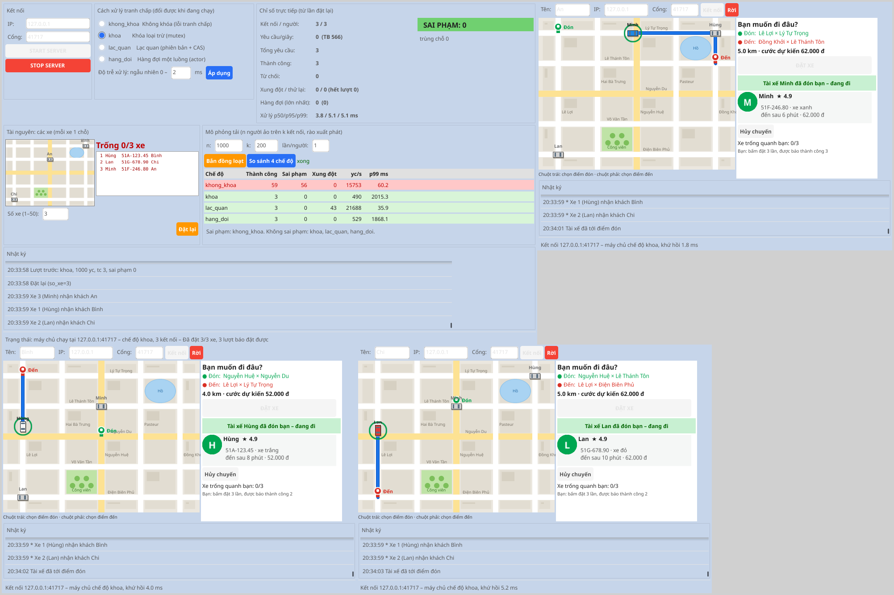
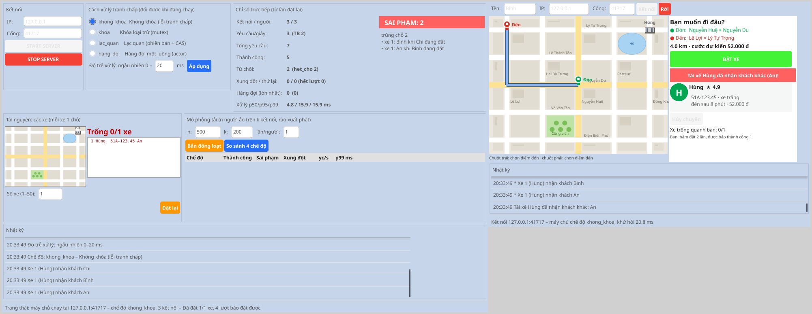
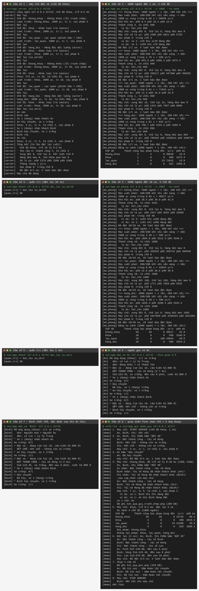

# Bài mở rộng MR6.7 – Đặt xe: n người cùng bấm "Đặt xe" cho một chỗ (Go)

| Thông tin | Nội dung |
|---|---|
| Loại | **Bài mở rộng**, không có trong giáo trình và không có mã giả tương ứng. Bài thứ hai của nhóm "tranh chấp tài nguyên" MR6.6–MR6.14, dùng chung khung của [MR6.6](../BaiMR6.6_DauGia/) |
| Liên hệ với giáo trình | Chương 6: Bài 6.1 (server đa luồng, một luồng mỗi kết nối), Bài 6.7 (kiểm thử tải); Chương 3: Bài 3.2 (định khung thông điệp theo dòng); bài mở rộng MR5.4/MR5.5 (luồng, đồng bộ) |
| Thư viện | Bản dòng lệnh: chỉ thư viện chuẩn Go (`net`, `sync`, `sync/atomic`, `encoding/json`, `math/rand/v2`). Ứng dụng giao diện (`gui/`, mô-đun riêng): Fyne v2.6.3 (cần cgo/gcc); kịch bản demo giao diện trên Linux cần Xvfb và ImageMagick (`import`) |
| Bản ngôn ngữ khác | [Python](../../../python/Chuong06/BaiMR6.7_DatXe/), [C#](../../../csharp/Chuong06/BaiMR6.7_DatXe/), [Java](../../../java/Chuong06/BaiMR6.7_DatXe/), [Rust](../../../rust/Chuong06/BaiMR6.7_DatXe/) |

## Mục tiêu
Bài mô phỏng một ứng dụng gọi xe. Có **m chiếc xe** (mặc định 1), mỗi xe **một chỗ**. **n người cùng bấm "Đặt xe"**: máy chủ giao xe trống gần điểm đón nhất, hết xe thì báo "Hết chỗ". Người đặt được có thể hủy chuyến để trả xe. Mỗi lần đặt là một thao tác "đọc trạng thái các xe → chọn xe (giả lập độ trễ cơ sở dữ liệu 0–2 ms) → ghi", xử lý theo **bốn cách** chọn được ngay lúc đang chạy: không khóa, khóa loại trừ, lạc quan, hàng đợi một goroutine. **Sổ kiểm toán** đếm số lần một chỗ đã có người lại được giao cho người thứ hai. **Bộ mô phỏng tải** (1000 người cùng đặt 1 xe; 2000 người cùng đặt 10 xe; 200 kết nối, rào xuất phát, pipelining) cho thấy bằng số liệu thật: chỉ chế độ không khóa "bán" một chỗ cho nhiều người.

Phần khung (`tranhchap/` trừ `nghiepvu.go`, `nguoiao.go`; `chung_cli.go`; `gui/chung_gui.go`, `gui/ve.go`) chép nguyên từ [MR6.6](../BaiMR6.6_DauGia/) (chỉ đổi đường dẫn gói). Bài này chỉ viết nghiệp vụ (`tranhchap/nghiepvu.go`, `tranhchap/nguoiao.go`), người gọi xe dòng lệnh, ứng dụng người dùng, bảng tài nguyên của máy chủ và kịch bản demo. Giao thức và dòng in giống hệt bản Python.

## Kiến thức chính
Số liệu dưới đây lấy từ `ket_qua.txt`, là một lần chạy thật trên máy cục bộ (127.0.0.1, Go 1.24, độ trễ xử lý ngẫu nhiên 0–2 ms). Mỗi lần chạy, số liệu lệch đi đôi chút.

```
1000 người cùng đặt 1 xe:
  Chế độ       Thành công Sai phạm Xung đột  yc/s  p99 ms
  khong_khoa            4        3        0 39639    16.8
  khoa                  1        0        0   590  1673.4
  lac_quan              1        0       15 71015    19.9
  hang_doi              1        0        0   622  1589.9
2000 người cùng đặt 10 xe:
  Chế độ       Thành công Sai phạm Xung đột  yc/s  p99 ms
  khong_khoa           59       49        0 40517    42.8
  khoa                 10        0        0   590  3346.9
  lac_quan             10        0      198 43044    39.6
  hang_doi             10        0        0   588  3344.2
```
(Mỗi người bấm một lần, 200 kết nối. "Thành công" là số người được báo "Đặt thành công", "Sai phạm" do sổ kiểm toán đếm, "Xung đột" là số lần so sánh-và-đổi thất bại, "yc/s" và "p99" (khứ hồi) đo ở bộ mô phỏng.)

- **Tranh chấp (race condition): một chỗ, nhiều người.** Ở `khong_khoa`, thao tác đặt xe làm "đọc các xe → chờ 0–2 ms → chọn xe trống → ghi" mà không đồng bộ. Mọi goroutine đọc được trước lần ghi đầu tiên đều thấy "xe 1 trống", đều được báo "Đặt thành công – tài xế Hùng", và bản ghi sau đè bản ghi trước. Với 1 xe, **4 người** cùng được báo thành công cho **một** chỗ, sổ kiểm toán đếm **3** lần "trùng chỗ" (ví dụ `xe 1: u79 khi u170 đang đặt`); với 10 xe, 59 người được báo thành công cho 10 chỗ (49 sai phạm). Người bị đè không hề biết: trên giao diện, họ thấy "Tài xế Hùng đã nhận khách khác!" khi bản cập nhật kế tiếp tới, tức là sau khi đã được báo thành công. Chế độ này chỉ dùng để minh họa lỗi trong phòng lab (loopback).
- **Vì sao 1 xe cho ít sai phạm hơn 10 xe.** Khe tranh chấp chỉ mở từ lúc goroutine đầu tiên đọc tới lúc nó ghi xong (vài phần mười mili giây tới 2 ms); mọi người đọc sau lần ghi đó đều thấy "Hết chỗ" và bị từ chối đúng. Một xe là một khe, mười xe là mười khe, nên số sai phạm tăng theo số chỗ chứ không theo số người. Với 1 xe, con số dao động mạnh giữa các lần chạy (3 trong `ket_qua.txt`, 12 ở một lần thử khác); bản Go nhận 1000 yêu cầu trong vài mili giây nên khe hẹp lại rất nhanh.
- **Vùng găng nhiều ô.** Để biết người đặt đã có chuyến chưa và xe trống nào gần nhất, mỗi lần đặt đọc **cả m ô** `xe1…xem` (theo đúng thứ tự tên ô – `doc` là map nên nghiệp vụ duyệt theo danh sách ô, không theo thứ tự ngẫu nhiên của map Go). Chế độ `khoa` giữ khóa của mọi ô (kênh đệm một chỗ, xin theo thứ tự tên ô nên không khóa chết) suốt đọc – chọn – ghi: sai phạm bằng 0, nhưng mọi yêu cầu đi qua cùng một bộ khóa, nên thông lượng chỉ còn ≈ 590 yc/s, như `hang_doi`. Khóa theo từng tài nguyên chỉ có lợi khi mỗi thao tác chạm vào ít ô, như ghế rạp ở [MR6.8](../BaiMR6.8_DatVePhim/).
- **Lạc quan (Kung & Robinson 1981).** Chế độ `lac_quan` đọc (giá trị, phiên bản) của các ô, chọn xe *ngoài* khóa, rồi so sánh-và-đổi: chỉ ghi nếu không ô nào đổi phiên bản. Chỉ vài yêu cầu đầu thật sự ghi, nên xung đột ít (15 với 1 xe, 198 với 10 xe), và mọi người đến sau bị từ chối "hết chỗ" ngay sau lần đọc mà không phải chờ ai: thông lượng cao nhất (71015 và 43044 yc/s).
- **Hàng đợi một goroutine (actor).** Chế độ `hang_doi` cho một goroutine nhận lần lượt từ channel, đến trước phục vụ trước. Sai phạm bằng 0, nhưng hàng đợi dài tối đa **994** (1000 người) và **1993** (2000 người), và khứ hồi p99 ≈ 1,6–3,3 s chính là thời gian xếp hàng.
- **Ảnh chụp trạng thái có số thứ tự.** Máy chủ đẩy `cap_nhat` gộp 10 lần/giây, nên một bản cập nhật chụp *trước* lần ghi của mình có thể tới *sau* trả lời `kq`. Vì vậy mỗi lần ghi được đánh số (`kq["phien"]`, bộ đếm `atomic.Int64` tăng mãi qua các lần đặt lại) và mỗi `cap_nhat` mang `"phien"` lúc chụp (đọc *trước* các ô). Client chỉ kết luận "xe đã nhận khách khác" từ bản cập nhật có `phien` ≥ số của lần đặt của mình. Trong demo giao diện, Chi thấy "đã nhận khách khác (Bình)" rồi bản kế tiếp ghi xe 1 chở An: chuỗi ghi đè Chi → Bình → An hiện ra đúng thứ tự.
- **Idempotency và pipelining.** Bộ mô phỏng gửi mọi yêu cầu của 5–10 người trên một kết nối trong một lần `Write` (`"so_nguoi"`, `"nguoi"`), sau rào xuất phát. Một `ma_yc` gửi lại không bị đặt lần hai; máy chủ gửi lại kết quả cũ kèm `"lap_lai": true`.

### Giao thức (giống hệt ở 5 ngôn ngữ)
Khung chung (chào, quản trị, `kq`, `cap_nhat`, `su_kien`, `thong_ke`) xem [README MR6.6](../BaiMR6.6_DauGia/README.md#giao-thức-giống-hệt-ở-5-ngôn-ngữ). Phần riêng của bài:

| Chiều | Thông điệp |
|---|---|
| người dùng → server | `{"loai":"dat_xe","ma_yc":k,"don":[x,y],"den":[x,y]}` (ngã tư trên lưới 5 × 5, tọa độ 0.1/0.3/0.5/0.7/0.9; bỏ trống thì đón ở [0.5,0.5]); `{"loai":"huy","ma_yc":k}`. Kết nối gộp thêm `"nguoi":"u17"` |
| quản trị → server | `{"loai":"dat_lai","ma_yc":k,"so_xe":10}` (1–50) |
| server → client | `{"loai":"kq","ma_yc":k,"ok":true,"xe":1,"khach","tai_xe","bien_so","mau","phut","cuoc","phien"}`; từ chối: `"ma_loi":"het_cho"\|"da_dat"\|"chua_dat"\|"xung_dot"\|"sai_du_lieu"\|…` |
| server → tất cả | `{"loai":"cap_nhat","che_do","phien","so_xe","trong","xe":[{"ma","tai_xe","bien_so","mau","vi_tri","khach","don","den","gio","cuoc","phut"}…],"lich_su":[…]}`; `{"loai":"su_kien","noi_dung":"Xe 1 (Hùng) nhận khách An"}` (chỉ cho người dùng thật) |

Sai phạm trong `thong_ke`: `[{"ma":"trung_cho","ten":"trùng chỗ","so":n}]`; `tom_tat`: `Đã đặt 1/1 xe, 4 lượt báo đặt được`.

## Cấu trúc tệp
- `tranhchap/`: khung chung (như MR6.6) + `nghiepvu.go` (`MayChuDatXe`: đặt xe, hủy, chọn xe gần nhất, cước, số thứ tự lần ghi; luật sổ kiểm toán; bản đồ: tên phố, ngã tư, `Km`, `Cuoc`, `TenDiem`), `nguoiao.go` (`nguoiAo` đặt từ một ngã tư ngẫu nhiên, `ThamSoDatLai = {}` – giữ số xe hiện tại của máy chủ).
- `main.go` (lệnh con `server`, `mo_phong`, `khach`, `dat_xe`), `chung_cli.go`, `server.go` (tùy chọn `--so-xe`), `dat_xe.go` (người gọi xe dòng lệnh).
- `gui/`: `chung_gui.go`, `ve.go` (khung chung), `server_gui.go`, `dat_xe_gui.go` (`banDo`: nền vẽ bằng bút ảnh, tuyến/ghim/xe là đối tượng Fyne, dùng ở cả hai cửa sổ), `demo_gui.go`, `main.go`.
- `demo.json`, `ket_qua.txt`, `ket_qua.png`, `ket_qua_gui.png`, `ket_qua_gui_tranh_chap.png`: kịch bản và kết quả thực thi thật.

## Cách chạy
Chạy trong thư mục bài (Go 1.24+):
```bash
go build -o out/app .
out/app server 127.0.0.1 9000                                  # cửa sổ 1 (gõ lệnh ở đây)
out/app mo_phong 127.0.0.1 9000 --n 1000 --so-sanh             # cửa sổ 2: 1000 người, 1 xe
out/app khach 127.0.0.1 9000 dat_lai so_xe=10                  # 10 xe
out/app mo_phong 127.0.0.1 9000 --n 2000 --so-sanh             # 2000 người, 10 xe
out/app dat_xe An 127.0.0.1 9000                               # cửa sổ 3, 4…: gõ dat / huy
```
- Lệnh của máy chủ: `che_do khong_khoa|khoa|lac_quan|hang_doi`, `tre <ms>`, `dat_lai [so_xe=…]`, `thong_ke`, `thoat`. Tùy chọn khi chạy: `--che-do`, `--tre-ms`, `--so-xe`.
- Lệnh của `dat_xe`: `dat` (đặt từ điểm đón mặc định theo tên), `huy`, `thoat`; dòng `@t lệnh` chờ tới giây thứ t.
- `mo_phong` có thêm `--k`, `--lan` (số lần bấm lại khi bị từ chối vì xung đột), `--che-do`, `--dat-lai`, `--tre-ms`.

Trong lượt chạy dòng lệnh (1 xe, chế độ `khoa`), An đặt được, Bình nhận "HẾT CHỖ", An hủy, Bình đặt lại được, rồi đến lượt An nhận "HẾT CHỖ". Muốn tái lập kết quả, chạy từ thư mục gốc của kho: `python3 tools/demo.py go/Chuong06/BaiMR6.7_DatXe`.

## Ứng dụng giao diện


Ảnh trên là lần chạy thật của `demo_gui` (Linux, Xvfb + Mesa llvmpipe, Fyne v2.6.3): bảng điều khiển máy chủ (trên trái), An (trên phải), Bình và Chi (dưới). Kịch bản đã chạy so sánh 4 chế độ với 3 xe (1000 người: `khong_khoa` 59 người được báo thành công, 56 sai phạm; ba chế độ kia 3 người, 0 sai phạm), rồi đặt lại 3 xe. Ba người cùng bấm "ĐẶT XE" và mỗi người được một xe (Minh, Hùng, Lan); xe chạy hoạt hình (40 ms/khung) theo tuyến nét đứt tới điểm đón rồi theo tuyến xanh tới điểm đến, vòng xanh đánh dấu xe của mình.



Ở bước trước đó, máy chủ đang ở `khong_khoa` với độ trễ 0–20 ms và chỉ có 1 xe. An, Bình và Chi cùng bấm "ĐẶT XE", và cả ba đều nhận trả lời thành công. Bản cập nhật kế tiếp cho thấy xe 1 chở An, nên Bình và Chi thấy "Tài xế Hùng đã nhận khách khác!". Ô **SAI PHẠM** chuyển đỏ (trùng chỗ 2). Cùng thao tác đó ở `khoa` thì một người "Đặt thành công", hai người "Hết chỗ – không còn xe trống".

- **Máy chủ** (`server_gui`): phần chung giống MR6.6; **tài nguyên**: bản đồ thu nhỏ với các xe (xe có khách mờ đi và ghi tên khách), "Trống x/m xe", danh sách xe (tài xế, biển số, khách – tô đỏ khi có khách), ô **Số xe** và nút **Đặt lại**.
- **Gọi xe** (`dat_xe_gui`): **bản đồ** 5 × 5 phố có tên, đường chính màu vàng, công viên, hồ, nhà; **điểm đón** (ghim xanh, chuột trái) và **điểm đến** (ghim đỏ, chuột phải); tuyến đường; các xe theo màu, xe đã có khách mờ đi; quãng đường và **cước dự kiến**; nút **ĐẶT XE**; trạng thái "Đang tìm tài xế…", "Đặt thành công – tài xế …", "Hết chỗ – không còn xe trống", "Tài xế … đã nhận khách khác!", "Tài xế … đã đón bạn – đang đi", "Đã tới nơi"; **thẻ tài xế** (chữ cái đầu, tên, biển số, màu xe, thời gian tới, cước); nút **Hủy chuyến** (sau khi tới nơi thành **Hoàn tất chuyến**, cũng gửi `huy` để trả xe); "Xe trống quanh bạn"; thanh trạng thái hiện chế độ máy chủ và khứ hồi.

### Cách chạy
```bash
go -C gui mod tidy                                   # lần đầu (cần mạng)
go -C gui build -o ../out/app_gui .
out/app_gui server_gui 127.0.0.1 41717               # bấm START SERVER (1 xe)
out/app_gui dat_xe_gui An 127.0.0.1 41717
out/app_gui dat_xe_gui Bình 127.0.0.1 41717
```
- **Windows:** Go 1.24+ và gcc cho cgo (như [MR6.6](../BaiMR6.6_DauGia/README.md#cách-chạy-1)). Kịch bản tự động (Linux, cần `xvfb`, `imagemagick`): `xvfb-run -a -s "-screen 0 2600x1700x24" out/app_gui demo_gui 127.0.0.1 41717`.
- Chạy riêng từng cửa sổ: mọi dòng nhật ký và cứ 5 giây một dòng số liệu cũng in ra dòng lệnh.
- Thử trên nhiều máy: máy chủ nghe trên IP card mạng (hoặc `0.0.0.0`) và mở tường lửa; cả lớp đếm ngược rồi cùng bấm "ĐẶT XE". Khi đó **chỉ dùng `khoa`, `lac_quan`, `hang_doi`**.

## Kết quả thực thi


## Ghi chú
- **Chạy chéo với bản Python** (đã thử): (a) `out/app mo_phong --n 1000 --so-sanh` → máy chủ Python (1 xe): `khong_khoa` 19 thành công / 18 sai phạm, ba chế độ kia 1 / 0 (`lac_quan` 13 xung đột); sau `out/app khach … dat_lai so_xe=3`, người gọi xe Go (An) và Python (Bình) cùng đặt: An được xe 3 (Minh), Bình xe 1 (Hùng); (b) `mo_phong.py` → máy chủ Go: 1000 người / 1 xe `khong_khoa` 8 / 7, 2000 người / 10 xe `khong_khoa` 34 / 24, ba chế độ kia đúng 1 và 10 thành công, 0 sai phạm; Chi (Python) nhận "HẾT CHỖ" rồi "TỪ CHỐI: bạn chưa đặt xe" khi hủy.
- Chọn xe gần nhất so (khoảng cách Manhattan, mã xe) như `min(key=…)` của Python; cước và số phút làm tròn nửa về số chẵn như `round()` của Python, nên cùng điểm đón/đến cho cùng cước ở mọi ngôn ngữ.
- Đổi chế độ hoặc đặt lại đi qua cổng `TamDung` của khung. `ThamSoDatLai = {}`: `--so-sanh` đặt lại trạng thái mà vẫn giữ số xe đang có.
- Kiểm thử: Linux, Go 1.24.7 (`gofmt`, `go vet` sạch, cả `GOOS=windows go vet . ./tranhchap/`); giao diện: Fyne v2.6.3 dưới Xvfb (chưa thử trên Windows; cửa sổ dùng `SetFixedSize` nên có `giuVe` chống cửa sổ trắng như MR6.5).

## Bài tập gợi ý
1. Chạy `out/app mo_phong --che-do khong_khoa --dat-lai` nhiều lần với 1 xe, rồi với `--tre-ms 10`. Vì sao số sai phạm tăng theo độ trễ mà gần như không tăng theo `--n`?
2. Đổi `xuLyYeuCau` để mỗi lần đặt chỉ khóa **một** ô (máy chủ đọc không khóa để chọn xe, rồi `ThucHien([]string{"xeK"}, …)`; nếu xe vừa có người thì thử xe kế). Đo thông lượng `khoa` với 10 xe. "Một người không đặt hai xe" còn được bảo đảm không, và cần thêm gì?
3. Thêm thao tác `hoan_thanh` (tài xế báo xong chuyến) và cho `nguoiAo` đặt – hủy – đặt lại nhiều vòng (`--lan 5`). Sai phạm của `khong_khoa` thay đổi thế nào khi mỗi lần hủy lại mở một khe tranh chấp mới?
4. Cho xe di chuyển thật ở máy chủ (cập nhật `ViTri` trong `dinhKy`). Mỗi lần di chuyển cũng là một thao tác ghi: ở `lac_quan`, số xung đột của thao tác đặt xe tăng ra sao?
5. Giao diện: khi ứng dụng nhận "Đặt thành công" nhưng sau đó thấy "đã nhận khách khác", hãy tự động đặt lại (tìm xe khác). Đây có phải cách "sửa" tranh chấp không? Vì sao?

## Đọc thêm
- H. T. Kung, J. T. Robinson (1981). *On Optimistic Methods for Concurrency Control*. ACM Transactions on Database Systems 6(2).
- E. G. Coffman, M. J. Elphick, A. Shoshani (1971). *System Deadlocks*. ACM Computing Surveys 3(2): điều kiện khóa chết và cách phòng bằng thứ tự khóa (khung khóa nhiều ô theo thứ tự tên ô).
- Tài liệu Go: [`sync`](https://pkg.go.dev/sync), [`sync/atomic`](https://pkg.go.dev/sync/atomic), [The Go Memory Model](https://go.dev/ref/mem), [`net`](https://pkg.go.dev/net); Fyne: [Goroutines – `fyne.Do`](https://docs.fyne.io/started/goroutines), [`canvas`](https://docs.fyne.io/explore/canvas).

Mã nguồn của bài được viết mới cho kho này.
