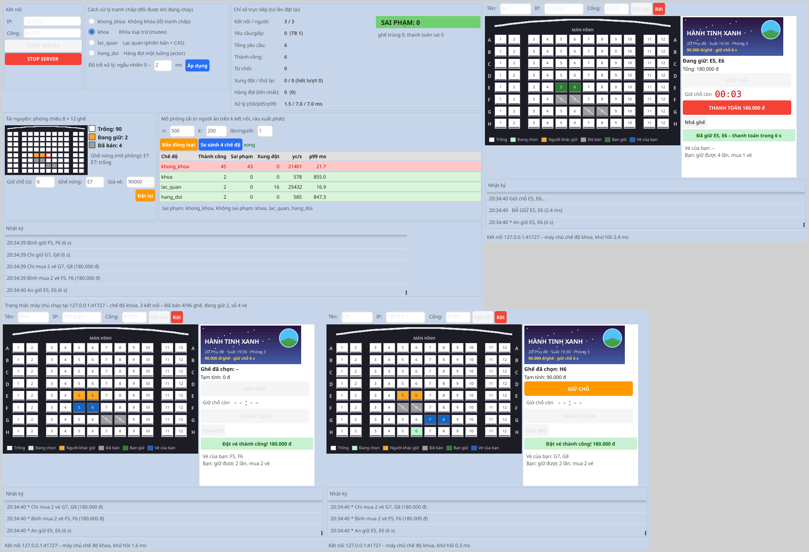
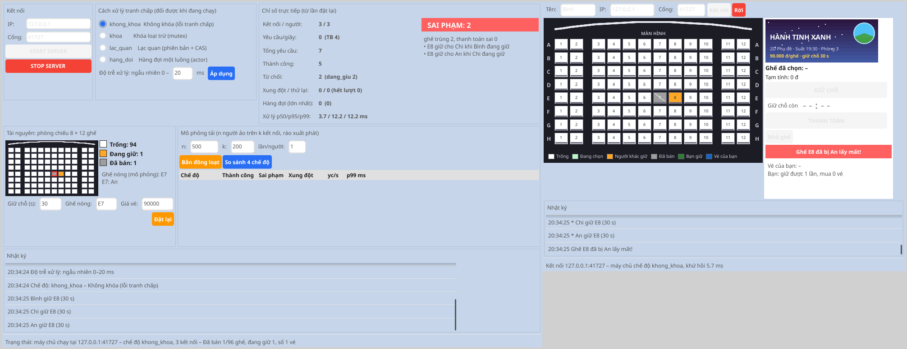
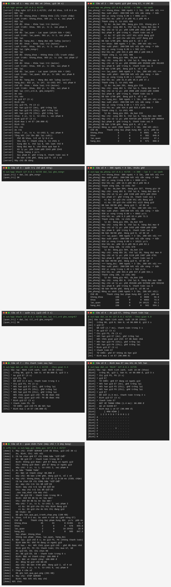

# Bài mở rộng MR6.8 – Đặt vé xem phim: giữ chỗ có thời hạn, n người cùng tranh một ghế (Go)

| Thông tin | Nội dung |
|---|---|
| Loại | **Bài mở rộng**, không có trong giáo trình và không có mã giả tương ứng. Thuộc nhóm "tranh chấp tài nguyên" MR6.6–MR6.14, dùng chung khung của [MR6.6](../BaiMR6.6_DauGia/) |
| Liên hệ với giáo trình | Chương 6: Bài 6.1 (server đa luồng, một luồng mỗi kết nối), Bài 6.7 (kiểm thử tải); Chương 3: Bài 3.2 (định khung thông điệp theo dòng); bài mở rộng MR5.4/MR5.5 (luồng, đồng bộ) |
| Thư viện | Bản dòng lệnh: chỉ thư viện chuẩn Go (`net`, `sync`, `sync/atomic`, `encoding/json`, `math/rand/v2`). Ứng dụng giao diện (`gui/`, mô-đun riêng): Fyne v2.6.3 (cần cgo/gcc); kịch bản demo giao diện trên Linux cần Xvfb và ImageMagick (`import`) |
| Bản ngôn ngữ khác | [Python](../../../python/Chuong06/BaiMR6.8_DatVePhim/), [C#](../../../csharp/Chuong06/BaiMR6.8_DatVePhim/), [Java](../../../java/Chuong06/BaiMR6.8_DatVePhim/), [Rust](../../../rust/Chuong06/BaiMR6.8_DatVePhim/) |

## Mục tiêu
Bài mô phỏng một ứng dụng đặt vé xem phim. Phòng chiếu có **8 hàng (A–H) × 12 ghế**. Người xem chọn ghế rồi **giữ chỗ** (`giu_cho`): ghế được giữ riêng cho họ trong **30 giây** (TTL). Trong thời gian đó họ **thanh toán** (`thanh_toan`) để nhận vé, hoặc **nhả** (`nha`) ghế. Quá hạn mà chưa thanh toán thì ghế **tự nhả**: goroutine nền của máy chủ dọn ghế quá hạn mỗi 100 ms, và một lượt giữ quá hạn cũng bị coi là trống ngay cả khi chưa kịp dọn. Thanh toán sau hạn bị từ chối. Mỗi ghế là một ô tài nguyên, và mọi thao tác là "đọc → kiểm tra (giả lập độ trễ cơ sở dữ liệu 0–2 ms) → ghi", xử lý theo **bốn cách**: không khóa, khóa loại trừ theo từng ghế, lạc quan, hàng đợi một goroutine. **Sổ kiểm toán** đếm ghế giữ/bán cho hai người và thanh toán sai. **Bộ mô phỏng tải** chạy hai tình huống: 500 người cùng giữ một ghế "nóng" E7, và 300 người × 3 lần thử chọn nhóm 1–2 ghế ngẫu nhiên trên cả rạp.

Phần khung chép nguyên từ [MR6.6](../BaiMR6.6_DauGia/) (chỉ đổi đường dẫn gói). Bài này chỉ viết nghiệp vụ, người đặt vé dòng lệnh, ứng dụng người dùng, bảng tài nguyên của máy chủ và kịch bản demo. Giao thức và dòng in giống hệt bản Python.

## Kiến thức chính
Số liệu dưới đây lấy từ `ket_qua.txt`, là một lần chạy thật trên máy cục bộ (127.0.0.1, Go 1.24, độ trễ xử lý ngẫu nhiên 0–2 ms). Mỗi lần chạy, số liệu lệch đi đôi chút.

```
500 người cùng giữ ghế nóng E7 (giữ được thì thanh toán ngay):
  Chế độ       Thành công Sai phạm Xung đột  yc/s  p99 ms
  khong_khoa            6        4        0  8881    46.4
  khoa                  2        0        0   582   840.9
  lac_quan              2        0        3 12452    37.1
  hang_doi              2        0        0   571   860.9
300 người × 3 lần thử, nhóm 1–2 ghế ngẫu nhiên (96 ghế):
  Chế độ       Thành công Sai phạm Xung đột  yc/s  p99 ms
  khong_khoa          156       17        0  9689    56.9
  khoa                156        0        0  8863    73.5
  lac_quan            160        0       26 10121    63.1
  hang_doi            150        0        0   562   554.1
```
("Thành công" đếm cả lần giữ chỗ và lần thanh toán được chấp nhận; "Sai phạm" do sổ kiểm toán đếm; "Xung đột" là số lần so sánh-và-đổi thất bại; "yc/s" và "p99" (khứ hồi) đo ở bộ mô phỏng; 200 kết nối.)

- **Tranh chấp trên một ghế nóng.** Ở `khong_khoa`, 500 người cùng đọc "E7 trống", và **5** người cùng được báo "ĐÃ GIỮ" (6 thành công = 5 lần giữ + 1 lần thanh toán). Sổ kiểm toán đếm **4** lần "ghế trùng" (ví dụ `E7 giữ cho u137 khi u115 đang giữ`). Bốn người kia đi thanh toán thì bị từ chối "ghế E7 không do bạn giữ" (`khong_giu 4`), vì lượt giữ của họ đã bị đè mất. Người dùng thật thấy điều này trên giao diện: vừa được báo "Đã giữ E8" thì ngay sau đó là "Ghế E8 đã bị An lấy mất!". Ba chế độ còn lại cho đúng 1 người giữ, 1 vé, 0 sai phạm. Chế độ `khong_khoa` chỉ dùng để minh họa lỗi trong phòng lab (loopback). (Số người cùng "giữ được" dao động mạnh giữa các lần chạy: từ 4 tới 43 sai phạm ở các lần thử, kể cả lần chạy trong giao diện.)
- **Khóa theo từng tài nguyên.** Ở tình huống nhiều ghế, mỗi yêu cầu chỉ chạm 1–2 ô. Chế độ `khoa` khóa riêng từng ghế, nên hai người chọn hai ghế khác nhau chạy **song song trên nhiều lõi**: thông lượng **8863 yc/s** (thời gian xử lý ở máy chủ p50 1,4 ms), gấp khoảng **16 lần** `hang_doi` (562 yc/s, p50 453 ms, hàng đợi max 300), trong khi với một ghế nóng thì hai chế độ ngang nhau (582 và 571 yc/s). Đây là điều MR6.6 và MR6.7 (một điểm nóng) không cho thấy được: một khóa toàn cục hay một goroutine duy nhất tuần tự hóa cả những thao tác không hề đụng nhau. Bản Go đa lõi cho khoảng cách lớn hơn bản Python (Python: gấp ≈ 6,5 lần).
- **Khóa nhiều ô theo thứ tự, không khóa chết.** Giữ "E7, E8" phải khóa cả hai ô cùng lúc (nhóm ghế hoặc được cả, hoặc không được gì). Khung xin khóa theo **thứ tự tên ô đã sắp xếp**, nên hai người giữ "E8, E7" và "E7, E8" không bao giờ chờ nhau vòng tròn (Coffman và cộng sự 1971). Ở tình huống nhiều ghế, `khoa`, `lac_quan`, `hang_doi` đều bán hết 96/96 ghế; `khong_khoa` chỉ bán 89 ghế, còn 7 ghế "đang giữ" bởi những lượt giữ đã bị đè (người giữ không còn thấy mình trong sơ đồ nên không thanh toán), cộng 17 sai phạm.
- **Lạc quan.** Chế độ `lac_quan` đọc (giá trị, phiên bản) của các ghế trong yêu cầu, kiểm tra ngoài khóa, rồi so sánh-và-đổi. Xung đột ít (3 và 26), vì phần lớn yêu cầu bị từ chối ngay sau lần đọc ("đã bán", "đang có người giữ"), nên thông lượng cao nhất ở cả hai tình huống (12452 và 10121 yc/s).
- **Giữ chỗ có thời hạn (TTL) và goroutine dọn.** Lượt giữ lưu thời điểm hết hạn theo **đồng hồ đơn điệu** (`time.Since` của một mốc cố định), còn client nhận `con_lai_ms` chứ không nhận thời điểm tuyệt đối. Nhả ghế quá hạn cũng là một thao tác ghi đi qua cùng chế độ xử lý tranh chấp, nên ở `khoa` không thể có chuyện "goroutine dọn nhả ghế đúng lúc chủ ghế đang thanh toán". Ở `khong_khoa` thì có thể: goroutine dọn đọc "giữ quá hạn của An", trong lúc đó Bình giữ lại ghế, rồi goroutine dọn ghi "trống" đè lên lượt giữ của Bình. Lượt chạy dòng lệnh (giữ chỗ 3 s) cho thấy:
  - An giữ E7 rồi không thanh toán. Bình giữ E7 khi An còn hạn thì bị từ chối "ghế E7 đang có người giữ". Hết hạn, máy chủ báo "Hết hạn giữ E7 (An), ghế trống lại", rồi Bình giữ và mua được E7 (mã vé `S1930-E7`).
  - An bấm thanh toán muộn thì nhận "TỪ CHỐI: ghế E7 không do bạn giữ" (ghế đã là của Bình).
  - Chi giữ F5, F6, thanh toán sau hạn thì nhận "TỪ CHỐI: giữ chỗ F5 đã hết hạn" (máy chủ nhớ ai giữ ghế lần cuối để báo đúng lý do).
- **Sổ kiểm toán.** Sổ giữ bản sao "ghế → (giữ/bán, người, hạn)" và kiểm tra từng giao dịch theo thứ tự ghi: một lượt giữ hay bán cho ghế mà người khác đang giữ còn hạn hoặc đã mua là `trung_ghe`; một lần thanh toán được chấp nhận cho ghế không do mình giữ hoặc đã quá hạn là `tt_sai`. Thời điểm dùng để kiểm tra hạn là thời điểm mà hàm nghiệp vụ đã dùng (`_luc`, không gửi cho client – máy chủ bỏ các trường bắt đầu bằng `_` trước khi trả lời), nên sổ không báo nhầm khi thanh toán sát giờ hết hạn.
- **Ảnh chụp trạng thái có số thứ tự.** Mỗi lần ghi được đánh số (`kq["phien"]`), và mỗi `cap_nhat` mang `"phien"` lúc chụp. Client chỉ kết luận "ghế đã bị lấy" hoặc "đã hết hạn" từ bản cập nhật có `phien` ≥ số của lần giữ của mình, nên một bản cập nhật cũ tới muộn không làm giao diện báo sai.

### Giao thức (giống hệt ở 5 ngôn ngữ)
Khung chung (chào, quản trị, `kq`, `cap_nhat`, `su_kien`, `thong_ke`) xem [README MR6.6](../BaiMR6.6_DauGia/README.md#giao-thức-giống-hệt-ở-5-ngôn-ngữ). Phần riêng của bài:

| Chiều | Thông điệp |
|---|---|
| người dùng → server | `{"loai":"giu_cho","ma_yc":k,"ghe":["E7","E8"]}`, `{"loai":"thanh_toan","ma_yc":k,"ghe":[…]}`, `{"loai":"nha","ma_yc":k,"ghe":[…]}` (1–8 mã ghế A1–H12, không trùng). Kết nối gộp thêm `"nguoi":"u17"` |
| quản trị → server | `{"loai":"dat_lai","ma_yc":k,"ttl_s":30,"ghe_nong":"E7"\|"","gia_ve":90000,"phim":…,"suat":"19:30"}` |
| server → client | giữ: `{"loai":"kq","ok":true,"ghe":[…],"moi":[…],"het_han_ms":30000,"nguoi","phien"}`; thanh toán: `{"ok":true,"ghe","ma_ve":["S1930-E7"],"tien","nguoi","phien"}`; nhả: `{"ok":true,"ghe","nguoi","phien"}`; từ chối: `"ma_loi":"dang_giu"\|"da_ban"\|"khong_giu"\|"het_han"\|"xung_dot"\|"sai_du_lieu"\|…` (giữ thất bại kèm `"ghe_ban":[…]`) |
| server → tất cả | `{"loai":"cap_nhat","che_do","phien","phim","suat","gia_ve","ttl_s","ghe_nong","hang":"ABCDEFGH","cot":12,"so_do":["....g..b....",…] (. trống, g đang giữ, b đã bán),"chu":{"E7":"An",…},"con_lai_ms":{"E7":27000,…},"dem":{"trong","giu","ban"}}`; `su_kien` cho người dùng thật: "An giữ E7 (30 s)", "Bình mua 1 vé E7 (90.000 đ)", "Hết hạn giữ E7 (An), ghế trống lại" |

Sai phạm trong `thong_ke`: `ghế trùng`, `thanh toán sai`; `tom_tat`: `Đã bán 96/96 ghế, đang giữ 0, sổ 96 vé`.

## Cấu trúc tệp
- `tranhchap/`: khung chung (như MR6.6) + `nghiepvu.go` (`MayChuDatVe`: giữ chỗ, thanh toán, nhả, dọn ghế quá hạn trong `dinhKy`, số thứ tự lần ghi; luật sổ kiểm toán), `nguoiao.go` (`nguCanh`: sơ đồ ghế kết nối biết, chọn nhóm ghế trống ngẫu nhiên; `nguoiAo`: lần đầu giữ ghế nóng, giữ được thì thanh toán, bị từ chối thì chọn ghế khác; `ThamSoDatLai = {}`).
- `main.go` (lệnh con `server`, `mo_phong`, `khach`, `dat_ve`), `chung_cli.go`, `server.go` (tùy chọn `--ttl`, `--ghe-nong`), `dat_ve.go` (người đặt vé dòng lệnh, lệnh `xem` in sơ đồ ghế).
- `gui/`: `chung_gui.go`, `ve.go` (khung chung), `server_gui.go`, `dat_ve_gui.go` (`soDoGhe`: sơ đồ ghế bằng đối tượng Fyne, dùng ở cả hai cửa sổ; áp phích phim), `demo_gui.go`, `main.go`.
- `demo.json`, `ket_qua.txt`, `ket_qua.png`, `ket_qua_gui.png`, `ket_qua_gui_tranh_chap.png`: kịch bản và kết quả thực thi thật.

## Cách chạy
Chạy trong thư mục bài (Go 1.24+):
```bash
go build -o out/app .
out/app server 127.0.0.1 9000                                  # cửa sổ 1 (gõ lệnh ở đây)
out/app mo_phong 127.0.0.1 9000 --n 500 --so-sanh              # 500 người cùng giữ ghế nóng E7
out/app khach 127.0.0.1 9000 dat_lai ghe_nong=                 # bỏ ghế nóng: chọn ghế ngẫu nhiên
out/app mo_phong 127.0.0.1 9000 --n 300 --lan 3 --so-sanh
out/app khach 127.0.0.1 9000 dat_lai ttl_s=3 ghe_nong=E7       # giữ chỗ 3 s
out/app dat_ve An 127.0.0.1 9000                               # gõ: giu E7 / tt / nha / xem
```
- Lệnh của máy chủ: `che_do khong_khoa|khoa|lac_quan|hang_doi`, `tre <ms>`, `dat_lai [ttl_s=… ghe_nong=… gia_ve=… phim=… suat=…]`, `thong_ke`, `thoat`. Tùy chọn khi chạy: `--che-do`, `--tre-ms`, `--ttl`, `--ghe-nong`.
- Lệnh của `dat_ve`: `giu E7 [E8 …]`, `tt [ghế…]` (mặc định các ghế vừa giữ), `nha [ghế…]`, `xem`, `thoat`; dòng `@t lệnh` chờ tới giây thứ t.

Muốn tái lập kết quả, chạy từ thư mục gốc của kho: `python3 tools/demo.py go/Chuong06/BaiMR6.8_DatVePhim`.

## Ứng dụng giao diện


Ảnh trên là lần chạy thật của `demo_gui` (Linux, Xvfb + Mesa llvmpipe, Fyne v2.6.3): bảng điều khiển máy chủ (trên trái, sơ đồ rạp thu nhỏ với ghế nóng E7 viền đỏ), An (trên phải), Bình và Chi (dưới). Sau so sánh 4 chế độ (`khong_khoa` 45 thành công, 43 sai phạm; ba chế độ kia 2 / 0), kịch bản đặt lại với giữ chỗ 6 s: An giữ F5, F6 rồi không thanh toán; Bình bấm F6 thì thấy "Ghế F6 đang có người giữ"; hết hạn, An thấy "Hết thời gian giữ chỗ – ghế đã được nhả", Bình giữ và mua F5, F6 (xanh dương trong cửa sổ Bình, xám gạch chéo ở người khác), Chi mua G7, G8; An giữ E5, E6 (xanh lá, đồng hồ đếm ngược đỏ), Chi đang chọn H6.



Ở bước trước đó, máy chủ đang ở `khong_khoa` với độ trễ 0–20 ms. Cả ba chọn E8 rồi cùng bấm "GIỮ CHỖ", và cả ba đều nhận "ĐÃ GIỮ E8". Bản cập nhật kế tiếp ghi E8 thuộc An, nên Bình và Chi thấy "Ghế E8 đã bị An lấy mất!". Ô **SAI PHẠM** chuyển đỏ (ghế trùng 2). Cùng thao tác đó ở `khoa` (với E7) thì một người giữ được, hai người nhận "Không giữ được: ghế E7 đang có người giữ".

- **Máy chủ** (`server_gui`): phần chung giống MR6.6; **tài nguyên**: sơ đồ phòng chiếu thu nhỏ (trống / đang giữ / đã bán, ghế nóng viền đỏ), số ghế mỗi loại, ghế nóng của bộ mô phỏng và chủ của nó, tham số đặt lại (giữ chỗ, ghế nóng, giá vé) và nút **Đặt lại**.
- **Đặt vé** (`dat_ve_gui`): **áp phích phim**; **sơ đồ 8 × 12 ghế** với MÀN HÌNH cong, lối đi, nhãn hàng A–H hai bên, số ghế, tay vịn; màu: trống / đang chọn / người khác giữ / đã bán (gạch chéo) / bạn giữ / vé của bạn, kèm chú giải; bấm ghế để chọn (tối đa 8); **GIỮ CHỖ**; **đồng hồ giữ chỗ** đếm ngược (đỏ khi < 10 s); **THANH TOÁN** (ghi tổng tiền); **Nhả ghế**; thông báo có màu ("Đã giữ … – thanh toán trong 30 s", "Ghế … đã bị … lấy mất!", "Hết thời gian giữ chỗ", "Đặt vé thành công!"); vé của bạn và số lần giữ/mua.

### Cách chạy
```bash
go -C gui mod tidy                                   # lần đầu (cần mạng)
go -C gui build -o ../out/app_gui .
out/app_gui server_gui 127.0.0.1 41727               # bấm START SERVER (giữ chỗ 30 s)
out/app_gui dat_ve_gui An 127.0.0.1 41727
out/app_gui dat_ve_gui Bình 127.0.0.1 41727
```
- **Windows:** Go 1.24+ và gcc cho cgo (như [MR6.6](../BaiMR6.6_DauGia/README.md#cách-chạy-1)). Kịch bản tự động (Linux, cần `xvfb`, `imagemagick`): `xvfb-run -a -s "-screen 0 2600x1700x24" out/app_gui demo_gui 127.0.0.1 41727`.
- Chạy riêng từng cửa sổ: mọi dòng nhật ký và cứ 5 giây một dòng số liệu cũng in ra dòng lệnh.
- Thử trên nhiều máy: cả lớp cùng tranh một ghế "đẹp" trên máy chủ của thầy; khi đó **chỉ dùng `khoa`, `lac_quan`, `hang_doi`**.

## Kết quả thực thi


## Ghi chú
- **Chạy chéo với bản Python** (đã thử): (a) `out/app mo_phong` → máy chủ Python: ghế nóng `khong_khoa` 15 thành công / 13 sai phạm, ba chế độ kia 2 / 0; nhiều ghế (300 × 3) `khong_khoa` 181 / 64, `khoa` 146 / 0, `lac_quan` 138 / 0, `hang_doi` 152 / 0; An (Go) giữ E7, Bình (Python) bị từ chối E7 rồi giữ và mua E8; (b) `mo_phong.py` → máy chủ Go: ghế nóng `khong_khoa` 4 / 2, ba chế độ kia 2 / 0; nhiều ghế `khong_khoa` 161 / 16, `khoa` 144 / 0 (6606 yc/s so với 634 yc/s của `hang_doi`), `lac_quan` 144 / 0; người đặt vé Python nhận đúng "TỪ CHỐI: ghế A1 đã bán" và in được sơ đồ từ `cap_nhat` của máy chủ Go.
- Dọn ghế quá hạn chạy trên goroutine nền 100 ms (`dinhKy`); tập ghế đang dọn được bảo vệ bằng `sync.Mutex`, vì `khiGhi` có thể chạy song song ở `khong_khoa`.
- Đổi chế độ hoặc đặt lại đi qua cổng `TamDung` của khung. `ThamSoDatLai = {}`: `--so-sanh` giữ ghế nóng và thời hạn giữ chỗ hiện tại của máy chủ.
- Kiểm thử: Linux, Go 1.24.7 (`gofmt`, `go vet` sạch, cả `GOOS=windows go vet . ./tranhchap/`); giao diện: Fyne v2.6.3 dưới Xvfb (chưa thử trên Windows; cửa sổ dùng `SetFixedSize` nên có `giuVe` chống cửa sổ trắng như MR6.5).

## Bài tập gợi ý
1. Chạy tình huống ghế nóng với `--tre-ms 0`, `2`, `10`. Ở `khong_khoa`, số người "cùng giữ được" E7 thay đổi ra sao? Vì sao ghế nóng lại ít sai phạm hơn tình huống nhiều ghế dù tranh chấp gắt hơn?
2. Đặt `ttl_s=1` và cho `nguoiAo` chờ 0–2 s trước khi thanh toán. Đếm số lần "het_han". Ở `khong_khoa`, có xuất hiện sai phạm `tt_sai` (thanh toán ghế đã hết hạn) không? Giải thích bằng tranh chấp giữa goroutine dọn và người thanh toán.
3. Sửa khung để `khoa` dùng **một** khóa chung cho cả rạp (mọi thao tác khóa cùng một ô giả). Đo lại tình huống nhiều ghế và so với khóa theo từng ghế.
4. Thêm quy tắc "không để trống một ghế lẻ giữa hai ghế đã bán" khi giữ chỗ. Quy tắc này phải đọc thêm những ô nào? Ảnh hưởng tới khóa theo từng ghế ra sao?
5. Giao diện: thêm nút "Chọn ghế tốt nhất" (ghế trống gần giữa hàng E nhất) và cho nhiều cửa sổ cùng bấm ở `lac_quan`: quan sát xung đột trên bảng điều khiển máy chủ.

## Đọc thêm
- H. T. Kung, J. T. Robinson (1981). *On Optimistic Methods for Concurrency Control*. ACM Transactions on Database Systems 6(2).
- E. G. Coffman, M. J. Elphick, A. Shoshani (1971). *System Deadlocks*. ACM Computing Surveys 3(2): điều kiện khóa chết và cách phòng bằng thứ tự khóa (giữ nhiều ghế = khóa nhiều ô theo thứ tự tên ô).
- Tài liệu Go: [`sync`](https://pkg.go.dev/sync), [`sync/atomic`](https://pkg.go.dev/sync/atomic), [`time`](https://pkg.go.dev/time) (đồng hồ đơn điệu), [The Go Memory Model](https://go.dev/ref/mem), [`net`](https://pkg.go.dev/net); Fyne: [Goroutines – `fyne.Do`](https://docs.fyne.io/started/goroutines).

Mã nguồn của bài được viết mới cho kho này.
