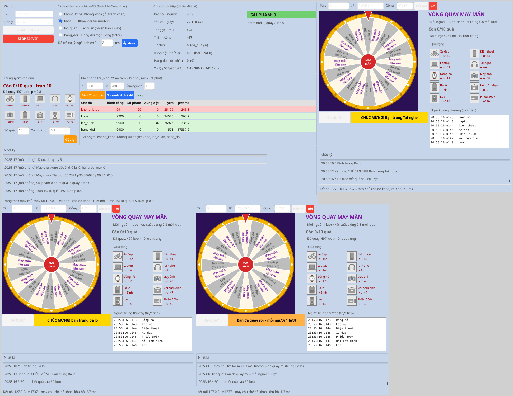
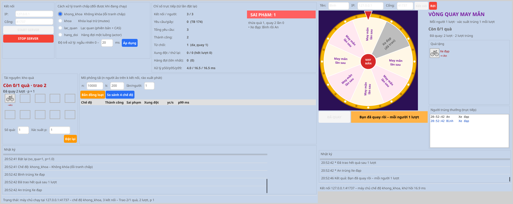
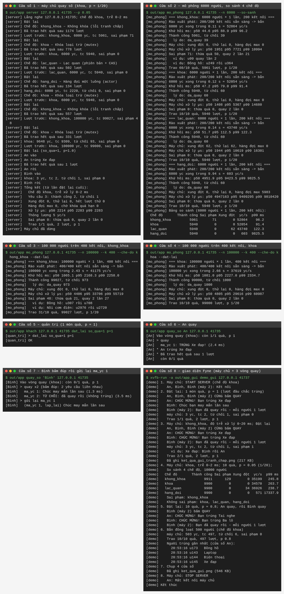

# Bài mở rộng MR6.9 – Quay số trúng thưởng: 100 000 lượt quay tranh 10 món quà (Go)

| Thông tin | Nội dung |
|---|---|
| Loại | **Bài mở rộng**, không có trong giáo trình và không có mã giả tương ứng. Thuộc nhóm "tranh chấp tài nguyên" MR6.6–MR6.13, dùng chung khung của [MR6.6](../BaiMR6.6_DauGia/) |
| Liên hệ với giáo trình | Chương 6: Bài 6.1 (server đa luồng, một luồng mỗi kết nối), Bài 6.7 (kiểm thử tải); Chương 3: Bài 3.2 (định khung thông điệp theo dòng); bài mở rộng MR5.4/MR5.5 (luồng, đồng bộ) |
| Thư viện | Bản dòng lệnh: chỉ thư viện chuẩn Go (`net`, `sync`, `sync/atomic`, `encoding/json`, `math/rand/v2`). Ứng dụng giao diện (`gui/`, mô-đun riêng): Fyne v2.6.3 (cần cgo/gcc) và `golang.org/x/image/font/opentype` (vẽ chữ xoay trên bánh xe); kịch bản demo giao diện trên Linux cần Xvfb và ImageMagick (`import`) |
| Bản ngôn ngữ khác | [Python](../../../python/Chuong06/BaiMR6.9_QuaySo/), [C#](../../../csharp/Chuong06/BaiMR6.9_QuaySo/), [Java](../../../java/Chuong06/BaiMR6.9_QuaySo/), [Rust](../../../rust/Chuong06/BaiMR6.9_QuaySo/) |

## Mục tiêu
Bài mô phỏng chương trình khuyến mãi "Vòng quay may mắn". Kho có **10 món quà**, hàng chục nghìn khách hàng mỗi người được **quay đúng một lần**. Mỗi lượt trúng với xác suất **p** (mặc định 1/2000) nếu kho còn quà, và người trúng nhận ngẫu nhiên một món còn lại. Có hai tài nguyên bị tranh chấp:
- **kho quà** (một ô "nóng", mọi lượt trúng cùng ghi);
- **lượt quay của từng người** (một ô cho mỗi người). Hai thiết bị của cùng một người, hoặc một lần bấm đúp, cùng gửi yêu cầu `quay`.

Máy chủ TCP đa luồng (một goroutine mỗi kết nối) xử lý thao tác "đọc → kiểm tra (giả lập độ trễ cơ sở dữ liệu 0–2 ms) → ghi" theo **bốn cách** chọn được ngay lúc đang chạy: không khóa, khóa loại trừ, lạc quan, hàng đợi một goroutine. **Sổ kiểm toán** đếm hai sai phạm: **thừa quà** (một món đã trao lại được trao lần nữa) và **quay 2 lần** (một người có hai lượt quay được chấp nhận). Bộ mô phỏng tải dồn **100 000 người lên 400 kết nối** (pipelining).

Phần khung chép nguyên từ [MR6.6](../BaiMR6.6_DauGia/) (chỉ đổi đường dẫn gói). Bài này chỉ viết nghiệp vụ, người quay dòng lệnh, vòng quay giao diện, bảng tài nguyên của máy chủ và kịch bản demo. Giao thức và dòng in giống hệt bản Python.

## Kiến thức chính
Số liệu dưới đây lấy từ `ket_qua.txt`, là một lần chạy thật trên máy cục bộ (127.0.0.1, Go 1.24, độ trễ xử lý ngẫu nhiên 0–2 ms). Như bản Python, máy chủ trong demo chạy với **p = 1/20** (`server --p 0.05`) để sai phạm hiện rõ trong vài giây. Mỗi lần chạy, số liệu lệch đi đôi chút.

```
  Chế độ       Thành công Sai phạm Xung đột  yc/s  p99 ms
  khong_khoa         5961       71        0 52864    96.2
  khoa               5940        0        0 52054    91.4
  lac_quan           5940        0       62 43740   122.3
  hang_doi           5940        0        0   603  9825.5
```
(6000 người × 1 lượt quay, 200 kết nối, 10 quà, p = 1/20. "Thành công" là số lượt quay được chấp nhận (trúng hoặc không); 60 yêu cầu còn lại là thiết bị thứ hai của 60 người và đúng ra phải bị từ chối. "Sai phạm" do sổ kiểm toán đếm, "Xung đột" là số lần so sánh-và-đổi thất bại, "yc/s" và "p99" (khứ hồi) đo ở bộ mô phỏng.)

**100 000 người trên 400 kết nối**, cùng p = 1/20:

| Chế độ | Thời gian | yc/s | Khứ hồi p99 | Thành công / từ chối | Sai phạm |
|---|---|---|---|---|---|
| `khong_khoa` | 2,43 s | 41 175 | 2,26 s | 99 027 / 973 | 48 (thừa quà 21: **trao 31/10 quà**; quay 2 lần 27) |
| `khoa` | 2,66 s | 37 619 | 2,33 s | 99 000 / 1000 | 0 (trao 10/10) |

- **Tranh chấp (race condition) trên kho quà.** Ở `khong_khoa`, hai lượt trúng gần như cùng lúc cùng đọc kho rồi cùng bốc một món và ghi lại; bản ghi sau đè bản trước, món vừa trao "sống lại" trong kho. 6000 người được trao **60 món** từ kho 10 món (sổ ghi 50 lần "thừa quà", ví dụ `Đồng hồ: u249 rồi u364`). Chế độ này chỉ dùng để minh họa lỗi trong phòng lab (loopback).
- **Idempotency theo tên, không chỉ theo `ma_yc`.** Khung chống *gửi lại* (cùng `ma_yc`): máy chủ trả lại kết quả cũ kèm `"lap_lai": true` (cửa sổ 7: `gui_lai 1` nhận lại "Chúc may mắn lần sau" mà không quay lần nữa). Bấm đúp hay hai thiết bị sinh **hai `ma_yc` khác nhau**, nên luật "mỗi người một lượt" nằm trong trạng thái: ô `ng:<tên>` ghi kết quả, yêu cầu thứ hai nhận `da_quay`. Ở `khong_khoa` cả hai cùng đọc "chưa quay" và cùng được nhận (21 lần "quay 2 lần" trong lượt 6000 người, 27 lần trong lượt 100 000 người).
- **Khóa theo tài nguyên, và chỉ khóa thứ thật sự tranh.** Rút thăm (`rand.Float64() < p`) làm **trước**, ngoài vùng găng. Lượt không trúng chỉ khóa ô của chính người đó, nên các goroutine chạy song song trên nhiều lõi; chỉ lượt trúng khóa thêm ô `qua` (hai khóa, xin theo thứ tự tên ô nên không khóa chết); kho đã hết thì không chạm ô `qua` nữa. Vì vậy `khoa` (52 054 yc/s) và `lac_quan` (43 740 yc/s) gần bằng `khong_khoa`, gấp khoảng **85 lần** `hang_doi` (603 yc/s). Bản Go đa lõi nhanh hơn bản Python khoảng 5 lần ở ba chế độ song song (Python: 9300–10 500 yc/s).
- **Lạc quan (Kung & Robinson 1981).** `lac_quan` đọc (giá trị, phiên bản) các ô, xử lý ngoài khóa, rồi so sánh-và-đổi: 62 xung đột, mỗi xung đột thử lại thành công, sai phạm 0.
- **Hàng đợi một goroutine (actor).** `hang_doi` đúng tuyệt đối nhưng **tuần tự** cả những lượt không trúng (vốn chạy song song được): hàng đợi dài tới gần 6000, p99 khứ hồi 9,8 s. Vì thế lượt 100 000 người chỉ chạy `khong_khoa` và `khoa`.
- **Pipelining, rào xuất phát.** 400 kết nối, mỗi kết nối chở 250 người ảo (`"so_nguoi"` trong lời chào, tên người ở `"nguoi"`); mọi goroutine chờ ở rào xuất phát rồi mỗi kết nối gửi 250 yêu cầu trong **một** lần `Write`. Người thứ 100, 200, … mang tên người liền trước (thiết bị thứ hai).
- **Đẩy trạng thái có gộp.** `cap_nhat` (số quà còn, món nào đã trao cho ai, số lượt, 20 người trúng gần nhất) gửi tối đa 10 lần/giây; `su_kien` "X trúng Y" chỉ phát cho người dùng thật.

### Giao thức (giống hệt ở 5 ngôn ngữ)
Phần chung (chào, quản trị, `thong_ke`, `lap_lai`) xem [README MR6.6](../BaiMR6.6_DauGia/README.md#giao-thức-giống-hệt-ở-5-ngôn-ngữ). Phần riêng:

| Chiều | Thông điệp |
|---|---|
| người dùng → server | `{"loai":"quay","ma_yc":k}` (kết nối gộp thêm `"nguoi":"u17"`) |
| server → client | `{"loai":"kq","ok":true,"trung":true,"qua":3,"ten_qua":"Tai nghe","nguoi":"An","con_lai":9}` · `{"ok":true,"trung":false,"qua":null,"nguoi":"An"}` · `{"ok":false,"ma_loi":"da_quay","ly_do":"đã quay rồi (trúng Tai nghe)","qua":3}` |
| server → tất cả | `{"loai":"cap_nhat","che_do","so_qua":10,"p":0.0005,"con_lai":7,"qua":[{"ma","ten","con","nguoi"}…],"da_quay":12345,"so_trung":3,"nguoi_trung":[{"nguoi","qua","gio"}…]}`; `{"loai":"su_kien","noi_dung":"An trúng Tai nghe"}` |
| quản trị → server | `{"loai":"dat_lai","ma_yc":k,"so_qua":10,"p":0.0005}` (số quà 1–10, p trong [0, 1]) |

## Cấu trúc tệp
- `tranhchap/`: khung chung (như MR6.6) + `nghiepvu.go` (`MayChuQuaySo`: ô `qua`, ô `ng:<tên>` tạo khi người đó quay lần đầu, rút thăm ngoài vùng găng; luật sổ kiểm toán; `GuiTho` cho lệnh `gui_lai`), `nguoiao.go` (người ảo quay `lan` lần; người thứ 100, 200, … dùng tên người liền trước; `ThamSoDatLai = {}`).
- `main.go` (lệnh con `server`, `mo_phong`, `khach`, `quay_so`), `chung_cli.go`, `server.go` (`--so-qua`, `--p`), `quay_so.go` (người quay dòng lệnh: `quay`, `quay x2`, `gui_lai [k]`).
- `gui/`: `chung_gui.go`, `ve.go` (khung chung), `server_gui.go`, `vong_quay_gui.go` (bánh xe, ảnh quà), `demo_gui.go`, `main.go`.
- `demo.json`, `ket_qua.txt`, `ket_qua.png`, `ket_qua_gui.png`, `ket_qua_gui_tranh_chap.png`: kịch bản và kết quả thực thi thật.

## Cách chạy
Chạy trong thư mục bài (Go 1.24+):
```bash
go build -o out/app .
out/app server 127.0.0.1 9000 --p 0.05                          # cửa sổ 1 (gõ lệnh ở đây)
out/app mo_phong 127.0.0.1 9000 --n 6000 --so-sanh              # bảng so sánh 4 chế độ
out/app mo_phong 127.0.0.1 9000 --n 100000 --k 400 --che-do khoa --dat-lai
out/app khach 127.0.0.1 9000 dat_lai so_qua=10 p=0.0005          # chương trình thật: p = 1/2000
out/app quay_so An 127.0.0.1 9000                               # gõ: quay / quay x2 / gui_lai
```
- Lệnh của máy chủ: `che_do khong_khoa|khoa|lac_quan|hang_doi`, `tre <ms>`, `dat_lai [so_qua=… p=…]`, `thong_ke`, `thoat`. Tùy chọn: `--che-do`, `--tre-ms`, `--so-qua`, `--p`.
- Lệnh của `quay_so`: `quay`; `quay x2` (hai `ma_yc` khác nhau); `gui_lai [k]` (gửi lại đúng `ma_yc` k); `thoat`; dòng `@t lệnh` chờ tới giây thứ t.

Muốn tái lập kết quả, chạy từ thư mục gốc của kho: `python3 tools/demo.py go/Chuong06/BaiMR6.9_QuaySo`.

## Ứng dụng giao diện


Ảnh trên là lần chạy thật của `demo_gui` (Linux, Xvfb + Mesa llvmpipe, Fyne v2.6.3): bảng điều khiển máy chủ (trên trái), An (trên phải), Bình và "Bình (máy 2)" (dưới). Kịch bản đã chạy so sánh 4 chế độ (10 000 người, p = 1/20: `khong_khoa` 129 sai phạm, ba chế độ kia 0). Sau đó, với 10 quà và p = 0,8, An trúng Tai nghe, Bình trúng Ba lô, "Bình (máy 2)" nhận "Bạn đã quay rồi – mỗi người 1 lượt"; 500 người ảo quay hết số quà còn lại và danh sách người trúng cập nhật ở cả ba cửa sổ.



Ở bước trước đó, máy chủ chạy `khong_khoa` với độ trễ 0–20 ms, kho có **1 món quà** và p = 1. An, Bình và Bình (máy 2) cùng bấm QUAY: máy chủ trao chiếc Xe đạp cho **nhiều người** và thiết bị thứ hai của Bình cũng được quay. Ô **SAI PHẠM** chuyển đỏ (thừa quà, quay 2 lần). Cùng thao tác đó ở `khoa` cho đúng một người trúng, thiết bị thứ hai bị từ chối.

- **Máy chủ** (`server_gui`): phần chung giống MR6.6; **tài nguyên**: số quà còn và số đã trao (đỏ khi trao quá số quà), số lượt đã quay, p, ảnh 10 món quà (viền xanh là còn, xám kèm "→ người nhận" là đã trao), ô số quà và p, nút **Đặt lại**.
- **Vòng quay may mắn** (`vong_quay_gui`): bánh xe mỗi món quà một ô màu, xen giữa là ô "May mắn lần sau", món đã trao chuyển xám "(đã trao)"; kim ở đỉnh; đèn viền nhấp nháy khi quay. Bấm **QUAY**: bánh xe quay tự do ngay, có kết quả thì giảm tốc (ease-out, 2,6 s) và dừng **đúng ô kết quả**; rồi hiện "CHÚC MỪNG! Bạn trúng …" / "Chúc bạn may mắn lần sau" / "Bạn đã quay rồi", nút chuyển "ĐÃ QUAY". Bên phải: số quà còn, số lượt, ảnh từng món, danh sách **người trúng trực tiếp** (tên mình tô xanh).
- Fyne không có cung tròn và chữ xoay, nên bánh xe là **ảnh**: đĩa các ô và chữ xoay (vẽ bằng phông của chủ đề qua `golang.org/x/image/font/opentype`) dựng lại khi trạng thái quà đổi hoặc khi bánh xe dừng ở góc mới; mỗi khung hình 30 ms chỉ xoay ảnh đĩa (nội suy song tuyến). Khi bánh xe đứng yên, chữ ở nửa trái được lật cho dễ đọc như bản Python.

### Cách chạy
```bash
go -C gui mod tidy                                   # lần đầu (cần mạng)
go -C gui build -o ../out/app_gui .
out/app_gui server_gui 127.0.0.1 41737               # bấm START SERVER (10 quà, p = 1/2000)
out/app_gui vong_quay_gui An 127.0.0.1 41737
out/app_gui vong_quay_gui Bình 127.0.0.1 41737
```
- **Windows:** Go 1.24+ và gcc cho cgo (như [MR6.6](../BaiMR6.6_DauGia/README.md#cách-chạy-1)). Kịch bản tự động (Linux, cần `xvfb`, `imagemagick`): `xvfb-run -a -s "-screen 0 2600x1700x24" out/app_gui demo_gui 127.0.0.1 41737`.
- Chạy riêng từng cửa sổ: mọi dòng nhật ký và cứ 5 giây một dòng số liệu cũng in ra dòng lệnh.
- Thử trên nhiều máy: muốn cả lớp có người trúng, đặt p = 0,1–0,3 và số quà bằng khoảng 1/5 số sinh viên; khi đó **chỉ dùng `khoa`, `lac_quan`, `hang_doi`**.

## Kết quả thực thi


## Ghi chú
- **Chạy chéo với bản Python** (đã thử): (a) `out/app mo_phong --n 6000 --so-sanh` → máy chủ Python (p = 1/20): `khong_khoa` 5940 thành công / 15 sai phạm, `khoa`, `lac_quan` (40 xung đột), `hang_doi` 5940 / 0; An (Go) quay trúng Xe đạp, Bình (Python) bấm đúp nhận "đã quay rồi" và `gui_lai 1` nhận lại kết quả cũ kèm `lap_lai`; (b) `mo_phong.py --n 6000 --so-sanh` → máy chủ Go: `khong_khoa` 5950 / 33, ba chế độ kia 5940 / 0 (`khoa` 49 185 yc/s, `hang_doi` 604 yc/s).
- Ô `ng:<tên>` được tạo lúc người đó quay lần đầu, dưới một `sync.Mutex` tạo ô riêng (để hai thiết bị không tạo hai ô cho cùng một người); việc kiểm tra "đã quay chưa" vẫn đi qua chế độ đang chọn.
- Dòng "Lượt trước" của máy chủ có thể dài 65 ký tự khi số yêu cầu lên tới 100 000 (định dạng của khung chung, như bản Python).
- Kiểm thử: Linux, Go 1.24.7 (`gofmt`, `go vet` sạch); giao diện: Fyne v2.6.3 dưới Xvfb (chưa thử trên Windows; cửa sổ dùng `SetFixedSize` nên có `giuVe` chống cửa sổ trắng như MR6.5).

## Bài tập gợi ý
1. Chạy `mo_phong --n 30000 --so-sanh` với p = 1/2000. `khong_khoa` có còn trao thừa quà không? Vì sao xác suất hai lượt trúng "đụng nhau" phụ thuộc p × (số yêu cầu đang xử lý cùng lúc) × (độ rộng khe đọc–ghi)?
2. Bỏ đoạn "hết quà thì khỏi chạm ô `qua`" trong `nghiepvu.go`, đo lại thông lượng của `khoa` với p = 1/20.
3. Gộp ô của mọi người thành một ô `da_quay` (một tập tên). Thông lượng của `khoa` và số xung đột của `lac_quan` thay đổi thế nào (độ mịn của khóa – lock granularity)?
4. Thêm luật "mỗi người quay tối đa 3 lần, trúng tối đa 1 lần". Cần đổi giá trị ô `ng:<tên>` và luật sổ kiểm toán ra sao?
5. Ở `lac_quan`, nếu rút thăm *bên trong* `xuLy` (mỗi lần thử lại rút lại) thì xác suất trúng thực tế có còn là p không?
6. Giao diện: cho bánh xe dừng có "nảy" nhẹ, và phát tiếng "tách" mỗi khi kim đi qua một ô.

## Đọc thêm
- H. T. Kung, J. T. Robinson (1981). *On Optimistic Methods for Concurrency Control*. ACM Transactions on Database Systems 6(2).
- E. G. Coffman, M. J. Elphick, A. Shoshani (1971). *System Deadlocks*. ACM Computing Surveys 3(2): thứ tự khóa (lượt trúng giữ hai khóa: ô người và ô quà).
- Tài liệu Go: [`sync`](https://pkg.go.dev/sync) (`Mutex`), [`sync/atomic`](https://pkg.go.dev/sync/atomic), [`math/rand/v2`](https://pkg.go.dev/math/rand/v2), [The Go Memory Model](https://go.dev/ref/mem), [`net`](https://pkg.go.dev/net); [`golang.org/x/image/font/opentype`](https://pkg.go.dev/golang.org/x/image/font/opentype); Fyne: [Goroutines – `fyne.Do`](https://docs.fyne.io/started/goroutines).

Mã nguồn của bài được viết mới cho kho này.
