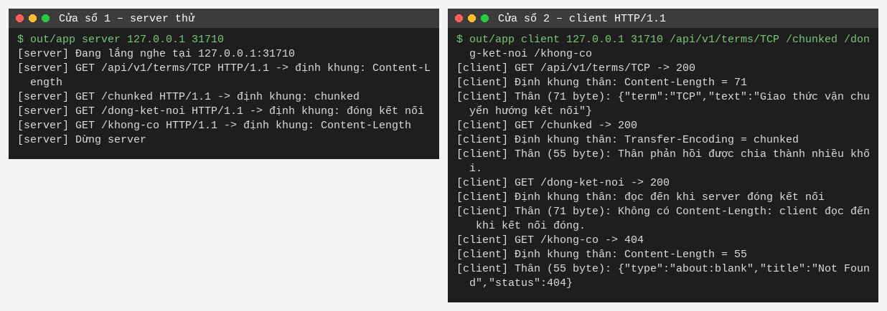

# Bài 7.1 – Client HTTP/1.1 tối giản trên socket TCP (Go)

| Thông tin | Nội dung |
|---|---|
| Mã giả tương ứng | Mã giả 7.1 (Client HTTP/1.1 tối giản trên socket TCP) |
| Mục giáo trình | 7.2.1 HTTP/1.1 |
| Kế thừa | Mã giả 2.2 (SAFE_CONNECT), Mã giả 3.4 (RECV_EXACT), Mã giả 3.5 (READ_LINE, Reader) |
| Thư viện | Thư viện chuẩn Go: `net`, `bytes`, `strings`, `strconv` (không dùng `net/http`) |

## Mục tiêu
Cài đặt `HTTP_REQUEST`, `READ_HEADERS`, `READ_CHUNKED`: ghép dòng yêu cầu và tiêu đề (có `Host` kèm cổng, `Connection: close`, dòng trống), đọc dòng trạng thái, đọc tiêu đề đến dòng trống và đọc thân theo đúng một trong ba cách định khung của HTTP/1.1: `Transfer-Encoding: chunked`, `Content-Length`, hoặc đọc đến khi server đóng kết nối. Server thử đi kèm trả về cả ba kiểu để kiểm tra từng nhánh của mã giả.

## Tệp
- `http_client.go` – Mã giả 7.1: `httpRequest`, `readHeaders`, `readChunked`, `Reader`, `readLine`, `readExact`, `readUntilClose`.
- `server_thu.go` – server thử tuần tự trả về ba kiểu định khung thân.
- `util.go` – đọc tham số cổng, xử lý Ctrl+C.
- `main.go` – chọn vai trò `server`, `client`.
- `demo.json` – kịch bản chạy minh họa (dùng với `tools/demo.py`).
- `ket_qua.txt`, `ket_qua.png` – kết quả thực thi thật.

## Cách chạy
Mở hai cửa sổ dòng lệnh trong thư mục bài:
```bash
go build -o out/app .
# Cửa sổ 1 – server thử
out/app server 0.0.0.0 8080
# Cửa sổ 2 – client, mỗi đường dẫn là một yêu cầu GET
out/app client 127.0.0.1 8080 /api/v1/terms/TCP /chunked /dong-ket-noi /khong-co
```
Trên Windows dùng `go build -o out/app.exe .` và `out\app.exe`.
Dừng server bằng Ctrl+C.

## Kết quả thực thi


Bốn yêu cầu đi qua ba nhánh định khung. Thân JSON có 58 ký tự nhưng `Content-Length` = 71 byte vì chữ tiếng Việt chiếm 2–3 byte UTF-8; thân chunked gồm ba khối (khối đầu có phần mở rộng `;vi-du=mo-rong`, cuối có trailer `X-So-Khoi`) được ghép lại đủ 55 byte; nhánh không có độ dài đọc đến khi server đóng kết nối; mã 404 vẫn có thân `application/problem+json`.

## Ghi chú
- `READ_EXACT(r, n)` lấy phần dư `pending` của bộ đọc trước rồi mới nhận tiếp từ socket, đúng như chú thích của mã giả; đọc thẳng trên socket sẽ mất phần đầu của thân đã đến cùng tiêu đề.
- `READ_HEADERS` kết thúc ở dòng trống; nếu kết nối đóng giữa phần tiêu đề (`READ_LINE` trả NULL, trong Go là lỗi `io.EOF`) thì báo lỗi `ConnectionClosed` như mã giả, kể cả khi đọc trailer sau khối 0 của thân chunked.
- Client chỉ minh họa cấu trúc giao thức: không hỗ trợ TLS, chuyển hướng, nén, giữ kết nối. Ứng dụng Go thật dùng gói `net/http` của thư viện chuẩn (Mục 7.2.1).
- Thời gian chờ nhận 5 000 ms (không có trong mã giả, `SetReadDeadline`) để client không treo nếu server không trả lời.
- `len(chuỗi)` trong Go là số byte UTF-8, nên độ dài khối hex của server thử và `Content-Length` đúng theo byte mà không cần mã hóa riêng.
- Có thể thử với server tĩnh của Python: `python3 -m http.server 8000` rồi gọi client với cổng 8000 và đường dẫn một tệp (phản hồi có `Content-Length`).
- Kiểm thử: Linux, Go 1.24.7.
