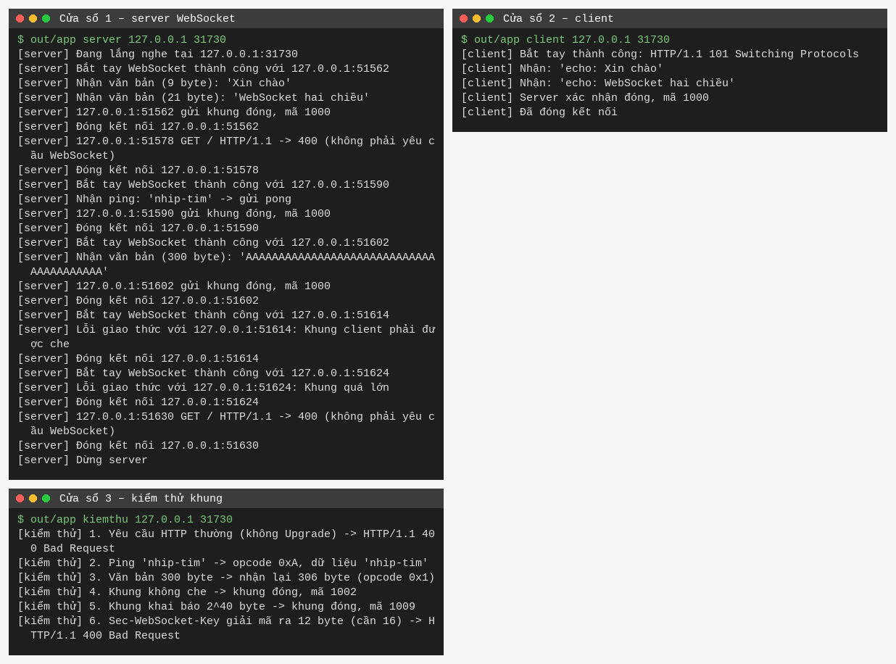

# Bài 7.3 – Server WebSocket tối giản và client thử (Go)

| Thông tin | Nội dung |
|---|---|
| Mã giả tương ứng | Mã giả 7.3 (Bắt tay mở đầu WebSocket phía server), Mã giả 7.4 (Đọc một khung WebSocket) |
| Mục giáo trình | 7.3.2 WebSocket |
| Kế thừa | Mã giả 7.2 (dòng đầu, READ_HEADERS, RESPOND), Mã giả 3.4 (READ_EXACT), Mã giả 6.3 (mỗi kết nối một tác vụ) |
| Thư viện | Thư viện chuẩn Go: `net`, `bufio`, `crypto/sha1`, `encoding/base64`, `encoding/binary`, `crypto/rand` |

## Mục tiêu
Cài đặt bắt tay mở đầu `WS_ACCEPT` (kiểm tra `Upgrade`, `Sec-WebSocket-Version: 13`, khóa `Sec-WebSocket-Key` giải mã Base64 ra đúng 16 byte, tính `Sec-WebSocket-Accept` = Base64(SHA-1(khóa + GUID))) và đọc khung `WS_READ_FRAME` (bit FIN, opcode, bit MASK, độ dài 7/16/64 bit, bỏ che bằng XOR). Server gửi trả khung văn bản `echo: …`, trả lời ping bằng pong, đáp khung đóng, đóng kết nối với mã 1009 khi khung vượt `MAX_FRAME` và 1002 khi khung từ client không được che. Chương trình kiểm thử tự tạo khung, kể cả khung vi phạm đặc tả.

## Tệp
- `ws_server.go` – Mã giả 7.3 `wsAccept`, Mã giả 7.4 `wsReadFrame`, `wsSend`, `wsClose`, vòng phục vụ `session`.
- `ws_client.go` – client WebSocket tự viết (thư viện chuẩn Go không có WebSocket): bắt tay, che khung, đọc khung.
- `ws_kiem_thu.go` – sáu ca kiểm thử với khung và yêu cầu tự tạo.
- `util.go` – đọc tham số cổng, xử lý Ctrl+C.
- `main.go` – chọn vai trò `server`, `client`, `kiemthu`.
- `demo.json` – kịch bản chạy minh họa (dùng với `tools/demo.py`).
- `ket_qua.txt`, `ket_qua.png` – kết quả thực thi thật.

## Cách chạy
```bash
go build -o out/app .
# Cửa sổ 1 – server
out/app server 0.0.0.0 8080
# Cửa sổ 2 – client: nhập từng dòng, Ctrl+D để đóng
out/app client 127.0.0.1 8080
# Cửa sổ 3 – kiểm thử khung
out/app kiemthu 127.0.0.1 8080
```
Trên Windows dùng `go build -o out/app.exe .` và `out\app.exe` (Ctrl+Z rồi Enter để kết thúc nhập).

## Kết quả thực thi


Client bắt tay thành công (101), nhận lại hai thông điệp kèm tiếng Việt và đóng bình thường với mã 1000. Sáu ca kiểm thử đều cho kết quả mong đợi: yêu cầu không có `Upgrade` nhận 400; ping nhận pong cùng dữ liệu; thông điệp 300 byte (độ dài mở rộng 16 bit) được trả lại 306 byte; khung không che nhận khung đóng 1002; khung khai báo 2^40 byte nhận khung đóng 1009 ngay sau tiêu đề, trước khi server đọc hay cấp phát dữ liệu; yêu cầu nâng cấp có `Sec-WebSocket-Key` chỉ giải mã ra 12 byte nhận 400.

## Ghi chú
- Ngoài mã giả, server ghép khung tiếp nối (opcode 0x0) đến khi FIN = 1, trả lời ping (0x9) bằng pong (0xA) và đáp khung đóng bằng cùng mã đóng (1000 nếu khung đóng không có mã), như đoạn giải thích bước (7) của Mã giả 7.4.
- Như mã giả, độ dài 64 bit có bit cao bằng 1 được gộp vào nhánh “quá lớn” (1009) thay vì 1002.
- Server không kiểm tra `Origin`, không thương lượng giao thức con/phần mở rộng và không có TLS (`wss://`); ứng dụng thật nên luôn dùng `wss://`.
- Server đọc bằng `bufio.Reader` (dòng đầu, tiêu đề, rồi khung bằng `io.ReadFull` trên cùng bộ đọc nên không mất byte đã đệm); `READ_EXACT_ASYNC` là `io.ReadFull`. Client tự viết đọc phản hồi bắt tay từng byte đến `\r\n\r\n` để không lấy lố sang khung đầu tiên; kiểm tra `Sec-WebSocket-Accept` trước khi coi là thành công.
- `wsReadFrame` nhận hai tham số `r` (để đọc) và `w` (để gửi khung đóng) thay cho `r.sock` của mã giả.
- Thư viện mở rộng `golang.org/x/net/websocket` hoặc các gói bên thứ ba có WebSocket đầy đủ; bài chỉ dùng thư viện chuẩn để thấy rõ định dạng khung.
- Kiểm thử: Linux, Go 1.24.7.
