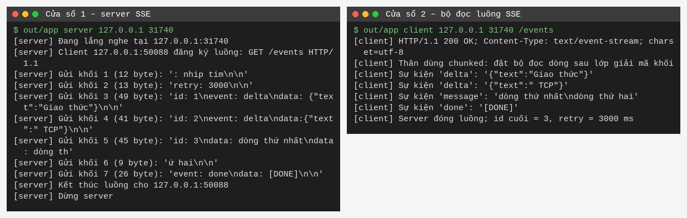

# Bài 7.4 – Bộ đọc luồng Server-Sent Events (Go)

| Thông tin | Nội dung |
|---|---|
| Mã giả tương ứng | Mã giả 7.5 (Bộ đọc luồng Server-Sent Events) |
| Mục giáo trình | 7.3.3 Server-Sent Events |
| Kế thừa | Mã giả 7.1 (gửi GET, đọc tiêu đề, READ_CHUNKED), Mã giả 3.5 (READ_LINE) |
| Thư viện | Thư viện chuẩn Go: `net`, `io` (giao diện `io.Reader`), `bytes`, `strings`, `strconv` |

## Mục tiêu
Cài đặt `SSE_READ`: đọc từng dòng của luồng `text/event-stream`, dòng trống kết thúc một sự kiện, bỏ dòng chú thích `:`, tách trường tại dấu hai chấm đầu tiên, bỏ đúng một dấu cách đầu giá trị, nối nhiều dòng `data`, lưu `id` và `retry`. Vì server SSE thường gửi thân bằng chunked, bộ đọc dòng được đặt phía sau lớp giải mã khối (READ_CHUNKED của Mã giả 7.1 viết dạng luồng). Server SSE nhỏ đi kèm phát một luồng mẫu, trong đó một sự kiện bị cắt giữa dòng qua hai khối.

## Tệp
- `sse_client.go` – Mã giả 7.5 `sseRead`, `Reader`, `readLine`, kiểu `ChunkedSource` (giải mã khối dạng luồng).
- `sse_server.go` – server SSE nhỏ phát luồng mẫu bằng chunked.
- `util.go` – đọc tham số cổng, xử lý Ctrl+C.
- `main.go` – chọn vai trò `server`, `client`.
- `demo.json` – kịch bản chạy minh họa (dùng với `tools/demo.py`).
- `ket_qua.txt`, `ket_qua.png` – kết quả thực thi thật.

## Cách chạy
```bash
go build -o out/app .
# Cửa sổ 1 – server SSE
out/app server 0.0.0.0 8080
# Cửa sổ 2 – bộ đọc luồng
out/app client 127.0.0.1 8080 /events
```
Trên Windows dùng `go build -o out/app.exe .` và `out\app.exe`. Có thể xem luồng thô bằng `curl -N http://127.0.0.1:8080/events`.

## Kết quả thực thi


Server gửi bảy khối; client nhận bốn sự kiện: hai sự kiện `delta` (cả `data: x` và `data:x` cho cùng giá trị), một sự kiện mặc định `message` có hai dòng `data` được nối bằng ký tự xuống dòng dù bị cắt giữa chữ “thứ” qua hai khối, và sự kiện `done`. Dòng chú thích và dòng `retry` không tạo sự kiện; `id` cuối = 3 và `retry` = 3000 ms được ghi nhận để dùng khi kết nối lại.

## Ghi chú
- Lớp giải mã khối trả về dữ liệu thân thuần cho bộ đọc dòng, nên các dòng độ dài khối (hex) không lẫn vào luồng sự kiện – chi tiết được nêu ngay sau Mã giả 7.5.
- `Reader` nhận bất kỳ giá trị nào có phương thức `Read` (giao diện `io.Reader` của Go): socket `net.Conn` hoặc `ChunkedSource`; đây là cách Go "xếp lớp" luồng dữ liệu, giống `bufio`, `gzip`, `tls` trong thư viện chuẩn.
- `readHeaders` theo Mã giả 7.1: dừng ở dòng trống, báo lỗi nếu kết nối đóng giữa phần tiêu đề (kể cả trailer sau khối 0).
- Ngoài mã giả: client kiểm tra mã 200 trước khi đọc luồng; không cài đặt kết nối lại tự động với `Last-Event-ID` (chỉ lưu `id` và `retry`).
- Server phát cùng một luồng mẫu cho mọi client rồi đóng (khối 0); mỗi kết nối một goroutine (Mã giả 6.1).
- Ứng dụng Go thật đọc SSE bằng `net/http` (thân phản hồi đã được giải mã chunked) đặt sau `bufio.Scanner`; Bài 8.1 dùng cách đó.
- Kiểm thử: Linux, Go 1.24.7.
