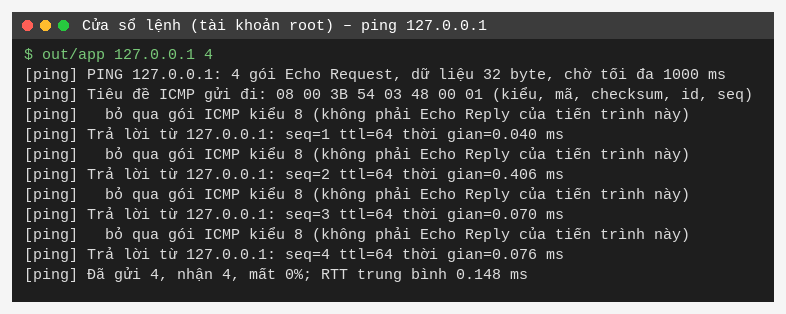

# Bài 7.7 – Gửi ICMP Echo Request và đo thời gian khứ hồi (Go)

| Thông tin | Nội dung |
|---|---|
| Mã giả tương ứng | Mã giả 7.8 (Gửi ICMP Echo Request và đo thời gian khứ hồi) |
| Mục giáo trình | 7.5.3 ICMP và chương trình ping |
| Kế thừa | Mã giả 4.4 (cùng mẫu gửi rồi chờ phản hồi có hạn giờ, bỏ qua gói không khớp) |
| Thư viện | Thư viện chuẩn Go: `net` (`ListenPacket("ip4:icmp")`, `IPConn.ReadMsgIP`), `encoding/binary`, `crypto/rand`, `time` |

## Mục tiêu
Cài đặt `INET_CHECKSUM` (RFC 1071) và `PING`: tạo gói Echo Request (kiểu 8, mã 0, tổng kiểm tra, mã định danh = PID, số thứ tự, 32 byte dữ liệu ngẫu nhiên), gửi qua socket RAW, nhận gói có cả tiêu đề IPv4, tính độ dài tiêu đề từ IHL, chỉ chấp nhận Echo Reply (kiểu 0) đúng mã định danh và số thứ tự, đọc TTL ở byte 8 của tiêu đề IP và đo thời gian khứ hồi.

## Tệp
- `ping.go` – Mã giả 7.8: `inetChecksum`, `ping` và vòng ping có thống kê (`main`).
- `demo.json` – kịch bản chạy minh họa (dùng với `tools/demo.py`).
- `ket_qua.txt`, `ket_qua.png` – kết quả thực thi thật.

## Cách chạy
Socket RAW cần quyền quản trị:
```bash
go build -o out/app .
# Linux, macOS
sudo out/app 127.0.0.1 4 1000
```
Tham số: `[host] [số_lần] [thời_gian_chờ_ms]` (mặc định `127.0.0.1 4 1000`).

## Kết quả thực thi


Bốn gói đều nhận Echo Reply với TTL 64 (Linux) và thời gian khứ hồi dưới 1 ms qua loopback. Trước mỗi Echo Reply, socket RAW nhận chính gói Echo Request (kiểu 8) do máy gửi tới 127.0.0.1; vòng lặp của mã giả bỏ qua gói này – đây là lý do mã giả kiểm tra kiểu, mã định danh và số thứ tự thay vì nhận gói đầu tiên.

## Ghi chú
- Kịch bản minh họa chạy bằng tài khoản root nên không cần `sudo`; không có quyền, chương trình báo "Socket RAW cần quyền quản trị" và kết thúc với mã 1 (đã thử bằng tài khoản `nobody`).
- `SOCKET(INET, RAW, ICMP)` là `net.ListenPacket("ip4:icmp", "0.0.0.0")`. Lưu ý: `ReadFrom` của Go tự cắt tiêu đề IPv4 khỏi gói nhận được, nên bài dùng `ReadMsgIP` – hàm này trả nguyên gói kèm tiêu đề IP như `RECVFROM` trên socket RAW của mã giả, nhờ đó đọc được IHL và TTL.
- Theo mã giả, `deadline ← NOW() + timeout_ms` được đặt một lần ngay sau `SENDTO` và là hạn chót chung cho cả vòng nhận (các gói ICMP bị bỏ qua không kéo dài thời gian chờ). Go dùng hạn chót tuyệt đối nên chỉ cần một lần `SetReadDeadline(deadline)`, tương đương `SETOPT(RECV_TIMEOUT, MAX(1, deadline − NOW()))` trước mỗi `RECVFROM`; hết hạn chót thì in "hết thời gian chờ".
- Thư viện mở rộng `golang.org/x/net/icmp` có sẵn hàm tạo/phân tích gói ICMP và hỗ trợ socket ICMP "không đặc quyền" của Linux (`udp4` + `net.ipv4.ping_group_range`); bài chỉ dùng thư viện chuẩn và socket RAW đúng như mã giả.
- Chương trình biên dịch được cho Windows nhưng chưa chạy thử trên Windows (cần cửa sổ lệnh "Run as administrator"; tường lửa có thể chặn ICMP).
- Mỗi lần ping mở một socket mới như mã giả; giữa hai lần ping có khoảng nghỉ 1 giây như lệnh ping của hệ điều hành; cuối cùng in số gói gửi, nhận, tỉ lệ mất và RTT trung bình.
- Bài tập cuối chương (ping 5 máy trong mạng lab, so sánh TTL 64/128) chạy cùng chương trình với địa chỉ các máy đó; kịch bản minh họa chỉ ping 127.0.0.1.
- Kiểm thử: Linux, Go 1.24.7 (tài khoản root).
