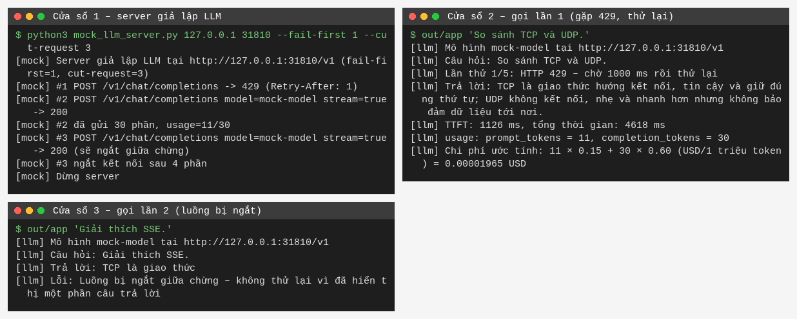

# Bài 8.1 – Gọi API LLM: truyền luồng SSE, giới hạn tần suất, thử lại (Go)

| Thông tin | Nội dung |
|---|---|
| Mã giả tương ứng | Mã giả 8.1 (Nhận câu trả lời của LLM theo luồng SSE), Mã giả 8.2 (Gọi LLM có giới hạn tần suất, thử lại và hạn chót) |
| Mục giáo trình | 8.2.2 Truyền luồng kết quả bằng SSE, 8.2.3 Giới hạn tần suất, thử lại và thời gian chờ, 8.2.5 Chi phí |
| Kế thừa | Mã giả 7.5 (SSE_READ), Mã giả 5.8 (RETRY_ASYNC), Mã giả 8.3 (ACQUIRE_TOKENS), lỗi NetError của Mã giả 2.2 |
| Thư viện | Thư viện chuẩn Go: `net/http`, `bufio`, `encoding/json`, `context`, `sync`, `math/rand/v2` |

## Mục tiêu
Gọi API mô hình ngôn ngữ lớn theo định dạng tương thích OpenAI Chat Completions (`POST {LLM_BASE_URL}/chat/completions`, `"stream": true`), hiển thị từng phần câu trả lời ngay khi nhận sự kiện SSE, đo TTFT và tổng thời gian, ghi nhận `usage` và tính chi phí theo Công thức (8.1). Lời gọi được bọc trong thủ tục thử lại có lùi thời gian và nhiễu ngẫu nhiên, tôn trọng `Retry-After` khi gặp mã 429, chỉ thử lại khi chưa nhận token nào, và tự giới hạn tần suất bằng thùng token. Khóa API chỉ lấy từ biến môi trường. Demo dùng server giả lập cục bộ `mock_llm_server.py`, không gọi dịch vụ LLM thật.

## Tệp
- `llm_client.go` – CALL_LLM (Mã giả 8.2), RETRY (Mã giả 5.8), HTTPS_POST, chương trình chính.
- `llm_stream.go` – NetError, SSE_READ (Mã giả 7.5), STREAM_COMPLETION (Mã giả 8.1), `idleReader` (thời gian chờ nhàn rỗi).
- `thung_token.go` – ACQUIRE_TOKENS (Mã giả 8.3, chép gọn).
- `mock_llm_server.py` – server giả lập API LLM (Python, thư viện chuẩn), dùng chung cho mọi ngôn ngữ (giống hệt bản trong thư mục C#, Java, Python): phát luồng SSE mã hóa khối, trả 401 khi thiếu khóa, `--fail-first N` trả 429 kèm `Retry-After` cho N yêu cầu đầu, `--cut-request K` ngắt kết nối giữa luồng ở yêu cầu thứ K.
- `demo.json` – kịch bản chạy minh họa (dùng với `tools/demo.py`).
- `ket_qua.txt`, `ket_qua.png` – kết quả thực thi thật.

## Cách chạy
```bash
go build -o out/app .
# Cửa sổ 1 – server giả lập (cần Python 3)
python3 mock_llm_server.py 127.0.0.1 9000 --fail-first 1 --cut-request 3
# Cửa sổ 2 – client
export LLM_BASE_URL=http://127.0.0.1:9000/v1 LLM_API_KEY=khoa-thu-nghiem LLM_MODEL=mock-model
export LLM_PRICE_IN=0.15 LLM_PRICE_OUT=0.60      # tùy chọn: đơn giá USD/1 triệu token
out/app "So sánh TCP và UDP."
```
Trên Windows (PowerShell) đặt biến bằng `$env:LLM_API_KEY = "khoa-thu-nghiem"`, tương tự cho các biến khác, và chạy `out\app.exe`. Khóa API không được ghi vào mã nguồn hay tệp cấu hình đưa lên kho mã.

## Kết quả thực thi


Lần gọi thứ nhất nhận 429 kèm `Retry-After: 1`, chương trình chờ 1 000 ms rồi thử lại và nhận câu trả lời theo luồng; TTFT đo từ lúc bắt đầu gọi nên gồm cả thời gian chờ thử lại. Lần gọi thứ hai bị server giả lập ngắt giữa luồng: không gặp `[DONE]` nên chương trình báo "Luồng bị ngắt giữa chừng" và không thử lại vì đã hiển thị một phần câu trả lời.

## Ghi chú
- `ESTIMATE_TOKENS` không được giáo trình định nghĩa; bài dùng ước lượng thô: tổng số ký tự (rune) các thông điệp chia 4, cộng `max_tokens`. Thùng token đặt dung lượng 20 000, nạp 2 000 token/giây (hạn mức tự đặt để minh họa).
- Theo Mã giả 8.2 và 5.8: `CALL_LLM(req, on_token, ct)` nhận mã hủy `ct` (`context.Context`, tạo bằng `signal.NotifyContext` nên Ctrl+C hủy lời gọi); `RETRY_ASYNC` bắt `Timeout` (luôn thử lại) và `NetError` (thử lại khi `retry`), không bắt lỗi hủy; khoảng chờ giữa hai lần thử là `select` giữa `time.After` và `ct.Done()` nên hủy được ngay khi đang chờ (đã thử: Ctrl+C trong lúc chờ `Retry-After: 5` kết thúc ngay với mã 130).
- Lỗi kết nối được ánh xạ như Mã giả 2.2: bị từ chối (`ECONNREFUSED`) → `REFUSED`, không thử lại; hết thời gian chờ kết nối hoặc chờ tiêu đề → `TimeoutError` (thử lại); không tới được → thử lại.
- Đơn giá tính chi phí lấy từ `LLM_PRICE_IN`, `LLM_PRICE_OUT` (USD cho 1 triệu token); không đặt thì không in chi phí.
- Đổi sang dịch vụ thật (Ollama cục bộ `http://localhost:11434/v1` hoặc nhà cung cấp đám mây) chỉ cần đổi `LLM_BASE_URL`, `LLM_MODEL`, `LLM_API_KEY`; cần đối chiếu tài liệu của nhà cung cấp về tên trường và cách xác thực.
- `net/http` đã giải mã thân chunked; `bufio.Reader` đặt sau thân phản hồi đóng vai `Reader` của `SSE_READ`. Thời gian chờ: kết nối 3 s (`net.Dialer.Timeout`), chờ tiêu đề phản hồi 30 s (`ResponseHeaderTimeout`), và thời gian chờ nhàn rỗi 30 s giữa hai lần nhận dữ liệu (`idleReader` đặt lại bộ hẹn giờ sau mỗi lần đọc; hết giờ thì hủy `context` của yêu cầu). Không dùng `http.Client.Timeout` vì giá trị này giới hạn cả thời gian đọc toàn bộ luồng.
- Go không có `async`/`await`; CALL_LLM, RETRY và ACQUIRE_TOKENS là hàm thường, có thể chạy trong goroutine khi cần gọi song song.
- Số JSON `content` được giải mã vào con trỏ `*string` để phân biệt sự kiện không có nội dung (`delta: {}` hoặc chỉ có `role`) với chuỗi rỗng, đúng điều kiện `d ≠ NULL` của Mã giả 8.1.
- Kiểm thử: Linux, Go 1.24.7, server giả lập chạy bằng Python 3.
