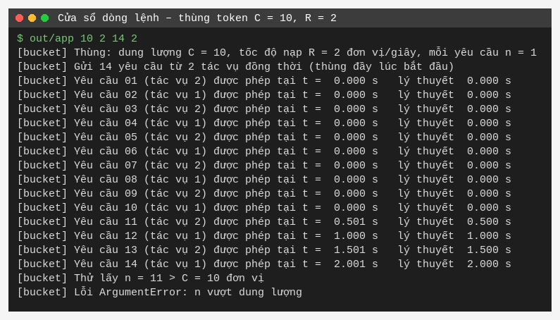

# Bài 8.2 – Thùng token giới hạn tần suất (Go)

| Thông tin | Nội dung |
|---|---|
| Mã giả tương ứng | Mã giả 8.3 (Thùng token giới hạn tần suất) |
| Mục giáo trình | 8.2.4 Tự giới hạn tần suất bằng thùng token |
| Kế thừa | Mã giả 5.8 (RETRY_ASYNC) – client tự giới hạn thay vì chờ lỗi 429 |
| Thư viện | Thư viện chuẩn Go: goroutine, `sync` (`Mutex`, `WaitGroup`), `time`, `runtime` |

## Mục tiêu
Cài đặt thuật toán thùng token: thùng dung lượng C được nạp lại R đơn vị mỗi giây, số đơn vị được tính bù một lần mỗi khi có yêu cầu (không cần bộ đếm giờ); yêu cầu thiếu đơn vị phải chờ ngoài vùng khóa rồi tính lại. Nhiều tác vụ đồng thời gửi chuỗi yêu cầu qua cùng một thùng; chương trình in thời điểm mỗi yêu cầu được phép và so với lý thuyết: C yêu cầu đầu đi ngay, yêu cầu thứ m > C được phép sau (m − C)/R giây.

## Tệp
- `thung_token.go` – `Bucket`, `acquireTokens` (ACQUIRE_TOKENS) và chương trình chính.
- `demo.json` – kịch bản chạy minh họa (dùng với `tools/demo.py`).
- `ket_qua.txt`, `ket_qua.png` – kết quả thực thi thật.

## Cách chạy
```bash
go build -o out/app .
out/app 10 2 14 2
```
Tham số: `C R số_yêu_cầu số_tác_vụ` (mặc định `10 2 14 2`, đúng ví dụ C = 10, R = 2 của Mục 8.2.4). Trên Windows dùng `out\app.exe`.

## Kết quả thực thi


Với C = 10, R = 2: mười yêu cầu đầu được phép ngay tại t ≈ 0, các yêu cầu 11–14 được phép tại khoảng 0,5; 1,0; 1,5; 2,0 giây, khớp giá trị lý thuyết. Yêu cầu n = 11 > C bị từ chối ngay bằng ArgumentError thay vì chờ mãi.

## Ghi chú
- Thời điểm được phép được ghi lại rồi in theo thứ tự thời gian sau khi mọi tác vụ kết thúc, để thứ tự in không phụ thuộc vào cách lập lịch; cột "tác vụ" cho thấy hai tác vụ cùng dùng một thùng (thứ tự xen kẽ giữa hai goroutine thay đổi giữa các lần chạy).
- `ASYNC_LOCK` là `sync.Mutex`; khác Python (một luồng sự kiện), các goroutine chạy song song thật nên khóa là bắt buộc để hai yêu cầu không cùng lấy một đơn vị. Khóa được mở trước `time.Sleep` (dòng 15 của mã giả: chờ ngoài khóa), nếu không mọi tác vụ khác bị chặn trong lúc một tác vụ ngủ.
- `ArgumentError` của mã giả là biến lỗi `ArgumentError` (`errors.New`), được `acquireTokens` trả về dưới dạng giá trị `error` (Go không dùng ngoại lệ).
- `runtime.Gosched()` nhường lượt sau mỗi yêu cầu, giả lập thời gian gửi yêu cầu (tương ứng `await asyncio.sleep(0)` của bản Python).
- Kiểm thử: Linux, Go 1.24.7.
