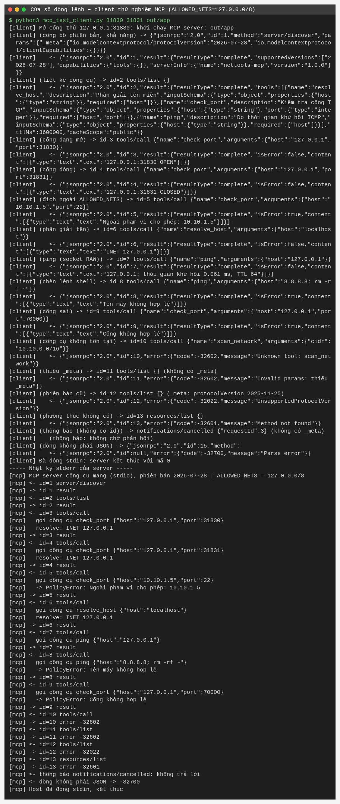

# Bài 8.3 – MCP server công cụ mạng qua kênh stdio (Go)

| Thông tin | Nội dung |
|---|---|
| Mã giả tương ứng | Mã giả 8.4 (MCP server công cụ mạng qua kênh stdio), Mã giả 8.5 (Thực thi công cụ có kiểm soát đầu vào), Mã giả 8.7 (Kiểm soát đích của công cụ mạng) |
| Mục giáo trình | 8.3.2–8.3.5 Model Context Protocol, 8.5.4 An toàn của MCP server |
| Kế thừa | Mã giả 3.5 (READ_LINE), Mã giả 1.1 (RESOLVE_HOST), Mã giả 1.2 (PORT_CHECK), Mã giả 7.8 (PING) |
| Thư viện | Thư viện chuẩn Go: `encoding/json`, `bufio`, `net` (kể cả socket RAW cho ICMP), `regexp` |

## Mục tiêu
Xây dựng MCP server qua kênh stdio theo đặc tả 2026-07-28 như giáo trình trình bày: JSON-RPC 2.0, mỗi thông điệp một dòng UTF-8 trên stdin/stdout, nhật ký chỉ ghi ra stderr; không có bắt tay `initialize`, mỗi yêu cầu mang `_meta` với `io.modelcontextprotocol/protocolVersion` và `io.modelcontextprotocol/clientCapabilities` (thiếu → −32602, phiên bản không hỗ trợ → −32022 UnsupportedProtocolVersion); `server/discover`, `tools/list` (kèm `ttlMs`, `cacheScope`), `tools/call`; mọi kết quả có `resultType`. Ba công cụ `resolve_host`, `check_port`, `ping` cài đặt bằng socket API, không gọi shell. Lỗi thực thi và lỗi chính sách trả về kết quả `isError: true`; công cụ không tồn tại trả lỗi JSON-RPC −32602. Đích của `check_port`, `ping` phải nằm trong `ALLOWED_NETS` (Mã giả 8.7): mọi địa chỉ phân giải được đều được kiểm tra, công cụ kết nối đúng địa chỉ đã kiểm tra (chống DNS rebinding).

## Tệp
- `mcp_server.go` – `mcpStdioServer`, `dispatch`, `writeMsg` (Mã giả 8.4), `callTool` (Mã giả 8.5).
- `net_tools.go` – `resolveHost`, `portCheck`, `ping` (ghi nhật ký ra stderr) và `validateName`, `validateTarget`, `validatePort` (Mã giả 8.7).
- `mcp_test_client.py` – client thử nghiệm đóng vai host (Python, thư viện chuẩn), dùng chung cho mọi ngôn ngữ (giống hệt bản trong thư mục C#, Java, Python): khởi chạy server như tiến trình con, gửi 15 thông điệp (discover, list, các lời gọi công cụ hợp lệ và bị chặn, lỗi giao thức, thông báo, dòng JSON hỏng), in phản hồi, thu riêng stderr của server và in ở cuối; mở sẵn một cổng TCP để `check_port` thấy trạng thái OPEN.
- `demo.json` – kịch bản chạy minh họa (dùng với `tools/demo.py`).
- `ket_qua.txt`, `ket_qua.png` – kết quả thực thi thật.

## Cách chạy
```bash
go build -o out/app .
ALLOWED_NETS=127.0.0.0/8 python3 mcp_test_client.py 9000 9001 out/app
```

Trên Windows (PowerShell) đặt biến trước: `$env:ALLOWED_NETS = "127.0.0.0/8"` và dùng `out\app.exe`. Để dùng với một host MCP thật (ứng dụng chat hỗ trợ MCP, MCP Inspector), cấu hình host khởi chạy đúng tệp chương trình `out/app` (đường dẫn tuyệt đối, không kèm `mcp_test_client.py`) và đặt `ALLOWED_NETS` là dải mạng lab, ví dụ `10.10.0.0/16`. Công cụ `ping` dùng socket RAW nên cần quyền quản trị (root hoặc Administrator).

## Kết quả thực thi


Cổng đang mở cho `127.0.0.1:<cổng> OPEN`, cổng không có chương trình lắng nghe cho `CLOSED`; đích 10.10.1.5 ngoài `ALLOWED_NETS`, chuỗi `8.8.8.8; rm -rf ~` và cổng 70000 đều bị từ chối dưới dạng kết quả `isError: true`; công cụ lạ, thiếu `_meta`, phiên bản 2025-11-25, phương thức lạ và dòng JSON hỏng nhận các mã lỗi −32602, −32602, −32022, −32601, −32700; thông báo không có `id` không được trả lời. Nhật ký stderr cho thấy stdout chỉ chứa thông điệp JSON.

## Ghi chú
- `DISCOVER_RESULT` không được giáo trình mô tả chi tiết; bài dùng các trường `resultType`, `supportedVersions`, `capabilities`, `serverInfo` (công bố phiên bản, khả năng và định danh như Mục 8.3.4). Cần đối chiếu đặc tả và SDK chính thức của MCP trước khi dùng thật.
- `TOOL(tên, mô tả, tham số)` được mã hóa thành `{name, description, inputSchema}` với `inputSchema` là JSON Schema kiểu `object`, mọi tham số bắt buộc.
- Theo Mã giả 8.5, `VALIDATE_PORT` báo `PolicyError` nên cổng sai kiểu/phạm vi trả về `isError: true` (không phải lỗi JSON-RPC như câu "tham số sai kiểu" trong đoạn văn trước mã giả).
- Theo Mã giả 8.5: `CALL_TOOL` bắt `NetError`, `PolicyError`, `ResolveError` (tên không phân giải được trong `VALIDATE_TARGET`) và `Timeout` (`PING` không nhận được Echo Reply) rồi trả kết quả `isError: true` cho mô hình; nhật ký stderr ghi loại lỗi. Bổ sung so với mã giả: lỗi ngoài dự kiến (panic) khi xử lý một yêu cầu trả −32603 Internal error nhờ `recover` thay vì làm dừng server; JSON hợp lệ nhưng không phải đối tượng được coi như không có `id`.
- Theo Mã giả 8.7, `VALIDATE_NAME` nhận ngay địa chỉ IP viết bằng số (`net.ParseIP`, kể cả IPv6 như `::1`); tên khác chỉ được chứa `[A-Za-z0-9.-]`, dài tối đa 253 ký tự. Địa chỉ IP vẫn phải nằm trong `ALLOWED_NETS` ở `VALIDATE_TARGET` (đã thử: `::1` với `ALLOWED_NETS=127.0.0.0/8` bị từ chối "Ngoài phạm vi cho phép: ::1"; tên `khong-ton-tai.invalid` cho `ResolveError`). `ALLOWED_NETS` vắng hoặc rỗng → chặn mọi đích; sai định dạng → server báo lỗi ra stderr và dừng.
- `resolve_host` chỉ kiểm tra tên (Mã giả 8.5), không áp dụng `ALLOWED_NETS`.
- `PING` dùng socket RAW `ip4:icmp` và `ReadMsgIP` (giữ tiêu đề IP để đọc TTL) đúng như Bài 7.7; không có quyền quản trị → kết quả `isError: true` "Không mở được socket RAW".
- Tham số được giải mã với `json.Decoder.UseNumber()` để phân biệt số nguyên `22` với `22.0` (đều là `float64` nếu giải mã mặc định); `id` được giữ nguyên văn (`json.RawMessage`) để trả lại đúng kiểu (số hoặc chuỗi). Kết quả dùng `struct` để giữ đúng thứ tự trường như bản Python; `properties` là map (Go xếp khóa theo bảng chữ cái, trùng thứ tự `host`, `port`).
- `os.Stdout` của Go không có bộ đệm: mỗi `WRITE_MSG` là một lần ghi trọn một dòng, không cần `FLUSH`.
- Kiểm thử: Linux, Go 1.24.7 (tài khoản root), client thử chạy bằng Python 3.
