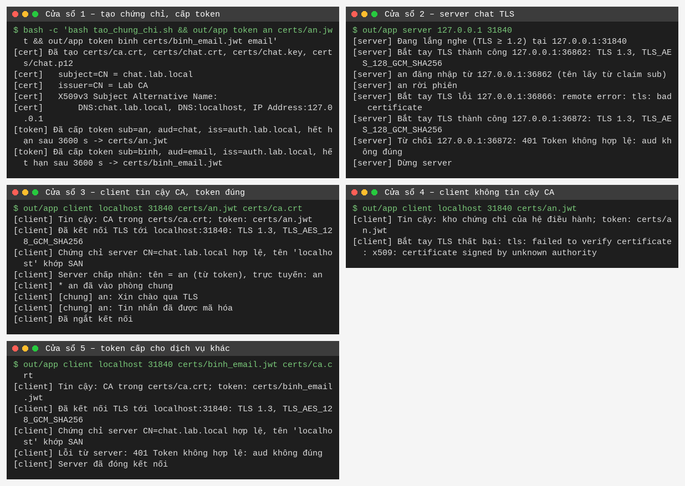

# Bài 8.4 – Bổ sung TLS và xác thực token cho hệ thống chat (Go)

| Thông tin | Nội dung |
|---|---|
| Mã giả tương ứng | Mã giả 8.6 (Bổ sung TLS và xác thực token cho hệ thống chat) |
| Mục giáo trình | 8.4.5 Lập trình socket an toàn với TLS, 8.4.6 Quản lý khóa bí mật |
| Kế thừa | Mã giả 6.5, 6.6 (server chat), Mã giả 5.5 (ChatClient), Mã giả 5.1 (khung JSON bất đồng bộ), Mã giả 2.2 (SAFE_CONNECT); kiểm tra JWT theo Mục 7.2.4 |
| Thư viện | Thư viện chuẩn Go: `crypto/tls`, `crypto/x509`, `crypto/hmac`, `crypto/sha256`, `encoding/base64`, `encoding/json`, `net`, `sync` |

## Mục tiêu
Bọc kết nối TCP của server và client chat bằng TLS (tối thiểu TLS 1.2, thư viện thương lượng TLS 1.3 khi hai bên hỗ trợ) mà không sửa giao thức khung JSON và logic chat. Server bắt tay TLS ngay sau ACCEPT (TLS_SESSION), ghi nhật ký và đóng kết nối khi bắt tay lỗi. Client bọc TLS sau khi kết nối TCP với `server_name ← host`, kiểm tra chuỗi chứng chỉ tới CA tin cậy và tên máy trong SAN; không bao giờ tắt kiểm tra chứng chỉ. Thông điệp `hello` mang token JWT (HS256) thay cho tên tự khai báo; server kiểm tra thuật toán, chữ ký, `exp`, `iss`, `aud = "chat"` và lấy tên người dùng từ claim `sub`. Chứng chỉ do CA nội bộ của phòng lab cấp, tạo bằng OpenSSL; bí mật (khóa ký JWT) chỉ lấy từ biến môi trường.

## Tệp
- `tls_chat_server.go` – `tlsSession` (TLS_SESSION), `chatSession` có VERIFY_JWT, `broadcast`, `writerTask`.
- `tls_chat_client.go` – `ChatClient`: `connect` (kết nối rồi bọc TLS), `receiveLoop`, `send` có khóa.
- `jwt_hs256.go` – ký và kiểm tra JWT HS256 (`verifyJWT`); vai trò `token` cấp token thử nghiệm.
- `khung.go` – `recvJSON`, `sendJSON` (Mã giả 5.1).
- `main.go` – chọn vai trò `server`, `client`, `token`.
- `tao_chung_chi.sh`, `tao_chung_chi.ps1` – tạo CA nội bộ và chứng chỉ server (SAN: `chat.lab.local`, `localhost`, `127.0.0.1`) theo các lệnh OpenSSL của Mục 8.4.5 (giống hệt bản Python); kết quả nằm trong `certs/` (chứa khóa riêng, đã có trong `.gitignore`). Bản Go dùng `certs/chat.crt`, `certs/chat.key` (PEM) và `certs/ca.crt`.
- `demo.json` – kịch bản chạy minh họa (dùng với `tools/demo.py`).
- `ket_qua.txt`, `ket_qua.png` – kết quả thực thi thật.

## Cách chạy
```bash
go build -o out/app .
export TLS_KEY_PASS=matkhau-lab CHAT_JWT_KEY=khoa-ky-jwt-cua-phong-lab-0123456789
export TLS_CERT=certs/chat.crt TLS_KEY=certs/chat.key
bash tao_chung_chi.sh                                   # Windows: powershell -File tao_chung_chi.ps1
out/app token an certs/an.jwt                           # cấp token cho người dùng "an"
out/app server 0.0.0.0 9200                             # cửa sổ 1
out/app client localhost 9200 certs/an.jwt certs/ca.crt # cửa sổ 2, nhập vài dòng rồi Ctrl+D
```
Trên Windows (PowerShell) đặt biến bằng `$env:TEN = "giá trị"` và dùng `out\app.exe`. Bỏ tham số tệp CA ở client để thấy bắt tay bị từ chối; cấp token với đối tượng khác (tham số thứ ba, ví dụ `email`) để thấy server từ chối mã 401. Giá trị mật khẩu, khóa ở trên chỉ dùng cho phòng lab.

## Kết quả thực thi


Client tin cậy CA nội bộ bắt tay TLS 1.3 (`TLS_AES_128_GCM_SHA256`), được server chấp nhận với tên `an` lấy từ token và nhận lại tin của chính mình trong phòng `chung`. Client chỉ dùng kho tin cậy mặc định từ chối chứng chỉ của server (CA nội bộ không có trong kho); server ghi nhận bắt tay lỗi do client gửi cảnh báo `bad certificate`. Token cấp cho đối tượng `email` bị server từ chối với mã 401 "aud không đúng" dù kênh TLS hợp lệ.

## Ghi chú
- Script (dùng chung với bản Python) theo đúng các lệnh OpenSSL của Mục 8.4.5: CA có `basicConstraints=critical,CA:TRUE` và `keyUsage=critical,keyCertSign,cRLSign`; chứng chỉ server có `basicConstraints=CA:FALSE`, `keyUsage=digitalSignature,keyEncipherment`, `extendedKeyUsage=serverAuth`, thêm `authorityKeyIdentifier`. Gói `crypto/x509` của Go kiểm tra `extendedKeyUsage` (phải có `serverAuth` nếu trường có mặt) và chỉ dùng SAN để so tên máy (không dùng CN).
- SAN có thêm `localhost` và `127.0.0.1` để chạy thử trên một máy mà không sửa tệp hosts. Kết nối bằng một tên không có trong SAN sẽ bị client từ chối do tên không khớp.
- Server chat là bản rút gọn của Mã giả 6.5–6.6: hỗ trợ `hello`, `join`, `msg`, `ping` (loại khác nhận lỗi 400); `welcome` có thêm trường `name` (tên lấy từ token) và lỗi có trường `text`. Token sai trả mã 401 (giáo trình không quy định mã cho trường hợp này).
- Token được cấp bằng vai trò `token` đóng vai server ủy quyền giản lược (khóa đối xứng HS256 dùng chung qua `CHAT_JWT_KEY`, `iss = auth.lab.local`); hệ thống thật nên dùng token do server ủy quyền OAuth 2.0 cấp, ký bất đối xứng (RS256/ES256). So sánh chữ ký dùng `hmac.Equal` (thời gian hằng).
- Sau khi gửi các dòng nhập, client gửi `ping` và chỉ ngắt khi nhận `pong`: vì mỗi client có một tác vụ ghi theo thứ tự, `pong` đến sau mọi tin trước đó.
- `LOAD_CERT_AND_KEY` là `tls.LoadX509KeyPair(TLS_CERT, TLS_KEY)` với khóa PEM không mật khẩu (lệnh `-nodes` của giáo trình); Go không có hàm chuẩn an toàn để giải mã khóa PEM có mật khẩu (`x509.DecryptPEMBlock` đã bị đánh dấu lỗi thời), nên `TLS_KEY_PASS` chỉ được script dùng để bảo vệ tệp `chat.p12` của bản C#, Java.
- `TLS_WRAP_ASYNC(conn, SERVER, cert)` là `tls.Server(conn, cfg)` rồi `Handshake()` trong goroutine của từng kết nối, đúng thứ tự bắt tay sau ACCEPT của mã giả; `*tls.Conn` cũng là `net.Conn` nên `chatSession`, `recvJSON`, `sendJSON` dùng lại nguyên vẹn. Bảng `users`, `rooms` có khóa `sync.Mutex` vì các goroutine phiên chạy song song.
- Thuật toán mã hóa do Go chọn (`TLS_AES_128_GCM_SHA256`) khác bản Python (`TLS_AES_256_GCM_SHA384`); cả hai đều là bộ mã TLS 1.3.
- Kiểm thử: Linux, Go 1.24.7, OpenSSL 3; `tao_chung_chi.ps1` chưa chạy (không có PowerShell).
