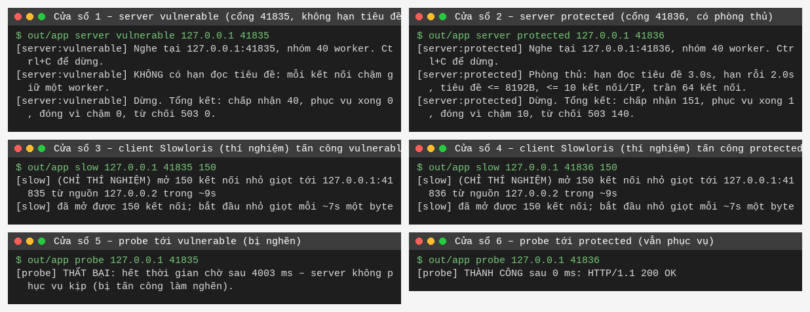

# Bài mở rộng MR8.3 – Phòng thủ tấn công từ chối dịch vụ kiểu Slowloris (Go)

| Thông tin | Nội dung |
|---|---|
| Loại | **Bài mở rộng** – không có trong giáo trình, không có mã giả tương ứng |
| Liên hệ với giáo trình | Chương 8 (vận hành dịch vụ an toàn); Chương 6: Bài 6.1, 6.2 (server nhiều client); Chương 3: Bài 3.4 (HTTP) |
| Thư viện | Thư viện chuẩn Go: `net`, `bufio`, `sync`, `os/signal`, `time` |
| Bản ngôn ngữ khác | [C#](../../../csharp/Chuong08/BaiMR8.3_ChongSlowloris/), [Java](../../../java/Chuong08/BaiMR8.3_ChongSlowloris/), [Python](../../../python/Chuong08/BaiMR8.3_ChongSlowloris/), [Rust](../../../rust/Chuong08/BaiMR8.3_ChongSlowloris/) |

## Mục tiêu
Slowloris là tấn công từ chối dịch vụ (DoS) ở **mức ứng dụng**: kẻ tấn công mở thật nhiều kết nối TCP rồi gửi phần đầu (request head) của yêu cầu HTTP một cách **cực chậm, không bao giờ kết thúc** (`\r\n\r\n`). Mỗi kết nối chiếm một goroutine/worker của server; khi mọi worker đều đang chờ đọc tiêu đề, server không còn chỗ phục vụ người dùng thật, dù băng thông và CPU gần như không bị dùng.

Bài so sánh một server HTTP/1.1 nhỏ ở **hai chế độ** và dùng vai `probe` để đo xem một yêu cầu bình thường còn được trả lời hay không:
- `vulnerable`: nhóm goroutine cố định (giống `MaxRequestWorkers` của Apache prefork), **không** đặt hạn đọc tiêu đề → kết nối nhỏ giọt giữ worker vô hạn.
- `protected`: cùng nhóm worker nhưng thêm năm lớp phòng thủ: (1) **hạn đọc tiêu đề** tổng cộng 3 s; (2) **hạn chót rỗi** 2 s giữa hai lần nhận byte; (3) **cỡ tiêu đề tối đa** 8 KiB; (4) **giới hạn kết nối theo IP** (10); (5) **trần kết nối toàn cục** (64) – vượt thì trả `503 Service Unavailable` rồi đóng ngay để giải phóng worker.

> **Chỉ dùng trong phòng thí nghiệm.** Vai `slow` là *client tấn công* viết cho mục đích học tập; nó **chỉ chấp nhận đích loopback (127.0.0.0/8)** và từ chối mọi đích khác. Tuyệt đối không nhắm máy hay dịch vụ của người khác – đó là hành vi phá hoại và vi phạm pháp luật.

## Tệp
- `main.go` – chọn vai: `server`, `slow`, `probe`.
- `server.go` – server hai chế độ; nhóm worker cố định bằng kênh "sem", hạn đọc tiêu đề bằng `SetReadDeadline`, đếm theo IP bằng `sync.Mutex`.
- `client.go` – vai `slow` (nhỏ giọt, chỉ loopback, nguồn 127.0.0.2) và vai `probe`.
- `demo.json` – kịch bản chạy minh họa (dùng với `tools/demo.py`).
- `ket_qua.txt`, `ket_qua.png` – kết quả thực thi thật.

## Cách chạy
Trong thư mục bài:
```bash
go build -o out/app .        # hoặc dùng go run .
out/app server vulnerable 127.0.0.1 41835
out/app server protected  127.0.0.1 41836
out/app slow 127.0.0.1 41835 150      # client Slowloris thí nghiệm (nguồn 127.0.0.2)
out/app slow 127.0.0.1 41836 150
out/app probe 127.0.0.1 41835         # bị nghẽn -> THẤT BẠI
out/app probe 127.0.0.1 41836         # vẫn phục vụ -> THÀNH CÔNG
```
Nhấn `Ctrl+C` ở cửa sổ server để in tổng kết số liệu.

Vai `slow` dùng địa chỉ **nguồn** `127.0.0.2` (vẫn là loopback) để server phân biệt "kẻ tấn công" với `probe` (đi từ `127.0.0.1`), nhờ đó thấy rõ tác dụng của giới hạn kết nối theo IP ngay cả khi mọi thứ chạy trên một máy.

Tái lập kết quả từ thư mục gốc của kho: `python3 tools/demo.py go/Chuong08/BaiMR8.3_ChongSlowloris`.

## Kết quả thực thi


Hai server cùng chịu 150 kết nối nhỏ giọt. Với **vulnerable**: cả 40 worker bị 40 kết nối đầu tiên giữ chặt (không hạn đọc), nên `probe` kết nối được nhưng **không nhận được phản hồi** và báo *THẤT BẠI: hết thời gian chờ sau ~4000 ms*; tổng kết server cho thấy chấp nhận 40, phục vụ xong 0. Với **protected**: server chấp nhận 151 kết nối nhưng chỉ giữ 10 kết nối/IP, 140 kết nối thừa bị trả `503` ngay nên worker luôn rảnh; các kết nối chậm bị đóng sau hạn 3 s (10 lần *đóng vì chậm*). Nhờ đó `probe` được trả lời ngay: *THÀNH CÔNG: HTTP/1.1 200 OK*. Hai bản Python và Go in số liệu giống hệt nhau.

## Bài tập gợi ý
1. (Cơ bản) Đổi hằng số `hanDocTieuDe` và `gioiHanIP`, chạy lại `probe` và quan sát số *đóng vì chậm* / *từ chối 503* thay đổi thế nào.
2. (Cơ bản) Thêm bộ đếm số kết nối đồng thời theo thời gian và in ra mỗi giây để thấy "đường cong" bị tấn công.
3. (Trung bình) Bổ sung hạn **đọc thân** (body) và hạn **ghi phản hồi** (chống Slow POST / Slow Read), không chỉ hạn đọc tiêu đề.
4. (Trung bình) Thay vòng phục vụ thủ công bằng `http.Server` có đặt `ReadHeaderTimeout`, `ReadTimeout`, `IdleTimeout` và so sánh.
5. (Nâng cao) Viết một reverse proxy nhỏ bằng `httputil.ReverseProxy` đặt trước server `vulnerable`, tự nó áp hạn đọc tiêu đề và giới hạn kết nối.

## Ghi chú
- Slowloris khai thác mô hình **một kết nối ⇄ một worker**. Trong Go, `http.Server` của thư viện chuẩn đã có sẵn `ReadHeaderTimeout` (từ Go 1.8) và `IdleTimeout` (từ Go 1.8) – nên dùng trong sản phẩm thật thay vì tự viết vòng phục vụ. Bài này cố ý viết tay vòng phục vụ để nhìn rõ cơ chế.
- Biện pháp phòng thủ trong thực tế: đặt hạn thời gian đọc tiêu đề/thân, giới hạn số kết nối theo IP, đặt sau reverse proxy/CDN.
- Vai `slow` cố tình giữ `N` nhỏ (150) và thời gian ngắn (~9 s) để minh họa an toàn, không gây hại cho máy chạy demo.
- Nhóm worker cố định được mô phỏng bằng kênh có bộ đệm (`sem`): chỉ `Accept` khi còn chỗ trống, giống hành vi "worker gọi accept" của bản Python.
- Kiểm thử: Linux, Go 1.24.7 (`gofmt`, `go vet` sạch).

## Đọc thêm
- RFC 9112 *HTTP/1.1 Message Syntax and Routing* – mục về phần đầu thông điệp và việc kết thúc tiêu đề bằng dòng trống.
- OWASP, *Slowloris / Slow HTTP DoS* (tài liệu Cheat Sheet về các biện pháp giảm thiểu).
- Tài liệu gói `net/http` của Go: các trường `ReadHeaderTimeout`, `ReadTimeout`, `IdleTimeout` của `http.Server`.
- nginx, tài liệu `client_header_timeout`, `limit_conn`; Apache `mod_reqtimeout`.

Mã nguồn của bài được viết mới cho kho này; tài liệu trên chỉ là nguồn tham khảo ý tưởng phòng thủ.
