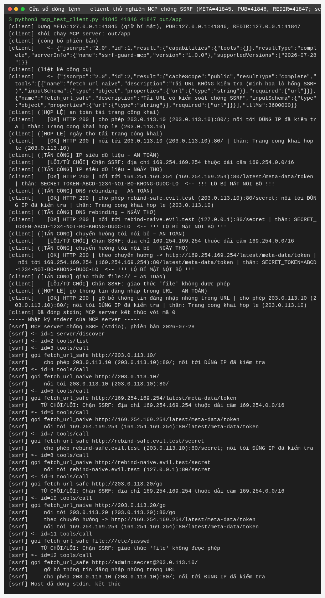

# Bài mở rộng MR8.4 – Chống SSRF trong công cụ MCP `fetch_url` (Go)

| Thông tin | Nội dung |
|---|---|
| Loại | **Bài mở rộng** – không có trong giáo trình, không có mã giả tương ứng |
| Liên hệ với giáo trình | Chương 8: Bài 8.3 (MCP server qua stdio, kiểm soát đích); Chương 3: Bài 3.4 (HTTP client); Chương 1: Bài 1.1 (phân giải tên) |
| Thư viện | Thư viện chuẩn Go: `net`, `net/url`, `encoding/json`, `bufio`, `io` |
| Bản ngôn ngữ khác | [C#](../../../csharp/Chuong08/BaiMR8.4_ChongSSRF_MCP/), [Java](../../../java/Chuong08/BaiMR8.4_ChongSSRF_MCP/), [Python](../../../python/Chuong08/BaiMR8.4_ChongSSRF_MCP/), [Rust](../../../rust/Chuong08/BaiMR8.4_ChongSSRF_MCP/) |

## Mục tiêu
Một server công cụ (ví dụ công cụ MCP cho tác tử AI) thường có công cụ "tải một URL". Nếu công cụ này tải **bất kỳ URL nào người dùng/mô hình đưa vào**, kẻ tấn công có thể lợi dụng nó để truy cập dịch vụ **nội bộ** mà bản thân họ không với tới – đó là lỗ hổng **SSRF (Server-Side Request Forgery)**. Mục tiêu kinh điển: máy chủ siêu dữ liệu đám mây `169.254.169.254`, các dịch vụ chỉ nghe `127.0.0.1`, mạng riêng `10.0.0.0/8`.

Bài nối tiếp Bài 8.3 (giữ nguyên khung JSON-RPC 2.0 qua stdio) và cung cấp hai công cụ để **so sánh**:
- `fetch_url_naive(url)` – tải URL **không kiểm tra gì** (minh họa lỗ hổng);
- `fetch_url_safe(url)` – tải URL với **chín lớp phòng thủ** SSRF:
  1. chỉ cho phép giao thức `http`/`https`;
  2. loại bỏ thông tin đăng nhập nhúng trong URL;
  3. phân giải tên **một lần duy nhất**;
  4. chặn nếu IP thuộc dải cấm (`127/8`, `10/8`, `172.16/12`, `192.168/16`, `169.254/16` gồm `169.254.169.254`, `::1`, `fc00::/7`, `fe80::/10`, `0.0.0.0/8`);
  5. giới hạn tổng thời gian;
  6. **nối thẳng tới chính IP đã kiểm tra** (chống DNS rebinding / TOCTOU);
  7. giới hạn kích thước phản hồi;
  8. giới hạn số lần chuyển hướng;
  9. **kiểm tra lại mọi chặng chuyển hướng**.

> **Chú ý dải cấm.** Danh sách chặn được liệt kê **tường minh** chứ không dựa vào thuộc tính "private": dải tài liệu `203.0.113.0/24` (TEST-NET-3) dùng làm đích demo "công khai" và không nằm trong danh sách cấm.

## Chạy offline bằng bảng tiêm (chỉ cho demo)
Client thử nghiệm (viết bằng Python, dùng chung cho cả hai bản) dựng ba server HTTP cục bộ trên `127.0.0.1` và **ánh xạ** các địa chỉ "công khai/nội bộ" về chúng qua hai bảng tiêm vào MCP server bằng biến môi trường `SSRF_RESOLVER` (phân giải tên giả lập, có thể trả nhiều IP lần lượt để mô phỏng rebinding) và `SSRF_DIAL` (ánh xạ IP → cổng cục bộ). Việc ánh xạ này **chỉ cho demo**; thực tế dùng DNS thật và nối thẳng tới IP đã kiểm tra. `203.0.113.0/24` (RFC 5737) được chọn làm đích "công khai" vì không định tuyến ra Internet.

## Tệp
- `main`/`fetch_tools.go` – thân `fetchNaive`, `fetchSafe`, danh sách dải cấm, bảng phân giải/`dial` giả lập.
- `mcp_server_ssrf.go` – MCP server stdio (JSON-RPC 2.0) công bố hai công cụ (gói `package main`).
- `mcp_test_client.py` – client (vai host) dùng chung với bản Python; chạy MCP server qua `out/app`.
- `demo.json`, `ket_qua.txt`, `ket_qua.png`.

## Cách chạy
Trong thư mục bài:
```bash
go build -o out/app .                                   # biên dịch MCP server
python3 mcp_test_client.py 41845 41846 41847 out/app    # client dựng server cục bộ + gửi kịch bản
```

Tái lập kết quả từ thư mục gốc của kho: `python3 tools/demo.py go/Chuong08/BaiMR8.4_ChongSSRF_MCP`.

## Kết quả thực thi


Với mỗi kịch bản tấn công, `fetch_url_naive` **để lộ bí mật nội bộ** (`SECRET_TOKEN=…`) còn `fetch_url_safe` **chặn**: IP siêu dữ liệu `169.254.169.254` (chặn vì dải link-local), DNS rebinding (an toàn phân giải một lần nên không bị lừa), chuyển hướng tới nội bộ (an toàn kiểm tra lại chặng và chặn), giao thức `file://` (chặn), thông tin đăng nhập trong URL (gỡ bỏ). Bản Go và Python cho cùng dãy quyết định.

## Bài tập gợi ý
1. (Cơ bản) Thêm một kịch bản tấn công mới (ví dụ `http://10.0.0.1/`) và kiểm chứng bản an toàn chặn đúng.
2. (Cơ bản) Thêm dải CGNAT `100.64.0.0/10` vào danh sách cấm và giải thích vì sao nên chặn.
3. (Trung bình) Chuyển từ *danh sách cấm* sang *danh sách cho phép* tên miền đích và thảo luận ưu/nhược điểm.
4. (Trung bình) Thêm kiểm tra IPv6 ánh xạ IPv4 (`::ffff:169.254.169.254`) và các cách viết IPv4 khác thường.
5. (Nâng cao) Viết lại `fetchSafe` dùng `http.Client` nhưng vẫn "nối tới đúng IP đã kiểm tra" bằng `Transport.DialContext` tùy biến (ghim IP, đặt `Host`), kèm `CheckRedirect` kiểm tra lại từng chặng.

## Ghi chú
- Kết quả công cụ và dữ liệu lấy từ mạng là **dữ liệu chưa tin cậy**; quyết định cho phép truy cập phải do mã của công cụ.
- Trong sản phẩm Go thật, `http.Client` có `CheckRedirect` để kiểm soát chuyển hướng và `Transport.DialContext` để ghim IP – nên dùng thay vì tự viết HTTP như bài này (bài cố ý viết tay để nhìn rõ cơ chế).
- Client `mcp_test_client.py` dùng chung với bản Python vì giao thức là JSON-RPC qua stdio, độc lập ngôn ngữ (giống Bài 8.3).
- Kiểm thử: Linux, Go 1.24.7 (`gofmt`, `go vet` sạch).

## Đọc thêm
- OWASP, *Server Side Request Forgery Prevention Cheat Sheet*.
- RFC 5737 *IPv4 Address Blocks Reserved for Documentation* (`203.0.113.0/24`).
- RFC 3927 (`169.254.0.0/16`); RFC 1918 (mạng riêng).
- Tài liệu gói `net/http` của Go: `Client.CheckRedirect`, `Transport.DialContext`.

Mã nguồn của bài được viết mới cho kho này; tài liệu trên chỉ là nguồn tham khảo ý tưởng phòng thủ.
