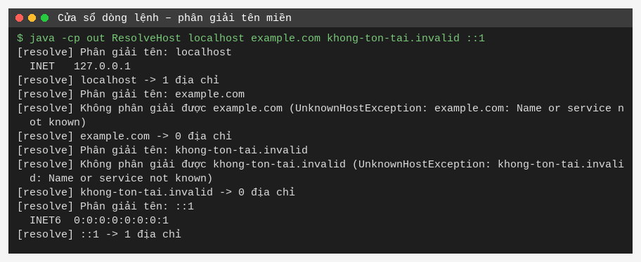

# Bài 1.1 – Phân giải tên miền thành danh sách địa chỉ (Java)

| Thông tin | Nội dung |
|---|---|
| Mã giả tương ứng | Mã giả 1.1 (RESOLVE_HOST – phân giải tên miền thành danh sách địa chỉ) |
| Mục giáo trình | 1.2.3 Địa chỉ IP và tên miền |
| Kế thừa | Không (thủ tục gốc; được dùng lại ở Bài 1.2) |
| Thư viện | JDK 21: `java.net.InetAddress` (`getAllByName`) |

## Mục tiêu
Minh họa lệnh `RESOLVE`: một tên có thể ánh xạ tới nhiều địa chỉ thuộc hai họ INET (`Inet4Address`) và INET6 (`Inet6Address`); lỗi phân giải được bắt trong `CATCH` và chuyển thành danh sách rỗng thay vì làm dừng chương trình.

## Tệp
- `ResolveHost.java` – phương thức `resolveHost(name)` và chương trình chính phân giải lần lượt các tên nhận từ dòng lệnh.
- `demo.json` – kịch bản chạy minh họa (dùng với `tools/demo.py`).
- `ket_qua.txt`, `ket_qua.png` – kết quả thực thi thật.

## Cách chạy
```bash
javac -encoding UTF-8 -d out ResolveHost.java
java -cp out ResolveHost localhost example.com
```
Không có tham số thì chương trình phân giải `localhost`.

## Kết quả thực thi


`localhost` được phân giải thành `127.0.0.1` theo tệp hosts của máy kiểm thử (tệp này không khai báo `::1`). Môi trường kiểm thử chặn truy vấn DNS ra Internet nên `example.com` không phân giải được, giống tên `khong-ton-tai.invalid` vốn được dành riêng để không bao giờ tồn tại (RFC 6761); trên máy có Internet, `example.com` trả về cả địa chỉ IPv4 và IPv6. Chuỗi `::1` là địa chỉ dạng số nên được trả lại với họ INET6.

## Ghi chú
- `ResolveError` của mã giả tương ứng với `UnknownHostException`. Lớp này không có mã lỗi số; chương trình in thông điệp lỗi của hệ điều hành thay cho `e.code`.
- `getHostAddress()` của `Inet6Address` in địa chỉ IPv6 ở dạng đầy đủ (`0:0:0:0:0:0:0:1`), không rút gọn thành `::1` như Python và C#.
- Theo mặc định, Java đặt địa chỉ IPv4 trước IPv6 (thuộc tính `java.net.preferIPv6Addresses=false`); thứ tự có thể khác thứ tự của getaddrinfo mà Python và C# trả về.
- `InetAddress` có bộ nhớ đệm kết quả phân giải riêng của JVM (thuộc tính bảo mật `networkaddress.cache.ttl`).
- Kiểm thử: Linux, OpenJDK 21.0.12.1.
