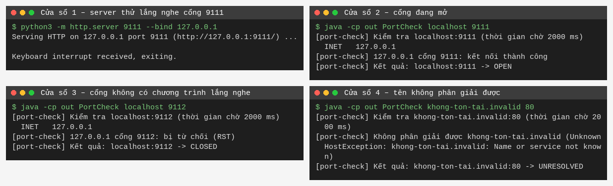

# Bài 1.2 – Kiểm tra trạng thái một cổng TCP (Java)

| Thông tin | Nội dung |
|---|---|
| Mã giả tương ứng | Mã giả 1.2 (PORT_CHECK – kiểm tra trạng thái một cổng TCP) |
| Mục giáo trình | 1.2.4 Cổng và bộ năm thông số, 1.2.5 Socket |
| Kế thừa | Mã giả 1.1 (RESOLVE_HOST, chép từ Bài 1.1) |
| Thư viện | JDK 21: `java.net.InetAddress`, `java.net.Socket` |

## Mục tiêu
Minh họa cách kết hợp phân giải tên, socket và cổng: thử kết nối TCP tới lần lượt từng địa chỉ của tên máy với thời gian chờ, rồi kết luận một trong bốn trạng thái: `OPEN` (bắt tay ba bước thành công), `CLOSED` (nhận gói RST), `FILTERED` (không địa chỉ nào phản hồi trong thời gian chờ hoặc không có đường đi), `UNRESOLVED` (tên không phân giải được). Chỉ kiểm tra trên máy và mạng thuộc quyền quản lý của người thực hiện.

## Tệp
- `PortCheck.java` – `resolveHost` (Mã giả 1.1), `portCheck` (Mã giả 1.2) và chương trình chính.
- `demo.json` – kịch bản chạy minh họa (dùng với `tools/demo.py`).
- `ket_qua.txt`, `ket_qua.png` – kết quả thực thi thật.

## Cách chạy
Mở hai cửa sổ dòng lệnh trong thư mục bài:
```bash
# Cửa sổ 1 – một server bất kỳ để có cổng đang mở (ví dụ server HTTP của Python)
python3 -m http.server 9000 --bind 127.0.0.1
# Cửa sổ 2 – biên dịch rồi kiểm tra cổng: <host> <port> [timeout_ms], mặc định timeout_ms = 2000
javac -encoding UTF-8 -d out PortCheck.java
java -cp out PortCheck localhost 9000
java -cp out PortCheck localhost 9001
java -cp out PortCheck khong-ton-tai.invalid 80
```
Dừng server bằng Ctrl+C.

## Kết quả thực thi


Server thử (`python3 -m http.server`) chỉ lắng nghe trên `127.0.0.1`; cổng của server cho `OPEN`, cổng kế bên không có chương trình lắng nghe nên hệ điều hành trả RST và kết quả là `CLOSED`; tên `khong-ton-tai.invalid` (dành riêng theo RFC 6761) cho `UNRESOLVED` mà không có ngoại lệ nào thoát khỏi hàm.

## Ghi chú
- `SOCKET(FAMILY(a), STREAM)` và `SETOPT(CONNECT_TIMEOUT)`: lớp `Socket` của Java tự chọn họ địa chỉ theo địa chỉ truyền vào `connect`, và thời gian chờ là tham số thứ hai của `connect(InetSocketAddress, timeout)`.
- Java không có lớp ngoại lệ riêng cho từng lỗi của mã giả: `ConnectionRefused` là `ConnectException` có thông điệp chứa "refused" (`ConnectException` do hệ điều hành hết thời gian chờ được xếp vào `Timeout`); `Timeout` là `SocketTimeoutException`; `HostUnreachable` là `NoRouteToHostException`; `NetworkUnreachable` là `SocketException` có thông điệp chứa "unreachable". Các `SocketException` khác được ném tiếp ra ngoài. Việc phân loại theo thông điệp phụ thuộc cách JDK diễn đạt lỗi của hệ điều hành.
- Trạng thái `FILTERED` không được đưa vào kịch bản minh họa: mạng ảo của môi trường kiểm thử chấp nhận ngay mọi kết nối TCP ra ngoài máy nên không tạo được tình huống gói tin bị lọc. Trên mạng thật, có thể quan sát `FILTERED` với một địa chỉ không phản hồi trong mạng phòng thí nghiệm.
- Tệp hosts của máy kiểm thử chỉ khai báo `127.0.0.1` cho `localhost`, nên tình huống `::1` trả RST trước khi `127.0.0.1` kết nối được (Mục 1.2.5, giải thích bước 7) không xuất hiện; trên máy có `::1 localhost`, kết quả in thêm một dòng "bị từ chối (RST)" cho `::1` trước dòng "kết nối thành công", và kết luận vẫn là `OPEN`.
- Các dòng `[port-check] <địa chỉ> cổng <n>: …` được in thêm để quan sát kết quả của từng lần thử; mã giả chỉ trả về trạng thái.
- Kiểm thử: Linux, OpenJDK 21.0.12.1.
