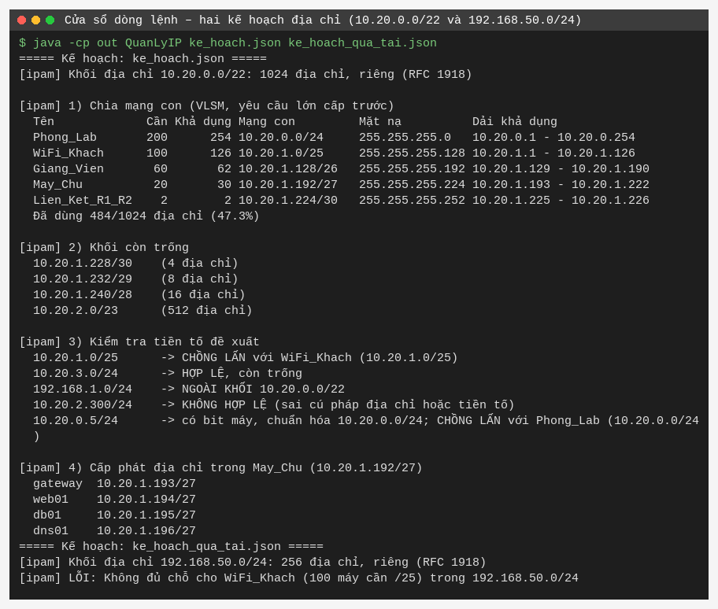

# Bài mở rộng MR1.1 – Quản lý địa chỉ IP (IPAM): chia mạng con, kiểm tra chồng lấn, cấp phát (Java)

| Thông tin | Nội dung |
|---|---|
| Loại | **Bài mở rộng** – không có trong giáo trình, không có mã giả tương ứng |
| Liên hệ với giáo trình | Chương 1, Mục 1.2.3 (địa chỉ IP, tiền tố mạng); Bài 1.1. Kế hoạch địa chỉ được dùng lại ở MR3.2 và MR8.2 |
| Thư viện | JDK 21: `java.nio.file`, `record`; `Json.java` tự viết (JDK không có thư viện JSON) |
| Bản ngôn ngữ khác | [C#](../../../csharp/Chuong01/BaiMR1.1_QuanLyDiaChiIP/), [Python](../../../python/Chuong01/BaiMR1.1_QuanLyDiaChiIP/), [Rust](../../../rust/Chuong01/BaiMR1.1_QuanLyDiaChiIP/), [Go](../../../go/Chuong01/BaiMR1.1_QuanLyDiaChiIP/) |

## Mục tiêu
Dùng phép tính trên địa chỉ IP thay vì tự cắt chuỗi: đọc một kế hoạch địa chỉ (JSON), chia khối `10.20.0.0/22` thành các mạng con theo số máy cần (VLSM – yêu cầu lớn cấp trước để mọi khối đều thẳng hàng), liệt kê phần còn trống dưới dạng ít khối CIDR nhất, kiểm tra các tiền tố đề xuất (sai cú pháp, có bit máy, ngoài khối, chồng lấn) và cấp phát địa chỉ cho thiết bị. Đây là phần lõi của các công cụ IPAM và là bước đầu tiên của mọi kịch bản tự động hóa mạng.

## Kiến thức chính
- Địa chỉ IPv4 là số nguyên 32 bit; mạng con `a.b.c.d/n` là khối 2^(32−n) địa chỉ bắt đầu ở bội của kích thước khối.
- VLSM: cấp khối lớn trước, làm tròn con trỏ lên bội của kích thước khối để khối thẳng hàng.
- Một dải địa chỉ bất kỳ tách được thành ít khối CIDR nhất bằng cách chọn khối lớn nhất vừa thẳng hàng vừa không vượt dải.

## Tệp
- `QuanLyIP.java` – chương trình chính: `prefixForHosts`, `planVlsm`, `rangeToCidr`, `freeBlocks`, `checkPrefix`, `assignHosts`.
- `Json.java` – bộ đọc JSON tối giản (chép từ Bài 5.3 bản Java).
- `ke_hoach.json`, `ke_hoach_qua_tai.json` – giống bản Python.
- `demo.json` – kịch bản chạy minh họa (dùng với `tools/demo.py`).
- `ket_qua.txt`, `ket_qua.png` – kết quả thực thi thật.

## Cách chạy
Trong thư mục bài:
```bash
javac -encoding UTF-8 -d out *.java
java -cp out QuanLyIP ke_hoach.json ke_hoach_qua_tai.json
```
Chương trình nhận một hoặc nhiều tệp kế hoạch; mã thoát 1 nếu có kế hoạch không thực hiện được.

Tái lập kết quả từ thư mục gốc của kho: `python3 tools/demo.py java/Chuong01/BaiMR1.1_QuanLyDiaChiIP`.

## Kết quả thực thi


Năm yêu cầu được cấp từ lớn đến nhỏ: `/24` (254 máy), `/25`, `/26`, `/27` và `/30` cho liên kết điểm–điểm, dùng 484/1024 địa chỉ. Phần còn trống `10.20.1.228 – 10.20.3.255` được biểu diễn bằng bốn khối CIDR. Năm tiền tố đề xuất cho bốn kết luận khác nhau; `10.20.0.5/24` có bit máy nên được chuẩn hóa thành `10.20.0.0/24` rồi mới phát hiện chồng lấn. Kế hoạch thứ hai thất bại vì sau khi cấp `/24` cho Phong_Lab, khối `192.168.50.0/24` không còn chỗ cho `/25`. Bản Java in kết quả giống hệt bản Python và Go.

## Ghi chú
- JDK không có lớp mạng con như `ipaddress` (Python) hay `net/netip` (Go): `InetAddress` chỉ biểu diễn một địa chỉ và còn có thể tra DNS khi gặp chuỗi lạ. Bài tự đọc chuỗi `a.b.c.d/n` (`parseNet`), đổi sang số 32 bit lưu trong `long` (tránh số âm của `int`) và tự tách dải trống thành CIDR (`rangeToCidr`, như bản Go).
- `parseNet(text, true)` báo lỗi khi còn bit máy (tương ứng `ip_network(strict=True)`), `parseNet(text, false)` xóa bit máy.
- `isPrivate` chỉ xét ba khối RFC 1918; `is_private` của Python còn coi nhiều khối đặc biệt khác (127/8, 169.254/16…) là riêng.
- Chỉ xử lý IPv4 cho gọn. Liên kết điểm–điểm dùng `/30`; RFC 3021 cho phép `/31` nhưng bài không dùng.
- Kiểm thử: Linux, OpenJDK 21.0.12.

## Bài tập gợi ý
1. Thêm tùy chọn dùng `/31` cho liên kết điểm–điểm (RFC 3021) và so sánh số địa chỉ tiết kiệm được.
2. Mở rộng `parseNet` cho IPv6 bằng `java.math.BigInteger` (128 bit).
3. Ghi kết quả cấp phát ra tệp JSON bằng `Json.stringify` để MR3.2 đọc lại.

## Đọc thêm
- Claus Töpke, *Network Programming and Automation Essentials*, Packt, 2023, Chương 4 (mục *IP allocation considerations*) và Chương 5 (mục *Use IP libraries*).

Mã nguồn của bài được viết mới cho kho này; sách trên chỉ là tài liệu tham khảo ý tưởng.
