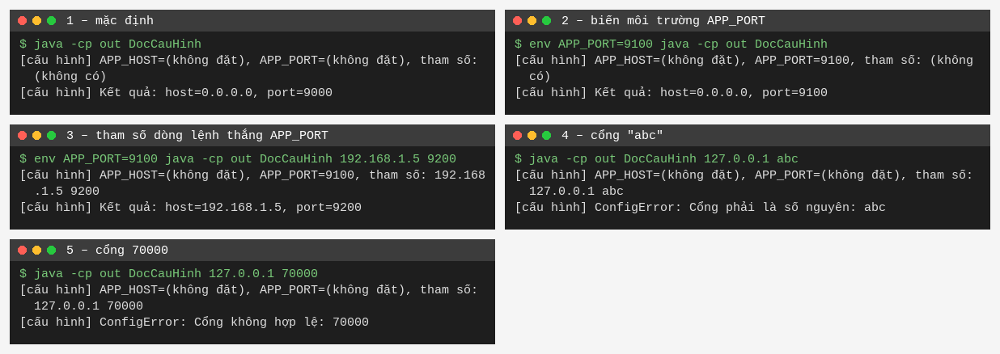

# Bài 2.1 – Đọc cấu hình địa chỉ và cổng (Java)

| Thông tin | Nội dung |
|---|---|
| Mã giả tương ứng | Mã giả 2.1 (PARSE_ENDPOINT – đọc địa chỉ và cổng từ tham số dòng lệnh, biến môi trường) |
| Mục giáo trình | 2.1.3 Tham số hóa địa chỉ và cổng |
| Kế thừa | Không (thủ tục gốc, được dùng lại ở mọi server và client từ Chương 3) |
| Thư viện | JDK 21: `java.lang.System` |

## Mục tiêu
Minh họa thứ tự ưu tiên cấu hình: tham số dòng lệnh > biến môi trường `APP_HOST`, `APP_PORT` > giá trị mặc định (`0.0.0.0`, `9000`), cùng việc chuyển chuỗi sang số và kiểm tra phạm vi cổng 1–65535 với lỗi `ConfigError` rõ ràng.

## Tệp
- `ConfigError.java` – ngoại lệ lỗi cấu hình.
- `DocCauHinh.java` – `parseEndpoint` (Mã giả 2.1) và chương trình in cấu hình nhận được.
- `demo.json` – kịch bản chạy minh họa năm trường hợp (dùng với `tools/demo.py`).
- `ket_qua.txt`, `ket_qua.png` – kết quả thực thi thật.

## Cách chạy
```bash
javac -encoding UTF-8 -d out *.java
# Linux/macOS
java -cp out DocCauHinh                              # mặc định
APP_PORT=9100 java -cp out DocCauHinh                # biến môi trường
APP_PORT=9100 java -cp out DocCauHinh 192.168.1.5 9200
java -cp out DocCauHinh 127.0.0.1 abc                # cổng không phải số
java -cp out DocCauHinh 127.0.0.1 70000              # cổng ngoài phạm vi
```
```bat
:: Windows (cmd)
set APP_PORT=9100
java -cp out DocCauHinh
set APP_PORT=
```

## Kết quả thực thi


Năm tiến trình cho đúng kết quả nêu trong giáo trình: giá trị mặc định `0.0.0.0:9000`; cổng 9100 lấy từ `APP_PORT`; tham số `192.168.1.5 9200` thắng `APP_PORT=9100`; cổng `abc` và `70000` bị từ chối bằng `ConfigError` với thông báo cụ thể. Trong `demo.json`, biến môi trường được đặt riêng cho từng tiến trình bằng lệnh `env`.

## Ghi chú
- Java không có kiểu bộ đôi (tuple) nên `parseEndpoint` trả về mảng `Object[] {host, port}`.
- `Integer.parseInt` chấp nhận dấu `+` nhưng không chấp nhận khoảng trắng; số vượt quá `int` bị báo "Cổng phải là số nguyên".
- Chương trình trả mã thoát 2 khi gặp `ConfigError`.
- Kiểm thử: Linux, OpenJDK 21.0.12.1.
