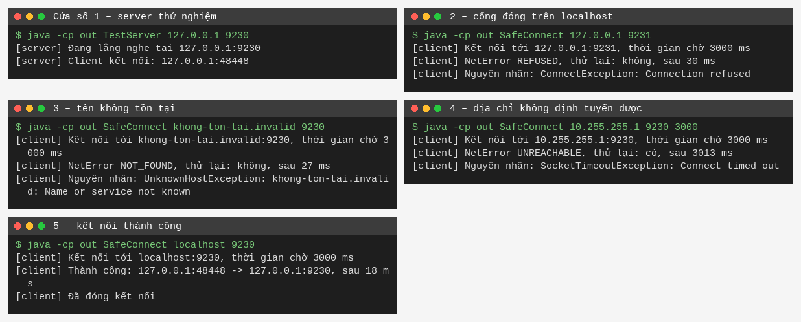

# Bài 2.2 – Kết nối có thời gian chờ và phân loại lỗi (Java)

| Thông tin | Nội dung |
|---|---|
| Mã giả tương ứng | Mã giả 2.2 (SAFE_CONNECT – kết nối có thời gian chờ và phân loại lỗi) |
| Mục giáo trình | 2.2.3 Khung xử lý lỗi dùng chung |
| Kế thừa | Mã giả 1.2 (PORT_CHECK), Mã giả 2.1 (PARSE_ENDPOINT, rút gọn) |
| Thư viện | JDK 21: `java.net` |

## Mục tiêu
Cài đặt thủ tục kết nối thử lần lượt các địa chỉ của một tên, luôn đặt thời gian chờ, đóng socket khi thất bại và gom mọi lỗi về `NetError` với ba loại: `NOT_FOUND` (tên không tồn tại, không thử lại), `REFUSED` (mọi địa chỉ trả RST, không thử lại), `UNREACHABLE` (hết thời gian chờ hoặc không có đường đi, có thể thử lại).

## Tệp
- `ConfigError.java`, `Endpoint.java` – lỗi cấu hình và `Endpoint.parse` (Mã giả 2.1, rút gọn).
- `NetError.java` – ngoại lệ lỗi mạng đã phân loại (`kind`, `retry`, nguyên nhân).
- `SafeConnect.java` – `safeConnect` (Mã giả 2.2) và client in kết quả.
- `TestServer.java` – server thử nghiệm tối giản: chấp nhận kết nối rồi đóng ngay, chỉ để tạo trường hợp thành công.
- `demo.json` – kịch bản chạy minh họa (dùng với `tools/demo.py`).
- `ket_qua.txt`, `ket_qua.png` – kết quả thực thi thật.

## Cách chạy
```bash
javac -encoding UTF-8 -d out *.java
# Cửa sổ 1 – server thử nghiệm
java -cp out TestServer 127.0.0.1 9000
# Cửa sổ 2 – client: [host] [port] [timeout_ms]
java -cp out SafeConnect localhost 9000              # thành công
java -cp out SafeConnect 127.0.0.1 9001              # REFUSED
java -cp out SafeConnect khong-ton-tai.invalid 9000  # NOT_FOUND
java -cp out SafeConnect 10.255.255.1 9000 3000      # UNREACHABLE (hết thời gian chờ)
```
Dừng server bằng Ctrl+C.

## Kết quả thực thi


Cổng đóng trên máy cục bộ cho `ConnectException` (`REFUSED`, không thử lại); tên thuộc miền `.invalid` cho `UnknownHostException` (`NOT_FOUND`); địa chỉ `10.255.255.1` không phản hồi nên thủ tục dừng sau khoảng 3000 ms với `SocketTimeoutException` (`UNREACHABLE`, có thể thử lại); kết nối tới `localhost` thành công và server ghi nhận đúng cổng nguồn của client.

## Ghi chú
- `new Socket()` chưa gắn họ địa chỉ; họ địa chỉ (IPv4/IPv6) được chọn theo địa chỉ đích khi gọi `connect(addr, timeoutMs)` – tham số thứ hai chính là `CONNECT_TIMEOUT`.
- Java có lớp riêng cho `HostUnreachable` (`NoRouteToHostException`) nhưng không có lớp riêng cho `NetworkUnreachable`; mã xếp các `SocketException` còn lại phát sinh khi kết nối vào nhóm "không tới được địa chỉ này" và thử địa chỉ kế tiếp. Các `IOException` khác được chuyển lên nơi gọi sau khi `finally` đóng socket.
- `ConnectException` cũng được JDK dùng cho lỗi `ETIMEDOUT` của nhân hệ điều hành; trường hợp này không xảy ra khi `timeoutMs` ngắn hơn thời gian chờ mặc định của hệ điều hành.
- Kiểm thử: Linux, OpenJDK 21.0.12.1.
