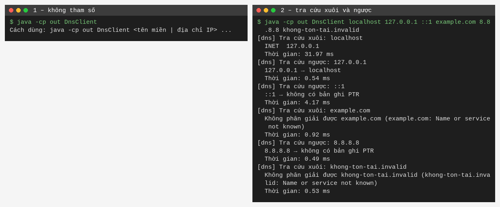

# Bài 2.3 – Client tra cứu DNS (Java)

| Thông tin | Nội dung |
|---|---|
| Mã giả tương ứng | Mã giả 2.3 (client tra cứu DNS dùng bộ phân giải của hệ điều hành) |
| Mục giáo trình | 2.5 Ví dụ: client tra cứu DNS |
| Kế thừa | Mã giả 1.1 (RESOLVE_HOST) |
| Thư viện | JDK 21: `java.net.InetAddress` |

## Mục tiêu
Nhận một hoặc nhiều tham số; với tên miền, in danh sách địa chỉ IPv4/IPv6 (`InetAddress.getAllByName`); với địa chỉ IP, tra cứu ngược bản ghi PTR (`getCanonicalHostName`); in thời gian tra cứu của từng tham số. Lỗi của một tham số không làm dừng các tham số còn lại.

## Tệp
- `DnsClient.java` – `resolveHost` (Mã giả 1.1), `isIpAddress` và chương trình chính (Mã giả 2.3).
- `demo.json` – kịch bản chạy minh họa (dùng với `tools/demo.py`).
- `ket_qua.txt`, `ket_qua.png` – kết quả thực thi thật.

## Cách chạy
```bash
javac -encoding UTF-8 -d out DnsClient.java
java -cp out DnsClient                                       # in cách dùng
java -cp out DnsClient localhost 127.0.0.1 www.ut.edu.vn 8.8.8.8 khong-ton-tai.invalid
```

## Kết quả thực thi


Không có tham số, chương trình in cách dùng. `localhost` phân giải thành `127.0.0.1` và `127.0.0.1` tra ngược ra `localhost`. Môi trường kiểm thử không truy cập được máy chủ DNS bên ngoài nên `example.com` không phân giải được và `8.8.8.8` không có bản ghi PTR; trên mạng thông thường, `8.8.8.8` cho tên `dns.google`. Tên `khong-ton-tai.invalid` cho `UnknownHostException` và đi vào nhánh `ResolveError`.

## Ghi chú
- `InetAddress.ofLiteral` (tương ứng `IS_IP_ADDRESS` trong giáo trình) chỉ có từ JDK 22; trên JDK 21, `isIpAddress` kiểm tra IPv4 bằng biểu thức chính quy và IPv6 bằng `InetAddress.getByName` (chuỗi chứa `:` được xử lý như địa chỉ IPv6, không tra DNS).
- `getCanonicalHostName` không ném ngoại lệ khi thiếu bản ghi PTR mà trả lại chính địa chỉ dạng số; chương trình so sánh kết quả với địa chỉ để nhận biết trường hợp `ResolveError` của mã giả.
- `UnknownHostException` không có mã lỗi riêng; `e.code` của mã giả được thay bằng thông điệp của ngoại lệ.
- Chương trình in thêm dòng tiêu đề `[dns] Tra cứu xuôi/ngược: …` trước kết quả của mỗi tham số; mã giả không có dòng này.
- Kiểm thử: Linux, OpenJDK 21.0.12.1.
